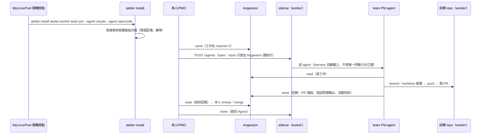

# Atelier v0 介面摘要（一頁）

> 給 PMO 向本人說明用（r3，2026-10-16）。設計全文：`openspec/changes/atelier-v0/`；v0 職務檔：`atelier/worker-team/pm/v0.md`（與草稿 `openspec/changes/atelier-v0/harness/worker-team-pm.md` 逐位元組相同）。本人已答覆：E1（Angareion 是 AiStorage 的要素、不是 harness 章節）、E2（虛擬資料夾＋工具讀）、E5（sidecar 暫不改）、E8（單人暫定）、E9（放 MyAiStorage 的 git）、E10（`atelier` 指令）、E4（`models` 先留空）、**E11（載入＝選項 1）**、E7（隊名 `worker-team`）。**沒有要本人裁定的了**；E6 由 MyPMO#33 處理（PR #66）。

## 實體

| 實體 | 是什麼 | 誰負責 |
|---|---|---|
| Atelier（harness 樹） | 職務的規矩；一個團隊／職務一組**虛擬資料夾**（`atelier/<team>/<role>/v<N>.md`；版本檔不可變） | MyAiStorage（內容與版控，PR 審查）；讀者＝任何 agent／人（對 harness 唯讀） |
| `atelier` 指令 | 讀 harness（`ls`／`show`）＋**安裝**（`install`，寫進 agent 的使用者層級指示檔）；與 agora／angareion 同一家族 | MyAiStorage（程式；與 angareion 共用本機複本） |
| 指示檔安裝 | worker 開機（或映像建置）時把 harness 裝進 agent 一定會載入的使用者層級指示檔（claude：`~/.claude/rules/atelier-*.md` 等；opencode：`~/.config/opencode/AGENTS.md` 的管理區塊） | MyAiStorage（`atelier install`）；MyLinuxPool（開機掛點跑它） |
| 團隊／職務 | 期 1＝worker team PM 一個職務（`atelier:worker-team-pm@v0`）；期 3＝PM／reviewer／實作隊員三職務 | Atelier（設計；本體期 3） |
| team PM agent | 由 sidecar 開的 agent（#33 r4：claude-code），身分 `<team PM 名>` | MyLinuxPool 的 sidecar 開；模型由 LLMGateway 供 |
| sidecar | worker 上控制 agent 的 daemon（open／close／status／poke）；**本設計不改它** | MyLinuxPool |
| Agora | Session 的儲存（記憶）；與 harness 不混 | MyAiStorage |
| Angareion 信道 | AI 之間留言（PM 收指示、回報）；本人：它也是 AiStorage 的要素 | MyAiStorage（程式）；MyLinuxPool（token 能力與部署） |
| worker／池 | 映像、能力（github、angareion、agora、llmgateway 等）、憑證的提供者 | MyLinuxPool |

## 控制時序

## 介面

- **harness 檔**：識別 `atelier:<team>-<role>@<vN>` ↔ 路徑 `atelier/<team>/<role>/v<N>.md`；frontmatter：`type/id/title/status/team/role/version/models{floor,preferred}`；本文五章：know／do／judge／dont／capabilities（能力為 H3 子節；v0：`github`／`angareion`／`agora`）。Angareion 不是章節；harness 明寫「專案自己的指示檔優先」。版本檔 append-only。
- **`atelier` 指令**：`ls`／`show <id>[@<版本>] [--section] [--json]`／`install <id>[@<版本>] --agent claude|opencode`（**可重複；每個各裝一次；不給＝用法錯**）。讀取走本機複本＋`git fetch`（匿名、同一複本路徑與 angareion 共用、flock、20 秒逾時）；install 寫**使用者層級指示檔**（管理區塊或獨立檔、冪等），**不碰專案 `AGENTS.md`／`CLAUDE.md`、工作目錄、`~/.claude/settings.json`**；exit 0（成功）／1（用法、查無）／2（複本或檔案問題）。
- **載入（E11：本人已選選項 1）**：使用者層級指示檔＋開機 install（**sidecar 零改動**；v0 單職務）。未選（保留）：選項 2＝每個 agent 一份設定目錄（`CLAUDE_CONFIG_DIR`／per-role `XDG_CONFIG_HOME`；期 3 多職務若要用，sidecar 要設環境變數）；選項 3 啟動參數注入（`--append-system-prompt-file`）；r2 的開場句；r1 的 sidecar 全文載入。**「一定會載入」＝一定注入 context，不等於強制遵守**（官方 memory 文件：CLAUDE.md 是 context、不是 enforced configuration）；規矩有沒有被遵守看行為驗收。
- **第一則輸入（#33）**：「先讀你的 harness」半句可以去掉；保留「指示在 Angareion」那半句（派工）。
- **要 MyLinuxPool 做的事**：1) 開機掛點的 **atelier 單位**（跑 `atelier install`；照 #130 的契約）；2) 套件 pin 升到含 `atelier` 的 sha（既有流程）。**sidecar 不改。**
