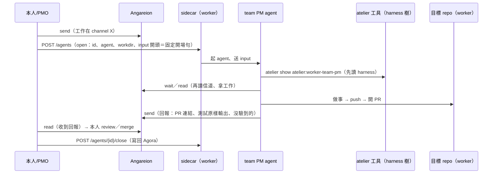

# Atelier v0 介面摘要（一頁）

> 給 PMO 向本人說明用（r2，2026-10-16）。設計全文：`openspec/changes/atelier-v0/`；v0 職務草稿：`openspec/changes/atelier-v0/harness/worker-team-pm.md`。本人已答覆：E1（Angareion 是 AiStorage 的要素、不是 harness 章節）／E2（harness＝虛擬資料夾＋工具讀）／E5（sidecar 暫不改）／E8（單人暫定同意）。**要本人裁定的是 E9（放哪）／E10（讀取工具）／E11（載入選項）**；E4（模型值）仍開放；E6 是現況缺口、不是裁定。

## 實體

| 實體 | 是什麼 | 誰負責 |
|---|---|---|
| Atelier（harness 樹） | 職務的規矩；一個團隊／職務一組**虛擬資料夾**（`atelier/<team>/<role>/v<N>.md`；版本檔不可變） | MyAiStorage（內容與版控，PR 審查）；讀者＝任何 agent／人（唯讀） |
| `atelier` 指令 | 讀 harness 的工具（`ls`／`show`）；與 agora／angareion 同一家族 | MyAiStorage（程式；與 angareion 共用本機複本） |
| 團隊／職務 | 期 1＝worker team PM 一個職務（`atelier:worker-team-pm@v0`）；期 3＝PM／reviewer／實作隊員三職務 | Atelier（設計；本體期 3） |
| team PM agent | 由 sidecar 開的 agent（claude-code 或 opencode），身分 `<repo 名>-pm` | MyLinuxPool 的 sidecar 開；模型由 LLMGateway 供 |
| sidecar | worker 上控制 agent 的 daemon（open／close／status／poke；只綁 127.0.0.1）；**本設計不改它** | MyLinuxPool |
| Agora | Session 的儲存（記憶）；與 harness 不混 | MyAiStorage |
| Angareion 信道 | AI 之間留言（PM 收指示、回報）；本人：它也是 AiStorage 的要素（存 adhoc 的 AI 對話） | MyAiStorage（程式）；MyLinuxPool（token 能力與部署） |
| worker／池 | 映像、能力（github、angareion、agora、llmgateway 等）、憑證的提供者 | MyLinuxPool |

## 控制時序

（固定開場句：「你是 worker 上的 team PM。先讀你的 harness：`atelier show atelier:worker-team-pm`……再用 `angareion wait`／`read` 讀信道。」——sidecar 只照舊送 `input`。）

## 介面

- **harness 檔**：識別 `atelier:<team>-<role>@<vN>` ↔ 路徑 `atelier/<team>/<role>/v<N>.md`；frontmatter：`type/id/title/status/team/role/version/models{floor,preferred}`；本文五章：know／do／judge／dont／capabilities（能力為 H3 子節；v0：`github`／`angareion`／`agora`）。**Angareion 不是章節**（本人 2026-10-16）。版本檔 append-only（改規矩＝新增下一版；舊版永久可讀）。
- **`atelier` 指令**：`atelier ls [--json]`；`atelier show <id>[@<版本>] [--section <章節>] [--json]`——預設整份原樣；只讀、匿名（匿名 HTTPS 讀本機複本＋`git fetch`）；exit 0（成功）／1（用法、查無）／2（複本或 git 壞；離線時沿用複本、exit 不變）。
- **載入**：sidecar `open` 的 `input` 開頭放固定開場句（讀 harness → 讀信道）；**sidecar 零改動**；版本預設讀最新，要固定就寫 `@v0`。
- **要 MyLinuxPool 做的事**：**v0＝零**（開場句走現有 `input`）。唯一相關＝worker 的套件 pin 升到含 `atelier` 指令的 sha（既有流程；與 angareion 共用本機複本）。**未選**：r1 的 sidecar 全文載入（`open.harness`＋`harness_dir`＋錯誤碼）保留在設計，日後要選再照做。
