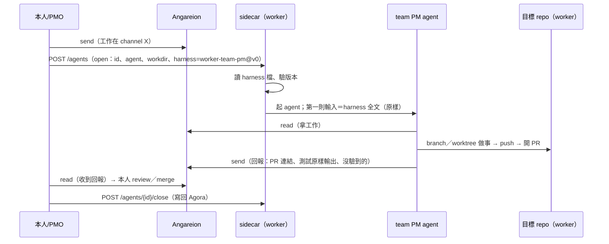

# Atelier v0 介面摘要（一頁）

> 給 PMO 向本人說明用。設計全文：`openspec/changes/atelier-v0/`（proposal／design／tasks／specs）；v0 職務草稿：`openspec/changes/atelier-v0/harness/worker-team-pm.md`。本頁只摘要；未決事項（要本人決定）見設計末節 E1～E8。

## 實體

| 實體 | 是什麼 | 誰負責 |
|---|---|---|
| harness 檔 | 一份職務的規矩（Markdown＋frontmatter）；v0 只有 `atelier:worker-team-pm@v0` | MyAiStorage：內容與版控（`docs/atelier/harness/`）；MyLinuxPool：放進 worker 映像 |
| 團隊／職務 | 期 1＝worker team PM 一個職務；期 3＝PM／reviewer／實作隊員三職務 | Atelier（設計；本體期 3） |
| team PM agent | 由 sidecar 開的 agent（claude-code 或 opencode），身分 `<repo 名>-pm` | MyLinuxPool 的 sidecar 開；模型由 LLMGateway 供 |
| sidecar | worker 上控制 agent 的 daemon（open／close／status／poke；只綁 127.0.0.1） | MyLinuxPool |
| Agora | Session 的儲存（記憶）；**與 harness 不混**（只靠 header 的 ref 字串互相指） | MyAiStorage |
| Angareion 信道 | agent 之間留言（PM 收指示、回報） | MyAiStorage（程式）；MyLinuxPool（token 能力與部署） |
| worker／池 | 映像、能力（git、模型、agora…）、憑證的提供者 | MyLinuxPool |

## 控制時序

（sidecar 還沒做 `harness` 欄位前：過渡做法＝把 harness 全文放在 `input`，其餘不變。）

## 介面

- **harness 檔**：識別 `atelier:<team>-<role>@<version>`；frontmatter：`type/id/title/status/team/role/version/models{floor,preferred}`；本文五章：know／do／judge／dont／capabilities（`capabilities` 內有 `angareion`）。
- **sidecar open 的變化**：新增選填 `harness: {name, version?}`（不帶＝照舊）；sidecar 讀 `harness_dir` 下的檔，把**全文原樣**當第一則輸入（在一般 `input` 之前）。錯誤（都什麼都沒開）：找不到→400 `harness_not_found`；版本不符→400 `harness_version_mismatch`；壞檔→400 `harness_invalid`。
- **版本與載入**：每次 open（含接續）載入一次；省略版本＝用部署版；升級＝換部署＋下次 open 生效。
- **要 MyLinuxPool 做的事**：
  1. sidecar：加 `harness` 欄位與 `harness_dir`、載入（全文、第一則輸入、原樣、不改內容、不進 log）、三個錯誤碼、單元與整合測試。
  2. 更新 `docs/sidecar.md`（欄位、錯誤碼、載入順序）。
  3. 把 harness 檔（從釘住的 MyAiStorage sha）放進 worker 映像；`install.sh --check` 驗檔案存在。
  4. （期 1 驗收前置）worker 上「誰開 team、怎麼呼叫 open」的呼叫路徑（現況缺口；與 #52／#130 相關）。
