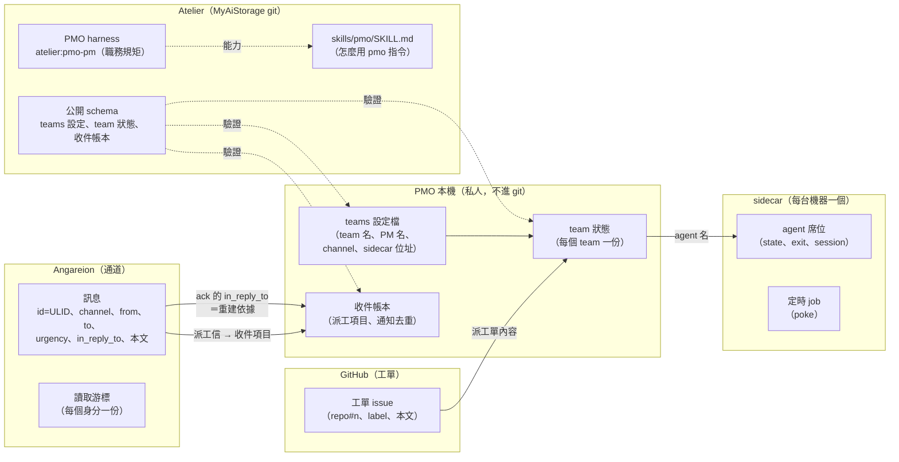
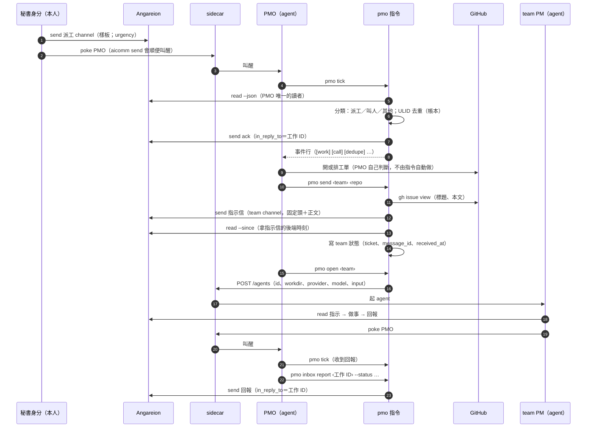
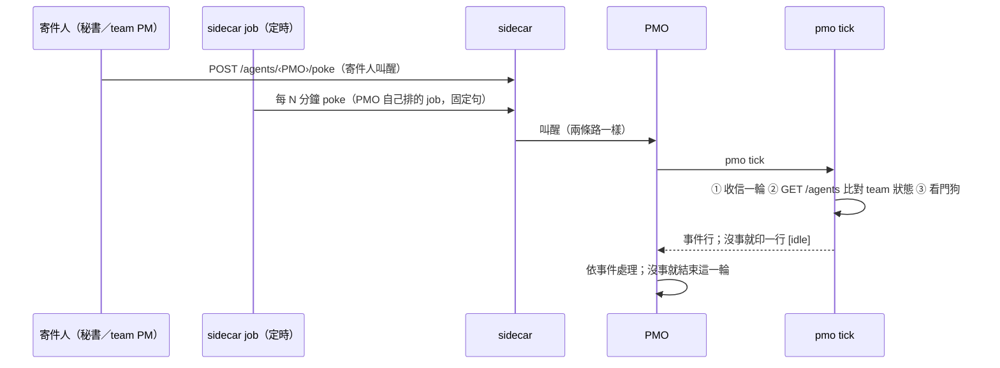
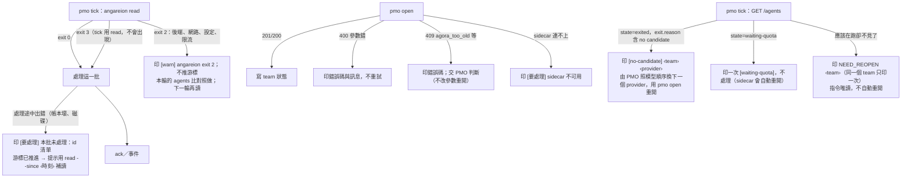
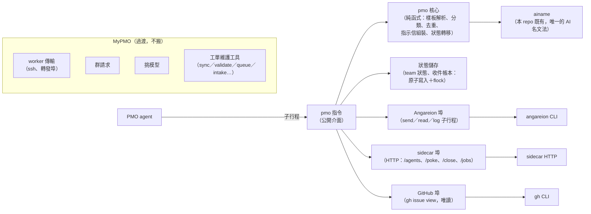

anthropic/claude-opus-5-5

# #110 設計筆記：PMO 的收件與派工搬成 Atelier 的 PMO skill

- 作者：專案架構師 myaistorage-arch-m1-1。作者模式：由非作者（Sonnet）審過，再交 PMO 帶去給本人看。**只設計、以介面為主，不實作。**
- 來由：本人 10-19 的方向（#110 工單）；本人同意先出設計（見 MyPMO#264）。
- 基準：本 repo main f4afe89；MyPMO 的 `pmo/` 只讀，下文只描述它的**介面形狀**，不貼程式，也不寫它的設定內容。
- 用詞：「PMO 工具」指現在 MyPMO 的 `pmo/dispatch.py`＋`pmo/inbox.py`（以及它們 import 的 `groups.py`、`ainame.py`）；「PMO skill」指本設計要做的東西。

## 0. 先講結論

1. **PMO skill ＝一個指令（暫名 `pmo`，和 agora／angareion／atelier／aicomm 同一個 distribution）＋一份說明檔（`skills/pmo/SKILL.md`）**。Atelier 的 PMO harness（`atelier:pmo-pm`）只寫「需要收件、派工、團隊這些能力」，由環境說明把能力對應到這個指令。這和 v1 起「harness 只寫能力，不寫工具名」的規則一致（D-1）。
2. **設定和狀態的「資料」留在本機或 MyPMO，「格式」公開在這裡**：teams 設定、team 狀態、收件帳本的 schema 由本 repo 定義和驗證；檔案本身由啟動方用環境變數指到本機（D-4）。
3. **收件帳本可以從 Angareion 重建**：PMO 的 ack 都帶 `in_reply_to`（指向派工訊息），所以「這張派工處理過沒有」以 Angareion 的紀錄為準，本機帳本只是快取（D-5）。這解決了現在「帳本不能刪、刪了就失去去重」的單點。
4. **常駐的 watch 迴圈改成一次一輪的 `pmo tick`**：PMO 進 sidecar 以後是被 poke 叫醒的，不能自己跑背景讀信迴圈（同一個身分只留一個讀者）。定時的監看由 sidecar 的定時 poke job 驅動，每次叫醒跑一輪（D-6）。
5. **第一階段只搬 Mac（本機 sidecar）的派工**。worker 的傳輸（ssh、轉發埠）、群請求、挑模型、MyPMO 的工單維護工具都**先留在 MyPMO**（D-8～D-11）；哪些之後要搬，列為待本人決定的點。

## 1. 實體圖

### 1.1 實體與資料歸屬

| 實體 | 是什麼 | 存在哪裡、誰是權威 | 現在 PMO 工具裡的對應 |
|---|---|---|---|
| 派工信 | 秘書身分在派工 channel 用固定樣板寄給 PMO 的工作（`# 工作：…`、`- 工作 ID：<ULID>`、建議層級、規格、備註） | **Angareion**（訊息本身） | inbox 的樣板解析 |
| 叫人信 | 寄給或提及 PMO、但不是派工的訊息 | Angareion | inbox 的「叫人」判斷 |
| 收件項目 | 一張派工信在 PMO 這邊的狀態：收到、ack、排程、對應的工單、派給哪個 team、回報 | **本機帳本（快取）**；權威是 Angareion 上的派工信和 PMO 的 ack／回報信（D-5） | 收件帳本的 `items` |
| 通知去重 | 同一則信不重複機械 ack、不重複標「叫醒」 | 本機帳本（快取）；可以從 Angareion 重建 | 收件帳本的 `notified` |
| 工單 | 要做的事（repo#n） | **GitHub** | `send` 前讀工單 |
| team | 一個專案的一隊：PM 的 AI 名、channel、sidecar 位址、模式（互動版／生活模式） | **本機 teams 設定**（私人）；格式由本 repo 的 schema 定 | teams 設定檔 |
| 派工單 | 一次派工：哪張工單、指示信的 id、後端時刻、第一則輸入要帶的 `--since` | **本機 team 狀態**；指示信本身在 Angareion | team 狀態檔 |
| agent 席位 | sidecar 上的一個 agent：state、exit、session | **sidecar**（`GET /agents`）；本機 team 狀態只記最後看到的幾個欄位 | team 狀態的 `state`／`exit` |
| 定時叫醒 | sidecar 的 poke job | **sidecar**（`/jobs`） | 現在由 watch 常駐迴圈代替 |
| 職務規矩 | PMO 的 harness | **Atelier** | （不變） |
| 模型挑選 | 依角色、作者、額度挑 `(provider, model)` | 第一階段留在 MyPMO（D-10） | pick_model |
| 群請求 | 秘書寄來的建群／封存請求的帳本與步驟機 | 第一階段留在 MyPMO（D-9） | groups |

### 1.2 為什麼帳本可以重建（D-5 的依據）

- 現在的 PMO 工具送機械 ack 時，已經把 `in_reply_to` 設成派工信的 id（＝工作 ID）；回報和叫人 ack 也一樣帶 `in_reply_to`。
- 所以「這張派工 ack 過沒有」可以用 `angareion log --from <PMO> --thread <工作 ID>`（或 `--around`）查到，不必只靠本機檔。
- `pmo inbox rebuild` 用 Angareion 的紀錄重建帳本的「收到／ack／回報」三個欄位；`issue`、`team` 這些 PMO 自己記的欄位，若在回報信的固定欄位裡寫過，就一起重建，沒寫過的留空並列出來。

## 2. 控制時序

### 2.1 收件 → 去重 → ack → 派工 → 回報

### 2.2 被叫醒的兩條路

- `pmo tick` 是**冪等的一輪**：重複叫醒只會多跑一輪，不會重複 ack（帳本去重），也不會重複 poke 看門狗（team 狀態記了時刻）。
- 定時 job 由 PMO 自己排（`POST /jobs`），sidecar 不替 PMO 掛預設 job（sidecar #519 的規則）。

### 2.3 失敗的分支

- **限流**：Angareion 的 GitHub 後端被限流時，`angareion` 回 exit 2；tick 不重試、不推游標，等下一次叫醒。
- **no candidate**：判斷以 `GET /agents/<id>` 的 `state` 和 `exit.reason` 為準；換 provider 是 PMO 的判斷（模型順序是政策），指令只把事實印出來（D-7）。
- **database is locked**（共用的 opencode 服務）：指令看到 sidecar 回這類錯誤時印原文，**不重試、不重開**，交本人（和現行環境說明一致）。

## 3. 介面圖

### 3.1 元件與依賴

**埠（port）**：指令只透過三個埠碰外部，每個埠是一個小介面，測試用同名方法的假物件取代（沿用 PMO 工具現在 `Deps` 的接縫作法）。核心不碰外部。

### 3.2 `pmo` 指令（skill 的公開介面）

所有內文一律走 stdin（`--body -`）；stdout 是給 PMO 讀的事件行，第一個 token 是方括號標籤；stderr 是診斷。

| 指令 | 輸入 | 輸出（stdout） | 結束碼 |
|---|---|---|---|
| `pmo tick` | （無） | 事件行：`[work] <工作 ID> <標題>`、`[call] <id>`、`[decision] …`、`[dedupe] …`、`[state] <team> <舊>→<新>`、`NEED_REOPEN <team> session=<sid\|none>`、`[no-candidate] <team>`、`[watchdog] <team>`、`[warn] …`、`[要處理] …`；全部沒事時一行 `[idle]` | 0 這一輪跑完（包含「部分失敗、已印 [warn]」）；1 用法錯；2 設定或狀態檔壞（這一輪什麼都沒做，不推游標） |
| `pmo inbox list [--json]` | | 收件項目一覽（唯讀） | 0／2 |
| `pmo inbox ack <工作 ID> [--issue <repo#n>] [--schedule 立即開工\|排入待開工佇列]` | | 送出的訊息 id | 0／1（查無工作 ID）／2（送不出去） |
| `pmo inbox report <工作 ID> --status <狀態> [--issue …] [--team …] --body -` | 本文 | 訊息 id | 0／1／2 |
| `pmo inbox rebuild [--since <時刻>] [--dry-run]` | | 重建的項目數與差異；`--dry-run` 只印 | 0／2 |
| `pmo check <team>` | | 逐項 OK／FAIL | 0 全過；1 有 FAIL |
| `pmo send <team> <repo#n> --body -` | 正文 | 指示信 id、後端時刻 | 0；1 用法、team 不存在、工單讀不到；2 外部失敗 |
| `pmo open <team> [--session <agora:…>] [--fresh] [--provider P --model M]` | | agent 的 state 與 attach 指令 | 0；1 用法或狀態不足（沒先 send）；2 sidecar 拒絕或連不上（印錯誤碼） |
| `pmo reply <team> --body -` | 正文 | 訊息 id（送出後叫醒對方，不打斷） | 0／1／2 |
| `pmo poke <team> [--interrupt] --body -` | 一句話 | sidecar 的回應碼 | 0／2 |
| `pmo status [<team>] [--json]` | | 每個 team PM 的 state／exit／session | 0／2 |
| `pmo close <team> [--timeout 秒]` | | 是否已關、刪了哪些 job | 0／2 |

**錯誤訊息**：一律不含 token、key、訊息內文；sidecar 的回應只挑已知欄位印（沿用 PMO 工具的 `sanitize` 規則，D-12）。

**刻意不提供**：自動建工單、自動派工、自動重開（D-7）。這些是 PMO 的判斷，指令只做「機械可驗證」的步驟。

### 3.3 skill 依賴的介面（契約以各自的文件為準）

| 依賴 | 用到的形狀 | 文件 |
|---|---|---|
| Angareion | `send --channel --to --in-reply-to --urgency --ref --body -`（stdout＝訊息 id）；`read --json [--since]`（含 `received_at`）；`log --from --thread --since --json`（重建用）；結束碼 0／2／3 | `docs/angareion.md` |
| aicomm | 不直接用。`pmo reply` 自己做「send＋poke」，避免 PMO 身分出現第二個讀者 | `docs/aicomm.md` |
| sidecar HTTP | `GET /agents`、`GET /agents/<id>`、`POST /agents`、`POST /agents/<id>/poke`、`POST /agents/<id>/close`、`GET /jobs`、`POST /jobs`、`DELETE /jobs/<id>` | sidecar 的文件（MyLinuxPool） |
| GitHub | `gh issue view <n> --repo <owner/repo> --json title,body`（唯讀） | gh |
| ainame | `parse`／`is_valid`（本 repo `src/ainame`） | `src/ainame/__init__.py` |

### 3.4 公開的 schema（本 repo 定義，資料留在本機）

- **teams 設定**：每個 team 的 key（`<專案>-<team 代號>`）、PM 的 AI 名、channel（`team-<專案>-<team 代號>`）、sidecar 位址（只收 loopback 或明寫的位址）、`tui`／`life`／`retired` 三個布林、預設的 provider／model（選填）。驗證規則照現行 PMO 工具（AI 名用 ainame 驗、key 和名字、channel 要一致、名字和 channel 不重複）。
- **team 狀態**：照 MyPMO 現在 `pmo/state/README.md` 的欄位，去掉 worker 專用的部分。
- **收件帳本**：`version`、`items`（以工作 ID 為 key）、`notified`；新增 `rebuilt_at`。
- 位置：`PMO_SKILL_CONFIG`、`PMO_SKILL_STATE_DIR` 兩個環境變數（由環境說明提供）；沒設就拒絕執行（exit 2），**不猜預設路徑**。

## 4. 決定（D-）

| # | 決定 | 理由 |
|---|---|---|
| D-1 | skill ＝ `pmo` 指令（本 distribution）＋`skills/pmo/SKILL.md`；harness 只寫能力（收件、派工、團隊、監看），環境說明對應到指令 | 沿用 angareion／aicomm 的「指令＋SKILL.md」先例，以及 harness v1 起「只寫能力」的規則；Atelier 本身目前只管 harness，不必為此新增一種檔 |
| D-2 | 核心（純函式）和外部的埠分開；測試用同名方法的假物件 | 現在的 PMO 工具已經是這樣做，測試能原樣搬 |
| D-3 | AI 名文法只用本 repo 的 `src/ainame` | MyPMO 的 `ainame.py` 是同一份文法的對齊副本；搬過來之後少一份副本 |
| D-4 | 設定和狀態的格式公開在本 repo，資料由環境變數指到本機；沒設就拒絕 | public repo 不放私人資料；不猜路徑，免得寫到錯的地方 |
| D-5 | 收件帳本是 Angareion 的快取，可以 `rebuild` | 現在帳本是去重的單點，遺失就會重複 ack；ack 已經帶 `in_reply_to`，可以重建 |
| D-6 | 常駐 `watch` 改成一輪的 `pmo tick`，由叫醒或定時 job 驅動 | sidecar 裡的 agent 不跑背景讀信迴圈；同一個身分只留一個讀者 |
| D-7 | 指令只做機械步驟；建工單、派工、重開、換 provider 都由 PMO 判斷 | PMO harness 的職務分界；自動化放錯層會越過 PMO 的判斷 |
| D-8 | 第一階段只支援本機 sidecar 的 team；worker 的傳輸留在 MyPMO | worker 的 ssh、轉發埠和 MyLinuxPool 綁在一起；本機 sidecar 已經是 Mac team 的路 |
| D-9 | 群請求第一階段留在 MyPMO | 它和 MyAiEntry 的介面逐字對齊、規模大，搬移風險高；收件時只把它分流出來（印 `[group-pending]`），不處理 |
| D-10 | 挑模型留在 MyPMO；`pmo open` 只收明寫的 `--provider/--model`（或 teams 設定的預設值） | 模型政策和外部挑選服務屬於 PMO 的私人設定 |
| D-11 | MyPMO 的工單維護工具（sync、validate、queue、intake、overview、snapshot、ticket_map、ghdata）不搬 | 它們維護 MyPMO 自己的工單樹，不是收件或派工 |
| D-12 | 印出去的字串一律過 `sanitize`；sidecar 回應只印已知欄位 | 沿用現行規則；public 工具更需要 |

## 5. 搬移切分

### 5.1 對照

| 現在（MyPMO） | 搬法 | 說明 |
|---|---|---|
| 收件：樣板解析、叫人判斷、ack／回報／決定題的本文組裝、ULID 去重 | **原樣搬**（邏輯）＋測試原樣搬 | 純函式，換掉身分與 channel 的寫死常數，改由設定給 |
| 收件帳本的讀寫（原子寫入＋flock） | **原樣搬** | 加上 `rebuild`（新寫） |
| 派工：`check`／`send`／`open`／`reply`／`poke`／`status`／`close` | **搬本機 sidecar 的路徑**，去掉 worker 分支 | `reply` 改成自己 send＋poke（不經 aicomm） |
| `watch` 常駐迴圈 | **重寫**成 `pmo tick` | 比對、看門狗的邏輯沿用；迴圈和退避拿掉 |
| worker 傳輸（ssh、轉發埠、遠端標記） | **不搬**（第一階段） | 見 Q-3 |
| 群請求 | **不搬**（第一階段） | 見 Q-4 |
| 挑模型 | **不搬** | D-10 |
| AI 名文法 | **不搬**，改用本 repo 的 `src/ainame` | D-3；先用 MyPMO 的測試向量對一次 |
| boot-pmo（開 PMO 的 bootloader） | **不搬** | 屬於 Mac 環境的啟動方 |
| 工單維護工具 | **不搬** | D-11 |
| 測試 | 收件、決定題、互動版或生活模式、本機 open、reply、team 狀態的測試，改掉 import 路徑後原樣搬；worker 傳輸和群請求的測試不搬；watch 的測試照 `tick` 重寫 | 測試的假物件（`Deps`）沿用 |

### 5.2 建議的 PR 切分（tasks）

每個 PR 都要經架構師結構審。

1. **T-1 骨架與 schema**：`src/pmo/`（套件名在 Q-5 定）、設定和狀態的 schema 與驗證、三個埠的介面和假物件、`sanitize`。不含任何指令行為。
2. **T-2 收件核心**：樣板解析、分類、去重、ack／回報／決定題、帳本讀寫；`pmo inbox list|ack|report`。搬測試。
3. **T-3 帳本重建**：`pmo inbox rebuild`（新寫），加上「刪掉帳本 → 重建 → 不重複 ack」的測試。
4. **T-4 派工**：`check`／`send`／`open`／`reply`／`poke`／`status`／`close`（本機 sidecar）。搬測試。
5. **T-5 tick**：`pmo tick`（收信一輪、agents 比對、看門狗、no-candidate 和 waiting-quota 的事件）。重寫測試。
6. **T-6 說明與接線**：`skills/pmo/SKILL.md`、PMO harness 的新版本（只改能力段）、環境說明範本；更新 overview／decisions。
7. **T-7 切換**（在 MyPMO，PMO 自己的單）：PMO 改用 `pmo`；MyPMO 的 dispatch.py 只留 worker 和群請求，或改成轉呼叫 `pmo`。並行期間兩邊不得同時當 PMO 身分的讀者。

## 6. 待本人決定的點

| # | 問題 | 選項 | 建議 |
|---|---|---|---|
| Q-1 | 「Atelier 的 skill」要落在哪裡 | (a) 指令＋`skills/pmo/SKILL.md`，harness 只寫能力（D-1）；(b) Atelier 新增一種「skill」檔（`atelier/skills/<名>/v<N>.md`，版本不可變），由 `atelier show` 讀；(c) 寫進 PMO harness 本文 | **(a)**：已有先例、不用擴充 Atelier；(b) 等第二個 skill 出現時再評估 |
| Q-2 | 收件帳本以哪邊為準 | (a) Angareion 為準、本機是快取、可重建（D-5）；(b) 照現在，本機帳本永久保留、不可刪 | **(a)** |
| Q-3 | worker team 的派工什麼時候搬 | (a) 第一階段不搬，PMO 對 worker team 繼續用 MyPMO 的工具（D-8）；(b) 一起搬，把 ssh／轉發埠做成第四個埠；(c) 等 MyLinuxPool 提供自己的 sidecar 存取方式再搬 | **(a)，之後走 (c)**：傳輸是 MyLinuxPool 的事，不該由 PMO skill 背 |
| Q-4 | 群請求什麼時候搬 | (a) 第一階段不搬（D-9）；(b) 一起搬 | **(a)** |
| Q-5 | 指令名和套件名 | (a) `pmo`（套件 `src/pmo`）；(b) `atelier pmo …`（掛在 atelier 指令下）；(c) 其他名字 | **(a)**：和 agora／angareion／aicomm 同一層；atelier 指令目前只讀 harness，混進派工會讓它變成兩種職責 |
| Q-6 | #110 的層級 | 現在標 c；新增一個指令和套件屬於「功能組新增」，依工單規則可能是 b | 請本人定；若改 b，T-1～T-6 掛成子單 |
| Q-7 | 舊工具的去留 | (a) 切換後 MyPMO 的 dispatch.py 只留 worker 與群請求；(b) 改成轉呼叫 `pmo` 的薄殼；(c) 整支退役 | **(a)**，等 Q-3／Q-4 都搬完再退役 |

## 7. 風險

- **兩個讀者**：切換期間，舊的 watch 和新的 `pmo tick` 若同時以 PMO 身分讀信，會互相吃掉訊息（`read` 推游標）。T-7 必須先停舊的再開新的；SKILL.md 和 harness 要明寫「PMO 身分的讀信只走 `pmo tick`」。
- **帳本重建的邊界**：重建只認得 PMO 寄出的、帶 `in_reply_to` 的信。過去沒帶 `in_reply_to` 的舊 ack 重建不出來；這些舊項目要先從現在的帳本匯入一次（T-3 的一部分）。
- **定時 job 失效**：sidecar 的 `close` 不會刪 job；PMO 重開後要確認 job 還在（`pmo status` 一併列出 PMO 自己的 job）。
- **公開與私人的界線**：schema、事件格式、測試假資料都在 public repo，假資料不得帶真的 AI 名以外的私人資訊（帳號、位址、額度）。

## 8. 沒驗到的

- 沒有跑 MyPMO 的測試；對它的描述來自讀程式和文件（只讀）。
- sidecar 的 `/jobs` 介面形狀以環境說明為準，沒有實際打過。
- `angareion log --thread` 能不能涵蓋重建所需的所有信（例如跨 channel 的叫人 ack），沒有實測；T-3 要先驗。

## 9. 審查清單（給非作者審查者；作者模式）

請逐條回「符合／不符合（附理由）」：

1. **實體**：§1.1 的每個實體，「權威在哪」是否只有一個？有沒有實體同時被兩個地方當權威？
2. **帳本可重建**（D-5）：MyPMO 的 ack／回報／叫人 ack 是否都帶 `in_reply_to`？請讀 MyPMO `pmo/inbox.py` 的 send 函式確認（只讀，不要貼到審查報告）。
3. **時序**：§2.1～2.3 是否涵蓋收件、去重、派工、回報、被叫醒、exit 2、限流、no candidate、waiting-quota、NEED_REOPEN？有沒有一條路會讓同一個身分出現兩個讀者？
4. **介面**：§3.2 每個指令的輸入、輸出、結束碼是否完整、彼此一致？有沒有指令越過 D-7（自動做 PMO 的判斷）？
5. **依賴方向**：skill 只透過三個埠碰外部，核心不碰外部？有沒有依賴 MyPMO 的程式？
6. **搬移切分**：§5.1 的「原樣搬／重寫／不搬」是否和 MyPMO 的實際模組對得上？T-1～T-7 是否各自可以單獨 merge？
7. **待本人決定的點**：Q-1～Q-7 的選項是否互斥、完整？建議是否有理由？
8. **public repo 的界線**：note 裡有沒有私人資訊（位址、帳號、額度、token、MyBrain 內容、私人 repo 的程式全文或設定內容）？
