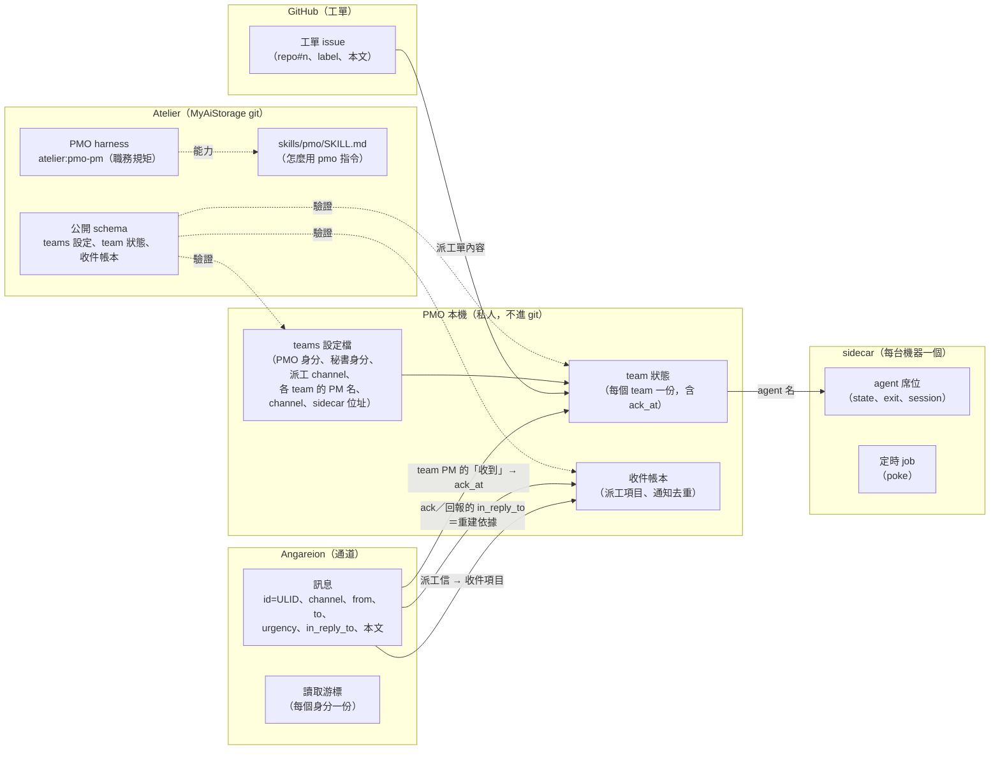
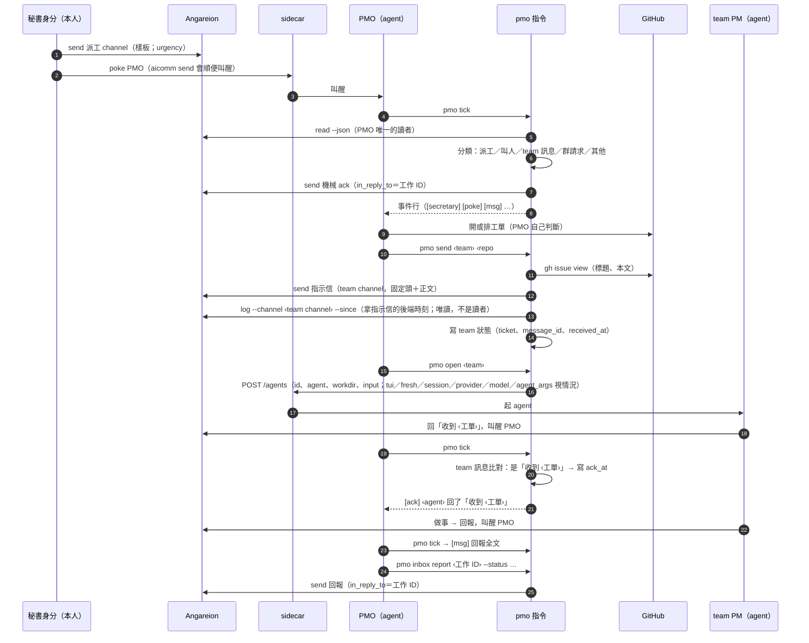
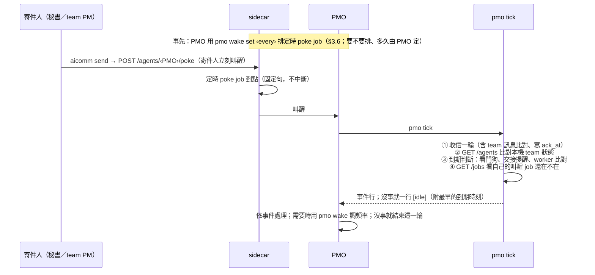
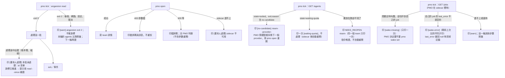
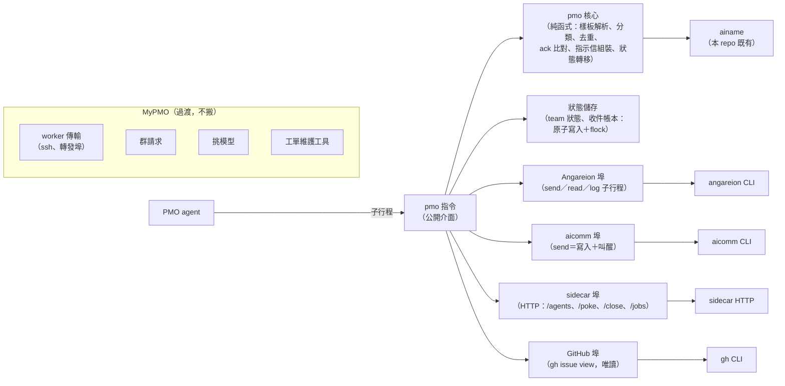

# #110 設計筆記：PMO 的收件與派工搬成 Atelier 的 PMO skill

- 作者：專案架構師 myaistorage-arch-m1-1。作者模式：由非作者（Sonnet）審過，經 PMO 交本人定案。**只設計、以介面為主，不實作。**
- 來由：本人 10-19 的方向（#110 工單）；本人同意先出設計（見 MyPMO#264）。
- 基準：本 repo main f4afe89；MyPMO 的 `pmo/` 只讀，下文只描述它的**介面形狀**，不貼程式，也不寫它的設定內容。
- 用詞：
  - 「PMO 工具」：現在 MyPMO 的 `pmo/dispatch.py`＋`pmo/inbox.py`（以及它們 import 的 `groups.py`、`ainame.py`）。
  - 「PMO skill」：本設計要做的東西。
  - 「秘書側」：本人透過秘書身分寄信、收回報的那一端（派工信、決定題、群請求的對方）。
- **定案**：§6 的 Q-1～Q-9 本人已全部決定（2026-11-02～03；#110 留言、MyPMO 決定檔 PR #270），§4 的 D- 都是定案。MyAiStorage 的結構維持現狀（本設計只新增 `src/pmo` 與 `skills/pmo/`）。

## 0. 先講結論（定案）

1. **PMO skill ＝一個指令（`pmo`，套件 `src/pmo`，和 agora／angareion／atelier／aicomm 同一個 distribution）＋一份說明檔（`skills/pmo/SKILL.md`）**。Atelier 的 PMO harness（`atelier:pmo-pm`）只寫「需要收件、派工、團隊、監看這些能力」，由環境說明把能力對應到這個指令（D-1；Q-1 (a)、Q-5 (a)）。
2. **設定和狀態的「資料」留在本機，「格式」公開在這裡**：teams 設定、team 狀態、收件帳本的 schema 由本 repo 定義和驗證；檔案由環境變數指到本機（D-4）。
3. **收件帳本大部分可以從 Angareion 重建**：PMO 的機械 ack、叫人 ack、回報都帶 `in_reply_to`，所以收件項目的主要欄位能重建；`team`、急件叫醒紀錄、決定題重建不出來（§1.2；D-5／Q-2）。
4. **「讀信」只有一個讀者：`pmo tick`**。它把讀到的每一則都交代清楚：自己處理的（秘書派工、team PM 的「收到」）、交給 PMO 看的（`[msg]` 全文）、交給過渡工具的（群請求、worker team 的動作）（D-6、D-13／Q-9）。
5. **第一階段只搬本機 sidecar 的派工**。worker 的傳輸、群請求、挑模型、MyPMO 的工單維護工具先留在 MyPMO；和 MyPMO 的交接採 id 交接（D-8～D-11、D-13；Q-3 (a)、Q-4、Q-9 (a)）。舊工具切換後只留 worker 動作和群請求（D-15；Q-7 (a)）；之後的搬移與退役時機是架構師的後續提議，本人沒有決定。
6. **tick 怎麼被叫起來（Q-8 (a)）**：有人用 aicomm 寄信給 PMO 時，寄件人立刻叫醒（現有行為）；沒人寄信時靠 PMO 自己排的 sidecar 定時 poke job。**要不要排、多久一次由 PMO 自己決定**，指令只提供開／調／停的介面 `pmo wake`（§3.6）。tick 每次被叫醒時，自己依 `tick.json` 與 team 狀態判斷哪些項目到期，不靠外部監看程式（D-14）。
7. **第一階段不做的事**：
   - **群請求不搬**（Q-4，本人定）：建群／封存請求的帳本、步驟機、重試 sweep 都留在 MyPMO；tick 只印 `[group-handoff]`／`[group-sweep-due]` 交接（Q-9 (a)），不解析、不推進群請求。
   - worker team 的動作（ssh、轉發埠、worker 上的 sidecar）不搬，tick 只印 `[worker-action]`（Q-3 (a)）。
   - 挑模型、MyPMO 的工單維護工具、boot-pmo 不搬（D-10、D-11）。
   - 指令不自動建工單、派工、重開、換 provider（D-7）。

## 1. 實體圖

### 1.1 實體與資料歸屬

| 實體 | 是什麼 | 存在哪裡、誰是權威 | 現在 PMO 工具裡的對應 |
|---|---|---|---|
| 派工信 | 秘書身分在派工 channel 用固定樣板寄給 PMO 的工作（`# 工作：…`、`- 工作 ID：<ULID>`、建議層級、規格、備註） | **Angareion** | inbox 的樣板解析 |
| 叫人信 | 寄給或提及 PMO、但不是派工的訊息 | Angareion | inbox 的叫人判斷 |
| team 訊息 | team PM 寄給 PMO 的信（「收到 ‹工單›」、回報、提問） | Angareion | dispatch 的 team 訊息比對 |
| 收件項目 | 一張派工信在 PMO 這邊的狀態 | **本機帳本**；主要欄位可以從 Angareion 重建（§1.2） | 收件帳本的 `items` |
| 叫人 ack 去重 | 同一則叫人信不重複回機械 ack | 本機帳本；**可以重建**（叫人 ack 帶 `in_reply_to`） | `notified.call` |
| 急件叫醒去重 | 同一則急件不重複標「叫醒」 | 本機帳本；**不能重建**（只印事件，不寄信） | `notified.poke` |
| 決定題 | PMO 問本人的選擇題（urgency 8，不帶 `in_reply_to`）和本人的作答 | Angareion；**不在帳本裡** | inbox 的決定題 |
| 工單 | 要做的事（repo#n） | **GitHub** | `send` 前讀工單 |
| team | 一個專案的一隊：PM 的 AI 名、channel、sidecar 位址、模式（互動版／生活模式） | **本機 teams 設定**（私人）；格式由本 repo 的 schema 定 | teams 設定檔 |
| 派工單 | 一次派工：工單、指示信 id、後端時刻、`--since`、team PM 回「收到」的時刻（`ack_at`）、看門狗的時刻 | **本機 team 狀態** | team 狀態檔 |
| agent 席位 | sidecar 上的一個 agent | **sidecar**（`GET /agents`） | team 狀態的 `state`／`exit` |
| 定時叫醒 | sidecar 的 poke job（PMO 用 `pmo wake` 自己開、調、停；§3.6） | **sidecar**（`/jobs`；只在記憶體，sidecar 重啟就消失）。PMO「想要的頻率」記在 `tick.json` 的 `wake`，用來發現 job 不見了 | 現在由 watch 常駐迴圈代替 |
| 職務規矩 | PMO 的 harness | **Atelier** | （不變） |
| 模型挑選 | 依角色、作者、額度挑 `(provider, model)` | 第一階段留在 MyPMO（D-10） | pick_model |
| 群請求 | 秘書側寄來的建群／封存請求的帳本與步驟機 | 第一階段留在 MyPMO（D-9／Q-9） | groups |

### 1.2 帳本重建：哪些能、哪些不能（D-5 的依據與限制）

現在的 PMO 工具：機械 ack 和叫人 ack 都把 `in_reply_to` 設成來信 id；回報的 `in_reply_to` 是工作 ID；決定題**不帶** `in_reply_to`。急件叫醒只印一行事件，不寄信。

| 帳本欄位 | 從哪裡重建 | 能否重建 |
|---|---|---|
| `id`、`title`、`level`、`sender`、`received_at` | 派工信本身（先用 `angareion log --channel <派工 channel> --to <PMO>` 列舉） | 能 |
| `ack_at`、`schedule`、`issue` | PMO 的機械 ack（`log --from <PMO> --thread <工作 ID>`） | 能 |
| `status`、`reported_at`、相關 PR | PMO 的回報（同上） | 能（回報樣板有狀態、相關工單、相關 PR） |
| `team` | 回報樣板沒有這一欄 | **不能**。本機帳本有值就保留；沒有值（例如帳本不見了）才留空並列出 |
| `notified.call` | 叫人 ack 的 `in_reply_to` | 能；和本機既有的紀錄取聯集，再照 `NOTIFIED_MAX` 修剪（log 只回一部分時不會變少） |
| `notified.poke` | 沒有寄信 | **不能**；rebuild 保留本機既有的紀錄。只有帳本不見了才會是空的，後果是同一則急件可能再標一次 `[poke]`（只多叫醒一次，無副作用） |
| 決定題 | 不在帳本 | 不適用；需要時用 `log --from <PMO> --grep` 另查 |

**併帳規則（T-3 定）**：rebuild 只增補或覆寫 log 有值的東西，**log 沒說的一律保留本機的值**：項目欄位（含 `team`）、`notified.call`、`notified.poke` 都照這一條。`issue` 取機械 ack 與回報之中較新的那一封。「刪掉帳本 → rebuild」時沒有本機值可保留，結果就是上表的「不能」各欄為空。

**同一張派工再出現時補發 ack 是現行語意**：同一個工作 ID 再次讀到時，現行工具會「補發 ack、沿用既有的工單和排程、不重開工單」。這是給秘書側重送用的，不是 bug。重建的測試要驗的是「重建後不會**重開工單**、補發的 ack 沿用重建出來的 `issue`／`schedule`」，不是「不會再 ack」。

## 2. 控制時序

### 2.1 收件 → 去重 → ack → 派工 → 收到 → 回報

### 2.2 被叫醒的路

- `pmo tick` 是**一輪**：重複叫醒只會多跑一輪。同一批信不會讀兩次（`read` 推游標）；看門狗的 poke 只做一次（team 狀態記了時刻）。
- **到期才處理**：tick 不知道、也不管自己是被誰叫醒的（寄件人、定時 job、PMO 自己手動跑）。每一輪都拿「現在」去比 team 狀態與 `tick.json` 裡記的時刻，只處理已經到期的項目，處理完把下一次到期時刻往後推（§3.4）。所以叫醒頻率只影響「到期之後多久才被看到」，不影響「會不會重複處理」。
- **延遲的上限**：到期項目最晚在「到期時刻＋叫醒間隔」被看到（例：看門狗 10 分鐘、間隔 10 分鐘 → 最晚 20 分鐘）；寄件人叫醒的信不受間隔影響。PMO 關掉定時叫醒時，到期項目要等下一封信才會被看到。
- 只有用 `--since` 補讀時同一則信會再出現；這時派工信照現行語意補發 ack（§1.2），叫人信和急件靠帳本去重。

### 2.3 失敗的分支

- **限流**：Angareion 的後端被限流時回 exit 2；tick 不重試、不推游標，等下一次叫醒。
- **no candidate**：判斷以 `GET /agents/<id>` 的 `state` 和 `exit.reason` 為準；換 provider 是 PMO 的判斷，指令只把事實印出來（D-7）。
- **database is locked**（共用的 opencode 服務）：看到這類錯誤時印原文，**不重試、不重開**，交本人。

## 3. 介面圖

### 3.1 元件與依賴

**埠**：指令只透過四個埠碰外部（Angareion、aicomm、sidecar、GitHub）。每個埠是一個小介面，測試用同名方法的假物件取代（沿用 PMO 工具現在 `Deps` 的接縫作法）。核心不碰外部。

**sidecar 埠依位址取得**：`sidecar_for(address)` 回傳那個位址的 sidecar 埠；team 的操作用 team 設定的 `sidecar`，PMO 自己的叫醒 job 用 `pmo_sidecar`。同一個位址可以由同一個埠服務（同一台時只問一次），兩者不同時也不會打到錯的機器。

### 3.2 `pmo` 指令（skill 的公開介面）

所有內文一律走 stdin（`--body -`）；stdout 是給 PMO 讀的事件行，第一個 token 是方括號標籤；stderr 是診斷。

| 指令 | 輸入 | 輸出（stdout） | 結束碼 |
|---|---|---|---|
| `pmo tick` | （無） | 見 §3.2.1 的事件表；全部沒事時一行 `[idle]` | 0 這一輪跑完（包含「部分失敗、已印 [warn]」）；1 用法錯；2 設定或狀態檔壞（這一輪什麼都沒做，不推游標） |
| `pmo inbox read` | （無） | 只做 tick 的「收信一輪」（不比對 agents、不跑看門狗） | 同 tick；給 T-2 階段與救援用 |
| `pmo inbox list [--json]` | | 收件項目一覽（唯讀） | 0／2 |
| `pmo inbox ack ‹工作 ID› [--issue ‹repo#n›] [--schedule 立即開工\|排入待開工佇列]` | | 送出的訊息 id | 0／1（查無工作 ID）／2（送不出去） |
| `pmo inbox report ‹工作 ID› --status ‹狀態› [--issue …] [--pr …] --body -` | 摘要與後續 | 訊息 id | 0／1／2 |
| `pmo inbox decision-send --body -` | 決定題的 JSON（題目、選項，最多 4 題） | `[decision] 已送出決定題 id=…` | 0；1 JSON 不合格式；2 送不出去 |
| `pmo inbox rebuild [--since ‹時刻›] [--dry-run]` | | 重建的項目數、差異、`team` 為空的項目清單、保留的 `notified.poke` 筆數 | 0；1 angareion 回用法錯（例如 `--since` 格式錯）；2 其他外部失敗、帳本壞或寫不進去 |
| `pmo check ‹team›` | | 逐項 OK／FAIL：team 存在且沒有 retired、PM 名合法且角色是 pm、team 狀態與 `tick.json` 讀得起來、channel 讀得到（`log --channel --since 現在`，不動游標）、本機 sidecar 的 `GET /agents` 有回應（T-4b 起）；worker team 只印一行「由過渡工具負責」 | 0 全過；1 有 FAIL |
| `pmo send ‹team› ‹repo#n› --body -` | 正文 | 指示信 id、後端時刻；`tick.json` 的 `wake.every` 比看門狗的 10 分鐘長、或是 `null` 時，多印一行 `[wake-hint] 看門狗 10m 後到期，目前叫醒 ‹every\|off\|unknown›`（`unknown`＝`tick.json` 讀不起來；這時 stderr 另印 `[warn]`，exit 仍是 0，因為信已送出）（只是提示，不改任何東西，D-7） | 0；1 用法、team 不存在、工單讀不到、組好的信超過上限、信（工單本文或正文）含憑證樣式（只說哪一段，不回顯）；2 外部失敗 |
| `pmo open ‹team› [--session ‹agora:…›] [--fresh] [--provider P --model M]` | | agent 的 state；互動版另印 `attach.local`（原樣，可直接貼上執行） | 0；1 用法或狀態不足（沒先 send、team 沒有 `workdir`、已退役）；2 sidecar 拒絕或連不上（印錯誤碼） |
| `pmo reply ‹team› [--urgency N] --body -` | 正文 | 訊息 id（經 aicomm：寫入＋叫醒） | 0；1 用法、team 不存在或已退役；2 沒寫進去；aicomm 逾時時印「送出結果不明，不要直接重送」並回 2 |
| `pmo poke ‹team› [--interrupt] --body -` | 一句話 | sidecar 的回應碼 | 0；1 用法、team 不存在或已退役；2 sidecar 拒絕或連不上 |
| `pmo status [‹team›] [--json]` | | 每個 team PM 的 state／exit／session，以及 PMO 自己排的 job | 0／2 |
| `pmo close ‹team› [--timeout 秒]` | | 是否已關；先刪掉的**自動重開 job**（sidecar 在 waiting-quota 時替這個 team PM 排的 `auto: true` job）；另外只列不動「瞄準這個 agent 的其他 job」 | 0（含 agent 本來就不在、close 還在背景進行）；2 sidecar 拒絕或連不上 |
| `pmo inbox handoff-close ‹id›` | | 把一筆交接出去的群請求標成已結案，之後不再印 `[group-sweep-due]` | 0；1 查無 id；2 tick 狀態檔壞或寫不進去 |
| `pmo wake set ‹every›` | 間隔（`5m`、`2h` 這類；規則見 §3.6） | `[wake] every=‹…› job=‹id› next=‹時刻›` | 0；1 間隔格式錯；2 PMO 不在 sidecar、sidecar 拒絕或連不上、tick 狀態檔壞 |
| `pmo wake off` | （無） | `[wake] off`，以及刪掉的 job id | 0；2 同上 |
| `pmo wake show [--json]` | （無） | 自己的叫醒 job（id、every、next_run_at、last_run、last_error 的碼）、`tick.json` 記的想要的頻率、`last_tick_at`、最早的到期時刻（唯讀） | 0；2 同上 |

**指示信的格式**：沿用 MyPMO `build_instruction` 的固定頭（工單號、標題、範圍、驗收、回報格式、派工時刻的說明）＋「工單本文（PMO 派工時從 GitHub 讀出）」＋正文，原樣見 #355 的實作；`life: true` 的 team 用生活模式的回報格式。現行的 M2 段落（開隊員的說明）不搬，那是環境說明的內容。超過 angareion 一則的上限就拒送（exit 1），不截斷。

**`pmo open` 的請求**：`POST /agents` 一定帶 `id`（team PM 的 AI 名）、`agent`（teams 設定的 `agent`，預設 `claude-code`；sidecar 必填，缺了 400）、`workdir`（teams 設定的 `workdir`，sidecar 必填）、`input`（第一則輸入）；互動版帶 `tui: true`（只配 `claude-code`），`--fresh` 只配互動版；`--session` 才帶 `session`（新開時省略整個鍵，互動版不帶）；`--provider/--model` 優先，其次 teams 設定的 `provider`／`model`，都沒有就省略（sidecar 依政策挑）；teams 設定有 `agent_args` 時以 `agent_args_mode: "append"` 帶上。**不帶 `subscription`**（只給 `subscription` 是舊形狀，Gateway 回 400；釘住某一把不在第一階段）。成功是 201 與 agent 物件。第一則輸入沿用 MyPMO `build_first_input` 的格式（指示在哪、只處理這張工單、讀到先回「收到 ‹工單›」、讀不到時的重試、怎麼回報；互動版是單行），只拿掉開頭的地點（Mac／worker）。看門狗靠那一則「收到」，這句不能省。

**`pmo close` 的 job 處理**：只刪 `auto` 為 true、`args.id` 是這個 team PM 的 job（sidecar 的自動重開 job；不刪的話，close 之後它到點會把 agent 開回來），而且先刪再 close。任何 poke job 都不刪：瞄準 team PM 的 poke job 是別人排的（§3.6「別人排的一律不碰」），PMO 自己的叫醒 job 瞄準的是 PMO，和 close 無關。`GET /jobs` 失敗時印 `[warn]`，照樣 close。自動重開 job 刪不掉時也照樣 close，但回 exit 2（已知有一個 job 到點會把 agent 開回來，要 PMO 處理）；`GET /jobs` 本身失敗只印 `[warn]`，exit 不變。agent 已 `exited` 時仍送 close（sidecar 的 close 是 idempotent，而且會刪掉 handoff）。**retired team**：`send`、`open`、`reply`、`poke` 拒絕（exit 1）；`check`、`status`、`close` 照常。

**送信前的身分守門**：所有會寄信的指令（ack、report、decision-send、send、reply），送之前檢查目前的身分（`ANGAREION_IDENTITY`）等於設定裡的 PMO 身分，不符就拒送（exit 2）。現行工具也有這道守門；公開版把身分改由設定給，守門照樣保留（C-3）。

**錯誤訊息**：一律不含 token、key、訊息內文；sidecar 的回應只挑已知欄位印（D-12）。

**刻意不提供**：自動建工單、自動派工、自動重開、自動換 provider（D-7）。

#### 3.2.1 tick 的事件表（沿用現行標籤）

原則：**現行工具已經有的標籤一字不改**（PMO 的 harness、環境說明、監看都靠標籤分辨）；只有新增的情況才用新標籤。T-5 的契約測試要逐一列舉。

| 標籤 | 情況 | 現行有無 |
|---|---|---|
| `[secretary]` | 新工作、重複工作補發 ack、叫人、不合規的秘書訊息 | 有，沿用 |
| `[poke]` | 秘書急件（秘書身分、派工 channel、urgency ≥ 8）：要立刻看 | 有，沿用 |
| `[dedupe]` | 急件已叫過 | 有，沿用 |
| `[decision]` | 收到決定題的作答（只印，不當授權） | 有，沿用 |
| `[msg]` | 寄給 PMO 的其他每一則信：第一行是欄位，後面接**全文** | 有，沿用（PMO 靠它看信，不必另外補讀） |
| `[ack]` | team PM 回「收到 ‹工單›」，已寫 `ack_at` | 有，沿用 |
| `[group-handoff] ‹id›` | 群請求：tick 不處理，交給過渡工具（Q-9） | **新增**。`[group-pending]`／`[group]` 留給 MyPMO 群請求帳本的原意（等 PMO 審、逾時），tick 不印 |
| `[group-sweep-due] ‹id…›` | 交接出去、還沒結案的群請求：提醒 PMO 跑過渡工具的 sweep（Q-9 (a)） | **新增** |
| `[state]` | team PM 的 sidecar 狀態變化 | 有，沿用 |
| `NEED_REOPEN ‹team› session=‹sid\|none›` | 應該在跑卻不見了 | 有，沿用 |
| `[watchdog]` | 派工後 10 分鐘沒有「收到」：已 poke 一次；再 10 分鐘升級成 `[要本人處理]` | 有，沿用 |
| `[要本人處理]` | 需要本人的狀況（狀態檔壞、sidecar 不可用、看門狗升級、本批未處理） | 有，沿用 |
| `[warn]` | 部分失敗 | 有，沿用 |
| `[no-candidate]` | team PM 因 no candidate 結束 | **新增** |
| `[waiting-quota]` | team PM 在等額度（只印一次） | **新增** |
| `[worker-action] ‹team› ‹動作›` | worker team 需要由過渡工具做的動作（看門狗要 poke、要比對 sidecar 狀態） | **新增**（Q-9） |
| `[wake-missing] every=‹…›` | `tick.json` 記著想要定時叫醒，但 sidecar 上找不到自己的叫醒 job（sidecar 重啟過）。同一次消失只印一次 | **新增**（Q-8） |
| `[wake-error] ‹job id› ‹碼›` | 自己的叫醒 job 的 `last_error` 不是空的（例：`agent_not_running`、`agent_awaiting_answer`）。碼和 `wake.error_reported` 記的不同才印（含沒有記錄）；`last_error` 變回 `null` 時清掉記錄（§3.6） | **新增**（Q-8） |
| `[wake-hint] 看門狗 10m 後到期，目前叫醒 ‹every\|off\|unknown›` | **由 `pmo send` 印，不是 tick**：叫醒間隔比看門狗長或沒開（M5-3） | **新增**（Q-8） |
| `[idle] [next-due=‹時刻›]` | 這一輪什麼都沒有；有未到期的項目時附上最早的到期時刻，給 PMO 決定間隔用 | **新增** |

**tick 對 worker team 的邊界**（第一階段，D-8；頻率記在 §3.4 的 `tick.json`）：
- **做**：team 訊息比對。worker team 的 PM 回「收到 ‹工單›」照樣寫 `ack_at`、印 `[ack]`（只動 team 狀態，不需要傳輸）；看門狗的到期判斷也照算。
- **不做**：任何要碰 worker 上 sidecar 的事（`GET /agents`、poke、open、close）。到期或需要比對狀態時印 `[worker-action] ‹team› watchdog-poke`／`[worker-action] ‹team› poll`，由 PMO 用過渡工具做。`poll` 只在**被叫醒的那一輪**判斷是否到期（`worker_poll.next_due_at`，預設間隔 10 分鐘），到期才印、印完往後推；不是每輪都印。

### 3.3 skill 依賴的介面（契約以各自的文件為準）

| 依賴 | 用到的形狀 | 文件 |
|---|---|---|
| Angareion | `send --channel --to --in-reply-to --urgency --ref --body -`（stdout＝訊息 id）；`read --json [--since]`（含 `received_at`）；`log --channel --from --to --thread --grep --since --json`（重建用）；結束碼 0／2／3 | `docs/angareion.md` |
| aicomm | `send --channel --to [--ticket] [--urgency] --body -`（寫入＋叫醒）；結束碼與逾時的語意照文件 | `docs/aicomm.md` |
| sidecar HTTP | `GET /agents`（`{"agents": [...]}`）、`GET /agents/<id>`（agent 物件）、`POST /agents`（201＋agent 物件）、`POST /agents/<id>/poke`、`POST /agents/<id>/close`、`GET /jobs`（`{"jobs": [...]}`）、`POST /jobs`、`DELETE /jobs/<id>`；agent 物件的 `attach` 只有互動版有值，用 `attach.local` | sidecar 的文件（MyLinuxPool） |
| GitHub | `gh issue view <n> --repo <owner/repo> --json title,body`（唯讀） | gh |
| ainame | `parse`／`is_valid`，加上 T-1 要補的「缺 team 段的提示」（見 §5.1） | `src/ainame/__init__.py` |

`pmo reply` 經 aicomm，沿用和其他 AI 同一份叫醒規則（MyPMO#183 的決定）。aicomm 的 `send` 只寫入加叫醒，不讀信，不會成為第二個讀者。

### 3.4 公開的 schema（本 repo 定義，資料留在本機）

- **teams 設定**：
  - 全域：PMO 身分、秘書身分、派工 channel（現行工具裡寫死的三個常數，改由設定給）；PMO 自己所在的 sidecar 位址（選填；沒有就表示 PMO 不在 sidecar，`pmo wake` 回 exit 2、tick 不查 `/jobs`）；叫醒固定句（選填，預設「定時叫醒：請跑 pmo tick」）；
  - 每個 team：key（`<專案>-<team 代號>`）、PM 的 AI 名、channel（`team-<專案>-<team 代號>`）、sidecar 位址或「worker」標記、`tui`／`life`／`retired` 三個布林、`agent`（選填，`claude-code`／`opencode`，預設 `claude-code`；`tui` 時必須是 `claude-code`）、`workdir`（`pmo open` 用，絕對路徑）、`agent_args`（選填，字串陣列，以 append 帶給 sidecar）、預設的 provider／model（選填；`model` 需要 `provider`，`provider` 可以單獨給）。

  驗證規則照現行工具（AI 名用 ainame 驗、key、名字、channel 一致、不重複）。
- **team 狀態**：照 MyPMO 現在 `pmo/state/README.md` 的欄位。**不認得的欄位原樣保留**（過渡期 worker team 的欄位由 MyPMO 寫，見 Q-9）。寫入照 §3.4 的原子寫入；讀改寫用每個 team 一把的 `<key>.json.lock`（flock，綁 state 目錄），`send` 與 tick 的「收到」比對都在鎖內重讀再改。
- **收件帳本**：`version`、`items`（以工作 ID 為 key）、`notified`；新增 `rebuilt_at`。
- **tick 狀態**（`<狀態目錄>/tick.json`，由 tick、`handoff-close`、`pmo wake set|off` 寫）：
  - `version`；
  - `last_tick_at`：tick 每輪結束時寫。用途：`pmo wake show` 顯示它；tick 開始時若「現在 − `last_tick_at`」超過想要的間隔的 3 倍，印一行 `[warn] 上次 tick 在 ‹時刻›`（叫醒可能沒在運作）；`wake.every` 是 `null` 時不做這項檢查（PMO 自己關掉了叫醒）；
  - `handoffs`：以群請求 id 為 key，值是 `handed_at`、`last_reminded_at`、`next_due_at`；`handoff-close` 刪掉該筆；
  - `worker_poll`：以 worker team key 為 key，值是 `last_reported_at`、`next_due_at`；
  - `wake`：`every`（PMO 想要的間隔；`null`＝PMO 選擇不排）、`set_at`、`missing_reported_at`、`error_reported`（以 job id 為 key，值是上次印 `[wake-error]` 時的碼；`last_error` 變回 `null`、或 job 已不在時刪掉該筆）、`orphan_reported_at`（上次印「沒記頻率，sidecar 上卻有 job」的時刻）。只有 `pmo wake set|off` 改 `every`；tick 只改這三個「已印過」的欄位（`missing_reported_at`、`error_reported`、`orphan_reported_at`）。

  **到期項目的判斷全在 tick 裡**：看門狗看 team 狀態的派工時刻與 `ack_at`；交接提醒看 `handoffs.*.next_due_at`；worker 比對看 `worker_poll.*.next_due_at`。被叫醒的那一輪，`next_due_at` ≤ 現在的才處理，處理完把 `next_due_at` 設成「現在＋預設間隔」（交接與 worker 都是 10 分鐘；是從「這一輪」往後推，不補跑錯過的次數）。

  寫入走同目錄暫存檔＋`os.replace`，並用 `tick.json.lock` 的 flock 包住「讀、改、寫」。**這把鎖只包本機檔案的讀改寫，期間不打任何 HTTP**：tick 先做完 `GET /agents`／`GET /jobs`，再拿鎖、**在鎖內重讀 `tick.json`**、套上這一輪的改動後寫回（不用 HTTP 之前讀到的那一份，以免蓋掉這段時間 `wake set|off` 剛寫的 `wake.every`）。等鎖最多 10 秒，等不到就回 exit 2、印 `[warn]`（下一輪再做）。讀 `tick.json` 不拿鎖（`os.replace` 保證讀到的是完整的一份）。**檔不存在**：視為空的並建立（`wake.every` 是 `null`，所以不會印 `[wake-missing]`）。**檔壞掉**：tick、`handoff-close`、`pmo wake` 回 exit 2、印 `[要本人處理]`。
- 位置：`PMO_SKILL_CONFIG`、`PMO_SKILL_STATE_DIR` 兩個環境變數（由環境說明提供）；沒設就拒絕執行（exit 2），**不猜預設路徑**。

### 3.5 （第 5 輪刪除）

原本的「`pmo watch --poke-only` 小監看程式」只在 Q-8 選 (b) 時才有；本人選了 (a)，整節連同 `watch.json`、T-8 一起刪掉。

### 3.6 定時叫醒：`pmo wake`（Q-8 (a)）

**分工**：要不要定時叫醒、多久一次，是 PMO 的判斷（本人 Q-8）；指令只做機械步驟（D-7）——把 PMO 選的間隔變成 sidecar 上**恰好一個**自己的 poke job，並在 tick 裡回報它是否還在。指令不自動調頻率、不自動重排。

- **哪些 job 是「自己的」（本節與 T-5 一律用這個定義）**：sidecar 的 job 沒有擁有者欄位，所以用內容認：`action` 是 `poke`、`args.text` **等於目前設定的**叫醒固定句、`auto` 是 false。`args.id` 不拿來認（PMO 換了 agent id 時，舊 id 的 job 也要能被清掉）。`wake set`、`wake off`、tick 的健康檢查都只動或只看「自己的」job；句子不同的 poke job（別人排的、或改固定句之前留下的）一律不碰，只在 `wake show` 列出。所以改固定句要照順序：先 `wake off`（用舊句子刪掉），再改設定，再 `wake set`。 `pmo close ‹team›` 不動任何 poke job，包括自己的（見 §3.2 的「`pmo close` 的 job 處理」）。
- **`pmo wake set ‹every›`**：
  1. 驗間隔：只收 `‹整數›m` 或 `‹整數›h`，範圍 2m～24h（擋掉誤寫成秒數；sidecar 本身接受的格式更寬）。這是工具替 PMO 設的邊界，Q-8 也註明了；要比 24 小時更久，就用 `pmo wake off`。
  2. `GET /jobs`，找出自己的 job。**`every` 一律換成秒數再比**：`POST` 時送的是字串（`10m`），`GET /jobs` 回的是秒數（`600.0`；MyLinuxPool c411b02 的 `jobs.py` 把 `every` 存成秒數、`to_dict` 原樣輸出，文件沒寫，見 §8）；比較時兩邊都轉成秒數，字串和數字兩種形狀都要收。若恰好一個、`every` 相同、`args.id` 是目前的 PMO 身分 → 不動 sidecar，只更新 `tick.json` 的 `wake`，印 `[wake]`。
  3. 否則**先建後刪**：`POST /jobs`（`action: poke`、`args: {id: ‹PMO 身分›, text: ‹固定句›, interrupt: false}`、`every`，不帶 `until`），成功後 `DELETE /jobs/<id>` 刪掉其他自己的 job。先建後刪，中間不會有沒人叫醒的空窗；代價是短暫有兩個 job，最多多叫醒一次（多跑一輪 tick 無副作用）。刪除失敗印 `[warn]` 附 job id，exit 仍是 0。
  4. 整個流程拿另一把 `wake.lock`（不是 `tick.json.lock`）：兩個 `set`／`off` 同時跑時會排隊，不會留下兩個 job。tick 不拿這把鎖，所以 `set` 卡在 HTTP 時 tick 照跑。每個 HTTP 呼叫逾時 10 秒；等 `wake.lock` 最多 30 秒，等不到回 exit 2。最後才用 `tick.json.lock` 短暫寫入 `wake`。
- **`pmo wake off`**：刪掉所有自己的 job，`wake.every` 設成 `null`。之後 tick 不再印 `[wake-missing]`。
- **`pmo wake show`**：唯讀，列出自己的 job 和 `tick.json` 的 `wake`、`last_tick_at`、最早的到期時刻；另外**只列不動**「`args.id` 是 PMO 身分、但句子和目前固定句不同」的 poke job（例如改過固定句之後留下的舊 job，或本人自己排的），讓 PMO 判斷要不要請排的人刪。只印已知欄位（D-12）。SKILL.md 要寫：改固定句之前先 `pmo wake off`。
- **固定句不帶任何內容**：不帶未讀數、不帶信的內容，也不帶位址或 token（和 sidecar 的 job 規則一致）。`interrupt` 一律是 false：定時叫醒不打斷 PMO 正在做的這一輪，sidecar 會排在這一輪之後。

**tick 怎麼看 job 的健康**（PMO 在 sidecar 裡、而且 `wake.every` 不是 `null` 時，每輪 `GET /jobs` 一次）：

| 看到的 | tick 印 | 為什麼 |
|---|---|---|
| 找不到自己的 job | `[wake-missing] every=‹…›`（記 `missing_reported_at`；job 再出現前不重印） | sidecar 的 job 只在記憶體，sidecar 重啟就沒了。PMO 看到後自己決定要不要 `pmo wake set` |
| 自己的 job 的 `last_error` 不是空的 | `[wake-error] ‹job id› ‹碼›`（碼和 `wake.error_reported` 記的不同才印（含沒有記錄）；`last_error` 變回 `null` 時清掉記錄） | 例：PMO 被 close 過那段時間的 409 `agent_not_running`；PMO 在 AskUserQuestion 時的 409 `agent_awaiting_answer`。job 本身照排程繼續，不自動重試。**`last_error` 只代表最後一次執行**：sidecar 在 job 成功時會把它清成 `null`（c411b02 `core.py` 的 job 迴圈；文件沒寫，見 §8），所以 PMO 回來之後，下一次叫醒成功它就消失，不會每輪都印。**去重只看碼，不看 `last_run`**：失敗期間（PMO 關著、或在提問）每次到點 `last_run` 都會前進，但碼一樣，所以只印一次（例：關 6 小時、間隔 10 分鐘，也只印 1 次，不是 36 次）。中間成功過一次（`last_error` 變回 `null`）時記錄會被清掉，之後再出現同一個碼會再印一次，因為那是一次新的失敗。若之後 sidecar 改成成功時不清 `last_error`，最壞是新的同碼失敗不會再印，不會洗版 |
| 自己的 job 超過一個 | `[warn] 自己的叫醒 job 有 ‹n› 個` | 先建後刪中斷時會發生；PMO 再跑一次 `pmo wake set` 就收斂 |
| `wake.every` 是 `null`，sidecar 上卻有自己的 job | `[warn] tick.json 沒記叫醒頻率，sidecar 上有自己的 job ‹id› every=‹…›`（記 `orphan_reported_at`；job 消失或 `wake set|off` 之前不重印） | `tick.json` 被刪或是在新的狀態目錄啟動時，PMO 想要的頻率就悄悄不見了。PMO 用 `pmo wake set` 記回來，或用 `wake off` 刪掉 |
| `GET /jobs` 失敗 | `[warn]`；這一輪其他步驟照做 | 和 `GET /agents` 失敗同一套 |

**PMO 的開機步驟**（寫進 SKILL.md；T-7 時寫進 PMO harness 的環境說明）：PMO 每次被開（新開、重開、sidecar 重啟後接回）先跑一次 `pmo tick`，再跑 `pmo wake show`；`tick.json` 想要定時叫醒但 job 不在時，由 PMO 決定要不要 `pmo wake set`。

**派工步驟**（寫進 SKILL.md）：`pmo send` 印出 `[wake-hint]` 時，表示目前的叫醒間隔比看門狗長（或沒開），看門狗到期後可能很久才被看到；由 PMO 決定要不要用 `pmo wake set 10m` 調短。

**預設建議頻率（建議，不是規定；PMO 依情況調）**：

| 情況 | 建議 | 理由 |
|---|---|---|
| 有派工在等「收到」、有未結案的交接、或有 worker team 在跑 | **10m** | 看門狗是 10 分鐘，間隔 10 分鐘時最晚 20 分鐘看到；換成 5m 只快 5 分鐘，叫醒次數卻加倍（一天 288 輪 vs 144 輪） |
| 什麼都沒在等（tick 只印 `[idle]`、沒有 `next-due`） | **30m～60m**，或 `pmo wake off` | 有信時寄件人會立刻叫醒，不受間隔影響；拉長只會延後發現「本機 team PM 的 sidecar 狀態變化」（#520 之後 sidecar 不發退出通知，這只能靠 tick 的 `GET /agents` 發現）。一天 48 或 24 輪 |
| 剛派工（`pmo send` 印了 `[wake-hint]`）、或剛看到 `[wake-missing]` | 依上面兩列重新判斷 | `[wake-hint]` 把「間隔比看門狗長」這件事推到 PMO 眼前，不用靠 PMO 自己記得 |

**`[idle]` 輪的成本**：每一次叫醒都是 PMO 模型的一輪推理（讀固定句 → 跑 `pmo tick` → 讀一行 `[idle]` → 結束）。一輪不大，但 tui 的對話會一直變長，次數多了會提早觸發壓縮；所以 SKILL.md 要寫明「看到 `[idle]` 就直接結束這一輪，不做其他工具呼叫」。額度用量 ≥70% 時，建議 PMO 把間隔拉長（照環境說明的額度規則）。

## 4. 決定（定案）

本人 2026-11-02～03 定完 §6 的 Q-1～Q-9，下表全部是定案；對應的 Q 欄寫本人選的選項。

| # | 決定 | 理由 | 對應的 Q |
|---|---|---|---|
| D-1 | skill ＝ `pmo` 指令（本 distribution）＋`skills/pmo/SKILL.md`；harness 只寫能力，環境說明對應到指令 | 沿用 angareion／aicomm 的「指令＋SKILL.md」先例，以及 harness v1 起「只寫能力」的規則 | Q-1 (a)、Q-5 (a) |
| D-2 | 核心（純函式）和外部的埠分開；測試用同名方法的假物件 | 現行工具已經這樣做，測試能原樣搬 | — |
| D-3 | AI 名文法只用本 repo 的 `src/ainame` | 少一份副本；兩版的差異在 T-1 補齊（§5.1） | — |
| D-4 | 設定和狀態的格式公開在本 repo，資料由環境變數指到本機；沒設就拒絕 | public repo 不放私人資料；不猜路徑 | — |
| D-5 | 收件帳本以 Angareion 為準，本機是快取，可以 `rebuild`；`team` 和急件叫醒紀錄不可重建（§1.2） | 現在帳本是去重的單點 | Q-2 (a) |
| D-6 | 常駐的 watch 改成一輪的 `pmo tick`；`pmo tick` 是 PMO 身分唯一的讀信者 | sidecar 裡的 agent 不跑背景讀信迴圈；同一個身分只留一個讀者 | Q-8 (a) |
| D-7 | 指令只做機械步驟；建工單、派工、重開、換 provider 都由 PMO 判斷 | PMO harness 的職務分界 | — |
| D-8 | 第一階段只支援本機 sidecar 的 team 的「動作」；worker team 的動作留在 MyPMO | worker 的傳輸和 MyLinuxPool 綁在一起。之後什麼時候搬是**架構師的後續提議**（等 MyLinuxPool 提供自己的 sidecar 存取方式，原 Q-3 (c)），本人沒有決定 | Q-3 (a) |
| D-9 | 群請求第一階段留在 MyPMO；tick 把它分流出來交接 | 它和秘書側的介面逐字對齊、規模大，搬移風險高 | Q-4（第一階段不搬）、Q-9 (a) |
| D-10 | 挑模型留在 MyPMO；`pmo open` 只收明寫的 provider／model 或 teams 設定的預設值 | 模型政策和外部挑選服務屬於私人設定 | — |
| D-11 | MyPMO 的工單維護工具不搬 | 它們維護 MyPMO 自己的工單樹 | — |
| D-12 | 印出去的字串一律過 `sanitize`；sidecar 回應只印已知欄位 | 沿用現行規則 | — |
| D-13 | tick 讀到的每一則都要有去處：自己處理、`[msg]` 交給 PMO、或交給過渡工具；不得靜默丟掉 | 一個讀者推了游標，別人就看不到；交接必須明寫 | Q-9 (a) |
| D-14 | 叫醒＝寄件人立刻 poke（現有）＋PMO 自己排的 sidecar 定時 poke job；開／調／停走 `pmo wake`（§3.6），頻率由 PMO 決定，指令只給預設建議。到期判斷全在 tick 裡（`tick.json` 與 team 狀態），不設外部監看程式 | 本人 Q-8 選 (a)；把「什麼時候到期」留在唯一的讀者裡，叫醒來源只需要「叫」，不需要知道狀態 | Q-8 (a)（2026-11-02） |
| D-15 | 切換（T-7）後，MyPMO 的 dispatch.py 只留 worker 動作和群請求，經 id 交接和 `pmo tick` 協作 | 第一階段不搬的部分仍要有人做；薄殼（轉呼叫 `pmo`）會多一層要維護的相容層。什麼時候整支退役是**架構師的後續提議**（Q-3、Q-4 都搬完之後），本人沒有決定 | Q-7 (a) |

## 5. 搬移切分

### 5.1 對照

| 現在（MyPMO） | 搬法 | 說明 |
|---|---|---|
| 收件：樣板解析、叫人判斷、急件判斷、ack／回報的本文組裝、去重、重複工作補發 ack | **原樣搬**（邏輯）＋測試 | 三個寫死的身分與 channel 常數改由設定給；身分守門保留 |
| 決定題：題目驗證、本文組裝、送出、作答解析 | **原樣搬**＋測試 | 介面是 `pmo inbox decision-send`；作答在 tick 印 `[decision]` |
| team 訊息比對（「收到 ‹工單›」→ `ack_at`、`[msg]` 全文） | **原樣搬**＋測試 | 看門狗依賴它；漏了會對每個 team 誤報 |
| 收件帳本的讀寫（原子寫入＋flock） | **原樣搬** | 加上 `rebuild`（新寫） |
| 派工：`check`／`send`／`open`／`reply`／`poke`／`status`／`close` | **本機 sidecar 的路徑實質上是重寫**（現行工具裡 worker 和本機的分支交錯，抽出來等於重寫），測試照搬並改寫 | `reply` 經 aicomm（沿用 MyPMO#183） |
| `watch` 常駐迴圈 | **重寫**成 `pmo tick` | 比對、看門狗的邏輯沿用；迴圈和退避拿掉 |
| worker 傳輸（ssh、轉發埠、遠端標記） | **不搬**（第一階段） | Q-3 (a)；交接見 Q-9 (a) |
| 群請求（含每輪的重試 sweep） | **不搬**（第一階段） | Q-4；sweep 由 PMO 看到 `[group-sweep-due]` 後跑（Q-9 (a)） |
| 挑模型 | **不搬** | D-10 |
| AI 名文法 | 改用本 repo 的 `src/ainame` | 現行工具用到一個本 repo 沒有的「缺 team 段的提示」函式；T-1 要在 `src/ainame` 補上（附測試向量）或在 pmo 內實作，並列出兩版其他差異 |
| boot-pmo（開 PMO 的啟動程式） | **不搬** | 屬於 Mac 環境的啟動方 |
| 工單維護工具 | **不搬** | D-11 |

### 5.2 建議的 PR 切分（tasks）

每個 PR 都要經架構師結構審。

**工單**（Q-6：#110 定為 b，2026-11-03）：T-1～T-6 各開一張 #110 的子單（sub-issue）；T-7 是 PMO 自己的切換單。#110 的 label 改成 `層級:b`、建子單，都**等本設計 PR merge 之後**再做（由 PM／PMO 依工單規則做；設計 PR 不動 label、不開單）。

1. **T-1 骨架與 schema**：`src/pmo/`（Q-5 (a)）、設定和狀態的 schema 與驗證（含 PMO 身分、秘書身分、派工 channel）、四個埠的介面和假物件、`sanitize`、ainame 的差異補齊。不含指令行為。
2. **T-2 收件核心**：樣板解析、分類、去重、補發 ack、急件、叫人、決定題、team 訊息比對、帳本讀寫；`pmo inbox read|list|ack|report|decision-send`。搬測試。**合併後可以用 `pmo inbox read` 驗**（不必等 tick）。
3. **T-3 帳本重建**：`pmo inbox rebuild`（新寫）。先驗 `angareion log` 能涵蓋列舉和 `--thread`；測試「刪掉帳本 → 重建 → 補發的 ack 沿用重建出來的 issue／schedule、不重開工單」。
4. **T-4a 派工（一）**：`check`、`send`。`send` 的 `[wake-hint]` 要測：`wake.every` 比 10m 長、或是 `null` 時印；10m 以下不印；`tick.json` 不存在時視為 `null`（`tick.json` 的 schema 在 T-1）；`tick.json` 壞掉時印 `unknown`、stderr 印 `[warn]`、exit 0。
5. **T-4b 派工（二）**：`open`。
6. **T-4c 派工（三）**：`reply`、`poke`、`status`、`close`。
7. **T-5 tick 與叫醒**：`pmo tick`（收信一輪、agents 比對、到期判斷〔看門狗、交接提醒、worker 比對〕、no-candidate、waiting-quota、交接事件、叫醒 job 健康）和 `pmo wake set|off|show`；事件表的契約測試；「收到 → 看門狗不發」的測試。到期與叫醒的測試要含：未到期不印、到期印一次並把 `next_due_at` 往後推、間隔很久才被叫醒也只印一次（不補跑）、`handoff-close` 之後不再印；`wake set` 同間隔不動 sidecar、改間隔先建後刪、只動固定句相同的 job（別人的 poke job 不碰）、兩個 `set` 同時跑只留一個；`wake off` 之後不印 `[wake-missing]`；job 不見時 `[wake-missing]` 只印一次；PMO 不在 sidecar 時 tick 不查 `/jobs`、`wake` 回 exit 2；假 sidecar 的 `GET /jobs` 要照實作回**秒數**（`600.0`），驗證 `wake set 10m` 不會動 sidecar（M5-1）；`[wake-error]` 的去重：失敗期間 `last_run` 一直前進、碼相同時只印一次；碼改變時再印；`last_error` 變回 `null` 時清掉記錄，之後同一個碼再出現要再印（M5-2、W6-1）；假 sidecar 卡住期間跑 `wake set`，tick 跑完後 `wake.every` 仍是新值（鎖內重讀，N6-1）；`wake off` 不刪句子不同的 job（N6-2）；`wake.every` 是 `null`、sidecar 上卻有自己的 job 時，`[warn]` 只印一次；`wake.every` 是 `null` 時不做「3 倍間隔」警告；`tick.json.lock` 不會在 HTTP 期間被拿著（假 sidecar 卡住時 tick 照跑，`set` 等 `wake.lock` 逾時回 exit 2）；只列不刪句子不同的 poke job。sidecar 用假物件，不打真的 `/jobs`。
8. **T-6 說明**：`skills/pmo/SKILL.md`、環境說明範本（**只是範本，不改任何人正在用的環境說明**）；更新 overview／decisions。**PMO harness 的新版本不在這裡發**。
9. **T-7 切換**（PMO 自己的單；MyPMO 一側和本 repo 一側同步）：PMO harness 的新版本（能力段指向 `pmo`，含 §3.6 的開機步驟）、環境說明改用 `pmo`、停舊的 watch、開始用 `pmo tick`、PMO 用 `pmo wake set` 排定時叫醒（間隔由 PMO 定）、MyPMO 依 Q-9 改成交接模式。三件事在同一個切換窗口做，避免「harness 叫 PMO 用 `pmo`，但設定還沒好」或「兩個讀者」。

## 6. 本人的決定（全部已定）

選項保留供日後追溯（Q-6 的選項整理成 b／c 兩項）；「決定」欄是本人選的選項與日期（#110 留言；MyPMO 決定檔 PR #270）。標「架構師註」「架構師的理由」的部分不是本人的決定。

| # | 問題 | 選項 | 決定 |
|---|---|---|---|
| Q-1 | 「Atelier 的 skill」落在哪裡 | (a) 指令＋`skills/pmo/SKILL.md`，harness 只寫能力；(b) Atelier 新增一種「skill」檔（`atelier/skills/<名>/v<N>.md`，版本不可變），由 `atelier show` 讀；(c) 寫進 PMO harness 本文 | **已定 (a)**（2026-11-03）（D-1）。架構師註：(b) 等第二個 skill 出現時再評估，是後續提議 |
| Q-2 | 收件帳本以哪邊為準 | (a) Angareion 為準、本機是快取、可重建（`team` 與急件叫醒紀錄除外）；(b) 照現在，本機帳本永久保留、不可刪 | **已定 (a)**（2026-11-03）（D-5）。(a) 的選項本身已寫明 `team` 與急件叫醒紀錄除外 |
| Q-3 | worker team 的動作什麼時候搬 | (a) 第一階段不搬，交給過渡工具（Q-9）；(b) 一起搬，把 ssh／轉發埠做成第五個埠；(c) 等 MyLinuxPool 提供自己的 sidecar 存取方式再搬 | **已定 (a)**（2026-11-03）：worker 動作第一階段不搬（D-8）。架構師註：之後等 MyLinuxPool 提供自己的 sidecar 存取方式再搬（原 (c)）是後續提議，本人沒有決定 |
| Q-4 | 群請求什麼時候搬 | (a) 第一階段不搬（交接方式見 Q-9）；(b) 一起搬 | **已定：第一階段不搬**（2026-11-03）。範圍見 §0 第 7 點（D-9） |
| Q-5 | 指令名和套件名 | (a) `pmo`（套件 `src/pmo`）；(b) `atelier pmo …`；(c) 其他名字 | **已定 (a)**（2026-11-03）（D-1）。架構師的理由：atelier 指令維持只讀 harness，不混進派工 |
| Q-6 | #110 的層級 | (b) 新增指令和套件屬於「功能組新增」；(c) 維持現在的 c | **已定 b**（2026-11-03），放在 MyAiStorage 的方向不變。T-1～T-6 掛成子單，T-7 是 PMO 的切換單；label 與子單等本設計 PR merge 後再做（§5.2） |
| Q-7 | 舊工具的去留 | (a) 切換後 MyPMO 的 dispatch.py 只留 worker 動作和群請求；(b) 改成轉呼叫 `pmo` 的薄殼；(c) 整支退役 | **已定 (a)**（2026-11-03）：舊工具只留 worker 動作與群請求（D-15）。架構師註：Q-3／Q-4 都搬完再退役是後續提議，本人沒有決定 |
| Q-8 | tick 由誰在什麼時候叫起來（PMO 已經由 sidecar 開，見 MyPMO 的 boot-pmo 說明；問題是「沒人寄信時」的定時工作怎麼觸發） | (a) sidecar 定時 poke job；(b) 不是 agent 的小監看程式，只在有事時 poke；(c) PMO 自己在背景跑常駐監看 | **已定 (a)**（2026-11-02，本人：「基本上是 (a)」）。以 sidecar 定時 poke 為主；要不要叫、多久叫一次由 PMO 自己決定（介面 `pmo wake` 和預設建議，§3.6）；有人用 aicomm 叫 PMO 時立刻叫醒（現有行為）。(b)、(c) 不採。`pmo wake set` 只收 2m～24h，這是工具設的邊界（防止把秒數誤寫成分鐘）；要更久就 `pmo wake off`，只靠寄件人叫醒（D-14） |
| Q-9 | tick 和過渡工具（MyPMO 的群請求、worker team 動作）怎麼交接 | (a) **id 交接**：tick 不處理、印 `[group-handoff] ‹id›`／`[worker-action] ‹team› ‹動作›`；MyPMO 的工具改成「給 id，用 `angareion log --around ‹id›` 取原信」（唯讀、不動游標）。重試的觸發：tick 在自己的狀態裡記下交接出去的 id（不讀 MyPMO 的帳本），每隔固定時間（預設 10 分鐘；在下一次被叫醒的那一輪判斷是否到期，最多每輪一次）印 `[group-sweep-due] ‹id…›`，PMO 看到就跑 MyPMO 的 sweep；MyPMO 報結案後，PMO 用 `pmo inbox handoff-close ‹id›` 停止提醒。team 狀態兩邊共用同一個目錄與 schema（不認得的欄位保留）。(b) tick 直接 import MyPMO 的群請求程式；(c) 先不切換：Q-3、Q-4 都搬完才做 T-7 | **已定 (a)**（2026-11-03）（D-13）。架構師的理由：讀者仍然只有一個，MyPMO 只改入口 |

## 7. 風險

- **兩個讀者**：切換期間，舊的 watch 和 `pmo tick` 若同時以 PMO 身分讀信，會互相吃掉訊息。T-7 必須先停舊的再開新的；SKILL.md 和 harness 要明寫「PMO 身分的讀信只走 `pmo tick`」。定時 poke job 只叫醒、不讀信，不算讀者。
- **交接漏件**（Q-9 (a)）：MyPMO 若沒有在 T-7 改成「用 id 取原信」，群請求會停在 `[group-handoff]`，沒人去取。T-7 的驗收要包含兩筆群請求：一筆一次走完；一筆在推進途中失敗，靠 `[group-sweep-due]` 提醒、PMO 再跑 sweep 之後續完。
- **帳本重建的邊界**：§1.2 列的不可重建欄位；過去沒帶 `in_reply_to` 的舊 ack 也重建不出來。T-3 要先從現在的帳本匯入一次。
- **定時 job 失效**（Q-8 (a)；依 sidecar 文件 §2.3）：
  - **sidecar 重啟**：job 只在記憶體，重啟後消失；PMO 也會跟著被重開。靠 §3.6 的開機步驟和 `[wake-missing]` 發現，由 PMO 重排。PMO 沒被重開之前，沒有任何東西會叫醒它，只剩寄件人叫醒（本來也叫不醒一個不在的 PMO）。
  - **PMO 被 close 再 open**（同一個 sidecar）：sidecar 的 `POST /agents/<PMO>/close` 不刪 job（sidecar #519；這是 sidecar 的行為，不是 `pmo close` 的規格），關著的那段時間每次到點都得到 409 `agent_not_running`，記在 `last_error`；以同一個 id 重開後照常叫醒，tick 印一次 `[wake-error]`（只是告知）。換了 id 重開時，舊 job 會一直 409；`pmo wake set` 依固定句認 job，會把它清掉。
  - **PMO 不再開了**：job 會一直空打 409。關 PMO 的一方（PMO 自己退場、或本人）要先 `pmo wake off`；寫進 SKILL.md 的退場步驟。
- **叫醒的副作用**：tui 的 poke 一律照送（sidecar #454），PMO 正卡在**權限詢問**時，定時 poke 的 Enter 會替人按下對話框的預設選項；正在 AskUserQuestion 時則是 409 `agent_awaiting_answer`、這次不送。間隔越短，碰上的機會越大；這是選短間隔的成本之一，指令不另外處理（要擋得在 sidecar 側，不在本設計範圍）。
- **`[idle]` 輪的成本**：見 §3.6。PMO 若長時間不調頻率，最壞是一天 144 輪（10m）；這是 PMO 的判斷，不是指令的錯，`pmo wake show` 讓它看得到。
- **到期延遲**：到期項目最晚在「到期＋間隔」才被看到；PMO 選 `pmo wake off` 時，要等下一封信。
- **公開與私人的界線**：schema、事件格式、測試假資料都在 public repo，假資料不得帶私人資訊（帳號、位址、額度）。

## 8. 沒驗到的

- 沒有跑 MyPMO 的測試；對它的描述來自讀程式和文件（只讀）。
- sidecar 的 `/jobs` 介面形狀以環境說明為準，沒有實際打過。
- `angareion log` 能不能涵蓋重建所需的列舉與 `--thread`，沒有實測（T-3 要先驗）。
- sidecar 的 `/jobs` 行為（只在記憶體、`close` 不刪、409 記在 `last_error`、`every` 停頓後只補一次、tui 正在提問時 poke 回 409）來自 MyLinuxPool `modules/sidecar/docs/sidecar.md`（c411b02 的 §2、§2.3）；沒有實際打過。sidecar 的 job 沒有擁有者欄位，「用固定句認自己的 job」是依這份文件的欄位清單推論。
- 文件沒寫、改讀 MyLinuxPool c411b02 原始碼（只讀）核實的兩件事：`GET /jobs` 的 `every` 是秒數（`jobs.py` 的 `Job.every: float`、`to_dict`；`http.py` 用 `parse_duration` 轉換）；job 成功時 `last_error` 會被清成 `null`（`core.py` 的 job 迴圈）。這兩件是**實作行為、不是文件寫的契約**；T-5 開工前要再確認一次，或請 MyLinuxPool 把它補進文件。
- Mermaid 沒有用渲染器驗證；方括號、角括號已避開（改用 ‹ ›）。

## 9. 審查清單（給非作者審查者；作者模式）

請逐條回「符合／不符合（附理由）」：

1. **實體**：§1.1 的每個實體，「權威在哪」是否只有一個？
2. **帳本可重建**（§1.2）：能重建與不能重建的欄位是否正確？請讀 MyPMO `pmo/inbox.py` 的寄信函式和回報樣板確認（只讀，不要貼到審查報告）。
3. **時序**：§2.1～2.3 是否涵蓋收件、去重、補發 ack、派工、team PM 的「收到」、回報、被叫醒、exit 2、限流、no candidate、waiting-quota、NEED_REOPEN？有沒有一條路會讓同一個身分出現兩個讀者？
4. **介面**：§3.2 每個指令的輸入、輸出、結束碼是否完整、一致？§3.2.1 的事件表是否涵蓋現行工具的所有標籤？有沒有指令越過 D-7？
5. **依賴方向**：skill 只透過四個埠碰外部，核心不碰外部？有沒有依賴 MyPMO 的程式？
6. **搬移切分**：§5.1 的「原樣搬／重寫／不搬」是否和 MyPMO 的實際模組對得上？T-1～T-7 是否各自可以單獨 merge，而且 merge 後不會留下壞掉的中間狀態？（T-1～T-6 是 #110 的子單，T-7 是 PMO 的切換單；Q-6）
7. **本人的決定**：§6 的 Q-1～Q-9 是否都已反映到 §0、§4 的 D-、§5.2 的工單切分？
8. **public repo 的界線**：note 裡有沒有私人資訊，或不必要地指名其他專案的內部細節？
9. **叫醒（Q-8 (a)）**：§3.6 的 `pmo wake` 是否只做機械步驟、頻率完全留給 PMO？「到期才處理」是否不依賴叫醒來源（任何一輪都只處理到期的、處理完往後推、不補跑）？job 被 close、sidecar 重啟、PMO 換 id、PMO 卡在權限詢問這幾種情況，是否都有被看見的路？

## 10. 修訂紀錄

### 第 2 輪（審查：REPORT-110-design-rev，Sonnet，針對 ea67e277：要修，3 高、5 中、4 低）

| 發現 | 處理 |
|---|---|
| H-1 tick 漏了 team PM「收到」的處理 | 核實為真。§1.1 加「team 訊息」實體；§2.1 加「收到 → ack_at」；§2.2 tick 的第 ① 步寫明；§3.2.1 加 `[ack]`；§5.1 加一列「原樣搬」；T-5 加「收到 → 看門狗不發」的測試 |
| H-2 一個讀者和「群請求、worker 留在 MyPMO」衝突 | 核實為真。新增 D-13（每一則都要有去處）和 Q-9（交接的三個做法，建議 id 交接）；§3.2.1 加 `[worker-action]`；§7 加交接漏件的風險 |
| H-3 漏了決定題的送出 | 核實為真。§3.2 加 `pmo inbox decision-send`；§1.1 加「決定題」實體；§1.2 寫明它不帶 `in_reply_to`、不在重建範圍 |
| M-1 重建依據高估 | 核實為真。§1.2 改成逐欄位的「能／不能」表（`team`、`notified.poke` 不能）；寫明重複工作補發 ack 是現行語意；T-3 的測試改寫；Q-2 的建議附上限制 |
| M-2 `reply` 不經 aicomm 的理由不成立 | 同意。改回經 aicomm（第四個埠），刪掉「避免第二個讀者」的理由，沿用逾時「結果不明，不要直接重送」 |
| M-3 poke 驅動的成本、PMO 是否進 sidecar | 成本部分同意；「PMO 是否進 sidecar」的前提**不同意**：MyPMO 的 boot-pmo 說明寫明它是「用 sidecar 開 PMO 的 bootloader」，PMO 已經在 sidecar 裡。真正的問題是定時工作怎麼觸發，列為 Q-8（三個選項，建議零額度的小監看程式） |
| M-4 T-2、T-6、T-7 的中間狀態 | 同意。T-2 加 `pmo inbox read`，合併後就能驗；T-6 只發 SKILL.md 和範本，harness 新版本移到 T-7，和切換同一個窗口 |
| M-5 事件標籤改名、漏項 | 同意。§3.2.1 新增事件表：現行標籤一字不改（`[secretary]`、`[poke]`、`[msg]`、`[ack]`、`[要本人處理]`…），只有新情況用新標籤；`[group-pending]` 是現行就有的，不是新增 |
| L-1 「原樣搬」低估規模 | 同意。§5.1 改稱本機路徑「實質上是重寫」；T-4 拆成 T-4a／b／c |
| L-2 身分守門沒寫 | 同意。§3.2 加送信前的身分守門；§3.4 的 schema 加 PMO 身分、秘書身分、派工 channel |
| L-3 ainame 兩版不同 | 核實為真：現行派工工具用到一個「缺 team 段的提示」函式，本 repo 沒有。§5.1 和 T-1 寫明要補齊 |
| L-4 未決寫成已決 | 同意。§4 改為「提議（待 Q 定案）」並加「對應的 Q」欄；overview、decisions 的措辭同步改成提議 |
| 其他：圖上 exit 3 的分支、其他專案名 | §2.3 刪掉 exit 3 的分支；審查點名的那個秘書側專案改稱「秘書側」（MyPMO、MyLinuxPool 在本 repo 公開文件已有先例，保留） |

### 第 3 輪（審查第 2 輪：N-1～N-5）

| 發現 | 處理 |
|---|---|
| N-1 群請求的重試 sweep 沒有觸發訊號 | 核實為真：現行每輪讀信前都先跑 sweep。Q-9 (a) 補上觸發：tick 記下交接出去的 id，定時印 `[group-sweep-due]`，PMO 用 `pmo inbox handoff-close` 結案；另一個做法（過渡工具自排 job）寫明不建議的理由；§7 的 T-7 驗收加「途中失敗再續」 |
| N-2 小監看程式重複 poke、廣播、介面缺口 | 同意。新增 §3.5（去重靠「最後一次 tick 的時刻」、15 分鐘補 poke、廣播不算誤叫醒、首次啟動先等一次 tick、不用 `--mentioned` 的理由、失敗退避）；§3.2 加 `pmo watch --poke-only`；§5.2 加 T-8（只在 Q-8 選 (b) 時才有）；overview 介面清單同步 |
| N-3 `[group-pending]` 被改義 | 核實為真。交接改用新標籤 `[group-handoff]`；`[group-pending]`／`[group]` 留給 MyPMO 的帳本，tick 不印 |
| N-4 worker team 在 tick 裡做到哪 | 核實為真：現行對所有 team 比對「收到」，worker 的 agents 比對要靠轉發。§3.2.1 後補「tick 對 worker team 的邊界」：做「收到」比對與看門狗到期判斷，不碰 sidecar，其餘印 `[worker-action]` |
| N-5 修訂紀錄寫法過頭 | 同意。第 2 輪那一列改成精確說法 |

### 第 4 輪（審查第 3 輪：R3-1～R3-4）

| 發現 | 處理 |
|---|---|
| R3-1 選 Q-8 (b) 時，交接提醒和 worker 比對沒有叫醒來源 | 同意。§3.5 加「tick 狀態裡的到期項目」：監看程式每 60 秒讀 `tick.json`，交接或 worker 比對到期就 poke 一次；T-8 的測試加對應案例 |
| R3-2 新的跨行程狀態沒進 schema | 同意。§3.4 加 `tick.json`（`last_tick_at`、`handoffs`、`worker_poll`）和 `watch.json` 的格式、檔名、原子寫入、flock、檔不存在與檔壞掉時的行為；`handoff-close` 補結束碼 2 |
| R3-3 監看程式首次啟動可能永遠不 poke | 同意。改成沒有 `last_tick_at` 時啟動就 poke 一次；T-8 的測試加這一條 |
| R3-4 worker 比對頻率、監看程式是否碰 worker、T-8 編號 | 同意。`poll` 每個 worker team 最多每 10 分鐘一次；監看程式的 `GET /agents` 跳過 worker team；T-8 註明 merge 順序在 T-7 之前，Q-6 和 §9 的範圍改成含 T-8 |

### 第 5 輪（本人決定 Q-8：「基本上是 (a)」，2026-11-02）

| 改動 | 位置 |
|---|---|
| Q-8 改成**已定 (a)**：以 sidecar 定時 poke 為主，要不要叫、多久叫由 PMO 決定；aicomm 寄信時寄件人立刻叫醒（現有）。(b)、(c) 不採 | §0 第 6 點、§6 Q-8、開頭的「D- 都是提議」加例外 |
| 刪掉 (b) 的一切：`pmo watch --poke-only`、§3.5 的規則、`watch.json`、T-8，以及第 3、4 輪為它加的條文（R3-1 的「監看程式讀 `tick.json` 到期就 poke」、R3-3 的「首次啟動先 poke」、R3-4 的「監看程式跳過 worker team」、T-8 的 merge 順序） | §3.2、§3.4、§3.5（留標題說明已刪）、§5.2、Q-6、§9 |
| R3-1～R3-4 重新整理：到期項目（看門狗、交接提醒、worker 比對）改成**tick 被叫醒的那一輪自己判斷**，到期才處理、處理完從這一輪往後推、不補跑；R3-2 的 `tick.json` 保留，拿掉「監看程式只讀」，加 `wake` 欄位與 `last_tick_at` 的新用途（間隔 3 倍沒跑就 `[warn]`）；R3-4 的「worker 比對每 10 分鐘最多一次」保留 | §2.2、§3.2.1、§3.4、Q-9 |
| 新增 §3.6 `pmo wake set|off|show`：用固定句認自己的 job、先建後刪、拿 `tick.json.lock`；tick 每輪查 `/jobs`，印 `[wake-missing]`／`[wake-error]`；開機步驟；預設建議頻率（有事在等 10m、沒事 30m～60m 或關掉）與 `[idle]` 輪的成本 | §3.6、§3.2、§3.2.1、§3.4 的 teams 設定加 PMO 的 sidecar 位址與固定句 |
| 新增 D-14（方向本人已定） | §4 |
| 風險改寫：sidecar 重啟 job 消失、PMO close 後 409、換 id、不再開時要先 `wake off`、權限詢問時 poke 會按下預設選項、`[idle]` 成本、到期延遲 | §7 |
| T-5 改成「tick 與叫醒」，測試同步；T-7 加「PMO 用 `pmo wake set` 排定時叫醒」與開機步驟 | §5.2 |
| 沒驗到的：刪掉 `angareion wait` 那條；加 sidecar `/jobs` 的行為只依文件、job 沒有擁有者欄位 | §8 |
| 第 1 輪起 note 第一行誤留了一行模型名，刪掉 | 開頭 |

Q-1～Q-7、Q-9 的選項與建議都沒改（Q-6 只拿掉 T-8 的括號）。

### 第 6 輪（審查第 5 輪：M5-1～M5-3、L5-1～L5-5）

先只讀核實；M5-1、M5-2 是文件沒寫的地方，改讀 MyLinuxPool c411b02 的 sidecar 原始碼確認。

| 發現 | 核實 | 處理 |
|---|---|---|
| M5-1 `every` 相同怎麼比 | **真**：`GET /jobs` 回秒數（`Job.every: float`，`http.py` 用 `parse_duration` 轉） | §3.6 第 2 步：兩邊都換成秒數再比，兩種形狀都收；§8 記為實作行為；T-5 的假 sidecar 回秒數 |
| M5-2 `[wake-error]` 會不會洗版 | **前提不成立**：job 成功時 sidecar 會把 `last_error` 清成 `null`（`core.py` 的 job 迴圈），所以 PMO 回來後不會每輪都印。但這不是文件寫的契約，所以去重仍要加強 | §3.6 表寫明這個依賴；去重改成「`last_run` 前進**而且** `last_error` 和上次不同」才再印；§8、T-5 同步 |
| M5-3 派工後間隔太長，看門狗等於失效 | 同意 | `pmo send` 在 `wake.every` 比 10m 長、或是 `null` 時，多印 `[wake-hint]`（只是提示，D-7）；§3.2.1 加這個標籤；§3.6 加派工步驟、建議表第 3 列；T-4a 加測試 |
| L5-1 2m～24h 是工具的邊界 | 同意 | Q-8 列加「請本人知悉」；§3.6 第 1 步寫明更久就用 `wake off` |
| L5-2 §2.3 圖沒有 `/jobs` 分支 | 同意 | §2.3 加 `GET /jobs` 的三個分支 |
| L5-3 拿著鎖打 HTTP | 同意 | `tick.json.lock` 只包本機檔案的讀改寫、不打 HTTP，等鎖最多 10 秒；`wake set|off` 改用另一把 `wake.lock` 來排隊，HTTP 每次最多 10 秒，等鎖最多 30 秒，逾時回 exit 2；讀檔不拿鎖 |
| L5-4 改固定句後舊 job 變孤兒 | 同意 | `wake show` 只列不動「PMO 身分、但句子不同」的 poke job；SKILL.md 寫「改固定句之前先 `wake off`」 |
| L5-5 `tick.json` 不見，頻率就悄悄消失；`null` 時的 3 倍警告 | 同意 | `wake.every` 是 `null`、sidecar 上卻有自己的 job 時，印一次 `[warn]`（新欄位 `orphan_reported_at`）；`null` 時不做 3 倍檢查；T-5 加測試 |

### 第 7 輪（審查第 6 輪：W6-1、N6-1、N6-2）

| 發現 | 核實 | 處理 |
|---|---|---|
| W6-1 `[wake-error]` 的去重沒有欄位可用，新舊兩種規則並存 | **真**：schema 只有 `error_reported_run`；§2.3 的圖、事件表、§3.6 表的前半還是「同一個 `last_run`」；失敗期間每次到點 `last_run` 都會前進（c411b02 `core.py`：先設 `last_run` 才執行），只比 `last_run` 會洗版 | 照審查建議：schema 改成 `error_reported`（job id → 碼）；規則統一為「碼和記錄的不同才印，`last_error` 變回 `null` 時清掉記錄」，不再提 `last_run`；§2.3 的圖、§3.2.1、§3.4、§3.6、T-5 一起改，T-5 加「清掉之後同一個碼再出現要再印」 |
| N6-1 先打 HTTP 再寫，沒寫要在鎖內重讀 | 同意 | §3.4 明寫「拿鎖後重讀，再套上改動」；T-5 加「`wake set` 和 tick 交錯時，`wake.every` 是新值」 |
| N6-2 「自己的 job」在 off／show 不一致 | 同意 | §3.6 把定義集中寫在一處（固定句等於目前的設定）；set、off、tick 只動或只看自己的 job，其他 job 只在 show 列出；寫明改固定句的順序；T-5 加「`wake off` 不刪句子不同的 job」 |

### 第 8 輪（本人定案寫回：Q-1～Q-9 全部已定，2026-11-02～03）

| 改動 | 位置 |
|---|---|
| Q 表改成「本人的決定（全部已定）」：「建議」欄改成「決定」，寫本人選的選項與日期；刪掉「若本人選…」「請本人定」之類的句子 | §6 |
| Q-6 定 b：T-1～T-6 掛成 #110 的子單、T-7 是 PMO 的切換單；label 改 b 與建子單等本設計 PR merge 後再做 | §5.2 開頭、§6 Q-6、§9 第 6 條 |
| Q-4（群請求第一階段不搬）寫進範圍與不做的事 | §0 第 7 點（新增）、§5.1 |
| D- 由「提議」改成「定案」；「對應的 Q」欄寫選定的選項；新增 D-15（Q-7 (a)：舊工具只留 worker 動作和群請求） | 開頭、§0、§4 |
| 交叉引用：T-1 套件名、§5.1 的 Q 引用、§9 第 7 條改成核對決定是否反映 | §5.1、§5.2、§9 |
| overview 的「規劃中」一節改成定案；decisions 刪 P-11，note 的 D- 搬成已決 D-15～D-20 | `docs/architecture/overview.md`、`docs/architecture/decisions.md` |

前面各輪的修訂紀錄保留原文（含當時「提議」「待本人」的措辭），不改。

### 第 9 輪（審查第 8 輪：W8-1、N8-1）

| 發現 | 核實 | 處理 |
|---|---|---|
| W8-1 把架構師的「之後走 (c)」寫成本人的決定 | **真**：決定檔只寫「Q-3 (a) worker 動作第一階段不搬」 | §4 D-8、§6 Q-3 拿掉；改寫成「架構師的後續提議，本人沒有決定」 |
| 同類（自查） | 決定檔 Q-7 只寫「舊工具只留 worker 動作與群請求」，沒有退役時機；Q-1、Q-5、Q-9 的「決定」欄混了架構師的評估與理由 | §0 第 5 點、§4 D-15、§6 Q-1／Q-5／Q-7／Q-9 改成「架構師註／架構師的理由」；§6 開頭寫明這兩種標記不是本人的決定 |
| N8-1 decisions D-16、D-18 沒有日期 | 真 | 補 2026-11-03 |
| N8-2 編號同號不同義 | 不處理（審查不要求；decisions 已有說明） | — |
