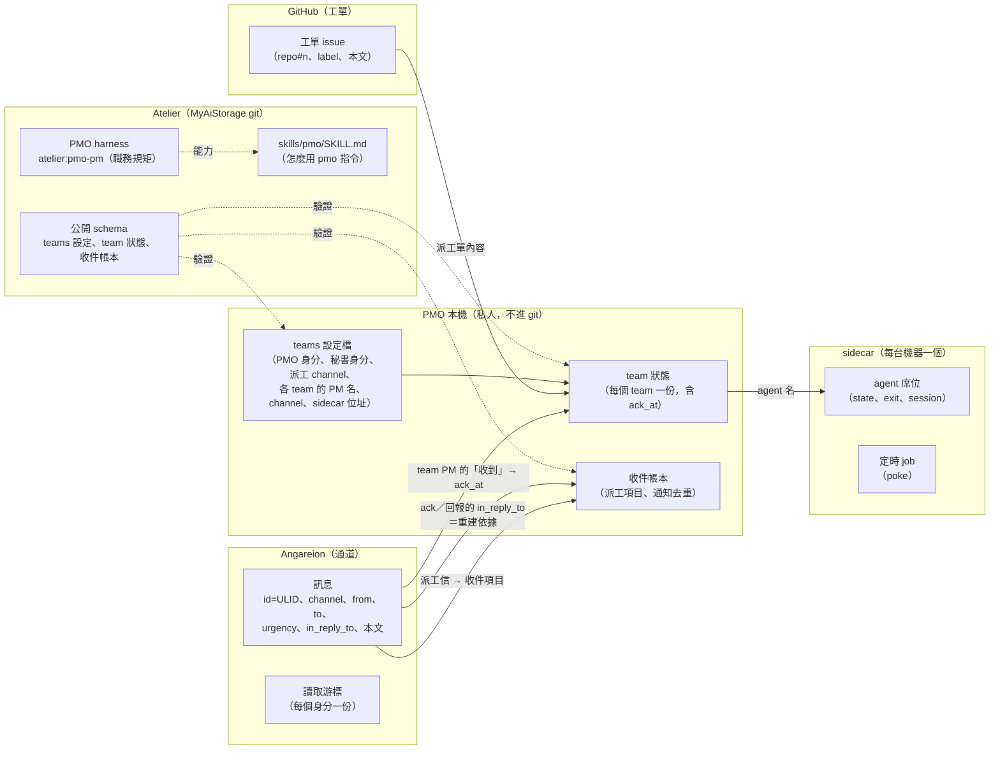
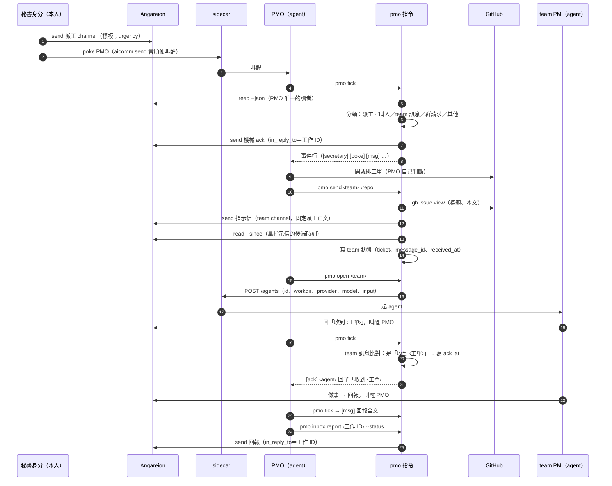
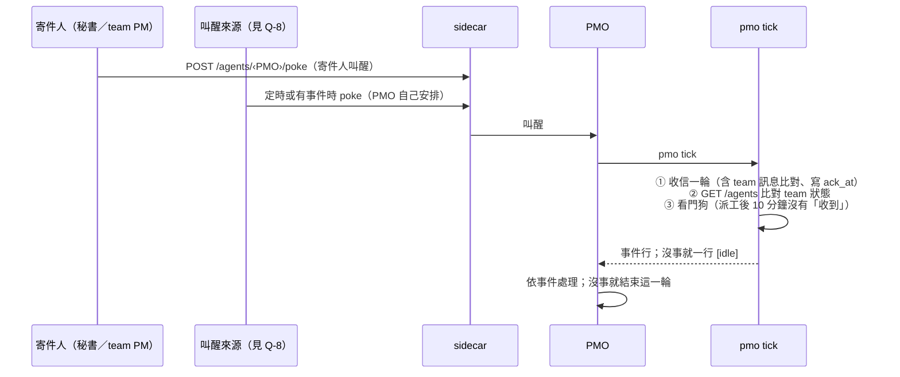
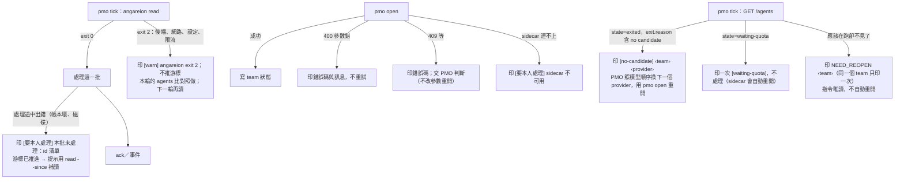
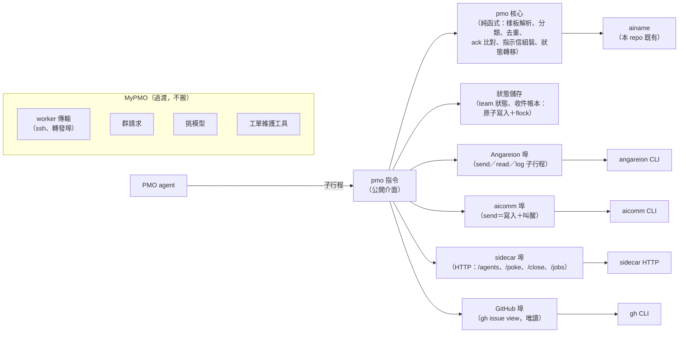

anthropic/claude-opus-5-5

# #110 設計筆記：PMO 的收件與派工搬成 Atelier 的 PMO skill

- 作者：專案架構師 myaistorage-arch-m1-1。作者模式：由非作者（Sonnet）審過，再交 PMO 帶去給本人看。**只設計、以介面為主，不實作。**
- 來由：本人 10-19 的方向（#110 工單）；本人同意先出設計（見 MyPMO#264）。
- 基準：本 repo main f4afe89；MyPMO 的 `pmo/` 只讀，下文只描述它的**介面形狀**，不貼程式，也不寫它的設定內容。
- 用詞：
  - 「PMO 工具」：現在 MyPMO 的 `pmo/dispatch.py`＋`pmo/inbox.py`（以及它們 import 的 `groups.py`、`ainame.py`）。
  - 「PMO skill」：本設計要做的東西。
  - 「秘書側」：本人透過秘書身分寄信、收回報的那一端（派工信、決定題、群請求的對方）。
- **§4 的 D- 都是提議**，要等 §6 的 Q- 由本人定案後才成立。

## 0. 先講結論（提議）

1. **PMO skill ＝一個指令（暫名 `pmo`，和 agora／angareion／atelier／aicomm 同一個 distribution）＋一份說明檔（`skills/pmo/SKILL.md`）**。Atelier 的 PMO harness（`atelier:pmo-pm`）只寫「需要收件、派工、團隊、監看這些能力」，由環境說明把能力對應到這個指令（D-1／Q-1）。
2. **設定和狀態的「資料」留在本機，「格式」公開在這裡**：teams 設定、team 狀態、收件帳本的 schema 由本 repo 定義和驗證；檔案由環境變數指到本機（D-4）。
3. **收件帳本大部分可以從 Angareion 重建**：PMO 的機械 ack、叫人 ack、回報都帶 `in_reply_to`，所以收件項目的主要欄位能重建；`team`、急件叫醒紀錄、決定題重建不出來（§1.2；D-5／Q-2）。
4. **「讀信」只有一個讀者：`pmo tick`**。它把讀到的每一則都交代清楚：自己處理的（秘書派工、team PM 的「收到」）、交給 PMO 看的（`[msg]` 全文）、交給過渡工具的（群請求、worker team 的動作）（D-6、D-13／Q-9）。
5. **第一階段只搬本機 sidecar 的派工**。worker 的傳輸、群請求、挑模型、MyPMO 的工單維護工具先留在 MyPMO。和 MyPMO 的交接方式列為 Q-9（D-8～D-11）。

## 1. 實體圖

### 1.1 實體與資料歸屬

| 實體 | 是什麼 | 存在哪裡、誰是權威 | 現在 PMO 工具裡的對應 |
|---|---|---|---|
| 派工信 | 秘書身分在派工 channel 用固定樣板寄給 PMO 的工作（`# 工作：…`、`- 工作 ID：<ULID>`、建議層級、規格、備註） | **Angareion** | inbox 的樣板解析 |
| 叫人信 | 寄給或提及 PMO、但不是派工的訊息 | Angareion | inbox 的叫人判斷 |
| team 訊息 | team PM 寄給 PMO 的信（「收到 ‹工單›」、回報、提問） | Angareion | dispatch 的 team 訊息比對 |
| 收件項目 | 一張派工信在 PMO 這邊的狀態 | **本機帳本**；主要欄位可以從 Angareion 重建（§1.2） | 收件帳本的 `items` |
| 叫人 ack 去重 | 同一則叫人信不重複回機械 ack | 本機帳本；**可以重建**（叫人 ack 帶 `in_reply_to`） | `notified.call` |
| 急件叫醒去重 | 同一則急件不重複標「叫醒」 | 本機帳本；**不能重建**（只印事件，不寄信） | `notified.poke` |
| 決定題 | PMO 問本人的選擇題（urgency 8，不帶 `in_reply_to`）和本人的作答 | Angareion；**不在帳本裡** | inbox 的決定題 |
| 工單 | 要做的事（repo#n） | **GitHub** | `send` 前讀工單 |
| team | 一個專案的一隊：PM 的 AI 名、channel、sidecar 位址、模式（互動版／生活模式） | **本機 teams 設定**（私人）；格式由本 repo 的 schema 定 | teams 設定檔 |
| 派工單 | 一次派工：工單、指示信 id、後端時刻、`--since`、team PM 回「收到」的時刻（`ack_at`）、看門狗的時刻 | **本機 team 狀態** | team 狀態檔 |
| agent 席位 | sidecar 上的一個 agent | **sidecar**（`GET /agents`） | team 狀態的 `state`／`exit` |
| 定時叫醒 | sidecar 的 poke job | **sidecar**（`/jobs`） | 現在由 watch 常駐迴圈代替 |
| 職務規矩 | PMO 的 harness | **Atelier** | （不變） |
| 模型挑選 | 依角色、作者、額度挑 `(provider, model)` | 第一階段留在 MyPMO（D-10） | pick_model |
| 群請求 | 秘書側寄來的建群／封存請求的帳本與步驟機 | 第一階段留在 MyPMO（D-9／Q-9） | groups |

### 1.2 帳本重建：哪些能、哪些不能（D-5 的依據與限制）

現在的 PMO 工具：機械 ack 和叫人 ack 都把 `in_reply_to` 設成來信 id；回報的 `in_reply_to` 是工作 ID；決定題**不帶** `in_reply_to`。急件叫醒只印一行事件，不寄信。

| 帳本欄位 | 從哪裡重建 | 能否重建 |
|---|---|---|
| `id`、`title`、`level`、`sender`、`received_at` | 派工信本身（先用 `angareion log --channel <派工 channel> --to <PMO>` 列舉） | 能 |
| `ack_at`、`schedule`、`issue` | PMO 的機械 ack（`log --from <PMO> --thread <工作 ID>`） | 能 |
| `status`、`reported_at`、相關 PR | PMO 的回報（同上） | 能（回報樣板有狀態、相關工單、相關 PR） |
| `team` | 回報樣板沒有這一欄 | **不能**，重建後留空並列出 |
| `notified.call` | 叫人 ack 的 `in_reply_to` | 能 |
| `notified.poke` | 沒有寄信 | **不能**；後果是重建後同一則急件可能再標一次 `[poke]`（只多叫醒一次，無副作用） |
| 決定題 | 不在帳本 | 不適用；需要時用 `log --from <PMO> --grep` 另查 |

**同一張派工再出現時補發 ack 是現行語意**：同一個工作 ID 再次讀到時，現行工具會「補發 ack、沿用既有的工單和排程、不重開工單」。這是給秘書側重送用的，不是 bug。重建的測試要驗的是「重建後不會**重開工單**、補發的 ack 沿用重建出來的 `issue`／`schedule`」，不是「不會再 ack」。

## 2. 控制時序

### 2.1 收件 → 去重 → ack → 派工 → 收到 → 回報

### 2.2 被叫醒的路

- `pmo tick` 是**一輪**：重複叫醒只會多跑一輪。同一批信不會讀兩次（`read` 推游標）；看門狗的 poke 只做一次（team 狀態記了時刻）。
- 只有用 `--since` 補讀時同一則信會再出現；這時派工信照現行語意補發 ack（§1.2），叫人信和急件靠帳本去重。
- 「定時」怎麼來，以及它的成本，見 Q-8。

### 2.3 失敗的分支

- **限流**：Angareion 的後端被限流時回 exit 2；tick 不重試、不推游標，等下一次叫醒。
- **no candidate**：判斷以 `GET /agents/<id>` 的 `state` 和 `exit.reason` 為準；換 provider 是 PMO 的判斷，指令只把事實印出來（D-7）。
- **database is locked**（共用的 opencode 服務）：看到這類錯誤時印原文，**不重試、不重開**，交本人。

## 3. 介面圖

### 3.1 元件與依賴

**埠**：指令只透過四個埠碰外部（Angareion、aicomm、sidecar、GitHub）。每個埠是一個小介面，測試用同名方法的假物件取代（沿用 PMO 工具現在 `Deps` 的接縫作法）。核心不碰外部。

### 3.2 `pmo` 指令（skill 的公開介面）

所有內文一律走 stdin（`--body -`）；stdout 是給 PMO 讀的事件行，第一個 token 是方括號標籤；stderr 是診斷。

| 指令 | 輸入 | 輸出（stdout） | 結束碼 |
|---|---|---|---|
| `pmo tick` | （無） | 見 §3.2.1 的事件表；全部沒事時一行 `[idle]` | 0 這一輪跑完（包含「部分失敗、已印 [warn]」）；1 用法錯；2 設定或狀態檔壞（這一輪什麼都沒做，不推游標） |
| `pmo inbox read` | （無） | 只做 tick 的「收信一輪」（不比對 agents、不跑看門狗） | 同 tick；給 T-2 階段與救援用 |
| `pmo inbox list [--json]` | | 收件項目一覽（唯讀） | 0／2 |
| `pmo inbox ack ‹工作 ID› [--issue ‹repo#n›] [--schedule 立即開工\|排入待開工佇列]` | | 送出的訊息 id | 0／1（查無工作 ID）／2（送不出去） |
| `pmo inbox report ‹工作 ID› --status ‹狀態› [--issue …] [--pr …] --body -` | 摘要與後續 | 訊息 id | 0／1／2 |
| `pmo inbox decision-send --body -` | 決定題的 JSON（題目、選項，最多 4 題） | `[decision] 已送出決定題 id=…` | 0；1 JSON 不合格式；2 送不出去 |
| `pmo inbox rebuild [--since ‹時刻›] [--dry-run]` | | 重建的項目數、差異、重建不出來的欄位清單 | 0／2 |
| `pmo check ‹team›` | | 逐項 OK／FAIL | 0 全過；1 有 FAIL |
| `pmo send ‹team› ‹repo#n› --body -` | 正文 | 指示信 id、後端時刻 | 0；1 用法、team 不存在、工單讀不到；2 外部失敗 |
| `pmo open ‹team› [--session ‹agora:…›] [--fresh] [--provider P --model M]` | | agent 的 state 與 attach 指令 | 0；1 用法或狀態不足（沒先 send）；2 sidecar 拒絕或連不上（印錯誤碼） |
| `pmo reply ‹team› [--urgency N] --body -` | 正文 | 訊息 id（經 aicomm：寫入＋叫醒） | 0；2 沒寫進去；aicomm 逾時時印「送出結果不明，不要直接重送」並回 2 |
| `pmo poke ‹team› [--interrupt] --body -` | 一句話 | sidecar 的回應碼 | 0／2 |
| `pmo status [‹team›] [--json]` | | 每個 team PM 的 state／exit／session，以及 PMO 自己排的 job | 0／2 |
| `pmo close ‹team› [--timeout 秒]` | | 是否已關、刪了哪些 job | 0／2 |
| `pmo inbox handoff-close ‹id›` | | 把一筆交接出去的群請求標成已結案，之後不再印 `[group-sweep-due]` | 0；1 查無 id |
| `pmo watch --poke-only`（**只在 Q-8 選 (b) 時才有**） | （常駐；不讀信） | stderr 診斷；stdout 不印 | 由啟動方管理的常駐行程；收到 SIGTERM 結束為 0 |

**送信前的身分守門**：所有會寄信的指令（ack、report、decision-send、send、reply），送之前檢查目前的身分（`ANGAREION_IDENTITY`）等於設定裡的 PMO 身分，不符就拒送（exit 2）。現行工具也有這道守門；公開版把身分改由設定給，守門照樣保留（C-3）。

**錯誤訊息**：一律不含 token、key、訊息內文；sidecar 的回應只挑已知欄位印（D-12）。

**刻意不提供**：自動建工單、自動派工、自動重開、自動換 provider（D-7）。

#### 3.2.1 tick 的事件表（沿用現行標籤）

原則：**現行工具已經有的標籤一字不改**（PMO 的 harness、環境說明、監看都靠標籤分辨）；只有新增的情況才用新標籤。T-5 的契約測試要逐一列舉。

| 標籤 | 情況 | 現行有無 |
|---|---|---|
| `[secretary]` | 新工作、重複工作補發 ack、叫人、不合規的秘書訊息 | 有，沿用 |
| `[poke]` | 秘書急件（秘書身分、派工 channel、urgency ≥ 8）：要立刻看 | 有，沿用 |
| `[dedupe]` | 急件已叫過 | 有，沿用 |
| `[decision]` | 收到決定題的作答（只印，不當授權） | 有，沿用 |
| `[msg]` | 寄給 PMO 的其他每一則信：第一行是欄位，後面接**全文** | 有，沿用（PMO 靠它看信，不必另外補讀） |
| `[ack]` | team PM 回「收到 ‹工單›」，已寫 `ack_at` | 有，沿用 |
| `[group-handoff] ‹id›` | 群請求：tick 不處理，交給過渡工具（Q-9） | **新增**。`[group-pending]`／`[group]` 留給 MyPMO 群請求帳本的原意（等 PMO 審、逾時），tick 不印 |
| `[group-sweep-due] ‹id…›` | 交接出去、還沒結案的群請求：提醒 PMO 跑過渡工具的 sweep（Q-9 (a)） | **新增** |
| `[state]` | team PM 的 sidecar 狀態變化 | 有，沿用 |
| `NEED_REOPEN ‹team› session=‹sid\|none›` | 應該在跑卻不見了 | 有，沿用 |
| `[watchdog]` | 派工後 10 分鐘沒有「收到」：已 poke 一次；再 10 分鐘升級成 `[要本人處理]` | 有，沿用 |
| `[要本人處理]` | 需要本人的狀況（狀態檔壞、sidecar 不可用、看門狗升級、本批未處理） | 有，沿用 |
| `[warn]` | 部分失敗 | 有，沿用 |
| `[no-candidate]` | team PM 因 no candidate 結束 | **新增** |
| `[waiting-quota]` | team PM 在等額度（只印一次） | **新增** |
| `[worker-action] ‹team› ‹動作›` | worker team 需要由過渡工具做的動作（看門狗要 poke、要比對 sidecar 狀態） | **新增**（Q-9） |
| `[idle]` | 這一輪什麼都沒有 | **新增** |

**tick 對 worker team 的邊界**（第一階段，D-8）：
- **做**：team 訊息比對。worker team 的 PM 回「收到 ‹工單›」照樣寫 `ack_at`、印 `[ack]`（只動 team 狀態，不需要傳輸）；看門狗的到期判斷也照算。
- **不做**：任何要碰 worker 上 sidecar 的事（`GET /agents`、poke、open、close）。到期或需要比對狀態時印 `[worker-action] ‹team› watchdog-poke`／`[worker-action] ‹team› poll`，由 PMO 用過渡工具做。

### 3.3 skill 依賴的介面（契約以各自的文件為準）

| 依賴 | 用到的形狀 | 文件 |
|---|---|---|
| Angareion | `send --channel --to --in-reply-to --urgency --ref --body -`（stdout＝訊息 id）；`read --json [--since]`（含 `received_at`）；`log --channel --from --to --thread --grep --since --json`（重建用）；結束碼 0／2／3 | `docs/angareion.md` |
| aicomm | `send --channel --to [--ticket] [--urgency] --body -`（寫入＋叫醒）；結束碼與逾時的語意照文件 | `docs/aicomm.md` |
| sidecar HTTP | `GET /agents`、`GET /agents/<id>`、`POST /agents`、`POST /agents/<id>/poke`、`POST /agents/<id>/close`、`GET /jobs`、`POST /jobs`、`DELETE /jobs/<id>` | sidecar 的文件（MyLinuxPool） |
| GitHub | `gh issue view <n> --repo <owner/repo> --json title,body`（唯讀） | gh |
| ainame | `parse`／`is_valid`，加上 T-1 要補的「缺 team 段的提示」（見 §5.1） | `src/ainame/__init__.py` |

`pmo reply` 經 aicomm，沿用和其他 AI 同一份叫醒規則（MyPMO#183 的決定）。aicomm 的 `send` 只寫入加叫醒，不讀信，不會成為第二個讀者。

### 3.4 公開的 schema（本 repo 定義，資料留在本機）

- **teams 設定**：
  - 全域：PMO 身分、秘書身分、派工 channel（現行工具裡寫死的三個常數，改由設定給）；
  - 每個 team：key（`<專案>-<team 代號>`）、PM 的 AI 名、channel（`team-<專案>-<team 代號>`）、sidecar 位址或「worker」標記、`tui`／`life`／`retired` 三個布林、預設的 provider／model（選填）。

  驗證規則照現行工具（AI 名用 ainame 驗、key、名字、channel 一致、不重複）。
- **team 狀態**：照 MyPMO 現在 `pmo/state/README.md` 的欄位。**不認得的欄位原樣保留**（過渡期 worker team 的欄位由 MyPMO 寫，見 Q-9）。
- **收件帳本**：`version`、`items`（以工作 ID 為 key）、`notified`；新增 `rebuilt_at`。
- 位置：`PMO_SKILL_CONFIG`、`PMO_SKILL_STATE_DIR` 兩個環境變數（由環境說明提供）；沒設就拒絕執行（exit 2），**不猜預設路徑**。

### 3.5 `pmo watch --poke-only` 的規則（只在 Q-8 選 (b) 時才有）

- **不讀信**：只跑 `angareion wait`（目標是「寄給我的」，和 tick 的 `read` 同一個游標；`wait` 不動游標）。不用 `--mentioned`：tick 不推那個游標，`wait --mentioned` 會一直報有新信。
- **去重**：`wait` 回 0 之後，只要 tick 還沒把游標往前推，下一次 `wait` 還會立刻回 0。所以監看程式記下「最後一次 poke 的時刻」，tick 每輪結束時在狀態目錄寫「最後一次 tick 的時刻」。**只有在上次 poke 之後 tick 已經跑過**，才因為 `wait` 回 0 再 poke；否則不 poke，改成等待（每 60 秒看一次 tick 有沒有跑）。
- **補 poke 的上限**：如果 poke 之後 15 分鐘 tick 都沒跑（PMO 在忙、或 poke 掉了），再 poke 一次；之後每 15 分鐘最多一次。不用 `interrupt`。
- **廣播**：「寄給我的」包含廣播。廣播本來就是 PMO 要看的信（tick 會印 `[msg]`），所以因廣播叫醒不算誤叫醒。唯一的例外是新身分第一次 `wait`：依 `docs/angareion.md`，第一次讀不會讀到「現在」之前的舊廣播，但第一次 `wait` 可能因此回 0。監看程式第一次啟動時先等 tick 跑過一次，再開始用 `wait` 的結果。
- **agents 和看門狗**：每 60 秒 `GET /agents`。只有在「和上次 poke 時看到的狀態不同」或「看門狗到期」時才 poke；同一個變化只 poke 一次。
- **失敗**：`wait` 回 2 時退避（30 秒起、上限 10 分鐘），不 poke；sidecar 連不上時不 poke（tick 自己會報）。

## 4. 提議（待 Q 定案）

| # | 提議 | 理由 | 對應的 Q |
|---|---|---|---|
| D-1 | skill ＝ `pmo` 指令（本 distribution）＋`skills/pmo/SKILL.md`；harness 只寫能力，環境說明對應到指令 | 沿用 angareion／aicomm 的「指令＋SKILL.md」先例，以及 harness v1 起「只寫能力」的規則 | Q-1、Q-5 |
| D-2 | 核心（純函式）和外部的埠分開；測試用同名方法的假物件 | 現行工具已經這樣做，測試能原樣搬 | — |
| D-3 | AI 名文法只用本 repo 的 `src/ainame` | 少一份副本；兩版的差異在 T-1 補齊（§5.1） | — |
| D-4 | 設定和狀態的格式公開在本 repo，資料由環境變數指到本機；沒設就拒絕 | public repo 不放私人資料；不猜路徑 | — |
| D-5 | 收件帳本以 Angareion 為準，本機是快取，可以 `rebuild`；`team` 和急件叫醒紀錄不可重建（§1.2） | 現在帳本是去重的單點 | Q-2 |
| D-6 | 常駐的 watch 改成一輪的 `pmo tick`；`pmo tick` 是 PMO 身分唯一的讀信者 | sidecar 裡的 agent 不跑背景讀信迴圈；同一個身分只留一個讀者 | Q-8 |
| D-7 | 指令只做機械步驟；建工單、派工、重開、換 provider 都由 PMO 判斷 | PMO harness 的職務分界 | — |
| D-8 | 第一階段只支援本機 sidecar 的 team 的「動作」；worker team 的動作留在 MyPMO | worker 的傳輸和 MyLinuxPool 綁在一起 | Q-3 |
| D-9 | 群請求第一階段留在 MyPMO；tick 把它分流出來交接 | 它和秘書側的介面逐字對齊、規模大，搬移風險高 | Q-4、Q-9 |
| D-10 | 挑模型留在 MyPMO；`pmo open` 只收明寫的 provider／model 或 teams 設定的預設值 | 模型政策和外部挑選服務屬於私人設定 | — |
| D-11 | MyPMO 的工單維護工具不搬 | 它們維護 MyPMO 自己的工單樹 | — |
| D-12 | 印出去的字串一律過 `sanitize`；sidecar 回應只印已知欄位 | 沿用現行規則 | — |
| D-13 | tick 讀到的每一則都要有去處：自己處理、`[msg]` 交給 PMO、或交給過渡工具；不得靜默丟掉 | 一個讀者推了游標，別人就看不到；交接必須明寫 | Q-9 |

## 5. 搬移切分

### 5.1 對照

| 現在（MyPMO） | 搬法 | 說明 |
|---|---|---|
| 收件：樣板解析、叫人判斷、急件判斷、ack／回報的本文組裝、去重、重複工作補發 ack | **原樣搬**（邏輯）＋測試 | 三個寫死的身分與 channel 常數改由設定給；身分守門保留 |
| 決定題：題目驗證、本文組裝、送出、作答解析 | **原樣搬**＋測試 | 介面是 `pmo inbox decision-send`；作答在 tick 印 `[decision]` |
| team 訊息比對（「收到 ‹工單›」→ `ack_at`、`[msg]` 全文） | **原樣搬**＋測試 | 看門狗依賴它；漏了會對每個 team 誤報 |
| 收件帳本的讀寫（原子寫入＋flock） | **原樣搬** | 加上 `rebuild`（新寫） |
| 派工：`check`／`send`／`open`／`reply`／`poke`／`status`／`close` | **本機 sidecar 的路徑實質上是重寫**（現行工具裡 worker 和本機的分支交錯，抽出來等於重寫），測試照搬並改寫 | `reply` 經 aicomm（沿用 MyPMO#183） |
| `watch` 常駐迴圈 | **重寫**成 `pmo tick` | 比對、看門狗的邏輯沿用；迴圈和退避拿掉 |
| worker 傳輸（ssh、轉發埠、遠端標記） | **不搬**（第一階段） | 見 Q-3、Q-9 |
| 群請求（含每輪的重試 sweep） | **不搬**（第一階段） | 誰驅動 sweep 見 Q-9 |
| 挑模型 | **不搬** | D-10 |
| AI 名文法 | 改用本 repo 的 `src/ainame` | 現行工具用到一個本 repo 沒有的「缺 team 段的提示」函式；T-1 要在 `src/ainame` 補上（附測試向量）或在 pmo 內實作，並列出兩版其他差異 |
| boot-pmo（開 PMO 的啟動程式） | **不搬** | 屬於 Mac 環境的啟動方 |
| 工單維護工具 | **不搬** | D-11 |

### 5.2 建議的 PR 切分（tasks）

每個 PR 都要經架構師結構審。

1. **T-1 骨架與 schema**：`src/pmo/`（套件名在 Q-5 定）、設定和狀態的 schema 與驗證（含 PMO 身分、秘書身分、派工 channel）、四個埠的介面和假物件、`sanitize`、ainame 的差異補齊。不含指令行為。
2. **T-2 收件核心**：樣板解析、分類、去重、補發 ack、急件、叫人、決定題、team 訊息比對、帳本讀寫；`pmo inbox read|list|ack|report|decision-send`。搬測試。**合併後可以用 `pmo inbox read` 驗**（不必等 tick）。
3. **T-3 帳本重建**：`pmo inbox rebuild`（新寫）。先驗 `angareion log` 能涵蓋列舉和 `--thread`；測試「刪掉帳本 → 重建 → 補發的 ack 沿用重建出來的 issue／schedule、不重開工單」。
4. **T-4a 派工（一）**：`check`、`send`。
5. **T-4b 派工（二）**：`open`。
6. **T-4c 派工（三）**：`reply`、`poke`、`status`、`close`。
7. **T-5 tick**：`pmo tick`（收信一輪、agents 比對、看門狗、no-candidate、waiting-quota、交接事件）；事件表的契約測試；「收到 → 看門狗不發」的測試。
8. **T-6 說明**：`skills/pmo/SKILL.md`、環境說明範本（**只是範本，不改任何人正在用的環境說明**）；更新 overview／decisions。**PMO harness 的新版本不在這裡發**。
9. **T-8 小監看程式**（**只在 Q-8 選 (b) 時才有**；在 T-7 之前）：`pmo watch --poke-only`，照 §3.5 的規則；測試要含「tick 沒跑就不重複 poke」「15 分鐘補 poke」「`wait` exit 2 退避」。
10. **T-7 切換**（PMO 自己的單；MyPMO 一側和本 repo 一側同步）：PMO harness 的新版本（能力段指向 `pmo`）、環境說明改用 `pmo`、停舊的 watch、開始用 `pmo tick`、MyPMO 依 Q-9 改成交接模式。三件事在同一個切換窗口做，避免「harness 叫 PMO 用 `pmo`，但設定還沒好」或「兩個讀者」。

## 6. 待本人決定的點

| # | 問題 | 選項 | 建議 |
|---|---|---|---|
| Q-1 | 「Atelier 的 skill」落在哪裡 | (a) 指令＋`skills/pmo/SKILL.md`，harness 只寫能力；(b) Atelier 新增一種「skill」檔（`atelier/skills/<名>/v<N>.md`，版本不可變），由 `atelier show` 讀；(c) 寫進 PMO harness 本文 | **(a)**：已有先例、不用擴充 Atelier；(b) 等第二個 skill 出現時再評估 |
| Q-2 | 收件帳本以哪邊為準 | (a) Angareion 為準、本機是快取、可重建（`team` 與急件叫醒紀錄除外）；(b) 照現在，本機帳本永久保留、不可刪 | **(a)**，接受「重建後 `team` 留空、急件可能多叫醒一次」 |
| Q-3 | worker team 的動作什麼時候搬 | (a) 第一階段不搬，交給過渡工具（Q-9）；(b) 一起搬，把 ssh／轉發埠做成第五個埠；(c) 等 MyLinuxPool 提供自己的 sidecar 存取方式再搬 | **(a)，之後走 (c)** |
| Q-4 | 群請求什麼時候搬 | (a) 第一階段不搬（交接方式見 Q-9）；(b) 一起搬 | **(a)** |
| Q-5 | 指令名和套件名 | (a) `pmo`（套件 `src/pmo`）；(b) `atelier pmo …`；(c) 其他名字 | **(a)**：atelier 指令目前只讀 harness，混進派工會變成兩種職責 |
| Q-6 | #110 的層級 | 現在標 c；新增指令和套件屬於「功能組新增」，依工單規則可能是 b | 請本人定；若改 b，T-1～T-6 掛成子單 |
| Q-7 | 舊工具的去留 | (a) 切換後 MyPMO 的 dispatch.py 只留 worker 動作和群請求；(b) 改成轉呼叫 `pmo` 的薄殼；(c) 整支退役 | **(a)**，等 Q-3／Q-4 都搬完再退役 |
| Q-8 | tick 由誰在什麼時候叫起來（PMO 現在已經由 sidecar 開，見 MyPMO 的 boot-pmo 說明；問題是「沒人寄信時」的定時工作怎麼觸發） | (a) sidecar 定時 poke job，每 N 分鐘一輪：N ≤ 10 分鐘（看門狗是 10 分鐘），一天至少 144 輪模型推理，大多是 `[idle]`；(b) 一個**不是 agent** 的小監看程式（`pmo watch --poke-only`，規則見 §3.5）：只用 `angareion wait`（不動游標，不算讀者）和 `GET /agents`，算好看門狗的到期時刻，**只在有事時** poke PMO，不叫醒時不花模型額度，由啟動方（Mac 環境）負責起停；(c) 照現在，PMO 自己在背景跑常駐監看（和「被 sidecar 管的不跑背景迴圈」的規則衝突） | **(b)**：只有有事才花額度，也維持「讀信只有 tick」；代價是多一個常駐行程，要由環境負責起停 |
| Q-9 | tick 和過渡工具（MyPMO 的群請求、worker team 動作）怎麼交接 | (a) **id 交接**：tick 不處理、印 `[group-handoff] ‹id›`／`[worker-action] ‹team› ‹動作›`；MyPMO 的工具改成「給 id，用 `angareion log --around ‹id›` 取原信」（唯讀、不動游標）。**重試的觸發**：tick 在自己的狀態裡記下交接出去的 id（不讀 MyPMO 的帳本），每隔固定時間（預設 10 分鐘，最多每輪一次）印 `[group-sweep-due] ‹id…›`，PMO 看到就跑 MyPMO 的 sweep；MyPMO 報結案後，PMO 用 `pmo inbox handoff-close ‹id›` 停止提醒。（另一個做法是過渡工具自己排定時 job；我不建議，因為 job 的起停又多一套要管的東西。）team 狀態兩邊共用同一個目錄與 schema（不認得的欄位保留）。(b) tick 直接 import MyPMO 的群請求程式（違反「不依賴 MyPMO」）。(c) 先不切換：Q-3、Q-4 都搬完才做 T-7 | **(a)**：讀者仍然只有一個，MyPMO 只改入口；若本人不想在過渡期多一套交接，就選 (c)，代價是切換延後 |

## 7. 風險

- **兩個讀者**：切換期間，舊的 watch 和 `pmo tick` 若同時以 PMO 身分讀信，會互相吃掉訊息。T-7 必須先停舊的再開新的；SKILL.md 和 harness 要明寫「PMO 身分的讀信只走 `pmo tick`」。Q-8 (b) 的小監看程式只 `wait`，不讀。
- **交接漏件**（Q-9 (a)）：MyPMO 若沒有在 T-7 改成「用 id 取原信」，群請求會停在 `[group-handoff]`，沒人去取。T-7 的驗收要包含兩筆群請求：一筆一次走完；一筆在推進途中失敗，靠 `[group-sweep-due]` 提醒、PMO 再跑 sweep 之後續完。
- **帳本重建的邊界**：§1.2 列的不可重建欄位；過去沒帶 `in_reply_to` 的舊 ack 也重建不出來。T-3 要先從現在的帳本匯入一次。
- **定時 job 失效**：sidecar 的 `close` 不會刪 job；`pmo status` 一併列出 PMO 自己的 job。
- **公開與私人的界線**：schema、事件格式、測試假資料都在 public repo，假資料不得帶私人資訊（帳號、位址、額度）。

## 8. 沒驗到的

- 沒有跑 MyPMO 的測試；對它的描述來自讀程式和文件（只讀）。
- sidecar 的 `/jobs` 介面形狀以環境說明為準，沒有實際打過。
- `angareion log` 能不能涵蓋重建所需的列舉與 `--thread`，沒有實測（T-3 要先驗）。
- `angareion wait` 在 Q-8 (b) 的用法（不動游標、與 tick 的 `read` 並存）依 `docs/angareion.md` 的說明推論，沒有實測。
- Mermaid 沒有用渲染器驗證；方括號、角括號已避開（改用 ‹ ›）。

## 9. 審查清單（給非作者審查者；作者模式）

請逐條回「符合／不符合（附理由）」：

1. **實體**：§1.1 的每個實體，「權威在哪」是否只有一個？
2. **帳本可重建**（§1.2）：能重建與不能重建的欄位是否正確？請讀 MyPMO `pmo/inbox.py` 的寄信函式和回報樣板確認（只讀，不要貼到審查報告）。
3. **時序**：§2.1～2.3 是否涵蓋收件、去重、補發 ack、派工、team PM 的「收到」、回報、被叫醒、exit 2、限流、no candidate、waiting-quota、NEED_REOPEN？有沒有一條路會讓同一個身分出現兩個讀者？
4. **介面**：§3.2 每個指令的輸入、輸出、結束碼是否完整、一致？§3.2.1 的事件表是否涵蓋現行工具的所有標籤？有沒有指令越過 D-7？
5. **依賴方向**：skill 只透過四個埠碰外部，核心不碰外部？有沒有依賴 MyPMO 的程式？
6. **搬移切分**：§5.1 的「原樣搬／重寫／不搬」是否和 MyPMO 的實際模組對得上？T-1～T-7 是否各自可以單獨 merge，而且 merge 後不會留下壞掉的中間狀態？
7. **待本人決定的點**：Q-1～Q-9 的選項是否互斥、完整？建議是否有理由？
8. **public repo 的界線**：note 裡有沒有私人資訊，或不必要地指名其他專案的內部細節？

## 10. 修訂紀錄

### 第 2 輪（審查：REPORT-110-design-rev，Sonnet，針對 ea67e277：要修，3 高、5 中、4 低）

| 發現 | 處理 |
|---|---|
| H-1 tick 漏了 team PM「收到」的處理 | 核實為真。§1.1 加「team 訊息」實體；§2.1 加「收到 → ack_at」；§2.2 tick 的第 ① 步寫明；§3.2.1 加 `[ack]`；§5.1 加一列「原樣搬」；T-5 加「收到 → 看門狗不發」的測試 |
| H-2 一個讀者和「群請求、worker 留在 MyPMO」衝突 | 核實為真。新增 D-13（每一則都要有去處）和 Q-9（交接的三個做法，建議 id 交接）；§3.2.1 加 `[worker-action]`；§7 加交接漏件的風險 |
| H-3 漏了決定題的送出 | 核實為真。§3.2 加 `pmo inbox decision-send`；§1.1 加「決定題」實體；§1.2 寫明它不帶 `in_reply_to`、不在重建範圍 |
| M-1 重建依據高估 | 核實為真。§1.2 改成逐欄位的「能／不能」表（`team`、`notified.poke` 不能）；寫明重複工作補發 ack 是現行語意；T-3 的測試改寫；Q-2 的建議附上限制 |
| M-2 `reply` 不經 aicomm 的理由不成立 | 同意。改回經 aicomm（第四個埠），刪掉「避免第二個讀者」的理由，沿用逾時「結果不明，不要直接重送」 |
| M-3 poke 驅動的成本、PMO 是否進 sidecar | 成本部分同意；「PMO 是否進 sidecar」的前提**不同意**：MyPMO 的 boot-pmo 說明寫明它是「用 sidecar 開 PMO 的 bootloader」，PMO 已經在 sidecar 裡。真正的問題是定時工作怎麼觸發，列為 Q-8（三個選項，建議零額度的小監看程式） |
| M-4 T-2、T-6、T-7 的中間狀態 | 同意。T-2 加 `pmo inbox read`，合併後就能驗；T-6 只發 SKILL.md 和範本，harness 新版本移到 T-7，和切換同一個窗口 |
| M-5 事件標籤改名、漏項 | 同意。§3.2.1 新增事件表：現行標籤一字不改（`[secretary]`、`[poke]`、`[msg]`、`[ack]`、`[要本人處理]`…），只有新情況用新標籤；`[group-pending]` 是現行就有的，不是新增 |
| L-1 「原樣搬」低估規模 | 同意。§5.1 改稱本機路徑「實質上是重寫」；T-4 拆成 T-4a／b／c |
| L-2 身分守門沒寫 | 同意。§3.2 加送信前的身分守門；§3.4 的 schema 加 PMO 身分、秘書身分、派工 channel |
| L-3 ainame 兩版不同 | 核實為真：現行派工工具用到一個「缺 team 段的提示」函式，本 repo 沒有。§5.1 和 T-1 寫明要補齊 |
| L-4 未決寫成已決 | 同意。§4 改為「提議（待 Q 定案）」並加「對應的 Q」欄；overview、decisions 的措辭同步改成提議 |
| 其他：圖上 exit 3 的分支、其他專案名 | §2.3 刪掉 exit 3 的分支；審查點名的那個秘書側專案改稱「秘書側」（MyPMO、MyLinuxPool 在本 repo 公開文件已有先例，保留） |

### 第 3 輪（審查第 2 輪：N-1～N-5）

| 發現 | 處理 |
|---|---|
| N-1 群請求的重試 sweep 沒有觸發訊號 | 核實為真：現行每輪讀信前都先跑 sweep。Q-9 (a) 補上觸發：tick 記下交接出去的 id，定時印 `[group-sweep-due]`，PMO 用 `pmo inbox handoff-close` 結案；另一個做法（過渡工具自排 job）寫明不建議的理由；§7 的 T-7 驗收加「途中失敗再續」 |
| N-2 小監看程式重複 poke、廣播、介面缺口 | 同意。新增 §3.5（去重靠「最後一次 tick 的時刻」、15 分鐘補 poke、廣播不算誤叫醒、首次啟動先等一次 tick、不用 `--mentioned` 的理由、失敗退避）；§3.2 加 `pmo watch --poke-only`；§5.2 加 T-8（只在 Q-8 選 (b) 時才有）；overview 介面清單同步 |
| N-3 `[group-pending]` 被改義 | 核實為真。交接改用新標籤 `[group-handoff]`；`[group-pending]`／`[group]` 留給 MyPMO 的帳本，tick 不印 |
| N-4 worker team 在 tick 裡做到哪 | 核實為真：現行對所有 team 比對「收到」，worker 的 agents 比對要靠轉發。§3.2.1 後補「tick 對 worker team 的邊界」：做「收到」比對與看門狗到期判斷，不碰 sidecar，其餘印 `[worker-action]` |
| N-5 修訂紀錄寫法過頭 | 同意。第 2 輪那一列改成精確說法 |

