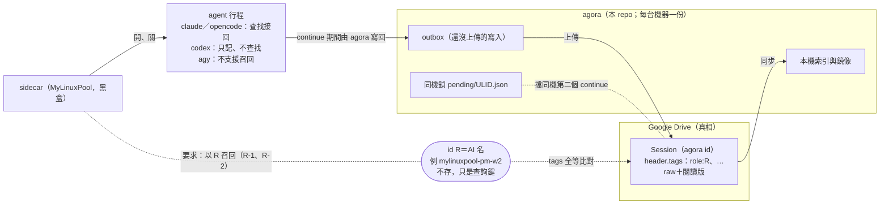
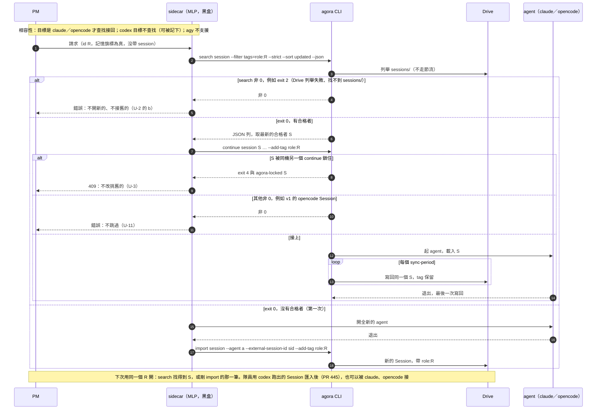
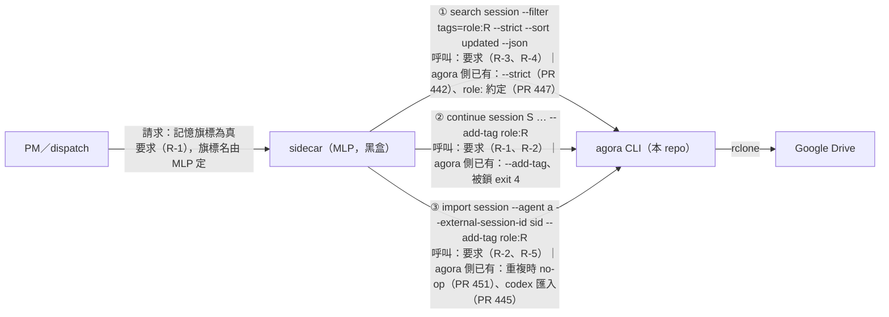

# #439 設計筆記：角色式 session 召回（M6）

- 單：#439（MAS）；承接 #205（c，狀態:構想）。作者：設計作者（隊員，claude-sonnet-5-5）。2026-11-08。架構師第 1、2 次退回（`ARCH-439-review.md`、`review2`），已處理（見 §9、§10）。本人 2026-11-08 已裁定 U-1＝(a)、U-2＝(B)、失敗時走 (b)、U-13 隨 U-2（見 §6）。
- **第二版（2026-11-10）**：本人同意「先開 M6 設計」，期六範圍以 session 為單位組合（#439 留言）。專案架構師（myaistorage-arch-w1-16，claude-opus-5-5）以作者模式增修：§0（結論）、§1（已完成的 PR）、§3／§4（請求名、codex、完成狀態）、§8、§11（四點改寫）、§12（對照成本控制三步與沉澱五問）、§13（三張圖）、§14（未決項／下一步）。已裁定的 U-1／U-2／U-3／U-13 與 #441／#443／#446／#449 已 merge 的契約都不動。**全文行號以 `0516139`（main）為準**；第一版的行號已逐條對到這一版。
- **第三版（2026-11-10，myaistorage-arch-w1-17，claude-opus-5-5）**：照 PMO 裁定處理第二版非作者審查（§10 末）。本稿是 public repo 的文件，**不轉述 MyLinuxPool（私有 repo）的內部設計**：跨 repo 只寫 agora 側事實與「對 MLP 的要求」（§14.2）。改了 header、§0、§1、§3、§4、§6（U-4）、§8、§10、§11、§12、§13、§14、§15；四點、§12 的對照、三張圖、契約 C-1～C-7 保留。
- **第四版（2026-11-10，myaistorage-arch-w1-18，claude-opus-5-5）**：照第三版非作者審查的 P-1～P-7，把跨 repo 的句子都改成「agora 側事實＋對 MLP 的要求」語氣，不再描述 MLP 的現況。改了 §1、§3、§4、§6（U-4）、§7、§9、§11、§13、§14.2。
- **第五版（2026-11-12，措辭對齊）**：照本人 2026-11-10 的決定（召回不分角色、預設記、啟動方每次可明示不記；任何 id 都能依 `role:<id>` 接回），對齊 MAS 側措辭：§0、§2、§3、§4、§6（U-5、U-6）、§7、§11、§12、§13、§14.2、`docs/design.md:102-108` 與 `session-continue` spec 的 Scenario 名。agora 側契約（C-1～C-7）與設計不變，只改措辭與召回範圍的現行規則。
- 範圍：只設計，不寫程式、不改 openspec 的 Requirement（本版只改 spec 的 Scenario 名）。agora 側的實作已由 #441（PR #442）、#446（PR #447）完成；第二版只改本 note。sidecar 在別的 repo（MyLinuxPool），本 note 只寫「對 sidecar 的要求」，不碰它的程式。
- 本人原則：介面簡單、不加多餘機制。

## 0. 結論（給本人，第二版）

- **做法不變**：角色＝`role:<AI 名>` tag，存在 Session 自己的 header；重開時 `search --strict` 找最新的合格者，用既有的 `continue` 接回；第一次沒有就開新的，退出時 `import` 記下。agora 不新增指令或旗標，`--strict` 是唯一新增的旗標，已完成（#441）。
- **agora 側已全部完成**：PR #442（`--strict`）、#447（約定文件＋召回驗收測試）、#445（codex 匯入）、#451（重複匯入不刷新時間）。sidecar 側（MyLinuxPool）的部分只列為對它的要求（R-1～R-7），本稿不描述其現況。
- **期六「以 session 為單位組合」的意思**（我的理解，請確認，§14 Q-1）：記憶的單位是整個 agora Session，不切、不摘要、不編輯。召回接回「最新的那一個」Session；同一個 id 的其他 Session 要不要、怎麼給 agent 參照，屬 sidecar 側，不在本單。
- **對 MLP 的要求**集中在 §14.2（R-1～R-7）：記憶旗標的欄位名、召回只認 `role:R`、只用 §3 一套挑選規則、`agent` 為 null 的列、退出時記下、驗收。sidecar 實作要照這些要求，和 MLP 現況的對照不在本稿，由 PMO 另行向本人說明。
- **成本面**：召回會讓同一個 Session 一直接下去，Session 越長，每個 request 重送的快取 context 越多（本人 11-09 實測平均約 36.8 萬 token）。本單不解決這件事。日後的接上點是：編輯機制產出一個新的 Session，讓它成為 `role:R` 底下最新的合格者，召回就不用改（§12）。

## 1. 現況

**#205 的原話**（`gh issue view 205`）：用 agora header 的自由欄位（tag）做「人↔session」關聯；一個人有很多 session，關聯分「主要擔當」與「旁人（協作）」，同種關聯有時序；agent 啟動時要能參照。相關：MyPMO#3、MyLinuxPool#340（sidecar 同名再開時接回對話的鍵）。

**agora 已經有的零件**（都不用新寫）：

| 零件 | 位置 | 行為 |
|---|---|---|
| 自由 tag | `docs/design.md:48`、`:81`（`tags` 欄位）、`:102-109`（`role:` 約定，#446）、`src/agora/header.py:209`（`LIST_KEYS`） | `tags` 是 header 的清單欄位，使用者可寫 |
| 附加 tag | `src/agora/cli.py:196-231`（`_with_user`、`_add_tags`，附加去重在 227-231）、`cli.py:2854`（`ADD_TAG_ACTIONS = import／continue／edit`） | `--add-tag X` 附加、保留原有、去重；可重複 |
| 依 tag 找 | `header.py:238`（`parse_filters`）、`src/agora/store.py:2857`（`_matches`，清單欄位逐項比對）、`docs/design.md:273` 範例 `--filter tags=ai:claude-work --json` | `--filter tags=<全等>` 對 tags 逐項比；多個 `--filter` 是 AND |
| 排序、筆數 | `cli.py:433-488`（`cmd_search`）、`store.py:2803`（`Index.search(sort=…)`）、`docs/design.md:250-255` | `--sort updated`＝依 `agora.updated_at` 新到舊，同值 ULID 新到舊；`--limit N`；`--json` |
| 機器可讀列 | `cli.py:506-529`（`_search_json_row`）、`docs/design.md:260-272` | 有 `id`、`agent`、`tags`、`updated_at`、`locked`、`locked_by`、`missing_in_cloud` |
| 接續 | `cli.py:2211`（`cmd_continue`）；`openspec/specs/session-continue/spec.md` | 接續（含跨 agent）預設原地寫回**同一個 agora Session**（agora id 不變，`cli.py:1482` `same_id = True`、`2314` `agora_id: source_id`；寫回時更新 `source.agent`，`cli.py:1558`，tag 照 `--add-tag` 附加，`1571-1573`）；`--fork` 才分岔。這和 agent 內部 session id 是兩回事：只有 Claude 在滿足沿用條件時沿用內部 id（`cli.py:2150-2151`，碰撞會鑄新的，`claude.py:1007`），opencode 一律重編（`opencode.py:1614-1615`）；本 note 只用 agora id。`--dir` 指定工作目錄，沒給就用來源記的目錄（`cli.py:2275-2276`） |
| 同機互斥 | `cli.py:2266-2271`、`store.py:2880`（`continuing`）、spec「同一台機器上不能同時接續同一個 Session」 | 不含 `--fork` 的接續，同機已在接續就 exit 4＋`agora-locked <id>` |
| 被刪／跨 agent | `cli.py:349`（`_refuse_if_gone`）、`cli.py:404`（`_refuse_cross_agent_source`，目前只擋 agy 與非 agy 互換） | 來源被刪就拒絕；claude↔opencode 可跨 agent 接續（轉換的是 raw，寫回仍是原 agora Session） |
| 匯入時打 tag | `import --add-tag`（同 `ADD_TAG_ACTIONS`） | 把剛結束的 agent session 匯入並帶 tag |

**缺的**：沒有任何「角色」的約定；沒有人規定 tag 長什麼樣；沒有從角色推出 agora session id 的規則（相關：MyLinuxPool#340）。
**agora 給啟動方的接續介面**（本 repo）：`continue --headless`、`--headless-port`（由呼叫方分配，`cli.py:2251-2255`）；被鎖時 exit 4＋固定行 `agora-locked <id>`，給呼叫方對成 409（`docs/design.md:397`、`:409`）。本單只補「從 `role:<id>` 推出 agora session id」；召回找到的 id 要走 MLP 帶 agora session 接續的同一條路，不另開一條（R-1）。sidecar 本稿當黑盒，只寫對它的要求（§14.2）。

**第一版之後已完成（agora 側；`git log` 已驗）**：

| 單 | PR（commit） | 內容 |
|---|---|---|
| #441（d） | #442（`be8de11`） | `search --strict`：不走節流，Drive 列舉失敗或找不到 `sessions/` 就 exit 2，單筆讀不到不算失敗（`cli.py:438-443`、`:3015`，`docs/design.md:183`） |
| #443（c） | 設計 #444（`a7c2d06`），實作 #445（`783de3f`） | codex session 只能匯入（import-only），不能用 codex 接續；codex 來源可以被 claude／opencode 接（`443-codex-import.md` §8） |
| #446（d） | #447（`8c07907`） | `role:` 約定寫進 `docs/design.md:102-109` 與 `session-continue` spec 的 Scenario（`spec.md:105-108`），召回驗收測試 `tests/unit/test_role_recall.py` |
| #449（d） | #451（`0516139`） | 內容沒變、`--add-tag` 去重後也沒變的 import 是 no-op，不刷新 `updated_at`（`cli.py:663-665`，`docs/design.md:279`）。所以退出時重複「記」不會把舊 Session 頂成最新 |

**對 MLP 的要求**：見 §14.2。本稿不描述 sidecar 的內部設計。

## 2. id→Session 對應鍵與存放位置

**結論：用一個約定好的 tag，存在 Session header 的 `tags` 裡；不新增欄位、不新增檔案、不新增指令。**

- 鍵＝id：`role:<ANGAREION_IDENTITY>` 完整原字串，例如 `role:mylinuxpool-pm-w2`、`role:myaistorage-arch-w1-1`。任何 id 都能召回（§6 U-6），id 不去序號，不必另定「去序號」的推導，sidecar 也不必解析身分格式；代理接手時沿用同一個名字。**隊員序號會循環（上限 99）**：序號重用時，新持有者會接回上一個持有者的 Session（明寫接受，啟動方可以每次明示不記來避開）。
- 值是字串全等比對（`--filter tags=role:mylinuxpool-pm-w2`），不需要新的比對方式。
- 存放：Session 自己的 header（隨 Session 上 Drive，換機器也在）。**不**另建「id→Session」對照表——對照表是第二份真相，會和 Session 不同步。
- 「最近的一個」就是時序：同一個 `role:` tag 下，`search … --strict --sort updated --json`（不加 `--limit`），依 JSON 的 `missing_in_cloud`／`agent` 取最新的合格者（§3 第 1、2 步）。時序不另存。
- 為什麼不用 header 的其他欄位：`case`／`refs` 是指向實體的 ref，語意不合；`agora` 區塊是系統欄位，使用者不能改（`header.py:SYSTEM_KEYS`）；`--header key=…` 加新頂層欄位（例如 `role: …`）也行，但 `--filter` 要靠 `tags` 才有「清單逐項比」的現成語意與 `--add-tag` 的附加語意，用 tag 零改動。

### 主要擔當／協作（#205 的兩種關聯）

#205 提了兩種。**本期只做「主要擔當」**（`role:<角色>`）。協作（旁人）本期不做（本人 2026-11-08 裁定，§6 U-1）；日後要有，同樣用 tag、另一個前綴（`with:<角色>`）即可，不需要機制改動。這樣介面只有一個前綴，需要時再加第二個。

## 3. 重開時的查找順序

由啟動方（sidecar）在「記憶旗標有效為真」、而且沒帶 `session` 的 open 時，在開 agent 之前跑；輸入是這個 id 的 `role:<身分>`，記為 `R`。（旗標怎麼表達由 MLP 定，見 R-1 與 MyLinuxPool#638；本稿只寫 MAS 這邊的要求。本 note 以下說「記憶為真」的地方，都是指「這個 open 要求接回並記下這個 id 的 Session」。）

1. **找**：`agora search session --filter tags=role:R --strict --sort updated --json`（不加 `--no-sync`、不加 `--limit`）。判斷成敗只看 **exit code**（`--strict` 見 §4、U-2＝(B)，本人 2026-11-08 裁定）。
2. **挑**：取**最新的合格者**。JSON 上的初篩只有兩條：`missing_in_cloud` 不是 true，且 agent 接得了（同 agent，或 claude↔opencode；agy 只能接 agy，`cli.py:404`）。不做「同 agent 優先」，也**不過濾 `locked`**。初篩過了不等於真能接（見 §6 U-11）：**相容性規則：目標是 claude／opencode 才查找接回**（agy 的 headless 被擋，`cli.py:2226-2227`）。**codex 目標不查找**（以 codex 開的 open，初篩的目標就是 codex，沒有任何來源接得了，`443-codex-import.md` §8），**但 codex 跑的 Session 可以被記下**：匯入時帶 `role:R`（import 帶 `role:`），下次以 claude／opencode 開同一個 id 就接得回；codex 來源也可以被 claude／opencode 接（#443，`docs/design.md:106`）。**agy 不支援召回。**
3. **接**：把挑到的 id 當成要接的 agora session，走 MLP 帶 agora session 接續的同一條路（R-1），用 `agora continue` 的旗標（`--headless`、`--headless-port`、`--harness-file`、`--agent-arg` 都已存在，`cli.py:2998`、`3000`、`3002`、`3004`），**再加 `--add-tag role:R`**。對已有的 tag 是 no-op（去重）；跨 agent 接續也是寫回原 Session、`source.agent` 換成新 agent、tag 保留，帶一次只是保險。
4. **最新的被鎖**：`agora continue` 回 exit 4＋`agora-locked <id>`（agora 側約定給呼叫方對成 409，`docs/design.md:397`、`:409`）；要求 sidecar 回 409（R-3）。**沿用，不往下挑舊的**：鎖住代表這台機器上同一個 id 已經在跑，再開一個會讓同一身分同時有兩個 agent（違反「同一個身分只留一個讀者」），記憶也分成兩條線。
5. **沒找到**（第一次、列表為空、全部被刪）→ 開全新的 agent。agent 結束後 `agora import … --add-tag role:R` 記下，之後找得到。**啟動方也可以要求這次不查找、直接開新的並記下**（例如確定要換一條線；明示不記的那一次則不查找、也不記）。
6. **查找本身失敗**（agora 非 0，含 `--strict` 下 Drive 列舉失敗或 `sessions/` 找不到的 exit 2）→ sidecar 回錯誤給 PM，由 PM 決定；**不自動開全新的、不接舊的**（U-2 失敗時 (b)，本人 2026-11-08 裁定）。**不比對 stderr 文字。**

## 4. 與 agora continue／sidecar open 的分工與最小介面

**agora 側（本 repo）：** 兩件事，header 欄位與新指令都不新增，**都已完成**：①「`role:` tag 的約定」已寫進 `docs/design.md:102-109` 與 `session-continue` spec 的 Scenario（`spec.md:105-108`；#446，PR #447）；②`search --strict`（U-2＝B；#441，PR #442）：`cmd_search` 在 `--strict` 時呼叫 `store.sync(paths, throttle=False, strict=True, strict_missing=True)`（`cli.py:440-441`）；Drive 列舉失敗 exit 2；`sessions/` 找不到也 exit 2（`strict_missing`，`store.py:3033`）；**逐筆讀不到不算失敗**。

**sidecar 側（MyLinuxPool，別的 repo，只提要求、不實作）：**

- 要求（R-1）：記憶旗標為真（欄位名由 MLP 定，MyLinuxPool#638）、沒帶 `session` 時，先跑一次「找」，把結果交給 MLP 帶 agora session 接續的同一條路；沒找到就開全新的 agent。**不新增第二套起 agent 的方式。**
- sidecar 不存「id→Session」，每次問 agora（Drive 是真相）。
- 結束後的「記」由 sidecar 在退出流程做（§6 U-4）。

**最小介面（約定，只有一條新指令用法）：**

```
找：agora search session --filter tags=role:<R> --strict --sort updated --json  # 新用法；--strict 已有（#441，PR #442）
接：agora continue session <S> …（啟動方要的旗標）--add-tag role:<R>               # --add-tag 已有
記：agora import session --agent <a> --external-session-id <sid> --add-tag role:<R> # --add-tag 已有
```

## 5. 不做什麼

- 不新增 `agora recall`／`agora role` 之類的指令；不新增 `--role` 旗標。唯一新增的旗標是 `search --strict`（U-2＝B；#441 已完成，PR #442）。
- 不新增 header 頂層欄位、不碰 `agora` 系統區塊。
- 不建 id→Session 的對照檔或資料庫；sidecar 不存對照。
- 不做 #205 的「協作」關聯（`with:`）與跨角色的脈絡共享（U-1＝(a)，本人 2026-11-08 裁定）。
- 不自動摘要、不自動合併多個舊 Session 當記憶（`agora merge` 另一條路，不在這張單）。
- 不改 `agora continue` 的原地寫回／fork 規則、不改同機互斥。
- 不做權限控制：tag 是自由欄位，誰都能寫 `role:別人`。這是約定，不是授權（私人 Drive 的信任範圍同現況）。
- 不解決 sidecar 的 `open` 內部流程；那是 MyLinuxPool 的設計。

## 6. 未決項（第一版；多數已裁定）

第二版的未決項另列在 §14。表中說「記憶為真」的地方，指的是「這個 open 的記憶旗標有效為真」；旗標名由 MLP 定（R-1）。

| # | 問題 | 選項 | 建議 |
|---|---|---|---|
| U-1 | 協作（旁人）關聯要不要做 | (a) 本期不做，只 `role:`；(b) 加 `with:<角色>` 前綴，召回時只當唯讀參考列出，不接續 | **已裁定（本人 2026-11-08）：(a) 本期不做。**理由：#205 本人說「先設計」，且最小介面原則；(b) 需要「怎麼把協作 session 餵給 agent」的產品決定，不是 tag 的問題 |
| U-2 | 查找失敗時（含如何辨識） | **怎麼辨識**：(A) 只看 exit code，不加介面（**被否決，備查**）；**(B) `search --strict`**，另開 d 單加一個旗標。**失敗時怎麼辦**：(a) 開全新 agent＋警告；(b) sidecar 回錯誤，由 PM 決定（PM 真要開就明示「要求這次不查找」＝不查找、開新的並記下，R-1 (2)，或「明示不記」＝不查找、也不記，R-1 (3)，再重開；不帶記憶旗標＝預設記，還是會查找） | **已裁定（本人 2026-11-08）：辨識＝(B)；失敗時＝(b)**（sidecar 回錯誤，由 PM 決定，不自動開新）。**事實**：`search` 在 Drive 連不上時退回本機索引仍 **exit 0**（`store.py:3020-3024` 回 `return index`，`cli.py:488` `return 0`）；`store.sync(strict=True)`（`store.py:2984-2985`、`3022`，`cli.py:1339` 已在用）才會往上拋，但 CLI 的 `search` 沒有這個旗標。**不把 stderr 文字（`連不上 Drive`、`讀不到，先跳過`、`Drive 上找不到 sessions/`）寫成 sidecar 的契約**：那是人讀、會改的文字；且 `讀不到，先跳過` 無法限定角色——Drive 上任何一筆無關的壞 Session 永遠不進索引、每次真同步都會再印（`store.py:3044-3065`、`3079-3087`），會讓所有角色的召回一起失敗。**(A) 只看 exit code（被否決，備查一句）**：Drive 連不上時照本機索引召回。同機角色自己的寫入已進本機索引（`_index_outbox`，`store.py:3125`），多數情況仍接得到；**殘餘風險**只剩「容器重建後本機索引為空、又剛好連不上 Drive」→ 開全新、換線；throttle 期間（300 秒，`store.py:3013-3014`）也沿用上次同步的結果。agora 與 sidecar 都沒有新東西。**(B) `search --strict`（定案）**：沿用 `store.sync(strict=True)`；不走 throttle；Drive 列舉失敗 exit 2（`EXIT_ERROR`，`cli.py:56`；`strict=True` 拋出的 `StoreError` 由 `main` 對成 exit 2，`cli.py:3132-3134`，`cmd_search` 本身不必另接）；`sessions/` 找不到也要 exit 2（現有 strict 只在列舉拋錯時 raise，`sessions/` 找不到只印訊息，`store.py:3108`，d 單要補這一處）；**逐筆讀不到不算失敗**（避免一筆壞資料擋住全部角色）；`cmd_search` 在 `--strict` 時用 `throttle=False`。契約是 exit code，和 exit 4 的慣例一致。**(B) 的限制**：最新那一筆剛好讀不到、或對方 raw 還沒寫完（U-13），仍可能取到舊列，明寫接受（殘餘風險）。`--no-sync` 完全不驗新鮮，sidecar 不應對召回使用。**失敗時 (a) 的長期後果**：退出時的「記」會把這個沒有脈絡的新 Session 標成 `role:R`，它是最新的，之後每次召回都拿它，舊脈絡永久換線，不只失憶一次。(b) 的代價是延後開，不丟資料（席位跨 session 記憶本以交接檔為準）。 |
| U-3 | 最新的被鎖時 | (a) 往下挑舊的／開新的；(b) 拒絕＝沿用 agora 既有的 exit 4（`agora-locked`），由 MLP 對應成 409（R-3） | **(b)**（見 §3 第 4 步）：不是新機制，少一個分支；(a) 會讓同身分兩個 agent、記憶分線 |
| U-4 | 「記」（import）誰做 | (a) sidecar 在 agent 退出時做；(b) agent 自己在收尾做；(c) 啟動時就預先 import 一個空殼 | (a)。(b) 依賴 agent 守規矩，被打斷就漏；(c) 增加空殼 Session。**只有「第一次全新開」那一段靠退出時 import**；接續以後由 `agora continue` 執行中自己寫回。**前提見 R-5**（對 MLP 的要求）。agora 側的理由：outbox 沒清空時，上一次沒上傳完的 raw 在另一台或重建後的容器開時還沒寫完（U-13 第②層） |
| U-5 | 角色名 | (a) 完整身分原字串；(b) 去序號；(c) 只用 `<專案>-<角色>` | (a)。id 是完整原字串，不必另定推導規則；不同 team 不混。pm、secretary 不帶序號；其他角色帶序號、會循環（上限 99），序號重用時會接回上一個持有者的 Session（明寫接受；要避開就由啟動方明示不記，見 U-6） |
| U-6 | 哪些 id 要召回 | (a) 全部；(b) 只有部分 id（原草案的「長期角色」：pm、arch、secretary/PMO） | **已裁定（本人 2026-11-10，取代原 (b)）：(a) 不分角色。** 預設記，啟動方每次可明示不記（不記＝不存、也不查找）。由 sidecar 的記憶旗標決定（MyLinuxPool#638），agora 不管。隊員一單一開時，啟動方可以明示不記，避免舊脈絡污染新單 |
| U-7 | 召回時要接多久以前的 | (a) 不限；(b) 超過 N 天就當沒找到 | (a)。N 是新參數；上下文過長的壓縮是 agent 自己的事。有問題再加 |
| U-8 | 跨機器：兩台機器各有同角色的 Session | 現況：`locked` 只判斷本機（`docs/design.md:267`） | 接受**既有限制**：跨機同時接續同一個 Session 是**後寫的贏、沒有衝突偵測**，另一台中途改的 header（title、tags）會被本機舊版蓋回（`docs/design.md:412`）。「被刪」救援只處理 Session 被刪，**不是**並行衝突保護。決策者接受的是：兩台同角色同時跑會丟其中一邊的對話；本期不加跨機鎖，靠「同角色只在一台開」的營運約定 |
| U-9 | 跨 agent（claude↔opencode）接續是否合格 | 同 agent 優先，或取最新的合格者 | **取最新的合格者**（§3 第 2 步），不做同 agent 優先，否則會捨棄較新的 Session。跨 agent 接續不產生新 Session：仍寫回同一個 agora id，`source.agent` 換成新 agent（`cli.py:1558`）；另存只發生在被刪救援（`cli.py:1513-1537`），不是跨 agent 的判斷 |
| U-10 | tag 前綴名 `role:` 是否和既有慣例衝突 | 現有範例 `ai:claude-work`、`workdir:/…`（`docs/design.md:274`）是使用者自訂 | 沿用「`前綴:值`」格式；`role:` 本 repo 內未見使用（`grep`），可用。要不要改成 `ai:<角色>` 讓人以為是同一類——不建議，語意不同 |
| U-14 | 召回結果日誌與換線掃描要不要做 | (a) 不做；(b) sidecar 每次召回記一行（查詢的 id、挑到的 Session id 或「無」、exit code）並定期掃「`role:R` 下 Session 多於一筆」 | 屬 sidecar 側，由 MLP 決定；**本設計不做**（符合「不加多餘機制」），agora 不動；§11 ①③ 只是建議 |
| U-13 | 同步部分失敗的殘餘風險（可能取舊列／誤開全新） | 隨 U-2：(A) 只看 exit code，下列風險全部接受（被否決）；(B) `--strict`，只消除「Drive 列舉失敗／`sessions/` 找不到／throttle 內沿用」，下列第②層仍在 | **已裁定（本人 2026-11-08）：隨 U-2＝(B)，殘餘風險明寫、接受。**風險有兩層：①throttle 讓不完整結果沿用約 300 秒（`last-sync` 照寫，`store.py:3131-3132`）——(B) 不走 throttle，可消除；②session 的 raw 還沒寫完（`raw_state` 為 False）時，該列被 `index.drop`（`store.py:3090-3093`）排除，首次會印「還沒寫完」，之後只要 session.md 的雜湊與遠端 raw 指紋不變，就走 `store.py:3052-3064` 的略過路徑（同樣 `index.drop`、**不再提示**），缺列可跨多次同步持續存在而沒有任何訊息——(B) 也不消除，原因是對方 raw 沒寫完，不是本機同步失敗；前提只有「上一次上傳沒完成，這次在另一台／重建後容器開」，營運上用 U-4③處理。後果是接到舊脈絡或多開一次全新（換線，見 U-2 (a) 的後果）。 |
| U-11 | 初篩合格但真的接不了 | 選到後 continue 失敗：(a) 回錯誤；(b) 跳過往下挑 | **(a)**，與 U-2 同理（跳過會讓記憶換線）。已知情況：opencode 1.x 的 v1 格式 Session 不能用 opencode 接（`opencode.py:1600-1609`）；agy headless 被擋（`cli.py:2226-2227`，故本期限定 claude／opencode）。continue 非 0（且不是 exit 4 的鎖）→ sidecar 回錯誤＋agora 的訊息給 PM；PM 可以明示「要求這次不查找」（不查找、開新的並記下，R-1 (2)）或「明示不記」（不查找、也不記，R-1 (3)）重開；不帶記憶旗標＝預設記，會再查找。不在 JSON 上猜版本 |
| U-12 | 傳了 `session` 又要求記憶 | (a) `session` 優先、不查找；(b) 以記憶旗標為準 | **(a)**（§4 已寫記憶旗標為真＋沒帶 `session` 才查找）；有記憶旗標時接續仍帶 `--add-tag role:R`，讓顯式指定的 Session 也被記到該 id 下 |

## 7. 驗證方式（日後實作的可驗判準）

日後實作若只是 §4 的文件約定＋sidecar 側呼叫，agora 側驗收如下（測試放 `tests/`，用 `uv run pytest`，不連真 Drive、不碰真家目錄，照 `AGENTS.md` 的測試隔離）：

1. **找得到、依序**：建三個**來源不同**（不同 `source.agent`／`session_id`，`cli.py:452-462` 會依此去重）的 Session 帶 `role:R`，`updated_at` 各異；另補一組 `updated_at` 相同、以 ULID 新到舊排序的判準；`search --filter tags=role:R --sort updated --json`（召回用法再加 `--strict`）回的第一筆是最新的；`--limit 1` 只回一筆。（現有行為；補一個以 `role:` 為例的測試或 spec Scenario，說明約定。）
2. **不同 id 不串**：`role:A` 與 `role:B` 各有 Session；`--filter tags=role:A` 看不到 B 的；`tags=role:mylinuxpool-pm` 不會比到 `role:mylinuxpool-pm-w2`（全等，不是包含）。
3. **接續後 tag 保留且不重複**：`continue --add-tag role:R` 對已有 `role:R` 的 Session，tags 裡只有一個 `role:R`（現有的 `_add_tags` 去重行為）。
4. **接續仍是原 Session**（本 repo 測試）：用假 agent 做一般（非 fork）continue，含 claude↔opencode 跨 agent：agora id 不變、`source.agent` 更新為目標 agent、原有 tag 保留、`--add-tag role:R` 後 tags 恰有一個 `role:R`；另列被刪救援另存的情況（新 id，tag 仍帶上）。
5. **locked 沿用 exit 4；missing 被排除**（歸屬：locked 的拒絕是 agora 側既有行為，測 `continue` 對被鎖 Session 回 exit 4＋`agora-locked`；「挑 missing_in_cloud 以外的最新者」是 **sidecar 側**測試，不在本 repo）。
6. **找不到→全新→記下→下次找得到**：第一次 `search` 為空；走「記」之後，同一個 `role:R` 下一次 `search` 回那一個。
7. **查找失敗的現況與驗收**：(a) **agora 側，記錄現況的測試**（假 rclone；各情況在「本機索引為空」與「有舊索引」兩種夾具各驗一次；夾具前提：明設沒有 pending／outbox 訊息，stamp 狀態逐項指定；現況 `search --json` 都 exit 0）：①列舉失敗 → 結果退回本機索引、exit 0，起始設「無 stamp」與「過期 stamp」各一次，驗失敗後**不建立、不更新** `last-sync`；②列舉成功但最新列 session.md 下載失敗 → 結果缺最新列、**`last-sync` 仍被寫**（把 U-13 殘餘風險釘成可見的測試）；③sessions/ 找不到 → exit 0、索引照舊；④批次下載失敗但逐筆補救成功 → 最新列在結果中；⑤②之後 300 秒內再 `search`（throttle）→ 假 rclone 列舉呼叫數不增加、仍缺最新列（記錄限制）；⑤′raw 不完整 → 缺該列；stamp 調成過期後再 `search`、遠端指紋不變 → 仍缺列且無首次提示（`store.py:3052-3064`），標為**接受的殘餘風險**（U-13）。這些測試只記錄現況，**不凍結 stderr 字句、也不是給 sidecar 比對用**。(b) **`--strict` 的驗收**（U-2＝B）：agora 側由另開的 d 單驗（假 rclone、隔離夾具；本機索引為空與有舊索引各驗一次）：Drive 列舉失敗 → exit 2；`sessions/` 找不到 → exit 2；一筆壞資料（逐筆讀不到）→ 仍 exit 0 且其他角色結果正常；不走 throttle（stamp 新鮮時仍連 Drive、假 rclone 列舉呼叫數增加）。**sidecar 側驗收**（不在本 repo）：召回一律帶 `--strict`；見 exit 2（或任何非 0）→ 回錯誤給 PM、不開全新、不接舊的；exit 0 → 照結果召回。⑤′與「最新那筆剛好讀不到」為已知殘餘風險（U-13），不要求擋下。
8. **沒有新介面**：不寫成測試（凍結 `--help` 沒驗到行為）；審查時對 `build_parser`（`cli.py:2974` 起）的 diff 檢查：除 `search --strict`（在另開的 d 單，不在本 PR）外沒有新旗標／新動作。
9. **文件**：`docs/design.md` header 一節有 `role:` tag 的約定說明；`session-continue` spec 有一條 Scenario（接續時帶 `--add-tag role:R`）。

**sidecar 側補強驗收**（不在本 repo，列給 MyLinuxPool）：(i) 最新列不合格（`missing_in_cloud` 或 agy）而第二筆合格 → 接第二筆；(ii) 最新合格列被鎖 → 回 409，不改挑舊列、不另開；(iii) 同時傳 `session` 與記憶旗標（U-12）→ 以 `session` 接、不查找、仍帶 `--add-tag`；(iv) 第一次全新開的退出 import 失敗 → 要有可見錯誤，並由 sidecar 保留該 agent session id 供重試（R-5）；(v) 選中的 Session continue 失敗（v1 opencode 等，U-11）→ 回錯誤、不跳過。

整體驗收（人工，sidecar 側）：開一個 `mylinuxpool-pm-w2`，對話幾句，關掉，再用同一個身分開，它的第一個畫面看得到上次的對話；另一個 id 開起來看不到；明示不記的那一次不存、不查找，所以**不記的那一次不會被記下，之後也就不會被接回（該 id 若先前記過，仍會接回先前那一個）**。**此項屬 sidecar 側驗收（R-7），本稿未驗。**

## 8. 範圍與下一步

- 本 note 不改 openspec 的 Requirement（本版只改 spec 的 Scenario 名）。agora 側原定的兩個 d 層級 PR 都已 merge：文件與測試（#446，PR #447）、`search --strict`（#441，PR #442）。主體在 sidecar（MyLinuxPool#340 與 §14.2 的要求）。
- #205 仍是 `狀態:構想`，本 note 是它設計的第一步。U-1、U-2、U-13 已由本人 2026-11-08 裁定（§6），U-3、U-11 隨之定案。第二版起的未決項與下一步見 §14：期六範圍 Q-1、跨機鎖 Q-2、對 MLP 的要求 R-1～R-7。

## 9. 第 1 次退回的處理（`ARCH-439-review.md`）

- **M-1**：已修。§1 改寫（附 `docs/design.md:397/409`、`cli.py:2251-2255`）；§3 第 3 步與 §4 改成「走同一條接續的路再加 `--add-tag`」，不另列新寫法（第四版再改成要求語氣，R-1）；「取代 #340 的鍵」改成「補從角色推出 id」。
- **M-2**：已修。§3 第 2 步與 U-9 只留「最新的合格者」。
- **M-3**：已修。刪「全部 locked」分支與先過濾 `locked`；最新被鎖就沿用 exit 4→409（§3 第 4 步、U-3）。
- **S-1**：採用。U-2 建議改 (b)，並寫出 (a) 的長期後果。
- **S-2**：採用。鍵用 `role:<ANGAREION_IDENTITY>` 原字串（§2、U-5）。
- **S-3**：採用。U-4 的前提（第四版併入 R-5）。
- **S-4**：採用。§7 第 5、7 項標明 sidecar 側歸屬；第 8 項改成審查 diff，不寫測試。

## 10. 非作者審查（`REPORT-439-rev*.md`）的處理

- **H-1**：同步部分失敗的風險，現在由 U-2＝(B) 與 U-13 承接，殘餘風險明寫（本人 2026-11-08 已裁定）；不再用 stderr 文字當契約。
- **M-1**：已修。§1、§3 第 3 步、U-9、§7 第 4 項改為「寫回原 agora id」。
- **M-2**：已修。U-8 如實寫後寫覆蓋、無衝突偵測。
- **M-3**：已修。§3 第 2 步限定 claude／opencode 並分初篩與真接續；新增 U-11；§7 補強驗收 (v)。
- **L-1、L-2**：已修（§1 表格、`cli.py:2226-2227`）。
- **驗收補強**：§7 第 1 項、sidecar 側補強驗收 (i)～(v)、U-12。
- **架構師第 2 次退回（`ARCH-439-review2.md`）**：M-1 已修（U-2／U-13／§3／§4／§5／§7 第 7 項曾改成 A／B 二選一，現已由本人裁定 B，見 §6）；S-1（本節縮短）、S-2（U-4③）已採用。
- **第二版的非作者審查**（報告在團隊目錄，不在 repo），第三版處理：
  - F-1：已修。PMO 裁定 public 稿不轉述私有 repo 的內容；§1、§11、§12.1、§14 裡關於 MLP 的部分都改成 agora 側事實＋對 MLP 的要求（§14.2），對照另寫成非公開文件。
  - F-2：已修。U-10 保持原結論（`role:` 與 `ai:` 語意不同，不改 header 慣例）；本稿不再討論改用別的鍵（R-2）。
  - F-3：已修。E-2、R-4 只引 `cli.py:422-425`，`spec.md:197-199` 標為「相關」。
  - F-4：該段已刪。
  - F-5：照舊，Q-1 若不是 (a)，§0、§12.1、§12.3 第 4、5 問要連動改。
  - F-6：header 已列出第三版改的節。
  - F-7：已修。§13.2 的失敗分支改成「search 非 0」。
  - F-8：已修。§4 寫成 `agora import session`。
  - F-9：已修。§13.1 不再寫 sidecar 的內部狀態。

## 11. 四點（給本人看的版本，第二版改寫）

本人要求設計附四點：頂尖專家會怎麼做、一手資料、方法工具、怎麼證明有用。每點先講結論。引用都回本 repo 原文核對過；查不到的寫「未查」，推論會標出來。

### ① 頂尖專家會怎麼做

**結論：先量再加機制。要量的壞結果有兩個：「換線」（記憶悄悄分成兩條）和「Session 越接越長」。**

- **只留一套挑選規則。** 同一個 id 若從不同入口、用不同規則挑 Session，會接到不同的 Session，記憶就換線。所以記憶為真的召回只用 §3 一套規則（R-3），先對齊再實作。
- **量召回結果。** sidecar 每次召回記一行：查詢的 id、挑到的 Session id 或「無」、exit code。有了這一行，才知道查找失敗、換線一週各發生幾次。這是建議，屬 sidecar（U-14），不重開 U-2。
- **從第一天記 Session 的大小。** 召回會一直接同一個 Session（U-7 不限時間），context 只增不減。專家會記下每個記憶為真的 id 目前 Session 的大小，或每個 request 的 token 數，當作日後編輯機制的基線（§12）。agora 的 header 只有 `generated.by`（agent 與模型，`docs/design.md:50`），沒有 token 數，也沒有 request 數。
- **假設約定會被繞過。** tag 誰都能寫（§5）；寫錯或被改掉，召回就靜默找不到、開新的。換線掃描（`role:R` 底下多於一筆）就是拿來抓這類問題的。
- **不記就沒有記憶。** 記不記由啟動方每次決定；明示不記的那一次不存、不查找，所以不記的那一次不會被記下，之後也就不會被接回（該 id 若先前記過，仍會接回先前那一個）；該 id 先前沒記過時，下次用同一個 id 開就是全新的。

### ② 一手資料

**結論：agora 側的契約和測試已讀、已跑；sidecar 側本稿只寫要求；真實營運數字都還沒有。**

| 資料 | 具體是什麼 | 狀態 |
|---|---|---|
| 成本基線 | 每個 request 平均重送約 36.8 萬 token 的快取 context | 本人 11-09 的實測（#439 留言），引為本人所述，我沒驗 |
| agora 召回契約 | `docs/design.md:102-109`（`role:` 約定）、`:183`（`--strict`）、`:250-272`（排序、JSON 列）、`:279`（#449 no-op）、`:409`（exit 4）；`openspec/specs/session-continue/spec.md:105-108` | 已讀 |
| agora 測試 | `tests/unit/test_role_recall.py`、`test_search_strict.py`、`test_import_tag_noop.py`、`test_agent_codex.py`，2026-11-10 在 `0516139` 跑 `uv run pytest -q`：**78 passed**；`test_cli_sync.py -k lock`：**7 passed** | 已跑 |
| sidecar 側 | 私有 repo；本稿不轉述 | 對它的要求見 §14.2 |
| 真實角色 Session 的筆數、agent 分布、長度、token 數 | Drive 上的真資料 | **未查**：架構師不讀真資料，要量時請 PM 給匯總數字 |
| 召回失敗、換線的實際次數 | 本稿不判斷 MLP 側狀態 | **未查**（目前沒有資料） |
| 業界做法 | — | **未查**，不引用 |

### ③ 方法與工具

**結論：不寫新工具。agora 側用既有的 `search --json` 和假 rclone 夾具；營運量測放在 sidecar。**

- **查詢**：`agora search … --strict --sort updated --json` 的 exit code，加上 JSON 的 `missing_in_cloud`、`agent`，就是 sidecar 判斷的全部依據（§3）。
- **重現失敗**：用假 rclone（`tests/fakes/fake_rclone.py`）和隔離夾具（`isolated_home`），同步失敗與殘餘風險都已寫成測試（`test_role_recall.py`、`test_search_strict.py`），不連真的 Drive。
- **確認沒有新介面**：審 `build_parser`（`cli.py:2974` 起）的 diff。
- **召回結果日誌**：建議，屬 sidecar（U-14），本設計目前沒有。
- **不用**：向量檢索、自動摘要合併（§5）。

### ④ 怎麼證明有用

**結論：「機制正確」在 agora 側已經證明（測試通過）。「重開後看得到上次的對話」屬 MLP 側驗收（R-7），本稿未驗。「省成本」不是本期要證明的。**

| 要證明的事 | 怎麼證 | 狀態 |
|---|---|---|
| 同一個 id 找得到最新的；不同 id 不會串；接續後 tag 保留，仍是原 Session；第一次記下之後，下次找得到 | §7 第 1～4、6 項；`test_role_recall.py` | **已通過** |
| 查找失敗時，不會靜默換線 | §7 第 7 項；`test_search_strict.py`（exit 2）、`test_role_recall.py`（現況與殘餘風險） | agora 側**已通過**；sidecar 側屬 MLP 驗收（R-7），本稿未驗 |
| 退出時重複「記」，不會把舊 Session 頂成最新 | `test_import_tag_noop.py`（#449） | **已通過** |
| 被鎖時 exit 4 | `test_cli_sync.py` 的鎖測試 | **已通過** |
| 被鎖時回 409、不改挑舊的；同時給 `session` 和記憶旗標時，以 `session` 為準；挑最新的合格者 | sidecar 補強驗收 (i)～(v) | 屬 MLP 驗收（R-3、R-7），本稿未驗 |
| **重開後第一個畫面看得到上次的對話，另一個 id 看不到；明示不記的那一次不會被接回** | 人工整體驗收（§7 末） | **未驗**，屬 MLP 驗收（R-7） |
| 「有用」的量化 | 建議：重開後不讀交接檔，也答得出上次在做什麼（可以埋一個標記字串）；營運上，`role:R` 底下多於一筆就是換線 | 未定，屬 sidecar／PM |
| 省成本 | 不是本單的目標；基線要靠成本控制第一步（可視化） | 延後（§12） |

## 12. 對照本人 11-09 的成本控制三步與沉澱五問

來源：#439 本人 2026-11-09、11-10 的留言。這一節只寫本單和日後編輯機制怎麼接，不設計編輯機制本身。

### 12.1 「期六以 session 為單位組合」的範圍（推論，待 Q-1 確認）

- **單位是整個 agora Session**。Session 內部不切、不選、不摘要。
- **本單**：一個記憶為真的 id 重開時，接回 `role:R` 底下最新的那一個 Session（§3）；明示不記的那一次不查找、也不記。
- **同一個 id 的其他 Session**：要不要、怎麼給 agent 參照（例如只列標題），屬 sidecar 側，不在本單；本單只保證它們仍在 Drive 上、帶著原本的 tag。
- 「以 session 為單位組合」＝以整個 Session 為單位挑、接、列，不動 Session 內部。本人 11-09 說的第三步（session 編輯）不在期六範圍內。

### 12.2 成本控制三步

| 步 | 期六涵蓋的部分 | 不涵蓋的部分與接上點 |
|---|---|---|
| ① 可視化（每個任務用了哪個模型、多少 token、幾次 request） | 只有「哪個模型」：每個 Session 的 header 有 `generated.by`（`docs/design.md:50`）。召回讓一個 id 的工作集中在同一個 agora id，日後可以用「一個 agora id＝一段工作」來歸帳（推論） | token 數與 request 次數，agora 不記；資料來源由日後那張單找。歸帳鍵用 agora id 還是 AI 名，由日後那張單決定 |
| ② 抓問題 | 不涵蓋。本單和它唯一的關係是：U-7 定「不限多久以前」，召回會讓同一個 Session 一直變長，這正是本人實測的長 session 成本來源（推論） | 抓問題要先有 ① 的數字。建議第一個抓的就是「每個記憶為真的 id 目前那個 Session 的 context 大小」 |
| ③ session 編輯（沉澱） | 不涵蓋 | 本單只提供接上點（12.4） |

### 12.3 沉澱五問

| 問 | 本期 | 答案，或延後的理由與接上點 |
|---|---|---|
| 1. 沉澱下來的東西怎麼存 | **有答案** | 本期沒有另外的沉澱物。記憶就是 Drive 上原樣的 agora Session；角色關聯記在它 header 的 `role:R` tag，不另建對照表（§2）。**延後**：沉澱物本身的格式。**接上點**：沉澱物也做成一個 agora Session（12.4 E-1），儲存不必再設計第二套 |
| 2. 何時沉澱 | **延後** | 本期只有「記」：第一次全新開的那一段在退出時 import（R-5），之後 continue 執行中自己寫回。**延後理由**：期六不做編輯；「事情做到一個段落」要先定義段落點，那屬 harness 與 PMO 的流程。**接上點**（推論，不設計）：段落點可以沿用已有的訊號，例如交接檔最新一節寫完的時候 |
| 3. 沉澱的內容怎麼選 | **本期的答案是「不選」** | 整個 Session 原樣接回；只選「接哪一個 Session」＝`role:R` 底下最新的合格者（§3）。**延後**：Session 內容的取捨。**延後理由**：選內容要有評估標準（第 5 問），評估標準又要先有 ① 的數字 |
| 4. 何時、以什麼 trigger、怎麼召回 | **有答案** | 時機：sidecar 開一個記憶為真的 id 時，在開 agent 之前。trigger：open 的記憶旗標有效為真、沒帶 `session`（旗標怎麼表達見 R-1 與 MyLinuxPool#638）。方式：`search --strict` → 挑最新的合格者 → 用既有的 `continue` 加 `--add-tag role:R`；找不到就開新的、退出時記下；啟動方可要求這次不查找、直接開新的並記下（R-1 (2)）；查找失敗回 PM，不自動開新的（§3）。不分角色（U-6，預設記（R-1 (1)）、啟動方每次可明示不記（不查找、也不記，R-1 (3)））；相容性：claude／opencode 才查找接回，codex 目標不查找（但可被記下），agy 不支援（§3 第 2 步） |
| 5. 怎麼知道機制好 | **只答「機制正確」** | §7 的驗收，加上 78＋7 個測試通過；人工整體驗收未驗（§11 ④）。**延後**：「好」的成本面，因為沒有可視化就沒有基線。**接上點**（推論）：同一個 id、同一類工作，比較編輯前後每個 request 的快取 context token 數（本人的基線約 36.8 萬），同時看「重開後答不答得出上次在做什麼」 |

### 12.4 和日後 session 編輯機制的接上點（只寫介面，不設計機制）

召回只認一件事：**`role:R` 底下，`--sort updated` 最新的合格者**。所以編輯機制只要滿足下面幾條，召回這邊一行都不用改：

- **E-1**：編輯的產物是一個 agora Session，帶 `role:R`，而且是 `role:R` 底下 `updated_at` 最新的一筆。
- **E-2**：產物要能被 claude／opencode 接。兩種都可以：有 `source.agent`（claude 或 opencode）；或是 merge 出來的 Session（JSON 的 `agent` 是 null，`cli.py:511`、`:517`）。agora 允許 claude／opencode 接續 merge 出來的 Session（`cli.py:422-425` 對 claude／opencode 目標只擋 agy 來源；相關：`spec.md:197-199`）。本單 §3 第 2 步的初篩「agent 接得了」沒寫 `agent` 是 null 的列怎麼判，見 R-4。
- **E-3**：編輯完之後，**不要在保留 `role:R` 的情況下改舊 Session 的 header**。`--sort updated` 看的是 header 最後被動過的時間，`edit --add-tag` 也會刷新它（`docs/design.md:252`），舊的長 Session 會被頂回最新，召回又接回它。兩條路擇一：摘掉舊 Session 的 `role:R`（例如用 `edit --header tags=[…]` 整個重寫，`docs/design.md:115`；它離開集合，刷新時間也沒關係），或者完全不碰舊 Session。選哪條由編輯機制決定。
- **E-4**：舊 Session 留在 Drive 上。之後 `role:R` 底下多於一筆是預期內的；U-14 的換線掃描要把「編輯產生的」那一筆排除，可以用 `relation`／`parents` 判斷（推論）。
- **E-5**：退出時的「記」不會破壞 E-1。#449 之後，內容沒變的重複 import 不刷新 `updated_at`（`docs/design.md:279`，`test_import_tag_noop.py`）。

**不在本單**：編輯怎麼選內容、誰來觸發、怎麼評估。那是日後那張單的事；本單只承諾上面的召回規則不變。

## 13. 三張圖

三張圖和 §3、§4 的文字一致；圖只畫預設「查找＋記」那一條，不畫「要求這次不查找」與「明示不記」兩條分支（§3 第 5 步、R-1 的值域）。圖裡寫「PR 442」的地方就是 PR #442（mermaid 裡不寫 `#`）。sidecar 畫成黑盒：只畫它對 agora 的呼叫面，不畫內部。

### 13.1 實體圖：誰擁有什麼



| 實體 | 誰擁有、誰寫 | 存在哪 |
|---|---|---|
| Session 的內容與 header | agora（`continue` 寫回、`import`） | Drive；每台機器有鏡像 |
| `role:R` tag | sidecar 透過 agora 的 `--add-tag` 寫；人也能用 `edit` 改（這是約定，不是授權，§5） | Session 的 header |
| id R | 不存；R＝完整 AI 名（§2、U-5） | — |
| id→Session 的對應 | 不存；每次都問 agora（§2） | — |
| 同機鎖 | agora | 本機的 `pending/` |
| 跨機鎖 | 本期沒有（U-8、Q-2） | — |
| sidecar 自己的狀態 | sidecar | 黑盒，本稿不寫 |

### 13.2 控制時序圖



### 13.3 介面圖



圖上每條 sidecar 的呼叫都是「要求（R-x）」，本稿不判斷 MLP 側是否已有。agora 這一側每一項都已經存在，agora 側不新增：

| 介面 | 提供者 | 狀態 | PR |
|---|---|---|---|
| `search … --strict` | agora | 已有 | #442（#441） |
| `role:` 約定（文件、spec Scenario、測試） | agora | 已有 | #447（#446） |
| `continue … --add-tag`、`import … --add-tag` | agora | 已有（第一版之前） | — |
| 重複 import、tag 沒變時 no-op | agora | 已有 | #451（#449） |
| `import --agent codex`（只能匯入） | agora | 已有 | #445（#443） |
| 被鎖時 exit 4 與 `agora-locked <id>` | agora | 已有（#54） | — |
| 收記憶旗標為真的 open | sidecar | **MLP 要做**（R-1） | — |
| 呼叫 `search --strict`、挑最新的合格者 | sidecar | **MLP 要做**（R-3、R-4） | — |
| `continue`／`import` 加 `--add-tag role:R` | sidecar | **MLP 要做**（R-2） | — |
| 退出時 import 第一段 | sidecar | **MLP 要做**（R-5） | — |

## 14. 未決項／下一步（第二版起）

### 14.1 要本人／PMO 裁定

| # | 問題 | 選項 | 建議 |
|---|---|---|---|
| Q-1 | 「期六以 session 為單位組合」的範圍 | (a) 本單接回最新的一個 Session；其他 Session 怎麼給 agent 參照屬 sidecar 側；Session 內部不編輯（12.1）；(b) 其他理解 | 請本人確認 (a)。這是我的理解，不是本人原話 |
| Q-2 | 跨機鎖算不算期六 | (a) 不算：照 U-8，靠「同一個 id 只在一台機器開」的營運約定；(b) 算：agora 要新增指令或旗標，另開 MAS 單 | **(a)**。本人 11-09 說「公司先跑通，再做成本優化」，11-10 說期六以 session 為單位組合。跨機鎖會新增 agora 介面，超出本單的最小介面，要另開單、另走設計 |

U-1、U-2、U-3、U-9、U-11、U-13 已裁定或隨之定案，下面的 R-3 只是把它們寫成對 sidecar 的要求，不重開。

### 14.2 對 MLP 的要求（見 MLP#638）

| # | 要求 | 依據 |
|---|---|---|
| R-1 | 記憶旗標的欄位名與取值由 MLP 定（MyLinuxPool#638），不得和 sidecar 的其他請求欄位名撞名。值域三種：**(1) 記憶為真（預設）**＝沒帶 `session` 時查找、接回（找到就 `continue`；找不到就開新的、退出時記下）；帶了 `session` 就以它為準、不查找、仍加 `--add-tag role:R`。**(2) 要求這次不查找**＝不查找，直接開新的並記下。**(3) 明示不記**＝不查找、也不記。不帶旗標＝預設 (1)，會再查找。召回找到的 id 要走 MLP 帶 agora session 接續的同一條路，不另開第二套起 agent 的方式（相關：MyLinuxPool#340） | §3、U-6、U-12 |
| R-2 | 召回的鍵只認 `role:R`（R＝完整 AI 名）；`continue` 與 `import` 都帶 `--add-tag role:R`。不改用其他 tag 當鍵（U-10：語意不同） | §2、`docs/design.md:102-109` |
| R-3 | 記憶為真的召回只用 §3 一套規則：`search --strict`，只看 exit code、不比 stderr；取最新的合格者，claude↔opencode 可互接、不做同 agent 優先、不先濾 `locked`；最新的被鎖回 409、不改挑舊的；查找或接續非 0 回錯誤給 PM、不自動開新、不跳過 | §3、U-2、U-3、U-9、U-11 |
| R-4 | 初篩時，JSON 的 `agent` 是 null 的列（merge 出來的）對 claude／opencode 目標算「接得了」。這是補清楚 `docs/design.md:106` 的意思，不是新規則；有了編輯機制（E-2）會常見 | `cli.py:422-425`（相關：`spec.md:197-199`） |
| R-5 | 第一次全新開的那一段要在退出前 import 並帶 `role:R`（sidecar 要拿得到 agent 的 session id；容器重建前也要 import 完，不能讓本機 session 檔隨重建消失）；import 失敗要有可見錯誤，並保留 agent 的 session id 供重試；容器重建前等 outbox 清空（營運） | U-4 |
| R-6 | 相容性：目標是 claude／opencode 才查找接回；codex 目標不查找，但它的 Session 匯入時可帶 `role:` 被記下；agy 不支援召回 | §3 第 2 步、`docs/design.md:104` |
| R-7 | 驗收：§3 第 1～6 步與 §7 補強驗收 (i)～(v)；召回日誌與換線掃描（U-14）由 MLP 決定要不要做 | §7、§15 的 S-1～S-5 |

### 14.3 後排（本單不做）

- 協作關聯 `with:`（U-1 (a)）。
- 成本控制 ①可視化、②抓問題（12.2）。
- ③session 編輯，接上點是 E-1～E-5（12.4）。
- 跨機鎖（Q-2）。

### 14.4 下一步

1. 本版（第五版）由非作者審查者照 §15 的架構清單審。
2. PMO 以介面為主向本人說明（b 級），請本人裁 Q-1、Q-2。
3. PM 把 §14.2 的要求帶給 MLP 架構師。
4. 除此之外，agora 側沒有待做的事。

## 15. 架構清單（給非作者審查者對照）

- **模組切割**：
  - agora（本 repo）：Session 的儲存、tag、搜尋、接續、匯入、同機鎖。
  - sidecar（MLP）：收請求、決定什麼時候找、挑哪一筆、呼叫 agora、退出時記。
  - agent：只負責對話。
  - 本單在 agora 側不新增模組，`role:` 只是約定。
  - 不做的：對照表、跨機鎖、編輯機制（§5、12.4）。
- **介面**：見 §13.3。agora 側沒有新的指令或旗標（`--strict` 已在 #441 加上）。對 sidecar 的要求是一個請求，名稱待定（R-1）。
- **依賴方向**：PM → sidecar（HTTP）→ agora CLI → Drive（rclone）。agora 不認識 sidecar，只用 exit code 和固定行 `agora-locked` 回報。沒有環。
- **SOLID**：
  - 單一職責：挑選在 sidecar，儲存在 agora。
  - 開閉：日後的編輯機制只要產出符合 E-1～E-5 的 Session，召回就不用改。
  - 介面隔離：sidecar 只依賴 exit code 與 JSON 欄位，不依賴 stderr 文字。
  - 依賴反轉：召回依賴的是「`role:R` 底下最新的合格者」這個約定，不依賴 Session 是誰產出的。
  - 不符合的地方：無。sidecar 側要只用一套挑選規則（R-3），由 MLP 驗收。
- **被捨棄的方案**：對照表（§2）、`role:` 以外的 header 欄位（§2）、往下挑舊的（U-3）、同 agent 優先（U-9）、比對 stderr（U-2）、失敗時自動開新（U-2 (a)）。
- **風險**：跨機後寫的贏（U-8）、raw 沒寫完時取到舊的列（U-13）、tag 可以被偽造（§5）、sidecar 實作偏離 §3（R-3，由 S-1～S-5 驗）、Session 越接越長（12.2）。
- **契約**（agora 側都已有測試，2026-11-10 在 `0516139` 跑過）：

| # | 輸入 → 輸出 | 測試 |
|---|---|---|
| C-1 | `search --filter tags=role:R --sort updated --json` → 只回帶 `role:R` 的列，`updated_at` 新到舊，同值時 ULID 新到舊；`role:A` 不會比到 `role:A-w2` | `test_role_recall.py::test_role_order_exact_match_and_limit`、`::test_role_updated_tie_uses_ulid_descending` |
| C-2 | `search --strict`：Drive 列舉失敗 → exit 2；找不到 `sessions/` → exit 2；單筆讀不到 → exit 0；不走節流；不能和 `--no-sync` 同用 → exit 1 | `test_search_strict.py`（S1～S6） |
| C-3 | 一般 `continue --add-tag role:R`（可跨 agent）→ 同一個 agora id、`source.agent` 換成目標、原 tag 保留、`role:R` 恰好一個 | `test_role_recall.py::test_role_continue_preserves_id_and_tags` |
| C-4 | 對被鎖的 Session `continue` → exit 4，說明之前先有一行 `agora-locked <id>` | `test_cli_sync.py -k lock` |
| C-5 | `import --add-tag role:R` → 下一次 `search` 找得到它 | `test_role_recall.py::test_role_first_session_recorded_and_found` |
| C-6 | 內容沒變、tag 也沒變的 import → 印既有 id、exit 0，不刷新 `updated_at` | `test_import_tag_noop.py` |
| C-7 | codex 只能匯入：codex 來源可以被 claude／opencode 接；`continue --agent codex` → exit 1，不起 agent | `test_agent_codex.py::test_c5_cross_agent_continue`、`::test_c7_reverse_direction_refused` |
| S-1～S-5 | sidecar 側（MLP 驗）：§3 第 1～6 步，以及 §7 的補強驗收 (i)～(v) | MLP 的實作單 |

- **測試策略**：agora 側照 §7，用假 rclone 和隔離夾具，不連真的 Drive；sidecar 側用假的 agora（由 MLP 定）。驗收門檻由 PM 定。

**沒驗到**：sidecar 的實作（本稿只寫要求）、真實的角色資料、人工整體驗收、mermaid 在 GitHub 上的實際渲染（語法只照官方格式寫，沒有在本機渲染過）。
