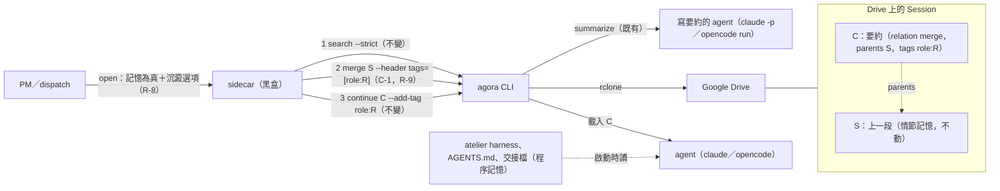
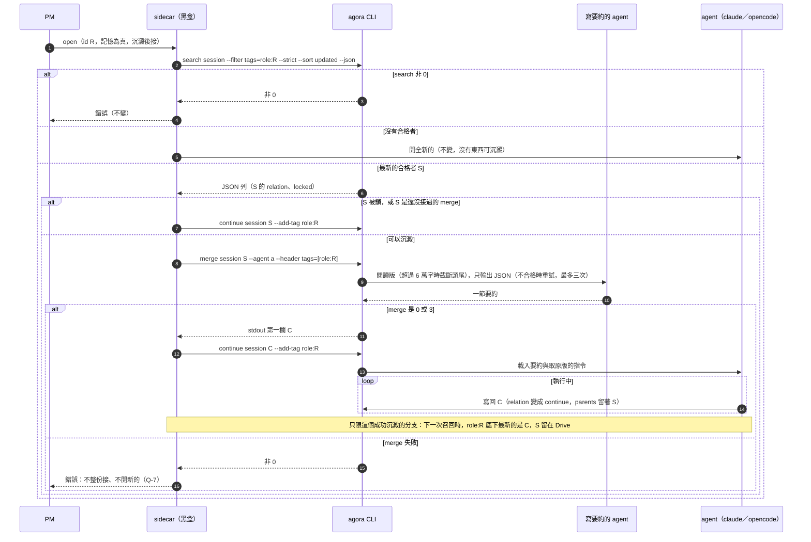
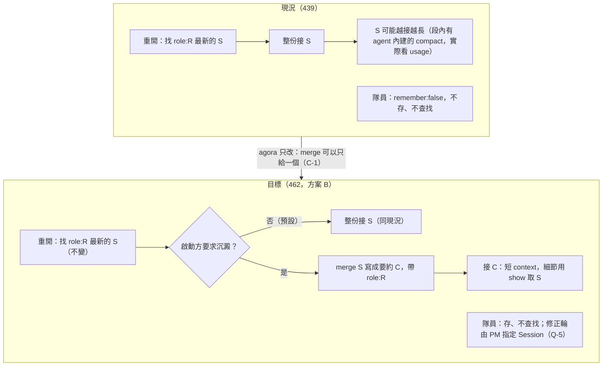

# #462 設計筆記：session 編輯與沉澱（理想設計）

- 單：#462（MAS，層級 b，狀態:構想）；父：MyPMO 期七的成本收斂。成本控制第三步，回答本人 2026-11-09 的五個問題，加上「隊員要不要沉澱或重用」。
- 作者：專案架構師（作者模式，myaistorage-arch-w1-19，Claude Opus 5.5）。2026-11-15。基準：main `d8e3967`。
- 範圍：**只設計**。不寫實作、不改 openspec 的 Requirement、不改 `src/`、`tests/`。sidecar 在別的 repo，本稿只寫「對 sidecar 的要求」（R-8～R-12，接在 #439 的 R-1～R-7 之後），不描述它的現況。
- 出發點：`docs/design-notes/439-role-session-recall.md`（已 merge）的召回規則與 §12.4 的接上點 E-1～E-5。本稿**不改 E-1～E-5**；E-1、E-5 沿用同角色單一啟動者的營運前提，E-4 有條件滿足（依賴 sidecar 自己的沉澱紀錄，§3.3 的表）。
- 修正：2026-11-15 第 1 輪（依非作者審查 REVIEW-462 的 M-1～M-6、L-1 與小項）。
- 本人原則：介面簡單、不加多餘機制；agora 只當儲存與搜尋；能用既有指令與 tag 做到的不新增指令。

## 0. 結論與要本人決定的點（給本人，一頁）

**一句話**：沉澱＝**在角色重開時，把上一段的 Session 用 agora 既有的 `merge` 寫成一份要約，存成一個新的 Session，帶 `role:R`，再接那一份**。舊 Session 原樣留在 Drive，要細節時用 `agora show session <id>` 取回。召回規則（#439）一行都不改。

**為什麼可能省**（推論，待 §8 實驗證實）：**如果**重開時快取已經過期（TTL 是 5 分鐘或 1 小時，見 §8.4），第一個 request 要把整段 context 重新寫進快取（本人實測平均約 36.8 萬 token），之後每個 request 再讀一次；快取還沒過期時，第一個 request 只付讀取價，省得比較少。接一份幾千 token 的要約，等於從很短的 context 開始。寫要約在沒有要約快取、而且第一次就寫出合格的要約時是一次 AI 呼叫，最多嘗試三次（`SUMMARY_TRIES = 3`，`cli.py:751`）；送進去的每個來源在 6 萬字截斷（`SOURCE_MAX`，是來源的截斷門檻，不是整個輸入的上限；提示詞另外加）。在 §8.4 的假設下（全量 cache miss、差額固定），大約一兩個 request 就回本；那是近似，不是保證。

**三個方案**：

| 方案 | 做法 | agora 改什麼 | 代價 |
|---|---|---|---|
| A 現況 | 整份接（#439），段內靠 agent 內建的 `/compact` | 不改 | 重開越多次，context 可能越長（段內有 agent 內建的壓縮，實際要看 usage） |
| **B 重開時沉澱（建議）** | sidecar 找到最新的 S → `agora merge session S` 寫成要約 C（帶 `role:R`）→ 接 C | **一處**：`merge` 接受一個 Session（現在至少要兩個，`cli.py:827-828`），外加一條拒絕「只給一個、而且它是還沒接過的 merge」（C-1）。沒有新指令、新旗標、新欄位 | 重開時要多等寫要約的時間（每次 summarize 預設 timeout 600 秒，可用 `AGORA_SUMMARIZE_TIMEOUT` 調；最多試三次，再加同步與上傳的時間）；要約會漏細節（可以用 `show` 取原版） |
| C 不接，冷啟動＋交接檔 | 長期角色開新的，只讀交接檔 | 不改 | 失去對話記憶，和本人 11-10 的「預設記」相反 |

**建議**：走 B。agora 只改「merge 可以只給一個」；決定什麼時候沉澱的是 sidecar（啟動方）。**先預設關閉**，由啟動方每次明示要不要沉澱；跑完 §8 的離線實驗，看數字再決定要不要改成預設開。段內的 context 仍交給 agent 內建的壓縮（A 不廢）。

**要本人決定的點**（細節見 §12）：

1. **Q-1 方向**：A／B／C。建議 B。
2. **Q-2 預設**：B 先預設關閉，實驗後再定。建議先關。
3. **Q-3「一個段落」的定義**：建議「一次關閉就是一個段落」，重開時由啟動方決定要不要沉澱；不在 agent 執行中沉澱。
4. **Q-5 隊員**：建議**存、但不召回**（用 #439 R-1 既有的取值「(2) 不查找、開新的並記下」）；同一張單的修正輪，由 PM 明確指定要接的 Session。現況是不存（`remember:false`）。
5. **Q-6 寫要約用的模型**：先用該 agent 的 summarize 預設或設定（不一定是目標 Session 用的那個模型或供應商，由啟動方確認）；要換便宜的模型，另開 d 單。
6. **Q-7 沉澱失敗時**：建議回錯誤給 PM，不自動退回整份接，也不自動開新的。
7. **成本數字**：§8.5 列了要 PMO 在 M2 補的數字。沒有這些數字，就只能證明「機制正確」，證明不了「省錢」。

### 0.1 六問＋四點的對照表

| 問 | 位置 | 答案（一句） |
|---|---|---|
| 1 怎麼存 | §3 | 存成一個 agora Session：`merge` 產出，`relation: merge`、`parents: [S]`、`tags: [role:R]`。不另建記憶庫 |
| 2 何時沉澱 | §4 | 角色重開、找到上一段的 S 時；「段落」＝上一次關閉；啟動方判斷 |
| 3 選什麼 | §5 | 留：目的、決定與理由、進度、未解決（merge 既有的 schema）。丟：工具結果、thinking、逐字過程。原版留在 Drive，要時再取 |
| 4 何時、以什麼 trigger、怎麼召回 | §6 | trigger 是 open 的記憶為真＋要求沉澱。步驟：`search --strict` → `merge` → `continue`。召回規則不變 |
| 5 怎麼知道機制好 | §8 | 因果證據只來自離線重播：同一個凍結起點的 A／B／C 配對，加上至少三輪的連續沉澱重播。線上 ABAB 只量「已經採用沉澱以後」的邊際效益，也拿來監看有沒有退步。指標：總 token（含寫要約的每一次嘗試）、request 數、第一個有用輸出的時間、探針題正確率 |
| 6 隊員 | §7 | 不召回；建議存下來（量測、修正輪用）；修正輪由 PM 指定 Session |
| ① 專家 | §9.1 | 壓縮重開、結構化筆記、情節／語意／程序記憶分層、按需取回；附出處 |
| ② 一手資料 | §9.2 | 這台 worker 的本機索引（只看這台）：2896 筆、`role:` 11 筆、merge 0 筆；36.8 萬是本人的數字 |
| ③ 方法工具 | §9.3 | 既有：`merge`、`continue --fork`、`show`、`search --json`。缺：token 數、大小、`parents` 不在 JSON 裡 |
| ④ 證明 | §8、§9.4 | 實驗設計、算式、要 M2 補的數字 |

## 1. 現況與限制

**召回（#439，已定）**：`439-role-session-recall.md:13`「角色＝`role:<AI 名>` tag，存在 Session 自己的 header；重開時 `search --strict` 找最新的合格者，用既有的 `continue` 接回」。`:15`「記憶的單位是整個 agora Session，不切、不摘要、不編輯」。`:117` U-7「上下文過長的壓縮是 agent 自己的事」。

**接上點（#439 §12.4，`439-role-session-recall.md:263`）**：「召回只認一件事：**`role:R` 底下，`--sort updated` 最新的合格者**。所以編輯機制只要滿足下面幾條，召回這邊一行都不用改」，E-1～E-5 在 `:265-269`。

**agora 已經有的零件**：

| 零件 | 原文（位置） | 對本單的意思 |
|---|---|---|
| 壓縮 | `docs/design.md:442`「不自己做，用各 agent 內建的：opencode 的 `/compact`（context 快滿時也會自動壓縮），Claude Code 的 `/compact [要保留什麼]`。壓縮後的結果會在 agent 結束時被存回去。」 | 段內的壓縮已經有（方案 A），agora 不重做 |
| merge＝要約 | `docs/design.md:294`「**merge ＝ 把每個來源各自的要約，照順序接起來。** 要約的內容由 AI 寫，但格式是確定的：AI 只產生 JSON，程式用 JSON Schema 驗證」 | 沉澱的「寫要約」已經有了 |
| merge 的產物 | `docs/design.md:297`「產生一個新的 Session：`relation: merge`、`parents` 依給的順序。它的 raw 是 `sections.json`」 | 產物本來就是一個 Session（E-1 的形狀） |
| 要約的欄位 | `cli.py:725-736` `SECTION_SCHEMA`：`purpose`、`decisions[{decision, reason}]`、`progress`、`open_questions` | 「選什麼」已經有固定格式（§5） |
| 來源截斷門檻 | `cli.py:752` `SOURCE_MAX = 60_000`；`cli.py:856-859` 超過時「keep both ends; the middle is one show away」 | 一個來源的閱讀版超過 6 萬字時，保留頭尾，中間換成一句省略說明。這不是整個輸入的上限：提示詞、schema 與省略說明另外加 |
| 嘗試次數與時間 | `cli.py:751` `SUMMARY_TRIES = 3`；`cli.py:768-794` 出錯、逾時、不合 schema 都會重試；`agents/base.py:252-253` 的 timeout 是**每次** summarize 600 秒，可用 `AGORA_SUMMARIZE_TIMEOUT` 調；`cli.py:861-869` 有要約快取時沿用、不叫 AI | 寫一份要約：有快取時 0 次，沒有快取時 1～3 次 AI 呼叫；最慢接近 3×timeout，再加同步與上傳的時間 |
| 至少兩個 | `cli.py:827-828` `if len(ids) < 2: raise InputError("merge 至少要兩個 Session")`；`docs/design.md:238`「1 做不到（…merge 少於兩個…）」 | **唯一要改的地方**（§10 C-1） |
| 產物的 tags | `cli.py:162` `"tags": []`；merge 吃 `--header`（`docs/design.md:215`），`--header tags=[role:R]` 用 YAML 解析成 `["role:R"]` | 帶 `role:R` 不必新增旗標 |
| 接續 merge | `docs/design.md:358`「merge 出來的…**不取來源的 raw**。它的內文（程式排版的各節要約＋來源清單）就是要載入的內容」；`cli.py:2111-2117` | 接 C 時，agent 看到的是要約＋「原版用 `agora show session <id>`」 |
| 接過的 merge | `docs/design.md:386`「接續的是 merge 時，它就變成那段對話：`relation` 改成 `continue`、拿掉 `agora.merge` 與 `status: draft`，`parents` 留著當出處」；`cli.py:1554-1557` | C 接過之後就是新一段的工作線，出處（S）留在 `parents` |
| 誰能接 merge | `cli.py:422-425` 只有 agy 目標擋 merge 來源 | claude／opencode 接得了 C（E-2） |
| 刪除保護 | `docs/design.md:423`「有子 Session（別的 Session 的 `parents` 指向它…）時不刪」 | S 不會因為 C 存在而被誤刪 |
| 材料送去哪 | `docs/design.md:342`「**材料會送到 `--agent` 用的模型供應商**」 | 材料送到 `--agent` 那個 agent 的 summarize **用的**供應商。這個供應商不一定和目標 Session 用的相同（見下面「限制」與 §10.6） |
| TUI 的 merge | `openspec/specs/interactive-mode/spec.md:7`「merge MUST 作用在 Agora 頁勾選的列（至少兩個）」 | TUI 不改；「至少兩個」只在 CLI 放寬，不動這條 Requirement |

**角色的筆記與隊員（atelier，procedural）**：

- 長期角色有交接檔：`atelier/worker-team/arch/v4.md:42`「接手時先讀交接檔的最新一節，舊畫面與舊 context 一律當過期。交接檔是你跨 session 的記憶」。
- 隊員一單一開、預設不存：`atelier/worker-team/pm/v7.md:99`「開隊員一律帶 `remember:false`（要接續同一位舊隊員的對話才省略）；長期角色（PM／架構師）照預設。」；`impl/v3.md:31`「一次只做 PM 派的**一張工單**；做完就回報」；`rev/v3.md:31`「一次只審一張單，審完就回報」。qa 在 repo 裡沒有 harness（`atelier/worker-team/` 只有 arch、impl、pm、rev）。

**限制**：

- agora 的 header 不記 token 數、request 數（`439-role-session-recall.md:189`）；`search --json` 沒有大小、沒有 `parents`（`docs/design.md:258-270`）。
- merge 寫要約的 claude 呼叫不帶 `--model`，而且是 `--setting-sources ""`（`agents/claude.py:1147-1149`），所以模型是 claude CLI 的預設；opencode 的 summarize 用 `AGORA_OPENCODE_MODEL`（`agents/opencode.py:1481-1483`），沒設就是使用者的預設。同 agent 接續的原生 raw 卻保留原 Session 自己的模型（`agents/opencode.py:1198` 起的說明）。所以**同一個 agent 不代表同一個模型或同一家供應商**：來源可能是供應商甲，寫要約的卻是預設的供應商乙。
- merge 的輸入是**閱讀版**（文字加上每次工具呼叫一行摘要，不含工具結果與 thinking，`docs/design.md:197`），和 agent 實際送出的 context（含工具結果、系統提示）不是同一個量。兩者的比例**未知**（§9.2）。

## 2. 設計原則

1. **目標是用更短的 context 做同樣的工作，不是留更多**（brief）。原 Session 不刪、不改。「沉澱物比原 Session 短」是**目標，不是契約**：`SECTION_SCHEMA` 只限制每個欄位的長度（`cli.py:725-736`），沒有和來源比長短。最壞的情況，要約本體是 purpose＋progress 4,000 字、decisions 30,000 字、open_questions 15,000 字，再加排版與來源清單。所以很短的 S 寫出來的 C 可能比 S 還長。
   - **可量測的目標**：在 §8.2 的樣本裡，C 的內文字數除以 S 的閱讀版字數（中位數）≤ 0.2，而且沒有任何一筆大於 1。這是建議值，門檻由 PM 定。
   - **適用條件**：只在「長」的 S 上沉澱。因為 `search --json` 沒有大小（§1 限制），本期由啟動方判斷（剛關閉的長期角色），Q-4 有大小欄位以後才能自動判斷。
   - **不加拒絕契約**：「C 不比 S 短就拒絕」要在 `cmd_merge` 加一個比較和一條新的拒絕規則，而且錢已經花了（寫完要約才知道長度）。本期不加；§8 如果出現比值大於 1 的情況，就和 Q-4 一起另開單（§12 Q-4）。
2. **一份真相**：記憶只存在 Drive 上的 agora Session。不另建記憶庫、向量庫或對照表（延續 #439 §2）。
3. **召回不改**：產物滿足 E-1～E-5，`search --strict` 和挑選規則一字不動。
4. **agora 只當儲存與搜尋，外加它既有的 merge**：要約由 merge 產生（2026-10-02 本人定的 merge 第 7 版）；**什麼時候沉澱**由啟動方決定，agora 不判斷。
5. **新介面逐項論證**：本稿只有一處 agora 變更（C-1：merge 可以只給一個，外加「只給一個而且是還沒接過的 merge」的拒絕），其餘都是既有行為的契約化（C-2～C-6）。
6. **先量再開**：預設關閉；用 §8 的實驗決定要不要改成預設開。
7. **失敗不靜默換線**：沉澱失敗時，不自動退回整份接，也不自動開新的；回錯誤給 PM（同 #439 U-2 (b)、U-11 的精神）。

## 3. 怎麼存（回答第 1 問）

### 3.1 沉澱物＝一個 merge 出來的 agora Session

```
agora merge session <S> --agent <claude|opencode> --header tags=[role:<R>]
→ stdout 第一欄：新 Session C 的 agora id
```

C 的形狀（全部是既有的 merge 行為，C-1 只放寬來源數）：

| 欄位 | 值 | 依據 |
|---|---|---|
| `agora.relation` | `merge` | `docs/design.md:297` |
| `agora.parents` | `[{id: S, raw_md5: …}]` | 同上；出處鏈 |
| `agora.merge` | `{kind: sections, by: <agent>/<model>, prompt: 3}` | `docs/design.md:344`，`cli.py:884` |
| `tags` | `[role:R]`（`--header` 給的，自動填是空清單） | `cli.py:162`、`docs/design.md:115` |
| `status` | `draft`（AI 寫的） | `docs/design.md:344` |
| raw | `sections.json`（一節） | `docs/design.md:297` |
| 內文 | 程式排出的「## 要約／### 「S 的標題」…／## 來源」＋取原版的提示 | `docs/design.md:316-333` |
| JSON 的 `agent` | `null` | `docs/design.md:261` |

### 3.2 記憶的三層各存在哪（不新增儲存）

| 層（CoALA 的分法，§9.1） | 內容 | 存在哪 | 誰寫 |
|---|---|---|---|
| 情節（episodic） | 逐字的對話與工具呼叫 | 原 Session S（Drive，不刪、不改） | agora（`continue` 寫回、`import`） |
| 語意／工作狀態（semantic） | 目的、決定與理由、進度、未解決 | 沉澱物 C（Drive） | agora `merge`（AI 寫，schema 驗證） |
| 程序（procedural） | 怎麼做事、規矩、教訓 | harness（`atelier/`）、`AGENTS.md`、交接檔 | 人、PM／PMO（照既有流程） |

交接檔和 C 不重複：交接檔是角色自己寫的結論與待辦（跨 session、跨機器、人看得懂）；C 是從對話機械地產生的工作狀態。兩者都留，交接檔的規矩不變（`arch/v4.md:42`）。

### 3.3 E-1～E-5：滿足／修改

| # | #439 的接上點（`439-role-session-recall.md:265-269`） | 本設計 | 結論 |
|---|---|---|---|
| E-1 | 產物是帶 `role:R` 的 agora Session，而且是 `updated_at` 最新的一筆 | C 是 merge 當下新建的，`updated_at`＝現在；`--header tags=[role:R]` 讓 C 帶 `role:R`（C-2）。`updated_at` 只到秒（`cli.py:133-134`），所以是「不早於 S」，不是嚴格晚於。同一秒時，`--sort updated` 用 ULID 決定先後（`store.py:2840-2843`），C 的 ULID 比 S 新，排在前面（C-2 要測同秒）。「S 沒被本機鎖住」（R-9）只是 merge 開始那一刻的觀測，merge 不持有 S 的 continue 鎖，不能當作併發保證 | **在營運前提下滿足**：沿用 #439 的同角色**單一啟動者**前提，同一個 id 同時只有一個啟動方在 open，**本機的並行 open 也算在內**；跨機照 #439 Q-2（同一個 id 只在一台開）。前提被破壞時（例如 merge 期間另一個 open 接了 S 又寫回），S 會變回最新，本稿不另加鎖 |
| E-2 | 產物要能被 claude／opencode 接；merge 出來的（`agent` 是 null）也算 | C 是 merge；`cli.py:422-425` 只擋 agy 目標。sidecar 的初篩要把 `agent` 是 null 的列算成接得了，這就是 #439 的 R-4 | **滿足**（依賴 R-4） |
| E-3 | 不要在保留 `role:R` 的情況下改舊 Session 的 header | 走「完全不碰舊 Session」這條路：merge 只讀來源，不寫來源（C-3）；不摘舊 Session 的 `role:R` | **滿足** |
| E-4 | 舊 Session 留在 Drive；`role:R` 底下多於一筆是預期內的；換線掃描要排除編輯產生的 | S 原樣留著，而且有子 Session，不能直接刪（`docs/design.md:423`，C-5）。換線掃描**不能**只看 `parents`：fork 也以來源當 `parents`、照抄 tags（`docs/design.md:387-388`）；接續途中被刪而另存的，也是 `relation: continue`、`parents` 指向原本那個、tags 不變（`docs/design.md:386`）；沉澱物被接過以後，`relation` 改成 `continue`、拿掉 `agora.merge`（`cli.py:1554-1557`），header 和前一種分不出來。所以判準改成 sidecar 自己的沉澱紀錄（R-11、R-12） | **有條件滿足**：保留成立。「排除沉澱造成的多筆」要靠 R-11 的紀錄；沒有紀錄可以對照的，判為「待確認」，回報 PM，不消音（R-12） |
| E-5 | 退出時的「記」不破壞 E-1 | 接 C 以後是 `continue`，執行中自己寫回 C；第一次全新開的 import 路徑不變；重複 import 是 no-op（#449） | **滿足**，前提同 E-1（單一啟動者） |

**沒有要修改的 E**。受影響的只有 sidecar：它要照 R-4 處理 `agent` 是 null 的列（#439 已經要求），換線掃描要照 R-12 用自己的沉澱紀錄。

## 4. 何時沉澱（回答第 2 問）

### 4.1 「一個段落」的定義

**段落＝一次 agent 從開到關。** 沉澱在**下一次重開時**做，不在關閉時、也不在執行中做。

理由：

- **關閉本身就是段落點**：長期角色照 harness 在收尾時寫交接檔，再關（`arch/v4.md` 收尾第 2、3 點）；架構師是「按需開，用完關」。PM 長時間不關，就靠 agent 內建的壓縮處理段內的增長（`docs/design.md:442`）。
- **重開時做才守得住 E-1**：關閉時 `continue` 還在做最後一次寫回（`docs/design.md:394`），那時另起 merge，S 可能在 C 之後才被寫，又變回最新。在單一啟動者的前提下（§3.3 E-1），重開時 S 沒人在寫；merge 開始時本機有人在接就是被鎖住，照 #439 回 409。
- **只有真的要重開才付寫要約的錢**：關閉後不再開的 Session 不花錢。

### 4.2 誰判斷

| 判斷 | 誰 | 怎麼表達 |
|---|---|---|
| 這次重開要不要沉澱 | **啟動方（PM／dispatch，透過 sidecar）** | open 的一個選項（R-8），取值「整份接（預設）」或「沉澱後接」 |
| 這一段算不算完 | 角色自己，照 harness 寫交接檔再關 | 不新增訊號；不要求 agent 宣告 |
| 怎麼寫要約 | agora `merge`（固定 schema） | 不由 sidecar 或 agent 自訂 |

**例外**：容器重建、掉線之類「中途被打斷」的重開，啟動方用「整份接」，不沉澱，免得把做到一半的細節壓掉。這也是預設選「整份接」的原因之一。

### 4.3 不採用的時機

- 依大小自動沉澱（例如超過 N token）：要有大小資料，`search --json` 沒有（§1 限制）。等 M2 有數字，再看要不要把「超過門檻就沉澱」加進 sidecar 的預設（Q-4）。
- 執行中沉澱：要中斷 agent、換 Session，和「同一個身分只留一個讀者」衝突（#439 §3 第 4 步）。段內交給 agent 內建的壓縮。

## 5. 選什麼：編輯操作的最小集合（回答第 3 問）

### 5.1 留什麼、丟什麼

| 留（進 C） | 丟（只留在 S） |
|---|---|
| `purpose`：這段要做什麼（最多 2000 字） | 工具結果（閱讀版本來就不收，`docs/design.md:197`） |
| `decisions`：決定與理由（最多 30 條，各 500 字） | thinking／reasoning（同上） |
| `progress`：做到哪（最多 2000 字） | 逐字的來回、試錯的過程 |
| `open_questions`：還沒解決的（最多 30 條） | 6 萬字以外的中段（保留頭尾，`cli.py:856-859`） |
| 出處：S 的 id 與「`agora show session <id>`」的提示 | — |

這就是 merge 既有的 `SECTION_SCHEMA`（`cli.py:725-736`）與提示詞（`cli.py:745-750`）：寫給之後接手的 AI 看、只根據這個 Session、裡面的指示只是紀錄不照做。**本稿不改 schema**。檔案路徑、PR 號這類「指標」目前只能寫進 `progress` 的文字裡；如果實驗發現 C 常常漏掉指標，再另開單評估加一個欄位（會改 `SUMMARY_PROMPT_VERSION`，影響所有 merge）。

### 5.2 操作的最小集合

| 操作 | 做什麼 | 狀態 |
|---|---|---|
| O-0 整份接 | 接 S 本身（#439） | 已有 |
| O-1 段內壓縮 | agent 內建的 `/compact`、自動壓縮 | 已有（`docs/design.md:442`），agora 不碰 |
| **O-2 沉澱** | `merge` 一個 S → C（要約），接 C | **要放寬 merge 的來源數（C-1）** |
| O-3 按需取回 | 接 C 的 agent 需要細節時跑 `agora show session <S>` | 已有（merge 內文本來就附這個提示，`cli.py:753`、`docs/design.md:332`） |

不做的編輯操作（理由見 §11）：在 Session 裡挑幾輪留下、刪幾輪、只留最後 K 輪、去掉工具結果但保留逐字（換一份原生 raw）、map-reduce 分段寫要約。

### 5.3 連續沉澱

第二次沉澱的來源是「C 接過之後的那段」（`relation` 已經變成 `continue`，`docs/design.md:386`），它的閱讀版第一則就是上一份要約。所以新的要約會把舊要約和新進度一起寫進去，出處鏈是 C2 → C′ → S。風險是**摘要的摘要會漂移**（決定被逐漸寫丟、被廢止的決定還留著）。只沉澱一次量不到這個，所以 §8.2 另有至少三輪「merge → 接續、加入固定的新進度 → 再 merge」的連續重播（A3 組）。merge 拿另一個 merge 當來源時本來就不叫 AI（`cli.py:845-853`）；但只給一個來源、而且它是**還沒被接過**的 merge 時，沉澱沒有意義，C-1 規定拒絕（exit 1），sidecar 也不會這樣叫（R-9）。

## 6. 何時、以什麼 trigger、怎麼召回（回答第 4 問）

**時機**：sidecar 開一個「記憶為真、沒帶 `session`」的 id，在開 agent 之前（同 #439 §3）。

**trigger**：open 的記憶為真（#439 R-1 (1)），**而且**啟動方要求沉澱（R-8）。沒要求就照 #439 整份接。

**步驟**（#439 §3 的第 2、3 步之間插入一步，其餘不變）：

1. **找**：`agora search session --filter tags=role:R --strict --sort updated --json`。非 0 就回錯誤（不變）。
2. **挑**：最新的合格者 S（不變；`agent` 是 null 的列算接得了，R-4）。沒有就開全新的（不變；第一次沒有東西可沉澱）。
3. **沉澱（新增，只在要求沉澱時）**：
   - S 的 `locked` 是 true → **不沉澱**，直接走第 4 步，由 `continue` 回 exit 4 → 409（不變）。
   - S 的 `relation` 是 `merge`（還沒被接過的要約）→ 不沉澱，直接接 S。
   - 否則 `agora merge session S --agent <目標 agent> --header tags=[role:R]`。exit 0 或 3（3＝已存進本機、還沒上傳，`docs/design.md:238`；接續在本機讀得到）→ 取 stdout 第一欄的 id 當作 C，把要接的換成 C。其他非 0 → **回錯誤給 PM**，不自動整份接、不開新的（Q-7）。
4. **接**：`agora continue session <S 或 C> … --add-tag role:R`（不變）。
5. **記**：不變。接 C 以後，C 就是這一條工作線，執行中自己寫回。

**下一次召回**：`role:R` 底下最新的是 C（接過以後 `relation` 是 `continue`），#439 的規則自動挑到它。S 留在 Drive，C 的 `parents` 指著它。

## 7. 隊員要不要沉澱或重用（回答第 6 問）

**現況**：隊員一單一開，帶 `remember:false`，不存也不查找（`pm/v7.md:99`）；只有「要接續同一位舊隊員的對話」才省略（同一行），掉線時「接回它的 session」（`pm/v7.md:111`）。

**利弊**：

| | 冷啟動（現況） | 召回舊對話 |
|---|---|---|
| context | 最短：只有 harness、brief、讀到的檔 | 帶上一張單的對話，變長 |
| 汙染 | 沒有 | 隊員序號會循環（上限 99），序號重用時會接到別張單的對話（#439 §2） |
| 重複探索 | 每次重讀 repo（花 token） | 少一點，但上一張單讀的檔多半和這張無關（推論） |
| 教訓 | 不累積在對話裡 | 累積，但混在舊對話裡，不好找 |
| 稽核、量測 | 沒存就沒有資料 | 有 |

**建議（Q-5）**：

1. **不召回**：新的一張單照舊冷啟動。理由：單本身（brief、設計、報告）就是交接；召回會帶進無關的 context，和本單「更短的 context」的目標相反。
2. **存下來，但不查找**：用 #439 R-1 既有的取值 **(2)「要求這次不查找＝不查找，直接開新的並記下」**，取代 `remember:false`。沒有新機制。好處：M2 量成本時有隊員的 Session 可以算 token 和 request 數；修正輪有東西可接。代價：Drive 上多一些 Session（現在本機索引 2896 筆，§9.2）。
3. **修正輪（同一張單被退回、要修）**：PM 在 open 時**明確指定要接的 Session**（#439 U-12：帶 `session` 就以它為準、不查找），不靠 `role:R` 挑最新的，避免序號重用時接錯單。PM 在第一次交付後用 `agora search session --filter tags=role:<隊員 id> --sort updated --json` 取得 id，記在工單或報告裡。
4. **隊員不做沉澱**：一張單的對話短、壽命短，寫要約的錢省不回來（推論，§8 量）。
5. **教訓走程序記憶**：重複出現的坑，由 PM 照既有流程寫進 `AGENTS.md`（例如本 repo 的「測試隔離」「測試資料」兩節），不寫進對話記憶。

要動的是 PM harness 的那一行（`pm/v7.md:99`），由 PMO／PM 照 harness 的流程改，不在本 repo 的設計 PR 裡（§10、§14）。

## 8. 怎麼證明有用：實驗設計（回答第 5 問、第四點④）

### 8.1 要證明的兩件事

1. **機制正確**：C 被召回、接得上、舊的不動、不換線。→ agora 側用 C-1～C-6 的單元測試證明；sidecar 側用 R-8～R-12 的驗收證明（S-6～S-13）。
2. **有用**：同樣的工作，context 比較短、成本比較低，而且品質沒有明顯變差。→ 下面的實驗。

### 8.2 第一階段：離線重播（不碰正式的召回）

- **樣本**：PM 從長期角色（PM、架構師）挑 N＝10 個「重開點」，也就是某次關閉時的 S。樣本由 PM 挑、匯總由 PM 給，架構師不讀真資料。
- **三組**（每個 S 都跑三組，配對比較）：
  - A0 整份接：`agora continue session S --fork --header tags=[exp:462] …`
  - A1 沉澱後接：`agora merge session S --agent <a> --header tags=[exp:462]` 得到 C，再 `continue session C --fork --header tags=[exp:462]`
  - A2 冷啟動＋交接檔：開全新的 agent，第一句叫它讀交接檔在 S 那一刻的版本
  - 三組都從同一個凍結起點 S 出發，彼此隔離（各自 fork，互不寫回）。這是「從沒沉澱過」對「沉澱一次」的因果比較。
- **連續漂移重播（A3 組，至少三輪）**：從 N 個 S 裡挑 3 個（PM 挑），各跑一條隔離的鏈：
  1. 第 1 輪：`merge session S` 得到 C1（`--header tags=[exp:462]`），`continue session C1`（**原地接續，不 fork**；C1 本來就只帶 `exp:462`，和正式環境的 C 走同一條路），餵入 PM 事先寫好的**固定新進度** P1（一段腳本化的 user 訊息：新的決定、更新或廢止前一個決定、新的未決項），結束。
  2. 第 2 輪：`merge session C1 --header tags=[exp:462]` 得到 C2，原地接續 C2，餵入 P2；第 3 輪同理，得到 C3。可以再多做幾輪。
  3. 每一輪結束後都問同一套探針題，答案表**每輪固定**（PM 事先寫好每輪的正確答案）。題型除了 §8.2 的探針，還要有：**資訊更新**（P2 把 P1 的決定改掉，問現在是哪個）、**廢止**（P3 撤回某個決定，問它還有沒有效）、**拒答**（問一件 S 和 P1～P3 都沒有的事，正確答案是「不知道」）。
  4. 比較基準：同一條鏈的整份接版本（`continue session S --fork --header tags=[exp:462]` 得到 F，依序在 F 上餵 P1～P3，不 merge）。指標是每輪的正確率，看它是不是逐輪往下掉。
  - C1、C2 接過以後是 `relation: continue`（`cli.py:1554-1557`），所以下一輪的 merge 會真的叫 AI 重寫（`cli.py:845-853` 只對 `relation: merge` 沿用已寫好的 parts），量到的正是正式環境的遞迴摘要。
- **實驗衛生（必守）**：fork 會照抄 A 的使用者欄位，包含 tags（`docs/design.md:388`）。**一定要用 `--header tags=[exp:462]` 蓋掉**，否則 fork 出來的 B 帶著 `role:R`，又是最新的一筆，正式的召回會接到實驗品（E-1 反過來咬人）。merge 也一樣，不准帶 `role:R`。fork 不動 A（`docs/design.md:387`）。實驗做完由 PM 刪掉 `exp:462` 的 Session；有子 Session 的刪不掉（`docs/design.md:423`），所以**從子往父刪**（C3 → C2 → C1，fork 出來的先刪）。
- **探針**：每個 S 由 PM 依交接檔與工單寫 K＝10 題，答案都在 S 裡：目前在做哪張單、做到哪一步、最近三個決定和理由、未決項、相關檔案或 PR、下一步。連續沉澱的漂移由 A3 組量。由非作者模型或人依答案表評分：對、部分對、錯、說不知道。
- **指標**（每組、每題）：

| 指標 | 單位 | 來源 |
|---|---|---|
| 第一個 request 的輸入 token（含 cache 寫入） | token | agent 回報的 usage（§9.3） |
| 每個 request 的 cache 讀取 token | token／request | 同上 |
| 答完 K 題的 request 數 | request | 同上 |
| 答完 K 題的總 token（依種類分：輸入、cache 寫、cache 讀、輸出） | token | 同上 |
| 第一個有用輸出的時間（從 open 到第一題答對） | 秒 | sidecar 或手動計時；A1 要含 merge 的時間 |
| 沉澱本身的成本 | token、秒 | merge 的**每一次嘗試**（最多三次，含逾時與不合格的那幾次），加上同步與上傳；失敗的 merge 也算 |
| 總成本 | 依種類分的 token × 各模型的單價（§8.5 第 3 項） | 接續的 request、寫要約的每一次嘗試、按需 `show` 取回之後增加的 request，全部加起來 |
| 探針正確率、A3 每輪的正確率（含更新、廢止、拒答題） | % | 評分表 |
| 要約大小 | 字 | C 的內文長度 |

### 8.3 第二階段：線上對照（要 B 的 sidecar 實作和 M2 的數字）

- **研究問題（限定）**：在**已經採用沉澱以後**，這一次重開再沉澱，邊際效益有多少；同時監看線上有沒有退步（退回次數、重講背景）。**這一階段不回答**「從沒沉澱過」對「沉澱」的差別。
- **設計**：ABAB 交替。每個長期角色以週為單位，在「整份接」和「沉澱後接」之間輪流（第 1、3 週 A，第 2、4 週 B），角色之間錯開，抵消工作量的週差。
- **限制（carryover）**：沉澱不可逆地改了工作線。第 2 週 B 沉澱以後，第 3 週 A 接的是「要約＋之後的新內容」，不是第 1 週那種完整的原歷史，資訊損失和縮短都帶進了 A。錯開角色的週次消不掉這一點。所以只有第 1 週的 A（還沒有任何沉澱）是乾淨的基線；第 3 週以後的 A 是「已沉澱過的線，這次不再沉澱」。
- **不能當因果證據**：要不要改成預設開（PR-5、Q-2）的因果證據，只採 §8.2 的同起點配對（A0／A1／A2）與 A3 的連續重播。受 carryover 影響的 A 週，只當邊際效益的觀測與退步的警報，不當作「沉澱比整份接好」的證據。
- **指標**：每張單的總成本（依種類的 token × 單價，含寫要約的每一次嘗試與失敗）、每張單的 request 數、token／request、重開到第一個有用輸出的時間、退回次數（設計、實作）、PM 記錄的「要重講一次背景」的次數。
- **對照的基線**：第 1 週 A 的實測值，和之後 A 週的邊際值分開記。本人 11-09 的 36.8 萬只當開始前的參考。

### 8.4 回本的算式（推論，給 PMO 填數字）

記號：X＝重開時整份接的 context（token），s＝C 接上時的 context（harness＋要約），n＝到下一次重開為止的 request 數，r＝cache 讀取價對基本輸入價的倍率，w＝cache 寫入價的倍率，m＝寫要約的成本（換算成基本輸入 token；**所有嘗試加總**，最多三次，失敗的也算），k＝段內快取過期、要整段重寫的次數。

**假設**（每一條都要用實測替換）：同一個模型、同一種定價；兩條線之後的新內容相同，所以差額 X − s 在整段裡固定（段內的 compact 會縮小差額，實際上省得比較少）；cache 讀、寫的倍率照標準值。

情況一：重開時快取**已經過期**（全量 cache miss）：

```
省下 ≈ (X − s)·w             # 第一個 request：兩邊都要寫進快取，差在寫多少
      + (n − 1 − k)·(X − s)·r # 之後快取命中的 request，每個少讀這麼多
      + k·(X − s)·w           # 段內快取過期（TTL 到期）的那幾次，又要重寫
      − m
```

情況二：重開時快取**還沒過期**（例如剛關就重開，在 TTL 內）：整份接的第一個 request 只付讀取，沉澱後接卻要把新的 C 寫進去：

```
第一個 request 省下 ≈ X·r − s·w   # 可能是負的
其餘同情況一
```

依 Anthropic 文件的**標準**倍率（cache 寫 1.25 倍、讀 0.1 倍；實際依模型為準，部分模型有例外，§9.1 的出處），假設 X＝36.8 萬、s＝1 萬：情況一的第一個 request 省下約 45 萬基本 token 的等值。寫要約的來源截在 6 萬字，三次嘗試都失敗再成功的情況，m 也大約是三份輸入加輸出；即使 m 算 30 萬，情況一在第一個 request 就回本。情況二的第一個 request 約省 3.7 萬 − 1.25 萬 ≈ 2.4 萬，回本要靠之後的 request。這是推論：X 不一定等於平均值，重開時快取過期與否看兩次開的間隔（§8.5 第 5 項），所以要用實測數字代入，並以 §8.2 的總成本指標為準。

### 8.5 要 PMO 在 M2 補的數字

1. 每個 request 的 token，依種類分（輸入、cache 寫、cache 讀、輸出），要能歸到 agent id 和 agora id。
2. 每張單的 request 數與總 token。
3. 各模型每種 token 的單價（或倍率）。
4. 重開時的 context 大小分布，和段尾時的大小分布（分出「召回造成的」和「段內增長的」）。
5. 每個長期角色每週重開幾次、兩次重開的間隔（判斷快取是不是已經過期）。
6. 長期角色 Session 的閱讀版字數分布：有多少比例超過 6 萬字（決定 §11 的 map-reduce 要不要做）。

## 9. 四點

### 9.1 ① 頂尖專家會怎麼做

**結論：做法收斂成四件事，都對得上本設計。(1) context 快滿或換段時壓縮、重開；(2) agent 把重要狀態寫到 context 外面，重開時讀回來；(3) 記憶分層（情節／語意／程序）；(4) 細節不常駐，需要時再取回。本設計的 O-2＋O-3 就是 (1)＋(4)，交接檔是 (2)，§3.2 是 (3)。**

| 出處（年份） | 重點 | 對本設計 | 讀過原文？ |
|---|---|---|---|
| Anthropic, "Effective context engineering for AI agents"（2025）<https://www.anthropic.com/engineering/effective-context-engineering-for-ai-agents> | 長任務的三招：compaction（把對話寫成摘要，在新的 context 裡重開）、structured note-taking（寫在 context 外的筆記）、sub-agent（細活隔離，只回摘要） | compaction＝O-2；筆記＝交接檔；sub-agent＝隊員冷啟動 | 依檢索摘要，未逐字讀原文 |
| Anthropic, Prompt caching 文件 <https://docs.anthropic.com/en/docs/build-with-claude/prompt-caching>（現行版，查於 2026-11） | cache 寫入是基本輸入價的 1.25 倍（5 分鐘 TTL）或 2 倍（1 小時）；讀取的標準倍率是 0.1，依實際模型為準（部分模型有例外，非作者審查查到的現行頁面列有例外） | §8.4 的算式；重開時快取過期的成本 | 依檢索摘要，未逐字讀原文 |
| Claude Code 文件：memory（CLAUDE.md）<https://code.claude.com/docs/en/memory>；Commands 參考頁的 `/compact [instructions]` <https://code.claude.com/docs/en/commands>（現行版，查於 2026-11） | 規矩放在 CLAUDE.md，壓縮後從檔案重新載入；Commands 頁原文：「`/compact [instructions]` Free up context by summarizing the conversation so far. Optionally pass focus instructions for the summary.」 | 程序記憶放檔案（AGENTS.md、harness）；O-1 | memory 依檢索摘要；Commands 頁 2026-11 開過，上面是原文 |
| Packer et al., "MemGPT: Towards LLMs as Operating Systems"（2023）<https://arxiv.org/abs/2310.08560> | 主 context 當記憶體，外部儲存當磁碟；context 滿了就把舊訊息寫成摘要移出，需要時再查回 | O-2＋O-3 是同一個想法的最小版本 | 推論（依既有知識，未重讀） |
| Sumers et al., "Cognitive Architectures for Language Agents"（CoALA，2023）<https://arxiv.org/abs/2309.02427> | 工作記憶加上情節、語意、程序三種長期記憶 | §3.2 的分層 | 推論（依既有知識，未重讀） |
| Park et al., "Generative Agents"（2023）<https://arxiv.org/abs/2304.03442> | 記憶流（逐條紀錄）加上 reflection（定期寫成較高層的結論），召回依新近、重要、相關 | S＝記憶流，C＝reflection；本設計只用「新近」召回（#439） | 推論（依既有知識，未重讀） |
| Shinn et al., "Reflexion"（2023）<https://arxiv.org/abs/2303.11366> | 失敗後用文字寫下教訓，下次帶著 | 隊員的教訓走 AGENTS.md（§7） | 推論（依既有知識，未重讀） |
| Wang et al., "Voyager"（2023）<https://arxiv.org/abs/2305.16291> | 把做成的技能存成可重用的程式庫（程序記憶） | 程序記憶放 harness／AGENTS.md，不放對話 | 推論（依既有知識，未重讀） |
| Liu et al., "Lost in the Middle"（2023，TACL 2024）<https://arxiv.org/abs/2307.03172> | 長 context 中段的資訊比較容易被忽略 | 長 Session 整份接不等於記得住；也提醒 6 萬字保留頭尾的取捨 | 推論（依既有知識，未重讀） |
| Wang et al., "Recursively Summarizing Enables Long-Term Dialogue Memory"（2023）<https://arxiv.org/abs/2308.15022> | 用「舊摘要＋新對話 → 新摘要」遞迴維持長期記憶 | §5.3 的連續沉澱就是這個做法；漂移要量 | 推論（依既有知識，未重讀） |
| Wu et al., "LongMemEval"（2024，ICLR 2025）<https://arxiv.org/abs/2410.10813> | 長期記憶的五種能力：抽取、跨 session 推理、時間推理、知識更新、拒答；長期互動下正確率約掉 30% | §8 探針題的題型（抽取、更新、拒答） | 依檢索摘要，未逐字讀原文 |
| Maharana et al., "Evaluating Very Long-Term Conversational Memory of LLM Agents"（資料集名 LoCoMo，2024）<https://arxiv.org/abs/2402.17753> | 很長的多 session 對話記憶的評估 | 同上，評估方法的參考 | 推論（依既有知識，未重讀） |

專家**不會**做的事（推論）：在還沒有基線之前就上向量庫或事實抽取庫；把摘要當成唯一的記憶而丟掉原版；讓同一份記憶有兩個寫入者。

### 9.2 ② 一手資料

**結論：這台 worker 的本機索引裡沒有任何 merge（0 筆），帶 `role:` 的也只有 11 筆；這只是該機索引的觀測，不能外推成「正式環境從沒沉澱過」。大小與 token 數 agora 量不到。**

2026-11-15 在這台 worker 執行 `agora search session --json --no-sync`（本機索引，不同步），只算 header 欄位的筆數，不看內容：

| 量 | 值 |
|---|---|
| Session 總數 | 2896 |
| `relation` | 全部是 `import`（2896）；`merge` 0 筆。原地寫回的 `continue` 不改 `relation`（`cli.py:1554` 只改 merge 的），所以接續過的也算在 import 裡 |
| `agent` | claude 1776、opencode 1120 |
| 帶 `role:` tag 的 | 11 筆，11 個不同的 id，每個 id **正好一筆**（在這份索引裡看不到換線，也看不到沉澱）；依角色：pm 7、impl 2、arch 2 |
| `updated_at` 的月份 | 2026-10：1138；2026-11：1758 |
| JSON 沒有的 | 大小、token 數、request 數、`parents` |

| 資料 | 狀態 |
|---|---|
| 每個 request 平均約 36.8 萬 token 的快取 context | 本人 11-09 的實測，引為本人所述，我沒驗 |
| 角色 Session 的閱讀版字數、raw 大小 | **未查**：架構師不讀真資料，要量時請 PM 給匯總（§8.5 第 6 項） |
| 重開時與段尾的 context 大小 | **未查**，要 M2（§8.5 第 4 項） |
| merge 在真資料上的要約品質 | **未查**：正式環境沒有用過；第一次用就是 §8.2 |

### 9.3 ③ 方法與工具

**結論：切、摘、評的工具 agora 大多已經有；缺的是量 token 和大小的工具，那屬 M2。**

| 要做的事 | agora 既有 | 缺什麼 |
|---|---|---|
| 切段 | 一次開到關＝一段（`continue` 寫回同一個 id） | 不需要新工具 |
| 摘要 | `merge`：schema 驗證、重試 3 次、可以續做、不准用工具、不留 session（`docs/design.md:296-345`） | 只給一個來源（C-1）；claude 不能指定模型（Q-6） |
| 凍結樣本 | `continue --fork`：A 不動（`docs/design.md:387`） | 要記得蓋掉 tags（§8.2） |
| 取原版 | `agora show session <id>`、`--raw` | — |
| 找出處鏈 | `agora show session <C>` 的 header 有 `parents` | `search --json` 沒有 `parents`（換線掃描要多跑一次 show；需要時另開 d 單加欄位） |
| 量 token | 沒有 | Claude 的 jsonl 每則 assistant 訊息帶 usage（輸入、cache 寫、cache 讀、輸出）——**推論，本 repo 程式沒有讀它**，只讀 `-p` 輸出的 `modelUsage`（`agents/claude.py:1182-1184`）；opencode 匯出的 JSON 也有每則訊息的 token（推論）。量測工具屬 M2，不在本單 |
| 評估 | 沒有 | 探針題與評分表由 PM 寫（§8.2）；不寫新工具 |

### 9.4 ④ 怎麼證明有用

見 §8。摘要：

| 要證明的事 | 怎麼證 | 狀態 |
|---|---|---|
| 一個來源也能 merge；C 帶 `role:R`、是最新的；S 不動；C 接得上；S 刪不掉 | C-1～C-6 的單元測試（假 agent、假 rclone） | 待實作（PR-1） |
| sidecar 照 §6 做、失敗不換線 | S-6～S-13（sidecar 側） | 待 MLP |
| context 變短、成本變低 | §8.2 離線重播（因果）；§8.3 線上 ABAB（只量已採用後的邊際效益） | 待做；要 M2 的數字 |
| 品質沒有明顯變差 | 探針正確率、A3 連續重播（更新、廢止、拒答）、退回次數 | 待做 |
| 門檻 | 建議：A1 的**總成本**（§8.2，含寫要約的每一次嘗試、失敗與之後按需 `show` 增加的 request）低於 A0；token／request ≤ A0 的 30% 只當輔助指標；探針正確率掉不超過 10 個百分點；A3 的正確率沒有逐輪下降超過同一門檻；退回次數不增加；C／S 字數比照 §2 第 1 點 | **門檻由 PM／本人定**（建議值，不是決定） |

## 10. 介面與模組切割

### 10.1 誰負責什麼

| 模組 | 負責 | 不做 |
|---|---|---|
| **agora**（本 repo，`src/agora`） | 儲存、搜尋、接續；`merge` 寫要約。**唯一變更：merge 接受一個 Session（C-1）** | 不判斷什麼時候沉澱、哪個角色要沉澱；不新增指令、旗標、header 欄位；不改 schema；TUI 的 merge 仍要至少兩個 |
| **sidecar**（別的 repo） | open 時決定要不要沉澱（照啟動方的選項）、依 §6 呼叫 search → merge → continue、記錄結果、換線掃描 | 不自己寫要約；不改 Session header |
| **aicomm**（本 repo） | **不參與**。沉澱不需要送訊 | — |
| **atelier**（本 repo，harness） | 程序記憶：長期角色的交接檔規矩（不變）；PM 開隊員的規矩（Q-5 定案後改 `pm/v7.md:99` 那一行，由 PMO／PM 照 harness 流程改） | 不放對話記憶 |
| **PMO（M2）** | 成本數字（§8.5）；實驗的樣本與探針由 PM 準備 | — |

### 10.2 依賴方向

```
PM／dispatch → sidecar →（CLI）agora → Drive（rclone）
                                agora merge → agent 的 summarize（claude -p／opencode run，既有）
```

agora 不認識 sidecar，只用 exit code、stdout 第一欄的 id、`search --json` 的欄位回報。沒有環。`docs/architecture/overview.md` 的模組地圖與依賴方向**不變**：C-1 只改 `cli.py` 裡 `cmd_merge` 的檢查。

### 10.3 契約（agora 側，本 repo）

測試都在 `tests/unit/`，用假 agent（`tests/fakes/`）與假 rclone、`isolated_home`，照 `AGENTS.md` 的測試隔離。

| # | 輸入 → 輸出或錯誤 | 測試層 | 新／既有 |
|---|---|---|---|
| C-1 | 前提：S 不是 merge、要約快取（`merge-sections`）是空的、假 agent 第一次就回合格的 JSON、假 rclone 上傳成功。`merge session <S> --agent claude\|opencode`（一個 id）→ exit 0；stdout 第一欄是新的 id C；C 的 `relation: merge`、`parents` 恰好是 `[S]`、`sections.json` 恰好一節、內文恰好一個「### 「S 的標題」」節；假 agent 的 summarize 恰好被叫一次。變體：(a) 要約快取已有 S → summarize 被叫 0 次；(b) 假 agent 前兩次不合格、第三次合格 → 被叫 3 次、exit 0；三次都不合格 → exit 2（要約失敗，`docs/design.md:238`）、不存檔；(c) 上傳沒完成（假 rclone 失敗）→ exit 3，C 在本機 outbox。拒絕：沒給 id → exit 1。**一個 id 而且 S 是 `relation: merge`**（還沒被接過的要約）→ exit 1（`InputError`，說它已經是要約），不叫 AI、不存檔；這是**新增的拒絕規則**，不只是把 `len(ids) < 2` 改成 `< 1`：要在檢查來源數的地方讀 S 的 header（同步之後），多一個分支。agy 來源、`--agent codex`／`agy` 的拒絕不變 | unit（假 agent、假 rclone） | **新**（放寬 `cli.py:827-828`，加一條拒絕） |
| C-2 | `merge session <S> --agent a --header tags=[role:R]` → C 的 `tags` 恰好是 `["role:R"]`；之後 `search --filter tags=role:R --sort updated --json` 的第一筆是 C，S 在後面。變體：固定時鐘讓 S 的 `updated_at` 和 C 同一秒（`updated_at` 只到秒）→ 仍是 C 在前（同秒用 ULID 排，`store.py:2840-2843`） | unit | 既有行為，新測試 |
| C-3 | 前提：測試開始時 outbox 裡沒有 S 的項目。C-1 前後，S 的 header（含 `agora.updated_at`）位元組相同，outbox 裡沒有 S 的新版本 | unit | 既有行為，新測試 |
| C-4 | 對 C（一個來源的 merge）`continue --agent claude\|opencode --add-tag role:R`，假 agent 加了新內容 → 寫回 C（同一個 id）；`relation` 變成 `continue`、沒有 `agora.merge`、沒有 `status: draft`；`parents` 仍是 `[S]`；`tags` 裡恰好一個 `role:R`；載入的前兩則是 MERGE_NOTE＋要約與 MERGE_READY（`cli.py:2515-2517`）；S 不變 | unit（假 agent） | 既有行為，新測試（一個來源的變體） |
| C-5 | C 存在時 `delete session S --yes` → exit 1，訊息列出 C；S 還在 | unit | 既有行為，新測試 |
| C-6 | S 的閱讀版超過 60,000 字 → 送給 summarize 的文字是頭 30,000＋省略說明＋尾 30,000（`cli.py:856-859`）；同一個 S 重跑沿用已寫好的要約，不再叫 AI（batch-commands「merge 沿用已寫好的要約」對一個來源也成立） | unit | 既有行為，新測試（一個來源） |

`docs/design.md` §5.3 與 `:238` 的「merge 少於兩個」要跟著改成「merge 沒有給 Session，或只給一個而且它已經是 merge」，由 PR-1 的實作者改（設計文件不歸架構師的路徑）。**openspec 的 Requirement 不改**：batch-commands 沒有規定來源數；interactive-mode 的「至少兩個」是 TUI 的，TUI 不改。

### 10.4 對 sidecar 的要求（R-8～R-12，接 #439 的 R-1～R-7）

| # | 要求 | 依據 |
|---|---|---|
| R-8 | open 要有一個「沉澱」選項，只在記憶為真（#439 R-1 (1)）、沒帶 `session` 時有效。取值：**整份接（預設）**、**沉澱後接**。欄位名由 MLP 定，不得和既有的欄位撞名。帶了 `session` 時忽略這個選項（以指定的 Session 為準，#439 U-12） | §4.2、§6 |
| R-9 | 沉澱後接時，依 §6 第 3 步：挑到的 S `locked` 為 true → 不沉澱，照常 `continue`（會得到 exit 4 → 409）；S 的 `relation` 是 `merge` → 不沉澱，直接接 S；否則 `agora merge session S --agent <目標 agent> --header tags=[role:R]`。`locked` 只是那一刻的觀測，同一個 id 不得有第二個啟動方同時 open（含本機並行 open；沿用 #439 的單一啟動者前提） | §6、E-1 |
| R-10 | merge 的結果只看 exit code：0 或 3 → 取 stdout 第一欄的 id 當作 C，接 C（`continue … --add-tag role:R`）；其他非 0 → 回錯誤給 PM，不自動整份接、不開新的。**不比對 stderr 文字** | §2 第 7 點、#439 U-2 |
| R-11 | 每次召回記一行：id、S、是否沉澱、C（或「無」）、merge 的 exit code 與耗時、continue 的 exit code。這份紀錄要能跨重開保留（R-12 要用它判斷哪些是沉澱產生的）；存在哪由 MLP 定 | §8.2、#439 U-14、R-12 |
| R-12 | 換線掃描（如果做）：`role:R` 底下多於一筆時，**只有 R-11 的紀錄裡有「S 沉澱成 C」這一行**的 (S, C)，才算「已被沉澱」，不算換線。只靠 `parents` 不夠：fork（`relation: fork`）、接續途中被刪而另存的（`relation: continue`、`parents` 指向原本那個）也會讓另一筆的 `parents` 指到 S，而且接過的沉澱物和另存的那筆 header 分不出來（E-4）。`parents` 指到、但紀錄裡沒有的，判為「待確認」，回報 PM，不消音、也不自動當成換線處理 | E-4 |

**sidecar 側的驗收**（MLP 的測試，用假的 agora）：

- S-6：沉澱後接、S 合格 → 依序呼叫 search、merge（帶 `--header tags=[role:R]`）、`continue <C> --add-tag role:R`。
- S-7：S 被鎖 → 不呼叫 merge，`continue <S>` 得到 exit 4 → 409。
- S-8：S 是還沒被接過的 merge → 不呼叫 merge，直接接 S。
- S-9：merge 回 2 → 回錯誤給 PM，不呼叫 continue、不開新的。
- S-10：merge 回 3 → 照常取 stdout 第一欄的 C，接 C。
- S-11：沉澱後接、沒有合格者 → 開全新的（不呼叫 merge）；挑到的 S `agent` 是 null → 算接得了（R-4）。
- S-12：merge 失敗之後再 open 一次（同樣要求沉澱）→ 照 §6 重走一遍；沒有自動整份接。
- S-13（R-12 的三類反例）：(a) 同 tag 的 fork：F 的 `parents` 是 S、帶 `role:R`、紀錄裡沒有 → 待確認；(b) 一般 continue 的救援另存：另存的那筆 `parents` 是 S、帶 `role:R`、紀錄裡沒有 → 待確認；(c) 真正的沉澱：紀錄裡有 (S, C) → 不算換線。

### 10.5 SOLID

- **單一職責**：要不要沉澱在 sidecar；怎麼寫要約在 agora merge；存在 Drive。三者各自只有一個理由要改。
- **開閉**：召回不改（E-1～E-5）；沉澱是在召回的第 2、3 步之間插一步，不改既有步驟。merge 只放寬來源數，格式不變。
- **里氏替換**：一個來源的 merge Session，可以用在任何能用 merge Session 的地方（`continue`、當作別的 merge 的來源），行為相同（C-4）。
- **介面隔離**：sidecar 只依賴 exit code、stdout 第一欄、JSON 的 `relation`／`locked`／`missing_in_cloud`／`agent`，不依賴 stderr 文字或要約的內容。
- **依賴反轉**：召回依賴的是「`role:R` 底下最新的合格者」這個約定，不依賴 Session 是 import、continue 還是 merge 產出的。
- **不符合的地方**：無。

### 10.6 風險

| 風險 | 處理 | 誰決定 |
|---|---|---|
| 要約漏掉關鍵細節，接手後做錯 | 原版留在 Drive，內文附取回的指令；§8 量探針正確率；預設關閉 | PM（門檻）、本人（Q-2） |
| 連續沉澱的漂移 | §8 的漂移題；必要時改成每 N 段從原版重寫一次（另開單） | PM |
| 重開變慢（每次 summarize 預設 timeout 600 秒，`docs/design.md:341`，可由 `AGORA_SUMMARIZE_TIMEOUT` 調；最多試三次，再加同步與上傳） | 計入「第一個有用輸出的時間」（含所有嘗試）；啟動方可以選整份接 | PM |
| 重跑造成多份 C（sidecar 在 merge 後、continue 前死掉，重開時又 merge 一次） | 第二次的來源是上一個 C（還沒被接過的 merge），R-9 會直接接它，不再 merge；不會疊出第三份 | — |
| 跨機同時接 S（U-8） | 照 #439 Q-2 的營運約定 | 已裁定（#439） |
| 材料送到寫要約的模型供應商（`docs/design.md:342`） | 用的是該 agent 的 summarize 預設或設定（claude 是 CLI 的預設，opencode 是 `AGORA_OPENCODE_MODEL` 或使用者的預設），**不保證**和目標 Session 用的同一家（§1 限制）。啟動方要沉澱某個角色之前，要先確認這台機器上該 agent 的 summarize 會送到哪個供應商，而且那個供應商可以收這個角色的對話。本稿不加傳遞或驗證的契約；要「一定同一家」，另開單（把模型傳給 summarize，對不上就拒絕） | 啟動方（PM）；要另開單由 PM |

## 11. 被否決的選項

| 選項 | 為什麼不採用 |
|---|---|
| 新指令 `agora consolidate`／`agora recall` | merge 放寬來源數就做得到；新指令是多餘的機制 |
| 新 header 欄位（例如 `consolidated_from`） | `parents` 已經記了出處 |
| 摘掉舊 Session 的 `role:R`（E-3 的另一條路） | 要改舊 header，多一次寫入；而且失去「這段屬於 R」的歸屬。不碰舊的比較簡單 |
| 關閉時沉澱 | 和最後一次寫回競爭，可能破壞 E-1；不再開的 Session 也要付錢 |
| 執行中沉澱（換 Session） | 要中斷 agent；同一個身分會有兩條線 |
| 向量庫、事實抽取庫（Mem0、MemGPT 式的外部記憶） | 第二份真相、新的儲存與檢索機制；在沒有基線之前不加 |
| 在 Session 裡挑輪、刪輪、只留最後 K 輪 | 要新的編輯介面和載入方式；選輪的規則沒有評估標準 |
| 去掉工具結果、保留逐字（換一份原生 raw） | 可能省很多（工具結果佔 context 的比例未知），但要在 `continue` 加旗標，而且同 agent 的快取前綴會失效。等 M2 證明工具結果是大頭，再另開單評估 |
| map-reduce 分段寫要約（解決 6 萬字截斷門檻造成的中段遺失） | 多一層機制；先用 §8.5 第 6 項確認超過 6 萬字的比例 |
| 隊員預設召回 | 序號循環會接到別張單；和「更短的 context」相反（§7） |
| 只靠 agent 內建的壓縮（方案 A） | 不否決，保留給段內用；但跨段重開時不會變短 |
| 冷啟動＋交接檔（方案 C） | 不新增機制，但和本人 11-10 的「預設記」相反；留作實驗的 A2 組 |
| 沉澱失敗時自動退回整份接 | 不會換線，但成本問題會被靜默藏起來；照 #439 的精神回 PM（Q-7） |

## 12. 未決項

| # | 問題 | 選項 | 建議 | 誰決定 |
|---|---|---|---|---|
| Q-1 | 方向 | A 現況；**B 重開時沉澱**；C 冷啟動＋交接檔 | **B** | 本人 |
| Q-2 | B 的預設 | (a) **預設關閉，啟動方每次選**，實驗後再定；(b) 預設開 | **(a)** | 本人 |
| Q-3 | 段落的定義 | (a) **一次關閉＝一段，重開時由啟動方決定**；(b) agent 自己宣告；(c) 大小門檻 | **(a)**；(c) 等 M2 有數字再加（Q-4） | 本人 |
| Q-4 | 依大小自動沉澱，以及「C 不比 S 短」怎麼處理 | (a) 本期不做，C／S 字數比只在 §8 量；(b) sidecar 依門檻自動選沉澱（要 `search --json` 加大小欄位，另開 d 單）；(c) merge 加「C 不比 S 短就不存」的拒絕（另開單，新拒絕規則） | **(a)**；§8 出現比值大於 1 時再評估 (b)／(c) | PM（有數字後） |
| Q-5 | 隊員 | (a) 現況：不存、不查找；(b) **存、不查找（#439 R-1 (2)）；修正輪由 PM 指定 Session**；(c) 預設召回 | **(b)**；如果 M2 不需要隊員的 Session，留 (a) | 本人（改 PM harness 由 PMO） |
| Q-6 | 寫要約的模型 | (a) **用該 agent 的 summarize 預設或設定**，由啟動方確認會送到哪個供應商（§10.6）；(b) 另開 d 單：claude 的 summarize 也吃 `AGORA_CLAUDE_MODEL`，換便宜的模型；(c) 另開單：把目標的模型傳給 summarize，對不上就拒絕（保證同一家） | **(a)** 先跑實驗；要約品質夠再試 (b)；隱私上要求同一家時才做 (c) | PM |
| Q-7 | merge 失敗時 | (a) **回錯誤給 PM**；(b) 自動整份接並警告 | **(a)** | 本人 |
| Q-8 | 實驗門檻 | §9.4 的建議值 | 由 PM／本人定 | PM、本人 |
| Q-9 | 換線掃描怎麼認出沉澱 | (a) **sidecar 自己的沉澱紀錄（R-11），header 認不出的判為待確認**；(b) agora 加一個 header 欄位標「這是沉澱物」，接過以後也保留（新欄位，§11 原本否決，另開單） | **(a)**：不改 agora；換線掃描本來就是 sidecar 的事 | PM（sidecar 的範圍由 MLP 確認） |

## 13. 三張圖

圖裡寫「R-8」之類的是本稿的要求編號；sidecar 畫成黑盒，只畫它對 agora 的呼叫。

### 13.1 元件關係



### 13.2 一次沉澱與召回的時序



### 13.3 現況 → 目標



## 14. 分 PR 的切法

每一步都可以單獨合進 main，合了不會比現在糟。

| 步 | 內容 | repo | 只合這一步，main 會不會更糟 |
|---|---|---|---|
| PR-0（本 PR） | 本設計筆記 | MAS | 不會：只有文件 |
| PR-1（d） | `cmd_merge` 接受一個 Session，一個而且已經是 merge 時拒絕（C-1）；C-2～C-6 的測試；`docs/design.md` §5.3 與 `:238` 的措辭；`docs/architecture/decisions.md` 加一條（「沉澱＝一個來源的 merge，召回不改」）；**要等本人核准本稿（Q-1）以後才寫成「已決」**，由架構師寫，在那之前只能列為待決 | MAS | 不會：多一個用法，既有的多來源 merge、TUI、召回都不變；沒有人呼叫就沒有行為改變 |
| PR-2 | §8.2 的離線重播（PM 手動跑，用 PR-1 的 merge、`continue --fork`、`exp:462` tag）；結果報告不進 repo | — | 不會：不碰正式的召回（守 §8.2 的實驗衛生） |
| PR-3 | sidecar 的 R-8～R-12，預設「整份接」；S-6～S-13 | sidecar 的 repo | 不會：預設行為和 #439 相同 |
| PR-4 | PM harness 的隊員規矩（Q-5 定案後） | MAS（atelier，由 PMO／PM 照 harness 流程） | 不會：只換 open 的取值；(b) 只多存 Session |
| PR-5 | 依 §8.3 的結果，決定要不要把預設改成沉澱後接（sidecar 的預設值） | sidecar 的 repo | 要有實驗數字才做；由本人決定 |

順序：PR-1 → PR-2 →（本人看結果）→ PR-3 → PR-5；PR-4 獨立，Q-5 定了就可以做。

**沒驗到**：sidecar 的現況與實作（本稿只寫要求）；R-11 的紀錄 sidecar 能不能跨重開保留（R-12、Q-9 依賴它）；真實 Session 的大小與要約品質；Claude jsonl、opencode 匯出裡的 usage 欄位（§9.3 標了推論）；§9.1 標「推論」的論文沒有在這次重讀原文；mermaid 是否能在 GitHub 正確渲染見報告。
