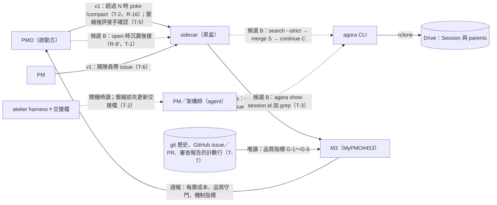
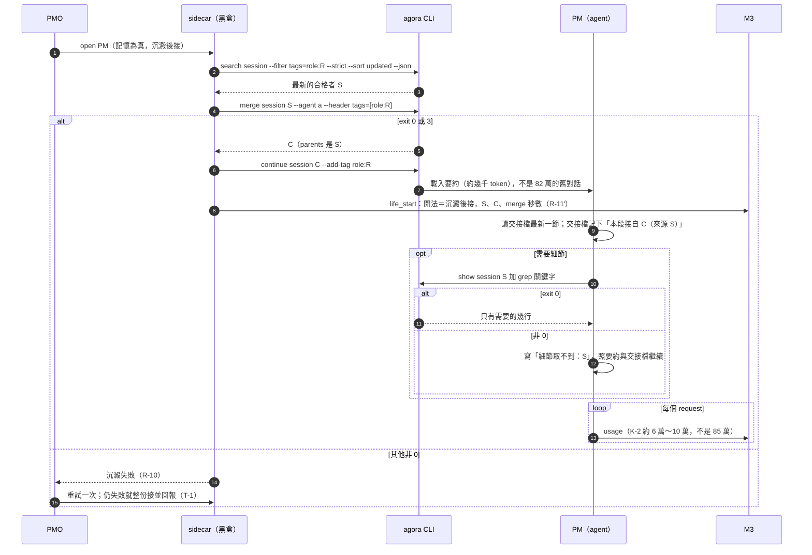
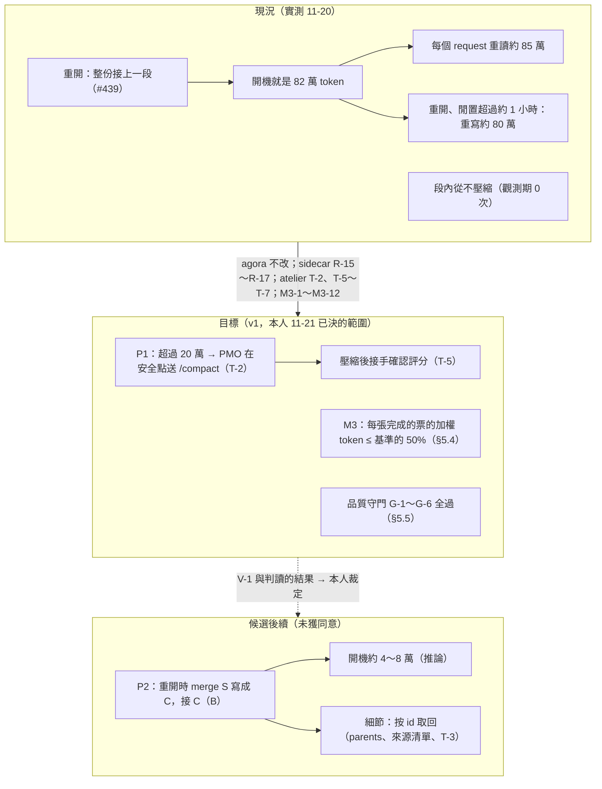

# #462 v1：用召回取代每輪重送（長對話成本收斂）

- 單：#462（MAS，層級 b）。父：期八 M4「長對話成本收斂」（PMO 派工，本人 2026-11-21 要求）。量測靠 M3（MyPMO#453）。
- 作者：專案架構師（作者模式，myaistorage-arch-w1-1，Claude Opus 5.5），2026-11-21。基準：main `fbdd60f`。
- 修正第 1 輪（2026-11-21）：回應非作者審查的中 1～4、低 1～3，以及 PM 提的三個風險點（`/compact` 前提鏈、門檻寬嚴、品質守門的上限）。改了 §0、§1.1、§2.1、§2.3、§4.1、§4.3（R-11′、R-14、S-16～S-18）、§4.4（T-1、T-2）、§4.5、§5.1（K-7、K-8）、§5.2、§5.3、§5.6、§5.7（M3-3、M3-6）、§6（Q-B、Q-E、Q-F）、§7、§11。
- 修正第 3 輪（2026-11-21）：照本人 11-21 的裁定（經 PMO，MyPMO#469）改範圍與成功門檻。**L1＝A**：v1 只做營運規矩＋V-1＋M3 度量與品質守門；B（重開時沉澱，R-8′～R-14、C-7～C-10、T-1、T-3、T-4、MLP-1、V-2）改成「看 V-1 與基準期結果再說」的**候選後續**，設計保留、**未獲本人同意進入實作**。**L2**：成功＝每張完成的票的 token 成本降到現況的 50% 以下，而且程式品質不退步。改了 §0、§2.3、§3、§4、§5（重寫）、§6、§7、§8、§9、§10、§11。
- 範圍：**只設計**。不改 `src/`、`tests/`、`openspec/specs/`、`atelier/`。sidecar 與 M3 在別的 repo，本稿只寫「對 sidecar 的要求」（R-編號）和「對 M3 的要求」（M3-編號），不描述它們的內部設計。
- 和 v0 的關係：v0 是 `462-session-editing-and-consolidation.md`（11-15；本人同意方向 B：重開時用 `agora merge` 沉澱，預設關閉）。v0 的 agora 側 C-1～C-6 已經實作並 merge（PR #465、#467，測試在 `tests/unit/test_cli.py:1948` 起）。v0 **原檔不改**，只在檔頭加一行指向本稿。逐項的「v0（11-15）→v1」對照放在 §9。
- **為什麼另開新檔、不就地改寫**：(1) v0 是本人核准方向時看的版本，程式（`cli.py:835` 的註解）、測試（`test_cli.py:1948-1952`）和 D-29 都用「462 §10.3 C-1」這種編號引用它；就地改寫會讓這些引用指到不同的內容。(2) v1 的目標換了（從「重開時接得短」變成「每個 request 少重讀」），被取代的地方遍布全篇，逐段標「v0→v1」會比新寫一份還難讀。(3) 舊檔留著不動，非作者審查可以直接 diff 兩份。
- 資料紀律：用到的真資料只有 sidecar `/costs` 用量帳的**數字**（團隊目錄的 `costs/costs-all.jsonl`），以及第一版大小探針的字數統計（`exp462/size-probe.csv`）。沒有讀任何 session 內容。每個數字都標「實測」或「推論」。第 3 輪另外用了：公開 repo 的 git 歷史與 GitHub 的 issue／PR 清單（只取編號、時刻、層級、行數）、團隊目錄的審查報告（只數條數與輪數，不引用內文）。腳本在團隊目錄 `exp462v1-fix3/`，只輸出數字。

## 0. 給本人的一頁

**已決（本人 2026-11-21，經 PMO，MyPMO#469）**：
- **範圍（L1＝A）**：v1 只做三件事。(1) **營運規矩**：長壽角色的 context 超過 N 時，由 PMO 在安全點送 `/compact`（T-2）。(2) **先驗證做得到**：V-1a 用拋棄式 agent，V-1b 用真的 PM（§7.1）。(3) **M3 的每票成本度量與品質守門**（§5）。**B（重開時沉澱）不在 v1**：設計留在 §3、§4，標成「候選後續」，等 V-1 與基準期的結果出來，再由本人決定要不要做。
- **成功（L2）**：**每張完成的票**（d／c，從開工到 merge 或關閉），所有角色合計的加權 token，降到現況基準的 **50% 以下**；**而且**品質守門的硬門檻全部通過（§5.4、§5.5）。

**根因（實測，§1）**：長壽 PM 每個 request 都重讀約 85 萬 token。其中 93% 是開機時從前幾段整份接回來的舊對話，而且從來沒有被壓縮過。

**一個要先講的風險**（推論；只有 #488 一張票的資料，§5.1）：
- **PM 只算這張票進行中的那段時間**：PM 佔這張票加權成本的 53%，實作 32%，審查 15%。這時就算 PM 的加權成本降 79～89%（§2.1 的估算），這張票也只降到基準的 53～59%，**達不到 50%**。
- **PM 的閒置與跨票開銷也分攤到完成的票（全帳）**：PM 佔 85%，同樣的降幅會讓這張票降到 24～33%。
- 所以，**未歸戶的開銷怎麼算（Q-I），會決定這個目標達不達得到**。只壓 PM 可能不夠：實作的 context 在一張票裡從 2 萬長到 12 萬。v1 只量隊員，不改。

**v1 的順序（§7）**：
1. 本稿核准。
2. M3 開始收每票成本與品質的基準（至少 10 張票，約 1 週）。同時做 V-1a，PM 在自己的 worker 上就能做。
3. V-1b：**要本人單次授權**，授權清單在 §7.2，可以直接貼。
4. P1：T-2 生效。
5. 判讀之後，由 PMO 帶著數字請本人決定 B。

**待本人決定**（括號是預設；細節見 §6）：
- Q-D：門檻 N 和動作（**20 萬，`/compact`**）
- Q-I：未歸戶的 PM／PMO 開銷怎麼算（**全帳：按完成票的歸戶成本比例分攤；分攤池的大小另外報**）
- Q-J：「token 數」怎麼數（**模型中立的加權 token，讀快取 0.1、寫快取 2.0、輸出 5；原始 token 與美元也報**）
- Q-K：品質守門的門檻（**§5.5 的 G-1～G-6 都是硬門檻**）
- Q-G：隊員（**不改，照舊 `remember:false`**）
- Q-L 授權：§7.2 的 A-2（對 PM 送一次 `/compact`）；A-1（PMO 跨機器 poke 拋棄式 agent）可選

## 1. 根因與資料（回答第 1 問）

**資料**：sidecar `/costs` 的列，在這台 worker 上由 PM 拉到團隊目錄。`usage` 列 143 筆，時間是 2026-11-20 15:03～21:49 UTC（JST 11-21 00:03～06:49），加上 `life_start` 列 24 筆（11-18～11-20）。在 11-20 15:03 UTC 以前拉的時候，`unattributed_count` 有 502～850 筆（實測，`costs/pull-log.jsonl`），也就是那之前的用量歸不到 agent。**所以基準期實際上只有 PM 的一段**（life `…94QDM`，44 個 request）。

### 1.1 實測

| 量 | PM（claude-sonnet-5-5） | 審查者（claude-sonnet-5-5） | 實作（deepseek-v4.1-flash，opencode） |
|---|---|---|---|
| 這段的 request 數 | 44 | 29 | 68 列（`requests` 是 null，見 §5.4） |
| 每個 request 的 context（input＋cached＋cache_write）：第一個 → 最後一個 | 821,914 → 879,741 | 37,176 → 83,280 | 20,397 → 119,625 |
| context 中位數 | 853,290 | 68,583 | 80,753 |
| 每多一個 request，context 增加多少（最小平方斜率） | 1,319 | 1,732 | 1,294 |
| cached_tokens：中位數／最大 | 849,936／877,220 | 67,170／82,818 | 80,448／119,424 |
| 快取讀取佔 token 的比例 Σcached／Σ(input＋cached＋cache_write) | 0.954 | 0.961 | 0.986 |
| cache_write 合計 | 1,731,359 | 72,942 | 0（不回報） |
| 其中「整段重寫」（單一 request 的 cache_write 超過 10 萬） | 2 次：811,576（開機的第一個 request）、862,333（閒置約 4 小時 18 分之後）；合計 1,673,909，佔 96.7% | 0 | — |

表註（實測）：
- `usage` 143 筆＝PM 44＋審查者 29＋實作 68＋測試隊員 `myaistorage-test-w1-1` 2 筆。測試隊員那 2 筆是 deepseek-v4.1-flash（opencode，`requests` 是 null），量太小，不進上表。
- 143 筆的 `provider` 欄位**全是 null**。表頭只寫 model；§1.2 套 Anthropic 的倍率，是從 `model` 推斷供應商（推論）。M3 要拿到真的 provider（M3-2）。

**推論**：

- **PM 的 context 有 93.4% 是開機時帶進來的**（821,914／879,741）。段內 44 個 request 只多了 57,827。#439 的召回把整條舊對話接回來（`439-role-session-recall.md:15`「記憶的單位是整個 agora Session，不切、不摘要、不編輯」），而且舊對話從沒被壓縮過。PM 從 11-18 09:25 到 11-20 15:02 開了 4 段（實測，`life_start`），每段都接著上一段，所以會越接越長。
- **審查者和實作是冷啟動**（`remember:false`，`pm/v7.md:99`）。它們的 context 只在段內長，最多約 12 萬。
- **快取的 TTL 看起來是 1 小時**：間隔約 24 分、約 59 分的兩次仍然命中，約 4 小時 18 分的那次沒命中。`at` 可能是收集的時刻而不是 request 的時刻（同一分鐘有很多列），所以間隔只是近似。
- **BRIEF 寫「`/compact` 之後下一個 request 只有約 1 萬」是誤讀**。那一個 request（seq 40）的 cached 是 10,336，但 cache_write 是 862,333，context 合計 872,671，和前一個差不多。這是**閒置超過 TTL、快取過期之後的整段重寫**，不是壓縮。這段資料裡**沒有看到任何壓縮**（同一段裡 context 一次掉超過 50% 的情況是 0 次）。至於 10,336，PM 和審查者的第一個 request 都是這個數字的 cached，推論是 Claude Code 共用的系統提示前綴。
- **PM 的 cache_write 合計約 173 萬，是「重開」加「閒置過期」造成的**，不是壓縮後的重寫。

### 1.2 換算成本（推論：倍率用 Anthropic 的標準值，cache 讀 0.1、寫 1.25（5 分鐘 TTL）或 2.0（1 小時 TTL）、輸出 5；實際以 M3 的價目表為準，M3-5）

| 量 | PM | 審查者 |
|---|---|---|
| 這一段的加權成本（基本輸入 token 等值；5 分鐘／1 小時） | 5,895,431／7,193,950 | 344,152／398,858 |
| 平均每個 request | 133,987／163,499 | 11,867／13,754 |
| 加權成本裡快取讀取的佔比 | 0.606／0.497 | 0.517／0.446 |
| 加權成本裡快取寫入的佔比 | 0.367／0.481 | 0.265／0.366 |

- **PM 佔兩個 Claude 角色加權成本的 94.5%～94.7%**；每個 request 的成本是審查者的 11.3～11.9 倍。
- **重寫一次（約 86 萬）的成本**，等於 20.3 個（1 小時 TTL）或 12.7 個（5 分鐘 TTL）request 的快取讀取。所以「閒置超過一小時」和「重開」兩件事一樣貴，都和 context 的大小成正比。
- deepseek 的價目在這裡沒有資料，只報 token 比例（0.986）。期七分析的「快取讀取佔加權成本 63.1%」是 PMO 的數字，本稿沒有重算。

### 1.3 第一版大小探針被什麼取代

`REPORT-462-size-probe.md` 量的是閱讀版的字數，有三個限制：(i) 閱讀版只是下界；(ii) relation 全是 import，分不出接續；(iii) 定不出重開點。`/costs` 把這三點都解掉了：

- **(i)**：直接量到 agent 每個 request 實際送出的 context。PM 的閱讀版最長 338,276 字（約 9.7 萬 token，chars／3.5），實際送出的 context 卻是 82～88 萬 token。推論：工具結果、系統提示這些閱讀版不收的東西，佔了大頭。兩邊不一定是同一段，`session_ref` 和 agora id 對不上（M3-3），所以這只是量級。
- **(ii)、(iii)**：`life_id` 加上 `life_start` 列就能定出段落和重開點，第一個 request 的 context 就是「重開時接回來的量」。

探針留著一個仍然有用的數字：**PM 的 28 段裡有 15 段的閱讀版超過 6 萬字**（`SOURCE_MAX`，`cli.py:752`）。其他角色：arch 42 段裡 2 段，impl、rev 0 段。這是 B 的品質風險（§2.3）。

## 2. 候選機制與取捨（回答第 2 問）

### 2.1 估算方法（推論）

用 PM 這一段的 44 個 request 重算。保留每個 request 的增量、輸出和兩次整段重寫的位置，只把開機時的 context 從 821,914 換成 s，s 是新做法開機時的 context。

- **s 的估法**：系統前綴加 harness 加交接檔加要約。審查者冷啟動的第一個 request 是 37,176（實測），要約最長約 5 萬字（`SECTION_SCHEMA`，v0 §2 第 1 點），所以取 s＝4 萬／6 萬／8 萬三個值。
- **m 是寫要約的成本**。最好的情況是有快取，0 次 AI 呼叫（C-1a）。最壞的情況是三次都送滿 6 萬字（推論約 6 萬 token），再加輸出，取 42 萬基本 token 等值當上界。

| s | m | 每個 request 的平均 cached | 降多少 | 一段的加權成本（1 小時 TTL）降多少 | token 比例 | 加權裡快取讀取的佔比 |
|---|---|---|---|---|---|---|
| 基準 | — | 811,876（實測） | — | — | 0.954 | 0.497 |
| 4 萬 | 0～42 萬 | 65,504 | −91.9% | −83.3～−89.1% | 0.945 | 0.24～0.37 |
| 6 萬 | 0～42 萬 | 84,594 | −89.6% | −81.0～−86.8% | 0.947 | 0.27～0.39 |
| 8 萬 | 0～42 萬 | 103,685 | −87.2% | −78.7～−84.6% | 0.949 | 0.30～0.41 |

（腳本：團隊目錄 `exp462v1/a4.py`，只輸出數字。兩次整段重寫（seq 1、40）保留實測的 cached 10,336（系統前綴命中），只把其餘的部分算成寫入；第一版把它們的 cached 設成 0，數字偏保守約 0.5 個百分點，已更正。5 分鐘 TTL 時加權降幅是 −77.2～−88.9%。）

**敏感度一：段內閒置重寫（K-5）**（推論，團隊目錄 `exp462v1-fix1/a5.py`）。基準段裡 seq 40 那次閒置 4 小時 18 分後的整段重寫，單獨就佔這一段加權成本的一大塊：把它改算成「命中，只有增量是寫入」，基準每個 request 的加權成本從 163,499 降到 126,278（−22.8%，1 小時 TTL）。處理期如果剛好沒有長閒置、基準卻有，比較就會偏向處理期。兩邊都扣掉段內 K-5 再比，降幅是 −84.1～−88.7%（m＝0），和不扣的 −84.6～−89.1% 差不到 1 個百分點；最不利的組合（處理期有、基準扣掉）仍有 −80.0～−85.9%。所以這個偏差不會讓 v1 原稿的 60% 門檻翻盤（第 3 輪已撤，§5.2）。第 3 輪的每票成本照實算進段內 K-5，另外報次數（§5.3 (c)）。**限制**：基準只有 1 段，「多久會閒置超過 TTL 一次」完全不知道。

**敏感度二：按 id 取回（T-3）留在 context 裡的量**（推論，`exp462v1-fix1/a5.py`）。PM 的 28 段裡有 15 段的閱讀版超過截斷門檻（§1.3），上線後 T-3 推論一定會用到。取回的內容會留在該段之後每個 request 的 context 裡。設每次取回帶入 x token、一段取回 k 次（平均分散在 44 個 request 裡），s＝6 萬、1 小時 TTL：

| x（每次取回） | k＝1 | k＝3 | k＝6 |
|---|---|---|---|
| 2 千（grep 幾行） | −89.5%／−80.8～−86.7% | −89.2%／−80.5～−86.3% | −88.9%／−80.0～−85.8% |
| 1 萬 | −89.0%／−80.2～−86.0% | −87.9%／−78.5～−84.3% | −86.2%／−76.0～−81.8% |
| 3 萬（整節讀進來） | −87.9%／−78.5～−84.3% | −84.5%／−73.5～−79.3% | −79.5%／−66.0～−71.8% |

（每格：每個 request 的平均 cached 降多少／加權成本降多少，m＝0～42 萬。）照 T-3 只取幾行（x ≤ 1 萬、k ≤ 3）時，降幅從 −89.6% 收斂到 −87.9～−89.5%，影響很小；最壞的一格（每段讀進 18 萬）收斂到 −79.5%／−66.0～−71.8%，仍過 v1 原稿的 50%、60% 門檻（第 3 輪已撤），而且那一段的 K-1 會到約 30 萬，會先碰到 T-2 的 N。所以 T-3「只取幾行」是成本上的必要條件，不只是建議；取回的量用 K-8 看（§5.2）。本段屬於候選 B。

### 2.2 比較表

| | A `/compact` 當政策 | **B 重開時沉澱** | C 段內門檻 | D 隊員召回 | E 冷啟動＋交接檔 |
|---|---|---|---|---|---|
| **預期省多少（推論）** | 和 B 同一個量級。**前提**：壓縮後重開時 agent 從壓縮點載入。前提不成立的話，每次重開仍要讀一次、重寫一次約 80 萬（約 170 萬基本 token 等值／次） | §2.1：每個 request 的快取讀取 −87～−92% | 建在 B 之上。PM 段內每個 request 約 +1,300，一天約 +6 萬（推論，只有一段資料），N＝20 萬時大多數段落觸發不到 | 負的（context 變長） | 比 B 略多（沒有要約、沒有 m） |
| **改動面** | atelier（PMO 規矩）；要驗證 sidecar 的 poke 能送斜線指令（R-16） | sidecar R-8′～R-14；atelier T-1～T-5；**agora 不改**（C-1～C-6 已完成） | sidecar 加自動門檻與安全點判斷 | 改 PM harness | atelier（啟動方改帶 #439 R-1 的 (2)）；不用寫程式 |
| **風險** | 壓縮的保留性沒驗；壓縮摘要不經 schema 驗證，也不是獨立的 Session；要往跑著的 tui 打字 | 要約漏細節（PM 段 15/28 超過截斷門檻）；連續沉澱會漂移；MLP 阻力（merge 走不到、跑在 HTTP 執行緒、900 秒＜1800 秒，依 PM 轉述 MyLinuxPool#1272 的結論） | 打斷工作；多一層協調；安全點難定 | 序號重用時混進別張單的內容（v0 §7） | 失去對話記憶；與 11-10「預設記」相反；全靠交接檔寫得好 |
| **可逆性** | 停送就好 | 啟動方改回「整份接」就好（T-1）。已沉澱的線接的是 C，要回到原線就在 open 時明指 `session`＝S（#439 U-12） | 關掉自動化就好 | — | 改回預設 (1) 就好 |
| **by-id** | 只有「自己的 id」：壓縮前的內容推論仍在同一個 Session 的 raw 裡，但 agent 不知道自己的 agora id | **有**：C 的 `parents`、內文的來源清單（`cli.py:803`） | 同 B | — | 只能靠交接檔手寫 id（T-4） |

### 2.3 v1 範圍（本人 11-21 已決：L1＝A）

**v1 做**：

1. **營運規矩（不用寫程式）**：
   - T-2：長壽角色（PM、架構師）最近一個 request 的 context 超過 N（預設 20 萬，Q-D）時，由 PMO 在安全點送 `/compact <保留重點>`。
   - 壓縮後，PMO 做一次接手確認並評分（T-5）。
   - 現在的 PM 約 88 萬，第一次檢查就會觸發。
2. **先驗證（§7.1）**：
   - V-1a：在拋棄式測試 agent 上驗前提鏈，也驗壓縮後還記不記得。
   - V-1b：對真的 PM 試一次。要本人單次授權（§7.2）。
3. **量測與守門**：
   - M3 收每票成本（§5.1）和機制指標（§5.2）。
   - 品質守門 G-1～G-6（§5.5）。
   - 基準期從現在開始收。
   - atelier 補兩條，讓這些數字收得到：T-6（開隊員一律帶 issue），T-7（審查報告結尾加計數行；缺陷逃逸要標記）。

**v1 不做**：

- **B（候選後續，未獲本人同意進入實作）**：重開時沉澱。包括 sidecar 的 R-8′～R-14、MLP-1、V-2，atelier 的 T-1、T-3、T-4，agora 的測試 C-7～C-10，以及 §5.8 的離線重播。設計保留在 §3、§4。等 V-1、基準期和 P1 的結果出來，由 PMO 帶數字請本人裁定（§7.3）。
- C 的自動化、D、E：理由同 §10。
- 不加 agora 的指令、旗標、header 欄位。R-12 換線掃描延後。map-reduce 長來源不做。

**B 留作候選的理由**（推論，給本人裁定時參考）：

1. 壓縮撐不過重開時（V-1 的結果②），每次重開仍要讀一次、重寫一次約 80 萬，約 170 萬基本 token 等值。B 處理的就是這一段。
2. 要約是另一個可以檢查的 Session，`parents` 連到原版，這就是 by-id 網狀。
3. B 不依賴 agent 怎麼壓縮，也不必往跑著的 agent 裡打字。

**不值得**的情況有兩種：
- 離線重播（§5.8）裡，B 的探針正確率不比冷啟動好。
- P1 已經讓每票成本達標，而且品質守門全過。

**為什麼 N＝20 萬**（推論）：
- 每重置一次的成本取 15～50 萬（m 加上重寫 s），段內增長 g≈1,319／request。
- 最小化「平均讀取＋攤提的重置成本」，得到 N−s ≈ √(重置成本×g／0.05) ≈ 6.3～11.5 萬，也就是 s＝6 萬時 N 約 12～18 萬。
- 取 20 萬，偏向少打斷。
- 這個模型沒有算進打斷工作和漂移的代價，所以門檻由本人定（Q-D）。

## 3. by-id 網狀：id 在哪、誰能解、解不開怎麼辦、循環與重複

> **本節屬於候選 B**（§2.3），v1 不實作。by-id 要等 B 做了才有；v1 的 `/compact` 沒有 by-id（§2.2）。

**原則**：一份真相。id 和出處只存在 agora 的 header 裡（Drive）。其他地方（sidecar 的紀錄、M3、交接檔）都只是索引或給人看的副本，兩邊不一致時以 agora 為準。這延續 v0 §2 第 2 點。

| 問題 | 答案 | 依據 |
|---|---|---|
| **id 存在哪** | (1) C 的 header `agora.parents: [{id: S, raw_md5}]`，是系統欄位，使用者不能改。(2) C 的內文每一節都有一行「`<id>`（原版：`agora show session <id>`）」，前面有 MERGE_NOTE「需要細節時，只用清單裡的 `agora show session <id>` 取原版」。(3) sidecar 的紀錄（R-11′）寫進 `/costs` 的 `life_start` 列，由 M3 長期保存（M3-1、M3-3）。(4) 交接檔的最新一節寫「本段接自 C（來源 S）」（T-4，給人看） | (1) `header.py:212-216` `check_user_fields` 擋系統欄位；`test_cli.py:859` `test_header_cannot_touch_system_fields`。(2) `cli.py:803`、`cli.py:2526-2527` |
| **誰能解** | 任何有 agora CLI、而且設好同一個 Drive 的行程：`agora show session <id>`。本機沒有這個 id 時會整份同步一次（`cli.py:290-298`），所以別台機器上傳過的也解得開。**模型限制**：取回的是真的對話內容，只有輪換表准碰真資料的模型能取（`pm/v7.md:165`）；長壽角色（PM、架構師）本來就是 | `cli.py:290-298`、`cli.py:2804` |
| **解不開** | (a) 不存在，或別台還沒上傳（還在 outbox，exit 3）→ `show` exit 1「找不到」（`cli.py:309-313`）。(b) Drive 上已刪、本機有舊副本 → exit 0，stderr 會說它不在雲端（`cli.py:2808-2809`；`test_cli.py:1296`）。(c) 同步出錯 → 非 0。**取回方的規矩（T-3）**：只要非 0 就當作取不到，在回報裡寫「細節取不到：<id>」，照要約和交接檔繼續做，不要猜，也不要為了補細節重跑 merge。**刪除保護**：S 有子 Session（C）時不能刪（v0 C-5，`test_cli.py` 的 `test_c5_…`），所以整個網只能從葉子（最新的）往回刪，被引用的節點不會先消失 | C-9（新測試）、v0 C-5 |
| **循環** | 不可能發生。`parents` 只在建立時寫（merge、fork），而且只能指向已經存在的 id；之後 `continue` 不改 `parents`（v0 C-4），使用者也改不了（系統欄位）。所以這個網是一個依建立時間排序的有向無環圖。取回方另外有跳數上限：沿 `parents` 最多往回 3 層（T-3） | C-8、C-10 |
| **重複** | (i) 同一個 S 被沉澱兩次：sidecar 在 merge 之後、continue 之前死掉的話，下次重開時 `role:R` 底下最新的是還沒接過的 C，照 R-9 直接接它，不會再 merge。merge 只給一個來源、而它是還沒接過的要約時，agora 會拒絕（v0 C-1）。就算真的重跑，要約快取讓第二次不叫 AI（v0 C-1a）。(ii) 同一個 id 在一次 merge 裡給兩次 → exit 1「重複了」（`cli.py` 的 `cmd_merge`）。(iii) 連續沉澱時，C2 的來源 C′ 的閱讀版第一則就是上一份要約，所以內容會遞迴包含上一份。這是漂移，不是 id 重複，用離線重播的 A3 量（§5.6） | v0 §5.3、R-9 |
| **取回的成本** | 取回的內容會進 context，而且整段都留著。整份 `show` 一段 PM 的閱讀版，最多約 34 萬字（實測最大值）。規矩（T-3）：用 `agora show session <id> \| grep -n <關鍵字>` 或 `sed -n` 只取需要的幾行，不要整份讀進來 | 推論 |

## 4. v1 的介面與契約（回答第 3 問）

### 4.1 誰負責什麼

| 模組 | v1 負責 | 候選 B 才有（v1 不做） | 不做 |
|---|---|---|---|
| **agora**（本 repo） | **沒有變更，也沒有新測試** | C-7～C-10 的測試，把 by-id 依賴的既有行為鎖住（§4.2） | 不判斷什麼時候沉澱；不量 token；不新增指令、旗標、欄位 |
| **sidecar**（MLP） | `/costs` 的資料品質（R-15）；每一列帶 `issue`（R-17）；確認 poke 能送斜線指令（R-16，由 V-1a 驗，不一定要寫程式） | open 時依選項沉澱、記錄開法、merge 的上限與併發（R-8′～R-14） | 不寫要約；不改 Session header；不判斷什麼時候壓縮 |
| **atelier**（本 repo 的 harness，由 PMO／PM 照 harness 流程改） | 什麼時候壓縮（T-2）；壓縮或重開後的接手確認評分（T-5）；開隊員帶 issue（T-6）；審查報告的計數行、缺陷逃逸的標記（T-7） | 沉澱後接（T-1）；按 id 取回（T-3）；交接檔記 id（T-4） | 不放對話記憶 |
| **M3**（MyPMO#453） | 收、存、算每票成本、機制指標與品質指標，出週報（M3-1～M3-12） | 沉澱的成本（K-7） | 不決定門檻（門檻由本人定） |
| **PMO** | 依 T-2 壓縮長壽角色；評接手確認（T-5）；轉授權請求給本人（§7.2）；判讀之後把數字帶回本人 | 依 T-1 開 PM | — |

**依賴方向**（不變，沒有環）：

```
PMO／PM（啟動方）→ sidecar →（CLI）agora → Drive
                    sidecar →（/costs）→ M3 → 週報 → PMO／本人
agent（PM、架構師）→（shell）agora show（按 id 取回；候選 B）
M3 → git 歷史、GitHub issue／PR、審查報告的計數行（品質指標，唯讀）
```

agora 不認識 sidecar 和 M3。M3 讀 repo 與報告，只讀不寫。`docs/architecture/overview.md` 的模組地圖**不變**，所以本 PR 不改它。

### 4.2 agora 側契約（**候選 B，v1 不做**；本 repo，`tests/unit/`，假 agent、假 rclone、`isolated_home`）

**C-1～C-6 沿用**，已實作，見 v0 §10.3 與 `test_cli.py:1948` 起的 `test_c1_…`～`test_c6_…`。v1 新增的都是**既有行為的新測試，不改 `src/`**：

| # | 輸入 → 輸出或錯誤 | 測試層 | 新／既有 |
|---|---|---|---|
| C-7 | **按 id 取回**：前提是 S 是 import 來的，假 agent 第一次就回合格的要約。`merge session S --agent opencode` 得到 C，然後：(a) `show session C` exit 0，header 的 `agora.parents` 只有一筆，`id` 等於 S；(b) 內文含 `` `S`（原版：`agora show session S`） `` 這一行（`cli.py:803`），也含 MERGE_NOTE 的「只用清單裡的 `agora show session <id>` 取原版」；(c) `show session S` exit 0，輸出和 merge 之前位元組相同 | unit | 既有行為，新測試 |
| C-8 | **鏈可以走完**：S → `merge` 得到 C → `continue C`（假 agent 加一則）→ `merge session C` 得到 C2。(a) 第二次 merge 有叫 summarize（C 已經是 `relation: continue`，不沿用，`cli.py:856`）；(b) C2 的 `parents` 是 `[C]`，C 的 `parents` 是 `[S]`，從 C2 沿 `parents` 兩跳到 S，每一跳 `show` 都是 exit 0；(c) 每一跳的 ULID 毫秒，父都早於子 | unit | 既有行為，新測試 |
| C-9 | **解不開**：`show session agora:<格式合法、但本機和假 Drive 都沒有的 ULID>` → exit 1，stderr 含「找不到」，stdout 是空的；假 Drive 上沒有、本機有舊副本 → exit 0，stderr 說它不在雲端（既有 `test_cli.py:1296`，引用就好） | unit | (a) 新測試；(b) 既有 |
| C-10 | **出處不可改**：`edit session C --header agora=…` 或 `--header-file` 裡帶 `agora` → exit 1，C 的 `parents` 不變。既有的 `test_cli.py:859`、`tests/unit/test_header.py:68` 已經涵蓋，**只引用、不新增**；`continue` 不改 `parents` 由 v0 C-4 涵蓋 | unit | 既有 |

### 4.3 對 sidecar 的要求（接在 #439 R-1～R-7、v0 R-8～R-12 之後）

**v1 只要 R-15、R-16、R-17**。R-8′～R-14 和 S-14～S-18 屬於候選 B，v1 不做，保留在這裡給本人之後裁定。

#439 的 R-1～R-7（`439-role-session-recall.md:394-400`）**全部沿用**。v0 的 R-8～R-12（v0 `462-session-editing-and-consolidation.md:439-443`）逐項如下：

| # | 要求 | 和 v0 的關係 |
|---|---|---|
| R-8′ | open 要有一個「沉澱」選項，只在記憶為真、沒帶 `session` 時有效。取值是「整份接」和「沉澱後接」。**sidecar 的預設維持整份接**（不改 #439 的行為）；長壽角色的「預設沉澱」由啟動方每次帶上（T-1）。啟動方包括 PMO 開 PM 的工具，所以 PMO 那邊的開啟工具也要能帶這個選項。欄位名由 MLP 定 | **改**：v0 只說預設關閉、啟動方每次選；v1 明訂由啟動方帶、預設值寫在 atelier |
| R-9 | 沉澱後接時：S 被鎖 → 不沉澱，照常接（得到 409）；S 是還沒接過的 merge → 直接接；其他情況 → `agora merge session S --agent <目標> --header tags=[role:R]` | 沿用 |
| R-10 | merge 的結果只看 exit code：0 或 3 → 取 stdout 第一欄的 C，接 C；其他非 0 → 回錯誤給啟動方，不自動整份接、不開新的。**v1 補一條**：這個錯誤要能和其他 open 錯誤分開辨認（碼由 MLP 定），讓啟動方照 T-1 處理 | 沿用＋補辨認 |
| R-11′ | 每一段的 `/costs` `life_start` 列（或同一個 `life_id` 的事件列）要帶：(a) 怎麼開的（全新／整份接／沉澱後接）；(b) 接的 agora id（S 或 C）；(c) 沉澱時的 S 和 C；(d) merge 的 exit code 與秒數；(e) 寫要約用的 agent 與 model，以及 merge 自己的 usage（拿得到的話），和該段 agent 的 usage 分開記，不混在一起；拿不到就明寫拿不到（Q-F）。M3 每次拉資料都會長期保存（M3-1），所以**不需要撐過容器重建**。依 MyLinuxPool#1272 的結論，撐過 sidecar 重啟是可行的 | **改**：v0 只說「記一行、存在哪由 MLP 定」，給換線掃描用；v1 的用途是量測，存在 `/costs` |
| R-12 | 換線掃描 | **延後**：v1 不需要它；需要時沿用 v0 原文 |
| R-13 | merge 的時間上限要和 agora 的最壞情況一致：三次嘗試 × `AGORA_SUMMARIZE_TIMEOUT`，加上同步與上傳。做法二選一：sidecar 帶較小的 `AGORA_SUMMARIZE_TIMEOUT`（例如 240 秒，3×240＋餘裕＜900），或把上限提高到超過 agora 的最壞情況。**超過上限時，要先讓 merge 子行程結束（或等它結束），才能回錯誤**；不准在 merge 可能還會產生 C 的時候就去接 S | **新**（MyLinuxPool#1272 指出 900 秒小於 1800 秒）。理由：還在跑的 merge 之後才寫出 C，C 會變成最新，破壞 #439 E-1 |
| R-14 | 沉澱的時候：(a) **照常回應**：sidecar 的其他請求（`GET /agents`、poke、close、別的 id 的 open）照常回應。(b) **狀態查得到**：呼叫方不用重送 open，就能查到這個 id 是「沉澱中」「已接上（接的是 C）」還是「失敗（R-10 的碼）」。形狀由 MLP 選，兩種都可以：`open` 先回「已受理」再讓呼叫方輪詢；或 `open` 照舊同步，但沉澱期間 `GET /agents`／`GET /agents/<id>` 就看得到這個 id 是「沉澱中」（附開始時刻）。(c) **同一個 `role:R`（R 就是 id，#439）同時只有一個進行中的 merge**：沉澱中又來一個同 id 的 open（包括呼叫方逾時後重送），不得再叫一次 `agora merge`（也就是不得再叫一次寫要約的 AI）；要回一個能和其他錯誤分開辨認的「沉澱中」，或掛到進行中的那一次、拿同一個結果（MLP 選）。(d) **呼叫方逾時不改結果**：呼叫方斷線或逾時，merge 照跑完，照 R-9、R-10 接 C 或記失敗，照 R-11′ 記一筆；不取消、不重做。(e) 沉澱中收到 close：照 R-13 先收掉（或等完）merge 子行程，再回；之後不接 C。已經寫出的 C 留著，下次 open 照 R-9 直接接 | **新**（MyLinuxPool#1272 指出同步跑在 HTTP 執行緒）。(c) 的理由：v0 C-1a 的要約快取只在第一次 merge 寫完之後才有效，第一次還在跑時重送，會再叫一次 AI |
| R-15 | `/costs` 的資料品質：(a) usage 列要有 request 本身的時刻；如果 `at` 是收集時刻，就另外給一個欄位。(b) opencode 的 `requests` 不能是 null，要給數字，或明文寫「一列就是一個 step，也就是一次模型呼叫」。(c) agent 有回報時，cache_write 依 TTL 分開（5 分鐘、1 小時）。(d) ring 被擠掉時要有計數（現在有 `evicted`，保留就好） | **新**（給 M3） |
| R-16 | 驗證（不一定要寫程式）：poke 的 `text` 以 `/` 開頭時（例如 `/compact …`），claude 和 opencode 的 tui 會把它當成斜線指令執行，不是當成一般訊息；agent 正在跑一輪時，不中斷的 poke 會等那一輪結束再送。驗法見 §7.1 的 V-1a。不成立的話，v1 的 T-2 沒有可用的動作（§7.3 的③） | **新**（給 A 用） |
| R-17 | 每一列帶 `issue`：open 時帶的票號，要寫進該段的 `life_start` 列和 usage 列。實測：`/costs` 的列有 `issue` 欄位，test 隊員那一段的 3 列都帶了（依 BRIEF 轉述，來自 MLP#1453 的 `open --issue`）。v1 要求三點：(a) 所有 agent 種類（claude-code、opencode、agy、codex）的 open 都接受 `issue`，並帶到列上。(b) 一段做到一半換票時，二選一（MLP 選）：用一個呼叫改這一段之後的 `issue`；或規定換票就重開，T-6 照這個規定寫。(c) 沒帶 `issue` 的列，值就是 null，不要猜 | **新**（給每票成本，§5.1） |

**sidecar 側的驗收**：
- v1 只有 S-19（R-17）：四種 agent 各帶 `issue` 開一次，`/costs` 的 `life_start` 和 usage 列都帶同一個 `issue`；不帶就是 null。
- 以下屬於候選 B：沿用 v0 的 S-6～S-12（v0 §10.4）；S-13 隨 R-12 延後；新增：

- S-14（R-11′）：三種開法各一次，`/costs` 的 `life_start` 都帶對種類和 id。
- S-15（R-13）：假 agora 的 merge 超過上限 → 先收掉子行程，再回錯誤，而且不呼叫 continue。
- S-16（R-14 (a)(b)）：假 agora 的 merge 卡住期間，`GET /agents` 在 1 秒內回應，而且這個 id 顯示「沉澱中」；merge 結束後變成「已接上」或 R-10 的失敗碼。
- S-17（R-14 (c)）：假 agora 的 merge 卡住期間，同一個 id 再 open 兩次（其中一次是呼叫方逾時斷線後重送）→ 假 agora 記到的 merge 呼叫只有 1 次；重送拿到可辨認的「沉澱中」或同一個結果；最後只開起一個 agent、只接一個 C。
- S-18（R-14 (d)(e)）：呼叫方在 merge 中途斷線 → merge 照跑完、接 C、`/costs` 只記一筆 R-11′；沉澱中送 close → 先收掉 merge 子行程再回，之後不呼叫 continue。

S-14～S-18 都是 sidecar 的測試（MLP），用會睡、會記呼叫次數的假 agora 執行檔，不碰真的 agora 與 Drive。

### 4.4 atelier 的程序改動（由 PMO／PM 照 harness 流程改，不在本 repo 的設計 PR 裡）

v1 做 T-2、T-5、T-6、T-7。T-1、T-3、T-4 屬於候選 B，v1 不做。

| # | v1？ | 改哪一份 | 加什麼規矩 |
|---|---|---|---|
| T-2 | **v1** | `atelier/pmo/pm/v8.md` | 每次看 M3 或 `/costs` 時，如果長壽角色最近一個 request 的 context（input＋cached＋cache_write）超過 N（預設 20 萬），就要在安全點處理。**安全點**：它剛回完話、沒有提問框（`awaiting_answer_since` 是空的）、沒有自己在跑的長指令。**處理**：先請它更新交接檔，再 poke `/compact 保留：目前的單、決定與理由、未決、下一步；交接檔路徑是 <路徑>`，接著做 T-5。**R-16 驗不過時**：沒有可用的動作（關掉再整份接，接回來的還是一樣長），只記錄，由 PMO 帶回本人（§7.3 的③）。**每次處理**都記在 M3（M3-4）。**P1 期間同一個角色一天最多處理 2 次**；超過就停下回報，因為那表示 N 定得太低，或者壓縮沒有生效 |
| T-5 | **v1** | `atelier/pmo/pm/v8.md`（接手確認） | 長壽角色**每次壓縮之後**、**每次重開之後**，PMO 都請它用一兩句說出三件事：現在在做哪些單、哪些在等審、哪些決定還沒做（`pm/v7.md:39`、`arch/v4.md:42` 的現況確認）。PMO 對照交接檔的最新一節評分：對／部分對／錯，記到 M3（M3-8）。評「錯」的時候，PMO 指出交接檔的那一節，請它重讀；這一次記成 G-6 的事件 |
| T-6 | **v1** | `atelier/worker-team/pm/v7.md`（開隊員）、`atelier/worker-team/arch/v4.md`（被開時） | PM 開隊員和架構師時，open 一律帶 `issue`，值是這張票，例如 `MyAiStorage#488`。**一個隊員一段只做一張票**；換票時照 R-17 (b) 的規定處理（改 issue，或關掉重開）。長壽 PM 本身不帶（它同時管好幾張票，分攤見 §5.1） |
| T-7 | **v1** | `atelier/worker-team/rev/v3.md`、`atelier/worker-team/arch/v4.md`（審查報告）；`atelier/worker-team/pm/v7.md`（開 d 單） | (a) 審查報告的**最後一行**用固定格式：`計數：高 <n>／中 <n>／低 <n>／nit <n>；規矩 <n>；改壞 <轉紅>/<總數>；輪次 <k>`。「規矩」是指發現裡有幾條違反 AGENTS.md 或 harness 的規矩（例如測試沒 `import _guard`、自己做了已有的 helper、碰了不該碰的路徑），這幾條同時也算進高／中／低。沒做改壞驗證就寫 `改壞 -`。(b) 開 d 單修正已經 merge 的 PR 時，`## 來源` 段寫一行 `逃逸自 #<PR>` |
| T-1 | 候選 B | `atelier/pmo/pm/v8.md:68`、`atelier/worker-team/pm/v7.md:99`（兩處都是「長期角色（PM／架構師）照預設」那一句，改成下面這條） | 開長壽角色（PM、架構師）一律帶「沉澱後接」（R-8′），除非本人或 PMO 明示這次要整份接。open 逾時或沒拿到結果時，先照 R-14 (b) 查狀態；還在沉澱就等，不重送。沉澱失敗（R-10）時重試一次；還是失敗就用「整份接」開，並在通道回報「沉澱失敗，改整份接」和 merge 的 exit code，不要靜默換 |
| T-3 | 候選 B | `atelier/worker-team/pm/v7.md`、`atelier/worker-team/arch/v4.md`、`atelier/pmo/pm/v8.md` 的 know（接手） | 開機的第一則是 merge 要約的話：要約是參考資料，**交接檔的最新一節才算數**（不改 `pm/v7.md:39`、`arch/v4.md:42` 的原則）。需要細節時用 `agora show session <id> \| grep -n <關鍵字>` 只取需要的幾行，不要整份讀進來。沿 `parents` 最多往回 3 層。exit 非 0 就寫「細節取不到：<id>」，不要猜，不要重跑 merge |
| T-4 | 候選 B | 同 T-3 的三份 | 開機時如果接的是要約，就在交接檔的最新一節寫「本段接自 <C>（來源 <S>）」，只寫 id，不寫內容 |
| — | — | 隊員（impl、rev） | **不改記憶**：照舊 `remember:false`（Q-G）。v0 Q-5 建議改成「存、不查找」，理由是「M2 要量隊員的 token」；現在 `/costs` 已經量到了，這個理由不在了（§9）。T-6 只是多帶 `issue` |

### 4.5 SOLID 與該層級的檢查

- **單一職責**：
  - 什麼時候壓縮，是 PMO 的政策（atelier T-2）。
  - 執行與記錄，是 sidecar（R-15～R-17）。
  - 算成本和品質，是 M3。
  - 寫計數行，是審查者（T-7）。
  - 每一塊都只有一個理由要改。品質的靜態指標由 M3 從 git 歷史算，不要求實作者自己報，免得「自己報自己」。
- **開閉**：#439 的召回規則和 E-1～E-5 不變；sidecar 的預設不變。v1 沒有新的機制，只加規矩和量測。
- **里氏替換**：每票成本對所有 agent 種類用同一個算法：模型中立的加權（§5.1），不管是哪一家的模型。
- **介面隔離**：
  - M3 只依賴 `/costs` 的欄位、git 的 diff、GitHub 的 issue／PR 欄位、報告的最後一行。
  - 審查者只要多寫一行，不必知道 M3 怎麼算。
- **依賴反轉**：門檻寫在本稿，經本人決定；M3 只負責算和比，不自己定門檻。
- **不符合的地方**：無。T-2 的 `/compact` 要往 agent 的 tui 打字，依賴 agent 的 UI 行為。這是**營運規矩**，不是介面，所以先用 V-1a 驗證 R-16，把風險擋在前面；驗不過就停在 §7.3 的③，不硬做。

## 5. 證明：用 M3 度量（回答第 4 問；第 3 輪依 L2 重寫）

**分工**：
- **驗收**看兩件事：每票成本（§5.1、§5.4），以及品質守門（§5.5）。
- **機制指標**（§5.2，原本的 K-2、K-4）只用來解釋成本為什麼降，不是驗收。
- 資料來源在每一節分成兩類：「現有」（現在就拿得到）和「要新增」（要 M3、sidecar 或 atelier 先補）。

### 5.1 主指標：每張完成的票的加權 token（L2）

**(a) 單位與邊界**

- **票**：這個 repo 的一張 d 或 c 單。
  - **開始**：第一個帶這個 `issue` 的段開始（T-6、R-17）。
  - **結束**：最後一個 PR merge，或以 completed 關閉。
  - 以 not planned 關閉的票，成本進「未歸戶池」，不進分母。
  - b 單不進主指標：數量太少，大小差太多。它的實作 PR 照樣進品質守門。
- **票當量**（分母）：一張票算 **它 merge 的 PR 數**，d 通常是 1。理由：c 單是「好幾步」，一張 c 抵好幾張 d。用 PR 數最容易從 GitHub 拿到，也不用主觀估大小。
- **票族**：merge 後 14 天內開的 d 單，如果 `## 來源` 寫了 `逃逸自 #<PR>`（T-7 (b)），它的成本**加回原票**，不另算一張。理由：防止「先草草 merge，再開修正單」把一張票的成本拆成兩張的便宜票（§5.3 (d)）。

**(b) 成本怎麼算**（Q-J）

- **模型中立的加權 token**：input×1＋cached×0.1＋cache_write×2.0＋output×5。
  - 所有模型都用同一組倍率，在基準期開始時凍結。
  - 好處：價目變了、改用免費模型，都不會讓數字自己變小。
  - 本人說的「token 數」，建議就是這個（Q-J）。
- **另外報兩個數**（不判讀）：原始 token（四項直接相加）；美元（M3-5 有價目才報）。
- **限制**：deepseek（opencode）的 `cache_write` 回報是 0（實測，§1.1），所以它的寫入看不到，實作的成本偏低。基準期和處理期一樣偏，比較不受影響。

**(c) 歸戶：誰的 token 算到哪張票**

| 角色 | 規則 | 資料來源 |
|---|---|---|
| 隊員（impl、rev、test）、架構師 | 該段的列帶 `issue`，就整段算給那張票 | 要新增：T-6（PM 一律帶）、R-17（四種 agent 都帶上）。**現有**：只有 test 隊員的 3 列帶了（實測） |
| 長壽 PM | **時間窗分攤**：每個 PM request，平均分給它發生時「進行中」的票（定義見 (a)）；那時沒有進行中的票，就進未歸戶池 | 要新增：M3-10。現有：`at` 可能是收集時刻，不是 request 的時刻（§1.1），所以先用 `at`，標「近似」，等 R-15(a) |
| PMO | 它的用量**不在這台 worker 的 `/costs` 裡**（實測：列裡只有 pm、impl、rev、test 四個 id）。拿得到時，按它當時管的團隊數平均分，再進該團隊的未歸戶池；拿不到時，基準期和處理期都不算，並在週報寫「PMO 未量」。T-2、T-5 的次數照樣記（M3-4） | 要新增：PMO 的用量來源（M3-1，由 MyPMO 定） |

**未歸戶池怎麼處理**（Q-I）：

| 選項 | 做法 | 好處 | 壞處 |
|---|---|---|---|
| (A) 只算歸戶 | 未歸戶的丟掉 | 簡單 | 把工作挪到未歸戶，數字就變好看；#488 這個例子裡 PM 只佔 53%，目標可能到不了 |
| **(B) 全帳分攤（預設）** | 每個判讀視窗內，全隊的加權 token（含未歸戶池）按完成票的歸戶成本比例分攤。每票成本加總起來＝帳單 | 鑽不了；最接近本人說的「目前總成本」 | 跨視窗還沒完成的票，它的成本會先落在別的票上，所以要用 10 張的視窗來平滑 |
| (C) 單獨列池 | 池另外報，設上限 | 透明 | 判讀時有兩個數 |

預設是 (B)，另外照 (C) 報池的大小和佔比。

**(d) 現有資料能算到哪裡**（實測，團隊目錄 `exp462v1-fix3/q2_ticket488.py`）

`/costs` 的 167 列裡，`issue` 有值的只有 3 列；`cost_usd` 全是 null。11-20 15:03 UTC 以前的用量歸不到 agent（§1）。唯一能拼出來的是 #488：
- 實作和審查各一段，時間在 PR #492 merge 之前。
- PM 用 16:30～17:16 UTC 這個時間窗。

| #488 | 列數 | 原始 token | 加權 token | 佔比（只算時間窗） | 佔比（全帳：PM 整段都算給它） |
|---|---|---|---|---|---|
| PM（時間窗內／整段） | 15／44 | 12,886,247／37,485,769 | 1,368,750／7,193,950 | 52.6% | 85.4% |
| 實作（deepseek） | 68 | 5,347,372 | 833,929 | 32.1% | 9.9% |
| 審查（sonnet） | 29 | 1,865,792 | 398,858 | 15.3% | 4.7% |
| 合計（只算時間窗／全帳） | — | — | 2,601,537／8,426,737 | 100% | 100% |

**推論**：
- PM 的加權降 78.7～89.1% 時（§2.1 的估算，1 小時 TTL；那是 B 的數字，A 要壓縮撐得過重開才在同一個量級，看 V-1），這張票只算時間窗會到 **53.1～58.6%**，全帳會到 **23.9～32.8%**。
- 「全帳」這一欄把 PM 那一段（約 7 小時，還做了別的事）全算給 #488，所以是上界；真的 (B) 要分給同一個視窗裡所有完成的票，PM 的佔比會落在兩欄之間。
- 結論：**只壓 PM 能不能到 50%，要看 Q-I 和基準期的實際分佈**，現在答不出來。

### 5.2 機制指標（解釋成本為什麼降，不是驗收）

全部從 `/costs` 算。

| # | 指標 | 算法 | 角色 |
|---|---|---|---|
| K-1 | 每個 request 的 context | input＋cached＋cache_write（null 當 0） | 機制 |
| K-2 | 每個 request 的快取讀取 | cached_tokens | 機制（v1 原稿的主指標，L2 之後降為機制） |
| K-3 | 快取讀取的 token 比例 | Σcached／Σ(input＋cached＋cache_write) | 只報告，不當門檻（§0、§2.1：預估只從 0.954 動到約 0.95，即 0.945～0.949） |
| K-4 | 加權成本裡快取讀取的佔比，以及每個 request 的加權成本 | 0.1×cached ÷（input＋0.1×cached＋2.0×cache_write＋5×output），倍率和 §5.1 相同 | 機制（同上） |
| K-5 | 整段重寫 | 單一 request 的 cache_write ≥ 0.5×K-1。分兩類：段首（重開）、段內（閒置超過 TTL） | 機制 |
| K-6 | 壓縮 | 同一段裡 K-1 比前一個 request 掉超過 50%，而且不是 K-5 | 機制（辨認壓縮） |
| K-7 | 沉澱的成本 | R-11′ 的 merge 秒數、exit code；token 優先用 R-11′(e) 記下的 merge 自己的 usage，沒有才用 §2.1 的上界 42 萬 | 候選 B |
| K-8 | 段內大增量 | 同一段裡 K-1 比前一個 request 多 1 萬以上的次數與合計。是按 id 取回（T-3）的代理指標，也會算到大的工具輸出（推論） | 機制 |

**對到角色與段落**：
- **角色**從 `agent` 解析（`<專案>-<角色>-<team>[-<序號>]`；`pm`、`arch` 是長壽角色，`impl`、`rev`、`test` 是隊員）。
- **段落**是 `life_id`。重開時，同一個 agent 會出現新的 `life_id`；段首的 K-5 就是重開時的重寫。
- **壓縮**是 K-6。PMO 依 T-2 送的 `/compact` 要另外記（M3-4），兩邊對得上才算。

**怎麼用來解釋**：
- 每個判讀視窗都要報：PM 的段數、K-2 的中位數、K-5（段首、段內分開）、K-6 的次數、T-2 的次數。
- **成本過了、K-2 卻沒降**：表示省下來的不是 T-2 的功勞（例如換了模型、票變小了）。照樣判，但 PMO 要寫明。這一點會影響 B 要不要做。
- **K-2 降了、成本沒過**：表示 PM 以外的角色是瓶頸。這是 §5.1 (d) 預告的風險，判讀時一起帶回本人。
- v1 原稿 §5.3 的 K-2 50%、加權 60% 門檻**撤掉**（被 L2 取代）。§2.1 的估算留著，用來解釋 PM 這一塊能省多少。

### 5.3 前後比較的協定

**(a) 判讀視窗**：
- 連續完成、合計 **10 個票當量**的票，組成一個視窗。照 11-08～11-20 的速度，大約 1 週一個（實測：那 13 天完成 d 13 張、c 6 張）。
- 不用「週平均」：一週的票數和大小起伏太大，而且週界會切開進行中的票。

**(b) 基準怎麼取**：
- **現有資料不夠**（§5.1 (d)）：只拼得出一張票。基準要從 T-6、R-17 生效後**往前收**。
- **至少 1 個視窗**（10 個票當量），其中改碼的 d 至少 7 張。
- **上限**：14 天收不滿，PMO 帶現有的票數回本人，決定要不要開始 P1。
- **等待的代價**：PM 每天約一段，一段約 720 萬基本 token 等值（推論，§1.2 的基準段）。
- **品質的基準可以用歷史**（§5.5），不用等。
- **分層**：「改碼」（動到 `src/` 或 `tests/`）和「純文件」（只動 `docs/`、`openspec/`、`atelier/`）分開報。兩期的純文件佔比差超過 20 個百分點時，把處理期重新加權成基準的組成再比。
- **模型**：每個視窗記下各角色的主要模型（M3-7）。PM 換模型，該期就重新起算。隊員的主要模型換了，那個視窗標「不可比」，不進判讀，但要報。

**(c) 比較與判讀**：
- **主判讀**：處理期視窗的「全帳每票當量」≤ 基準的 **50%**。
- **「先達」**：**連續兩個**不重疊的處理期視窗都 ≤ 50%，而且這兩個視窗的品質硬門檻（§5.5）全過，才算達成。理由：一個視窗只有 10 張，一張大票就能讓它過或不過；連續兩個，偶然過的機率小很多。
- **統計檢查**（改碼 d 那一層，用分攤後的每票成本）：
  - 把處理期每張票的成本 ×2，和基準期比，做 Mann–Whitney 單尾檢定，p < 0.05。也就是「處理期的中位數 ≤ 基準的一半」不是偶然。
  - 主判讀過了、統計沒過時，延長 1 個視窗再判。延長後仍不一致，就兩個數都報，由 PMO 帶回本人。
- **混淆**：
  - **工作難度**：每張票記改動行數（additions＋deletions，`src/`、`tests/` 分開）和 PR 數。兩期的中位數差超過 30% 時，改用「每 100 行改動的加權 token」當主判讀，兩個都報。
  - **模型輪換**：見 (b)。
  - **額度政策**：`waiting-quota` 等待不花 token，但 sidecar 的換把重開會多一次段首重寫（K-5）。這一項照實算進成本，另外報次數。
  - **審查輪數**：照實算進成本，不扣。理由：返工本來就是成本，扣掉就會鼓勵草草送審（(d)）。
  - **閒置**：段內 K-5 照實算進成本，另外報（§2.1 的敏感度一）。
  - **harness 版本**：記在 M3-7。

**(d) 會不會被鑽漏洞**：

| 漏洞 | 怎麼守 |
|---|---|
| 把工作丟給別的角色（例如 PM 少想、隊員多做） | 所有角色的 token 都算進同一張票（(c) 歸戶） |
| 丟到沒量到的地方（PMO、手動跑的 headless、不經 sidecar 的 agent） | 全帳（(B)）；每個視窗報**覆蓋率**：有帶 `issue` 的隊員段數÷全部隊員段數。覆蓋率 < 90% 的視窗標「不可比」。PMO 的 T-2、T-5 次數照記 |
| 延後：先 merge，再開修正單 | 票族（(a)）：修正單的成本加回原票；另外有 G-3 缺陷逃逸當硬門檻 |
| 拆票、拆 PR，讓每張票變小 | 每票改動行數的中位數比較（(c) 工作難度）；分母用票當量 |
| 少審查、少測試 | 審查輪數照算；G-2、G-5 是硬門檻；審查本來就是 harness 的必經 |
| 換便宜的模型 | 模型中立的加權（(b)）；模型組合每個視窗都報 |
| 挑容易的票做 | 分層（改碼、純文件）和改動行數；排序由 PM 定，PMO 看週報時對照 |

### 5.4 成功門檻（本人已答 L2，取代 v1 原稿的 Q-E）

判為「達成」要**同時**滿足：
1. **成本**：§5.3 (c) 的主判讀和「先達」規則。
2. **品質**：同樣那兩個視窗裡，§5.5 的硬門檻 G-1～G-6 全過。任何一條不過就判**不通過**，即使成本已經過了。
3. **資料可比**：兩個視窗都不是「不可比」（覆蓋率、模型）。

**不通過時**：PMO 把成本、品質和機制指標（§5.2）一起帶回本人。品質不過時，先檢討 T-2 是不是壓得太勤（N 太低），而不是放寬門檻。

**基準收滿之後重看**：基準視窗裡每票成本的變異係數 > 1 時，改用 2 個基準視窗。PM 的 K-2 中位數和 §1 那一段（81.2 萬）差超過 30% 時，PMO 把 §5.4 帶回本人重確認。

### 5.5 品質守門（與成本並列的驗收條件）

**原則**：
- 每一條都可以量，不靠主觀。
- 能用歷史資料取基準的，就用歷史資料。
- 門檻寫成「不得比基準差超過 X」，X 依資料量定。
- 硬門檻任一條不過＝不通過；其他的只報告。
- **歷史基準的範圍**：11-08～11-20 merge 的改碼 PR（實測 15 個，`exp462v1-fix3/q3_out.jsonl`），以及 11-15～11-20 的審查報告（團隊目錄 `REVIEW-*.md`，33 份）。

| # | 指標 | 怎麼算 | 資料：現有／要新增 | 基準（實測或抽查） | 門檻 | 硬？ |
|---|---|---|---|---|---|---|
| G-1 | 審查的發現率 | 每個改碼 PR **首輪**非作者審查的高＋中條數；高另外數 | 現有：審查報告，但格式不一。**實測**：用規則自動數，抽查 10 份有 4 份和人工數對不上，所以歷史要人工標一次，只記條數（M3-12）。要新增：T-7 的計數行 | 抽查 8 個改碼 PR 的首輪審查：高 2、中 5、低 16、nit 5，也就是高＋中平均 0.88／PR（人工數，未完整） | 視窗的平均 ≤ 基準＋0.5；而且高的條數每 10 個 PR ≤ 基準＋1 | **硬** |
| G-2 | 返工輪數 | 每個改碼 PR 的審查輪數−1 | 現有：審查報告的檔名（`-r2`、`-r3`…）。要新增：T-7 的「輪次」 | 12 個 PR 共 21 輪，平均多 0.75 輪；扣掉 b 單 #468 的 4 個 PR（11 輪），其餘 8 個 PR 共 10 輪，平均多 0.25 輪 | 同一層（b／c／d）比：視窗平均 ≤ 基準＋0.25 | **硬** |
| G-3 | 缺陷逃逸 | merge 後 14 天內開的、`逃逸自 #<PR>` 的 d 單數，每 10 張票 | 現有：issue 的 `## 來源`，但沒有標記，要人工判斷。要新增：T-7 (b) | 11-08～11-20 開的 14 張 d 單裡，有 5 張的來源引到 14 天內 merge 的票；哪些算缺陷還沒判。同期完成 19 張票（d 13、c 6），所以基準的上界約每 10 張票 2.6 張 | 每 10 張票 ≤ 基準＋1。**晚 14 天判** | **硬** |
| G-4 | 靜態壞味道 | 每個改碼 PR，在 `src/` 新增的：函式跨過 50 行、巢狀跨到 4 層以上、跨檔重複的 6 行窗、檔案跨過 1000 行、和既有函式 AST 相同的新函式。都是「這個 PR 讓它跨過門檻」，不算原本就超過的 | 要新增：M3-11 的腳本（標準庫 `ast`，不引入新相依；repo 現在沒有 lint 設定）。原型 `exp462v1-fix3/q3_static.py` 已經能回算歷史，只差 AST 相同函式那一項 | 15 個 PR：跨 50 行 6 個（分布在 3 個 PR）、跨 4 層 5 個（2 個 PR）、跨檔重複 1、跨 1000 行 0；**有任一項的 PR 是 5／15＝33%**；平均 0.80 個／PR | 有壞味道的 PR 比例 ≤ 基準＋20 個百分點，也就是 10 個裡最多 5 個。另外，**任何一個檔案跨過 1000 行，或出現 AST 相同的新函式，都交架構師判**（基準是 0 次） | **硬**（比例） |
| G-5 | 測試 | (i) 改碼 PR 有動到 `tests/` 的比例；(ii) 改壞驗證的轉紅率 | (i) 現有：git。(ii) 現有的審查報告大多有改壞表，但格式不一；要新增：T-7 的「改壞」 | (i) 15／15；淨增測試函式的中位數 10 | (i) ≥ 90%（硬）。(ii) T-7 收滿 10 個 PR 之前只報告；收滿之後 ≥ 基準−10 個百分點（硬） | (i) **硬**，(ii) 先報告 |
| G-6 | **壓縮或重開後失去脈絡** | (a) T-5 的接手確認評分；(b) 「規矩」類的發現（T-7）：違反 AGENTS.md 或 harness、自己做了已經有的東西；(c) G-4 的 AST 相同函式（重複造輪子） | (a)(b) 要新增：T-5、T-7。(c) 同 G-4 | (a) 沒有基準（現在不評）；(b) 歷史要人工標一次 | (a) 每個視窗的「錯」≤ 1，而且不能連續兩次「錯」；(b) 每 10 個 PR ≤ 基準＋1；(c) 同 G-4 | **硬** |

**特別針對「壓縮或重開後失去脈絡」**：
- G-6 抓**直接的**訊號：說不出自己在做什麼、違反已經講過的規矩、重做已經有的東西。
- G-1、G-2 抓**間接的**訊號：審查發現變多、返工變多。
- 另外做一個**診斷**（只報告，因為樣本小）：處理期的票分成兩組：「進行中時 PM 被壓縮或重開過」，和「沒有」。G-1、G-2、G-4 兩組分開算。前一組比後一組差，而且差距超過兩期基準之間的差時，PMO 回報，並在判讀時檢討 N 和 `/compact` 的保留指示。
- V-1a 先在拋棄式 agent 上量一次「壓縮後的記憶」（§7.1 第 6、8 步），在動到 PM 之前先看到這個風險有多大。

**只報告，不當門檻**：低和 nit 的條數、淨增測試數、檔案長度、每 100 行改動的成本、改壞轉紅率（T-7 收滿之前）。

**門檻為什麼這樣定**（推論）：
- **G-1**：一個 PR 的高＋中大約 0.9 條，可以當成 Poisson。10 個 PR 的平均，標準差約 0.3，所以 +0.5 大約是 1.6 個標準差：擋得住真的變差，又不會因為一張爛票就不過。
- **G-2**：+0.25 等於 4 個 PR 裡多一輪返工。歷史的輪數只看得到審查報告的檔名，PR 留言裡的往返看不到，所以基準偏低；T-7 生效後改用計數行。
- **G-3**：+1 張，因為基準很少，而且還沒判讀。
- **G-4**：用「有壞味道的 PR 比例」，不用平均。理由：一個大 PR 就貢獻了 12 個裡的 7 個（`463b27a`），平均會被它主導。10 個 PR、p＝0.33 時，比例的標準差約 0.15，所以 +20 個百分點大約是 1.3 個標準差。
- **G-5 (i)**：基準是 100%，留一個 PR 的空間（例如純重構）。

### 5.6 opencode 的 `requests` 是 null

實作的 68 列都是 `opencode-sse`、`requests` 是 null；`seq` 從 1 連續到 68，cached 逐列遞增（實測）。**推論**：一列就是一個 step，也就是一次模型呼叫。M3 在 R-15(b) 落地之前，先用「一列＝一個 request」，並在週報上標「推論」。每票成本會用到隊員的列，所以在那之前，隊員的加權 token 是推論值；這一點在基準期和處理期都一樣，比較不受影響。

### 5.7 要 M3（MyPMO#453）提供的（只寫要求）

| # | 要求 | v1？ |
|---|---|---|
| M3-1 | 每台 worker 的 `/costs` 列要**長期保存**：照 id 去重；拉資料的間隔要比 ring 被擠掉的時間短；每次拉都記 `evicted`、`unattributed_count`。**PMO 的用量**也要有來源（它不在 worker 的 `/costs` 裡），拿不到就在週報寫「PMO 未量」 | v1 |
| M3-2 | 每個 request 的欄位：agent、角色（從 id 解析）、life_id、**issue**（R-17）、provider、model、request 時刻（R-15(a)）、input、cached、cache_write（有的話依 TTL 分開）、output、requests（opencode 照 §5.6） | v1 |
| M3-3 | 每段一列：life_id、agent、issue、model、開始與結束、request 數、第一個 request 的 K-1、平均和中位數的 K-1、K-2、K-5 次數與 token、K-6 次數、K-8 次數與合計。候選 B 才有的：開法與 S、C（R-11′）、merge 的 exit code 與秒數 | v1（B 的欄位除外） |
| M3-4 | 事件：K-5（分段首、段內）、K-6；PMO 依 T-2 送 `/compact` 的時刻；T-5 的評分。後兩項由 PMO 寫進 M3 | v1 |
| M3-5 | 各 (provider, model) 的價目：輸入、cache 讀、cache 寫（5 分鐘、1 小時）、輸出。只用來報美元；沒有價目的標「未知」，不要猜。主指標用 §5.1 (b) 凍結的模型中立倍率 | v1 |
| M3-6 | **週報**，外加每個判讀視窗結束時出一份判讀：(1) 每票成本：視窗的全帳每票當量、和基準的比、改碼 d 那一層的 Mann–Whitney p、未歸戶池的大小與佔比、覆蓋率、各角色的佔比、原始 token、美元；(2) 品質：G-1～G-6 每一條的值、基準、門檻、過或不過；(3) 機制：§5.2 的 K-1～K-8，依角色類別（長壽、隊員）分開；(4) 失去脈絡的診斷（§5.5）；(5) 混淆：每票改動行數的中位數、純文件佔比、模型組合、`waiting-quota` 換把次數；(6) 資料品質：歸不到的列、null 的 request、空檔 | v1 |
| M3-7 | 期別標記：基準期、P1 的起點（來自決定紀錄）；每個視窗各角色的主要模型；每段的 harness 版本 | v1 |
| M3-8 | 品質訊號：T-5 的評分、T-7 的計數行（每份審查報告一列）、`逃逸自` 的 d 單 | v1 |
| M3-9 | **每票一列**：票號、層級、改碼或純文件、開始與結束、PR 數（票當量）、改動行數（`src/`、`tests/` 分開）、各角色的加權 token（隊員直接歸戶、PM 的時間窗分攤、全帳分攤後的）、原始 token、美元（有價目才給）、審查輪數、模型組合、票族（加回的 d 單）、沒帶 `issue` 的段數 | v1 |
| M3-10 | **PM 的時間窗分攤**：每個 PM request 在發生的時刻，有哪些票「進行中」（§5.1 (a)），就平均分給它們；沒有就進未歸戶池。時刻先用 `at`，等 R-15(a) | v1 |
| M3-11 | **靜態指標腳本**：只用標準庫 `ast`，對每個 merge 進 main 的 PR 跑一次（first-parent diff），算 G-4 的五項，並對已經 merge 的 PR 回算基準。原型在團隊目錄 `exp462v1-fix3/q3_static.py`，**不進 repo**，還沒做 AST 相同函式。腳本放在 M3 那邊，不放在這個 repo：它是量測工具，不是 agora 的功能 | v1 |
| M3-12 | **審查計數**：讀 T-7 的最後一行。T-7 生效之前的歷史報告，由人工標一次（只記高、中、低、nit、規矩的條數和輪數），結果存成 M3 的基準表 | v1 |
| M3-13 | 沉澱的成本（K-7）：沉澱的 usage 和該段 agent 的 usage 分開列（R-11′(e)） | 候選 B |

### 5.8 候選 B 的品質守門：離線重播（v1 不做；B 進入實作之前才跑）

本節是 v1 原稿的 §5.5、§5.6，原文保留，給本人之後裁定 B 時用。只有在 B 獲得同意之後，才在 T-1 生效之前跑。

#### 5.8.1 離線重播和 M3 線上度量的分工

| | 離線重播（v0 §8.2、`exp462/PROTOCOL.md`） | M3 線上度量 |
|---|---|---|
| 回答什麼 | **品質的因果**：同一個凍結起點，整份接（A0）、沉澱（A1）、冷啟動（A2）三組答得一樣好嗎？連續沉澱（A3）會漂移嗎？ | **成本的效果**：真實工作量下，每個 request 的重讀量和加權成本，前後差多少 |
| 為什麼要它 | 線上看不到反事實，而且沉澱不可逆（v0 §8.3 的 carryover） | 離線樣本少、不是真實的工作量 |
| 由誰做 | PM 手動跑，用既有的 `merge`、`continue --fork`、`exp:462` tag | M3（MyPMO#453） |
| 什麼時候 | 現在就能跑（C-1 已經 merge）；**在 T-1 生效之前跑完** | 基準期從現在開始 |

#### 5.8.2 最小可行版

v0 的離線重播是 10 個樣本、每個 10 題、四組，太重。最小版是：

- **樣本**：PM 的重開點 N＝3，每個 K＝6 題（目前在做的單、做到哪、最近兩個決定和理由、一個未決、下一步、一題拒答），A0、A1、A2 三組。
- **漂移**：A3 一條鏈三輪，用同樣的 6 題，加上更新題和廢止題。
- **衛生**：照 `exp462/PROTOCOL.md` 的 0.3 節，每一步之後都檢查。
- **判讀**：
  - A1 對 A0：守門：A1 的探針正確率 ≥ A0 − 10 個百分點；A3 每一輪相對 F 的差距、相對首輪的累積下降，都不超過 10 個百分點（沿用 v0 §8.2 第 6 點）。
  - A1 對 A2：**B 值不值得**。A1 沒有比 A2 好的話，建議 v2 改成 E，也就是不寫要約、直接冷啟動加交接檔，省掉 MLP 的工。
  - A 組（`/compact`）要不要加一組 A4（fork S 之後在 headless 裡壓縮）：要看 headless 接不接受斜線指令（推論，未驗）。不行就不加，改由線上的 T-5 評分。
- **成本與人力的上限**（推論）：
  - **次數**（headless 跑不經 sidecar，`/costs` 看不到，所以用次數管）：
    - 帶整段舊對話的跑：A0 每個重開點 1 次，F 鏈 6 次（3 次接 P、3 次評估 fork），合計 **≤ 9 次**；
    - merge：A1 3 次、A3 3 次，合計 **≤ 6 次**（每次最多 3 次嘗試）；
    - 小跑（A1 的評估 fork、A2、A3 的接 P 和評估 fork）**≤ 12 次**。
    - 衛生檢查沒過要重跑時，也算進這些次數。
  - **token**：每次整段的跑約 170～210 萬基本 token 等值（寫入約 82 萬×2.0，加幾個 request 的讀取）；merge 每次 ≤ 42 萬；小跑每次約 20 萬。合計約 2,400 萬，**上限 3,000 萬**，大約是基準 PM 4 段的成本。B 上線後每段約省 610 萬（§2.1），回本約 4～5 段。探針 6 題用一則訊息送，不要一題一個 request。
  - **人力**：PM 寫題與答案表、跑、評分（照 v0 §8.2）。評分約 100 項（3 個重開點×3 組×6 題，加 A3 的 3 輪×C、F 兩條×8 題）。PM 投入上限是**一個工作段**；做不完就停在已經做完的重開點，報 N＝已完成的數字。
  - **提早停**：第一個重開點的 A1 比 A0 低 30 個百分點以上，就停下回報 PMO（守門已經確定不過），不要把三個點跑完。
  - **超過任何一個上限**：停下，經通道回報 PMO，不要自己加量。

## 6. 要本人決定的點（回答第 5 問；括號是預設）

**已決**（本人 2026-11-21，經 PMO，MyPMO#469）：

| # | 問題 | 本人的決定 | 本稿怎麼落實 |
|---|---|---|---|
| Q-B | v1 範圍 | **本人已選 A（11-21）**：先做營運規矩＋V-1；網狀沉澱（B）看結果再說 | §2.3：v1＝T-2、T-5～T-7、V-1、M3 度量與品質守門；B 是候選後續 |
| Q-E | 成功門檻 | **本人已答 L2（11-21）**：最終完成工作花的 token 數，先達目前總成本的 50% 以下，並且維持甚至提升程式品質 | §5.1（每票成本）、§5.4（判讀）、§5.5（品質守門） |
| Q-A | 驗收的「快取讀取比例」 | **被 L2 取代**：K-2、K-4 降為機制指標 | §5.2 |

**待決**：

| # | 問題 | 選項 | 建議（預設） | 理由 |
|---|---|---|---|---|
| Q-D | 段內門檻 N 和動作 | N：**20 萬**（或 15 萬、30 萬）；動作：**`/compact`** | **20 萬、`/compact`**；R-16 驗不過時，v1 沒有動作（§7.3 的③） | §2.3 的最適點約 12～18 萬，取偏少打斷的那一邊；G-6 會抓「壓得太勤、失去脈絡」 |
| Q-I | 未歸戶的 PM／PMO 開銷怎麼算 | (A) 只算歸戶；**(B) 全帳分攤**；(C) 單獨列池 | **(B)，並照 (C) 報池的大小** | 最接近「目前總成本」，也鑽不了（§5.3 (d)）。**這一項會決定 50% 到不到得了**（§5.1 (d)：#488 是 53～59% 對 24～33%） |
| Q-J | 「token 數」怎麼數 | **(a) 模型中立的加權 token**（1／0.1／2.0／5，凍結）；(b) 原始 token；(c) 美元 | **(a)，(b)、(c) 也報** | (b) 把一個快取讀取和一個輸出算成一樣，PM 的 token 有 95% 是快取讀取；(c) 沒有 deepseek 的價目，而且輪換模型就會變 |
| Q-K | 品質守門的門檻 | §5.5 的 G-1～G-6 | **照 §5.5**：G-1～G-4、G-5 (i)、G-6 是硬門檻 | 門檻都用歷史基準加一個依資料量定的餘裕（§5.5 末） |
| Q-G | 隊員（取代 v0 Q-5） | (a) **不改，照舊 `remember:false`**；(b) 存、不查找 | **(a)** | (b) 的理由（量隊員的 token）已經由 `/costs` 做到 |
| Q-L | V-1 的授權 | §7.2 的 A-1（可選）、A-2 | **同意 A-2；A-1 只有在本人要先證實跨機器那一步時才做** | V-1b 是唯一會動到正在跑的 PM 的步驟 |

**隨 B 延後**（B 獲同意之後才問；原文保留）：

| # | 問題 | 選項 | 建議（預設） | 理由 |
|---|---|---|---|---|
| Q-C | 長壽角色重開時的預設（取代 v0 Q-2） | (a) **沉澱後接，由啟動方帶（T-1）**；(b) 維持整份接 | **(a)** | 成本的大頭就是重開時帶回來的 82 萬。要回頭只要改規矩，原線還能明指 `session` 接回去 |
| Q-F | 寫要約的模型和供應商（沿用 v0 Q-6） | (a) 該 agent 的 summarize 預設，由啟動方確認供應商可以收 PM 的對話 | **(a)** | PM 的對話會送到寫要約的那家（v0 §10.6）。**費用歸屬**：寫要約的模型或計價路徑可能和主對話不同，§2.1 用同一組倍率估的 m 會和實際有差；所以沉澱的 usage 要和該段 agent 的 usage 分開記（R-11′(e)），M3 才分得出沉澱成本（M3-6、K-7） |
| Q-H | 沉澱失敗時（沿用 v0 Q-7，補程序） | sidecar 回錯誤（R-10）；**啟動方重試一次，還是失敗就整份接並回報**（T-1） | **照 T-1** | 不靜默換線，也不讓 PM 開不起來 |

## 7. 分 PR 的切法與閘門（回答第 6 問；第 3 輪依 L1＝A 重排）

| 步 | 內容 | repo | 只合這一步，main 會不會更糟 | 閘門 |
|---|---|---|---|---|
| PR-0（本 PR） | 本稿；v0 檔頭加一行指向本稿；`decisions.md` 的 P-15 | MAS | 不會：只有文件 | 非作者審查；PMO 向本人說明 §0、§6、§7.2 |
| M3-a | M3-1～M3-12（每票成本、機制、品質；靜態腳本；歷史審查報告人工標一次） | MyPMO | 不會：只讀 | 不用等本人（只是量測）；要 PMO 排程 |
| MLP-a | R-15、R-17；S-19（多半已有，主要是確認四種 agent 都帶 `issue`） | MyLinuxPool | 不會：只是記錄 | MLP 自己的審查 |
| atelier-1 | T-6、T-7（量測要用，先上） | MAS（atelier，由 PMO／PM 照 harness 流程改） | 不會：只是規矩 | 本人核准本稿 |
| 基準期 | 至少 1 個視窗（10 個票當量）；品質的基準用歷史 | — | — | T-6、R-17、M3-a 都就位之後才開始算 |
| V-1a | §7.1 第 0～9 步，拋棄式測試 agent | 操作，不是 PR | — | PM 在自己的 worker 上就能做，不用本人；第 7 步（可選）要 A-1 |
| V-1b | §7.1 第 10～13 步，真的 PM | 操作，不是 PR | — | V-1a 的結果是①或②，而且探針沒有掉太多；**本人單次授權 A-2** |
| atelier-2 | T-2、T-5（P1 開始） | MAS（atelier） | 不會：要回頭就改回來 | V-1b 通過；基準期收滿；Q-D |
| 判讀 | 處理期連續兩個視窗（§5.4） | — | — | 本人決定要不要保留 T-2；PMO 同時帶 B 的問題（§7.3） |
| 候選 B | 見 §7.4 | — | — | **本人另外裁定**（L1：看結果再說） |

**順序**：PR-0 → M3-a、MLP-a、atelier-1 → 基準期，同時做 V-1a → V-1b → atelier-2（P1）→ 判讀 → 本人決定 B。

### 7.1 V-1 的驗證協定（可以照做）

**目的**：驗證 R-16 的前提鏈，以及壓縮後的記憶：
- (1) 送 poke 的那一方叫得到 agent 所在的 sidecar；
- (2) poke 的 `text` 被當成使用者輸入打進 tui；
- (3) tui 把開頭的 `/` 當成斜線指令，帶參數執行 `/compact`。不是被選單吃掉 Enter，也不是當成一般訊息送給模型；
- (4) agent 正在跑一輪時，不中斷的 poke 會等那一輪結束再送；
- (5) 壓縮後關閉、重開（記憶為真），第一個 request 的 K-1 是壓縮後的大小，還是漲回去了；
- (6) 壓縮前後、重開後，agent 還記得多少。

**拋棄式測試 agent 的設定**（以下寫成 `$T`）：
- **id**：`myaistorage-test-w1-<沒用過的序號>`，例如 `myaistorage-test-w1-9`。
- **agent 與模型**：`agent: "claude-code"`，`model: "claude-haiku-5-5"`，`provider: "anthropic"`，加上 `subscription: {"id": "claude-personal"}`（環境說明：Claude 一律走私人訂閱）。
- **workdir**：`/home/worker/work/MyAiStorage`，公開 repo 的 clone。
- **記憶**：第一次 open 帶 `"fresh": true`，意思是「這次開新的，但要存下來給下次接」。**不帶 `remember:false`**，因為第 8 步要靠召回接回來。不要帶 `agent_args`；要帶的話一定加 `"agent_args_mode": "append"`，否則全權限旗標會被丟掉。
- **內容紀律**：只放公開 repo 的檔案和**合成的**事實，也就是 6 個自己編的代號和值，例如「代號 KITE-3 的值是 47」。不放任何真的決定、對話或私人資訊。用完照第 9 步清掉。

**判讀用的量**（都從 `/costs` 只取 `$T` 的列；讀法同團隊目錄 `costs/pull_costs.py`，只取數字）：
- K-1＝input＋cached＋cache_write：每個 request 的 context 大小。
- `cached_tokens`、`cache_write_tokens`：分辨「命中」和「重寫」。
- `requests`、列數：有沒有多出 request。
- **壓縮**：同一段裡，K-1 比前一個 request 掉超過 50%，而且那一列不是整段重寫（K-6）。
- **重開**：新的 `life_id`。它的第一個 request 的 K-1 叫 K-1r。

| # | 步驟 | 誰 | 怎麼做 | 怎麼判讀 | 要授權嗎 |
|---|---|---|---|---|---|
| 0 | 前置檢查 | PM | `~/.local/state/agora-warm/status` 是 `done`；`GET /agents` 裡沒有 `$T`；`agora search session --filter tags=role:$T --strict --json` 是空的（不是空的就換一個序號）；記下開始時刻；預算計數歸零 | 任何一項不符就不開 | 不用 |
| 1 | 開 | PM | `POST /agents`，body 照上面的設定，`input` 寫：「這是測試，不做任何改動。記住下面 6 個代號和值：…（合成的）。回報收到。」curl 用 `--max-time 360` | `/costs` 出現 `$T` 的 `life_start`；記下第一個 request 的 K-1 | 不用 |
| 2 | 灌 context | PM | 不中斷 poke：「用 Read 依序讀完下面的檔案全文，每讀完一個只回『讀完 <檔名>』」。檔案用 `src/agora/` 底下的大檔（例如 `store.py`、`cli.py`、`claude.py`、`opencode.py`）。每次 poke 之後看 `/costs` | K-1 到 **10 萬以上**就停。**不要超過 15 萬**：Haiku 的視窗是 20 萬，太接近時 Claude Code 會自動壓縮，結果就分不清是誰壓的 | 不用 |
| 3 | 壓縮前的探針 | PM | 不中斷 poke，一則訊息問 6 題（每個代號的值），請它一次答完 | 記下答對幾題（A0；預期 6／6） | 不用 |
| 4 | 忙碌中送 `/compact`，驗 (2)～(4) | PM | 先不中斷 poke 一個長一點的工作（「再讀 `<另一個大檔>` 全文，讀完回『讀完』」），10 秒內再不中斷 poke `/compact 保留：六個代號和它們的值`。之後看 `GET /agents/$T` 的 `state`、`awaiting_answer_since`、`input_unconfirmed_at`，以及 `/costs` | **(4) 過**：長工作的 request 都跑完之後，才出現 K-6。**(3) 過**：出現 K-6，而且畫面（`GET /agents/$T` 的 `output`，或 attach）是 Claude Code 的壓縮結果，不是模型回一句「我不能執行指令」。記下壓縮後的 K-1（K-1c）。poke 回 409 `agent_awaiting_answer` 時，記下來，算 (4) 不確定 | 不用 |
| 5 | 閒置時再送一次（只有第 4 步沒有壓縮時才做） | PM | 等它回完，不中斷 poke `/compact 保留：六個代號和它們的值` | 有 K-6 → (3) 過、(4) 不過；還是沒有 → (3) 不過，跳到第 9 步 | 不用 |
| 6 | 壓縮後的探針 | PM | 同第 3 步 | 記下答對幾題（Ac） | 不用 |
| 7 | 跨機器，驗 (1)（**可選**） | PMO | PMO 從自己的機器，對 `$T` 不中斷 poke 一句「回覆 PMO-OK」 | 送出是 2xx，而且 `$T` 有回 | **要 A-1**。預設不做：PMO 本來就經 sidecar 開 PM、叫醒 PM，(1) 依現行流程推論成立，V-1b 的第 10 步就是它的實證 |
| 8 | 重開，驗 (5) | PM | 照 Close SOP：poke「停下來，等指示」（中斷）→ `POST /agents/$T/close` → 輪詢到 `exited`。再 `POST /agents`，同一個 id，**不帶 `fresh`、不帶 `remember`**（預設召回），`input`：「回報收到，然後回答：<同樣 6 題>」 | 記下 K-1r 和答對題數（Ar）。**撐得過**：K-1r ≤ 1.5×K-1c。**漲回去**：K-1r ≥ 0.7×（壓縮前最後一個 K-1）。介於兩者之間就照實記錄，判成②，保守 | 不用 |
| 9 | 收尾 | PM | Close SOP 關掉 `$T`，輪詢到 `exited`。`agora search session --filter tags=role:$T --json` 列出這次產生的 Session，逐一確認建立時刻在測試期間、tag 是 `role:$T`，**從子往父** `agora delete session <id> --yes`，每筆都要 exit 0；再搜一次要是空的。不要刪任何沒有 `role:$T` tag 的 Session | 清乾淨了才算 V-1a 結束 | 不用：只刪自己這次建立的測試 Session，內容只有公開檔案和合成事實 |
| 10 | V-1b：在安全點送 `/compact` | PMO | 前提：V-1a 是①或②；Ac 和 Ar 都 ≥ A0−2；PM 已經更新交接檔；PM 在安全點（T-2 的定義）。PMO 不中斷 poke `myaistorage-pm-w1`：`/compact 保留：目前的單、決定與理由、未決、下一步；交接檔路徑是 <路徑>` | 有 K-6；記下壓縮前後的 K-1 | **要 A-2** |
| 11 | V-1b：接手確認 | PMO | 照 T-5 問三件事，對照交接檔評分 | 對／部分對／錯 | 包含在 A-2 |
| 12 | V-1b：自然重開時量 | PMO（看 M3） | **不強制重開**。等 PM 下一次照常重開，看新 `life_id` 的 K-1r | 和第 8 步同一個判讀 | 不用（沒有另外的操作） |
| 13 | V-1b：觀察 24 小時 | PMO | 看 PM 被退回或被本人糾正的次數 | 見 A-2 的停損 | 包含在 A-2 |

**預期結果與決策**（對到 §7.3）：
- (2)(3) 過，而且壓縮撐得過重開 → **①**。
- (2)(3) 過，但重開後漲回去 → **②**。
- (3) 不過 → **③**。
- **記憶**：Ac 或 Ar 比 A0 少 3 題以上 → 先改 `/compact` 的保留指示，從第 1 步換一個新的 `$T` 再試一次。還是少 3 題以上，就不做 V-1b，由 PMO 帶回本人（T-2 很可能讓 G-6 不過）。
- **(4) 不過**：T-2 的「安全點」要更嚴：PMO 送之前，先確認 `GET /agents` 的狀態不是在跑。只改規矩，不影響①～③。
- **(1) 不成立**（第 7 步或第 10 步送不到）：由 PMO 經通道請 PM 在自己的 worker 上，對自己排一個不中斷的 poke。這是未驗的備案，要再驗一次才能用。

**成本與時間上限**（推論）：
- **context**：K-1 不超過 15 萬。
- **request**：合計 ≤ 60 個。
- **重開**：≤ 2 次。`/compact` ≤ 3 次。重試（換 `$T` 從頭來）≤ 1 次。
- **時間**：V-1a 的牆鐘時間 ≤ 2 小時。
- **token**：原始 token ≤ 600 萬，加權（§5.1 (b)）≤ 300 萬。估法：約 30 個 request、平均 cached 8 萬，讀取約 24 萬；寫入約 15 萬×2.0×3 次（開、重開、壓縮後），約 90 萬；加上輸出，合計約 120 萬。
- **停損**：任何一項到上限，或者 `$T` 出現權限詢問、進入 `waiting-quota`、狀態是 `exited` 但不是自己關的 → 停下，照第 9 步收尾，經通道回報 PMO，不要自己加量。

### 7.2 授權清單（可以直接貼給本人）

PM 在自己的 worker 上，用拋棄式測試 agent 就能做的，**不用授權**：第 0～6、8、9 步。這些步驟只碰 `$T`，內容只有公開檔案和合成事實；不碰別的團隊的 agent，不碰 Mac。

需要本人單次授權的：

| # | 操作 | 對象 | 風險 | 回退 | 停損 |
|---|---|---|---|---|---|
| A-1（可選） | PMO 從 PMO 所在的機器，對 MAS 隊員層 worker 的 sidecar 送 poke：一般訊息 1 次 | 只限拋棄式測試 agent `$T`（V-1a 第 7 步） | 跨機器操作；id 打錯會打到別人的 agent | 一般訊息不需要回退；送錯對象就立刻停，並通報該 agent 的 PM | 送之前 `GET /agents/$T` 確認 id 和 agent 種類；任何一次不是 2xx 就停，不重試，回報 |
| A-2 | PMO 對 `myaistorage-pm-w1` 送**一次**不中斷的 `/compact 保留：目前的單、決定與理由、未決、下一步；交接檔路徑是 <路徑>`，接著做一次 T-5 接手確認（V-1b 第 10～13 步） | 只限 MAS 的長壽 PM，一次 | PM 失去細節脈絡，而且壓縮在同一個對話裡不可逆；之後的品質可能變差（G-6） | **沒有可靠的回退**。agora 存的原版推論仍含壓縮前的內容，但接回時 claude 會從壓縮點載入（未驗）。所以靠交接檔：送之前 PM 先更新；評「錯」時，PMO 指出交接檔的那一節，請 PM 重讀 | 只送一次。T-5 評「錯」且重讀後仍錯，或之後 24 小時內 PM 被退回或被本人糾正超過 1 次 → 停止 T-2 的試行，PMO 帶回本人。時機只在安全點 |

不在這份清單裡的：
- **P1 的開始**（T-2 對所有長壽角色生效）不是單次操作，是政策，由本人核准本稿的 Q-D 時一起決定。
- **候選 B 的 V-2**（真的沉澱），等 B 獲同意後再另外申請。

### 7.3 決策點（V-1 之後）

| V-1 的結果 | 意思 | v1 怎麼走 | B |
|---|---|---|---|
| ① 斜線指令會執行，而且壓縮撐得過重開 | A 拿到段內和重開兩邊的省 | 照常進 P1 | 等 P1 的判讀出來，PMO 帶著數字請本人在「維持 A」和「加做 B」之間選 |
| ② 斜線指令會執行，但壓縮撐不過重開 | A 只在段內有用；每次重開又是約 82 萬起跳 | 照常進 P1（段內仍然有省） | PMO **在 P1 開始時**就把 V-1 的結果和基準期的數字帶回本人，請本人決定要不要提早做 B。不自動開工 |
| ③ 斜線指令不會執行（R-16 不成立） | T-2 沒有可用的動作 | P1 跳過；基準期繼續收 | PMO 帶回本人，選項有兩個：B（要 MLP 開工），或 E（冷啟動加交接檔，和 11-10「預設記」相反）。兩個都要本人同意 |
| 記憶掉太多（§7.1 的預期結果） | `/compact` 會讓品質守門不過 | 不做 V-1b，不進 P1 | 同③，帶回本人 |

### 7.4 候選 B 的步驟（v1 原稿保留；未獲同意，不排程）

| 步 | 內容 | repo | 只合這一步，main 會不會更糟 | 閘門 |
|---|---|---|---|---|
| PR-1（d） | C-7～C-9 的測試（C-10 只引用），**不改 `src/`** | MAS | 不會：只加測試 | 本人裁定做 B |
| 重播 | §5.8 的最小版離線重播（PM 手動跑，結果不進 repo） | — | 不會：守 `exp:462` 的衛生 | 本人裁定做 B 之後；**在 T-1 生效之前跑完** |
| MLP-1 | R-8′～R-11′、R-13、R-14（R-15 已在 v1 的 MLP-a）；S-6～S-12、S-14～S-18。**sidecar 的預設仍是整份接** | MyLinuxPool | 不會：預設行為和 #439 一樣 | MLP 自己的審查 |
| V-2 | 用真的 agora、Drive、要約供應商，對一個長壽角色的重開跑一次沉澱後接 | 操作 | — | **要真機驗證和本人單次授權**（PM 的對話會送到寫要約的供應商，Q-F） |
| T-1 | 啟動方預設帶沉澱後接（P2 開始） | atelier（PMO／PM） | 不會：要回頭就改回整份接 | V-2 通過；離線重播的 A1 ≥ A0 − 10 個百分點 |

順序（B 獲同意之後）：PR-1 → MLP-1 → V-2 → 離線重播 → T-1（P2）→ 判讀。T-1 要等 MLP-1 已經部署在 PM 所在的 worker 上，而且 V-2 已通過。

## 8. 三張圖（回答第 7 問；語法未經機器驗證）

### 8.1 元件關係



### 8.2 一次沉澱與按 id 召回的時序（**候選 B**，v1 不做）



### 8.3 現況 → 目標



## 9. v0（11-15）→ v1 對照

| v0 的位置 | v1 | 理由 |
|---|---|---|
| §0「為什麼可能省」：只算重開時的快取寫入，以 36.8 萬當 X | **改**：主要的錢是**每個 request 的重讀**；X 實測是 82～88 萬（§1） | 有了 `/costs` 的實測 |
| §0 方案 A／B／C（B 建議、預設關閉） | **保留 B 的機制**；**改預設**（Q-C）；**加**營運規矩 A 當第一步（Q-B）；v0 的 C 現在叫 E，降為重播的 A2 組 | 目標從「接得短」變成「每輪少重讀」 |
| §2 原則（不加機制、一份真相、召回不改、失敗不靜默） | **保留** | — |
| §3、§3.3 E-1～E-5 | **保留** | 機制不變 |
| §4.1「一段＝一次開到關，重開時沉澱」 | **保留**，另外加段內門檻（T-2） | PM 的段很長，從不壓縮 |
| §4.2 例外：中途被打斷的重開用整份接 | **改**：一律沉澱，除非明示（T-1） | 被打斷的 PM 一樣帶著 82 萬；要細節可以按 id 取回 |
| §4.3「依大小自動沉澱：沒有大小資料」 | **改**：大小在 `/costs` 裡有了（K-1）；自動化仍延後，先手動（T-2） | 資料的限制已經不在 |
| §5 選什麼（`SECTION_SCHEMA`） | **保留**，不改 schema | — |
| §6 步驟 | **保留** | — |
| §7 隊員：建議存、不查找（Q-5 (b)） | **改**：維持 `remember:false`（Q-G） | 存下來是為了量 token，`/costs` 已經量到 |
| §8.2 離線重播（N＝10、K＝10、四組） | **縮小**到最小版（§5.8，第 3 輪起屬於候選 B）；角色只剩品質守門，外加判斷「B 值不值得」 | 成本改由 M3 量 |
| §8.3 線上 ABAB | **改**成以票為單位的前後比較（§5.3）；段只用在機制指標（§5.2） | ABAB 有 carryover，v0 自己也承認不能當因果證據 |
| §8.4 回本算式 | **保留**算式；數字換成實測（重寫一次＝20.3 個 request 的讀取，1 小時 TTL） | — |
| §8.5 要 M2 補的數字 | **改**成 M3-1～M3-13（第 3 輪擴充） | M2 → M3 |
| §9.2 一手資料（2896 筆、36.8 萬） | **補**上 §1 的 `/costs` 實測；size probe 被取代（§1.3） | — |
| §10.3 C-1～C-6 | **保留**（已實作）；**加** C-7～C-10（只補測試） | — |
| §10.4 R-8～R-12 | R-8 → R-8′、R-11 → R-11′；R-9、R-10 保留（R-10 補可辨認）；R-12 延後；**加** R-13～R-17。第 3 輪起 v1 只用 R-15～R-17，其餘屬於候選 B | §4.3 |
| §11 被否決的選項 | **保留**；「只靠 compact」從「保留給段內」改成「當作第一步的政策」 | 段內從沒壓縮過，政策比機制便宜 |
| §12 Q-1～Q-9 | Q-1 已定（B）；Q-2 → Q-C；Q-3 保留＋T-2；Q-4 → Q-D；Q-5 → Q-G；Q-6 → Q-F；Q-7 → Q-H；Q-8 → Q-E；Q-9 保留 (a)，隨 R-12 延後 | — |
| §14 PR 切法 | **改**成 §7 | — |
| （第 3 輪）v0 的方向 B | **改成候選後續**：設計保留，未獲本人同意進入實作（§2.3、§7.4） | 本人 11-21 的 L1＝A |
| （第 3 輪）v0 §8 的成本指標 | **改**成每張完成的票的加權 token（§5.1），加上品質守門（§5.5） | 本人 11-21 的 L2 |

## 10. 被否決或延後的選項（v1）

| 選項 | 為什麼 |
|---|---|
| 新的 agora 指令或旗標（例如 `show --grep`、`merge` 回報 token） | shell 的 `grep`、`sed` 就做得到；merge 的 token 先用上界估，真的需要再另開 d 單 |
| 在 agora header 加 token 數或大小欄位 | 大小在 `/costs`（sidecar）已經有了；agora 不量 token（v0 §10.1） |
| sidecar 自動門檻（C 的自動化） | 現在的資料看不出段內會長到 N；先手動（T-2），M3 顯示超過 N 的段數多了再做 |
| 換線掃描（R-12） | 和成本目標無關 |
| E 當正式做法 | 和 11-10「預設記」相反；留在重播的 A2 組當判準 |
| 隊員沉澱或召回 | 段短、冷啟動，本來就是對照組 |
| 拿 token 比例（K-3）當門檻 | 不敏感（§2.1） |
| 拿長壽角色的 K-2、K-4 當驗收（v1 原稿的 Q-A、Q-E） | 被 L2 取代：本人要的是整張票、所有角色合計的成本；K-2、K-4 只量 PM，留作機制指標（§5.2） |
| 用「週平均」判讀「先達」 | 一週的票數和大小起伏太大，週界又會切開進行中的票；改用 10 個票當量的視窗，連續兩個（§5.3 (c)） |
| 用原始 token 當主指標 | PM 的 token 有 95% 是快取讀取；原始 token 把讀一次快取和輸出一個 token 算成一樣（Q-J） |
| 為了靜態指標引入 lint 工具（ruff、radon 等） | repo 沒有 lint 設定；標準庫 `ast` 就夠算 G-4 的五項，不引入新相依（M3-11） |
| 自動數歷史審查報告的條數 | 格式不一，抽查 10 份有 4 份數錯；歷史改由人工標一次，之後靠 T-7 的固定格式（M3-12） |
| 品質守門用主觀評分（例如請模型評「壞味道」） | 不可重現、會漂移；改用可以重算的計數（§5.5） |
| map-reduce 長來源 | 先看重播的 A1 是不是因為截斷而退步；退步了再另開單 |

## 11. 沒驗到

- **`/compact` 的三件事都沒驗**：壓縮之後，agora 存回去、下一次整份接時，agent 是不是從壓縮點載入；poke 送的斜線指令會不會被執行（R-16、V-1a 的 (1)～(4)）；headless 接不接受斜線指令（§5.6 的 A4）。
- **R-14 的兩種形狀**（open 先回已受理再輪詢，或同步但查得到沉澱中）哪個適合 sidecar 現在的結構，沒讀 MLP 的內部，由 MLP 選。
- **§2.1 的兩個敏感度**（段內閒置重寫、按 id 取回）都是用這一段 44 個 request 模擬的；閒置頻率和取回的 x、k 都沒有實測。
- **§5.8（候選 B）的成本上限**是用基準段的 context 大小推的；headless 跑的 token 不在 `/costs` 裡，量不到，所以只能用次數管。
- **TTL 是 1 小時**是推論：`at` 可能是收集時刻。
- **s（沉澱後開機的 context）** 是用審查者冷啟動的 37,176 和 schema 上限推的，沒有實測（V-2 會量到）。
- **m（寫要約的 token）** 只有上界。
- **基準期只有 PM 一段**，段之間的變異未知。
- **opencode 一列是不是一次模型呼叫**（§5.6）。
- **每票成本**（第 3 輪）：
  - 只拼得出 #488 一張票。PM 的時間窗用的是 `at`，它可能是收集的時刻。
  - 實作（deepseek）不回報 `cache_write`，所以它的加權偏低。
  - 「全帳」那一欄把 PM 整段都算給 #488，是上界。
  - 所以 §0、§5.1 (d) 的 53～59%、24～33% 只是量級。
- **PMO 的用量**在哪裡、拿不拿得到，沒查（不在這台 worker 的 `/costs`）。
- **R-17**：`open --issue` 是不是四種 agent 都支援；換票時能不能改 `issue`。只看到 test 隊員（opencode）的列有帶，其他沒驗。
- **G-1、G-3、G-6 (b) 的歷史基準**：
  - G-1 只人工抽查了 8 個改碼 PR 的首輪審查。
  - G-3 的 5 張候選，還沒判斷哪些是缺陷。
  - G-6 (b) 的「規矩」類發現，完全還沒標。
- **G-4 的原型**：
  - 還沒做「AST 相同的新函式」。
  - 「跨檔重複」只比對 6 行的正規化文字窗，換了變數名的複製抓不到。
  - 只看 `src/`。
  - 只用 15 個 PR 校過，沒有和人工判斷對照。
- **V-1 協定**：
  - Haiku 的自動壓縮從多少開始，沒查；15 萬的上限是保守估的。
  - opencode 的 tui 有沒有 `/compact`，沒查，所以協定只寫 claude-code。
  - 壓縮後接回時，claude 是不是從壓縮點載入，就是 V-1 要驗的事。
- **`session_ref` 和 agora id 的對應**（M3-3）。
- **sidecar 的現況**：只用 PM 轉述的 MyLinuxPool#1272 結論，沒讀它的內部設計。
- **倍率**用的是 Anthropic 的標準值，沒有核對 claude-sonnet-5-5 實際的價目。
- **mermaid** 沒有在工具上渲染過。
