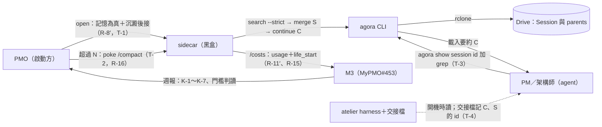
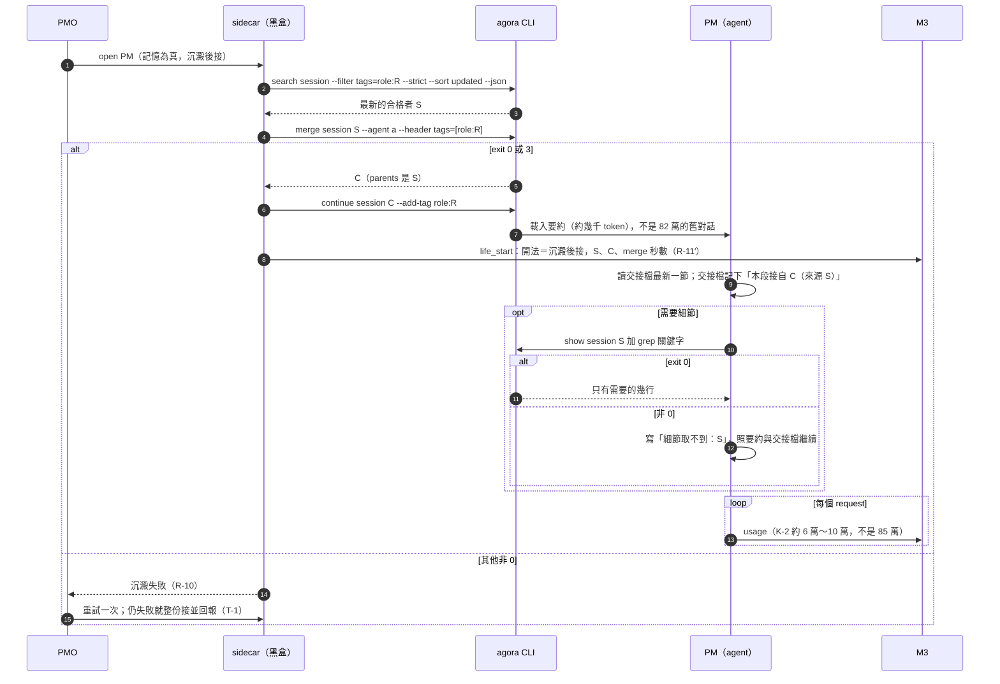
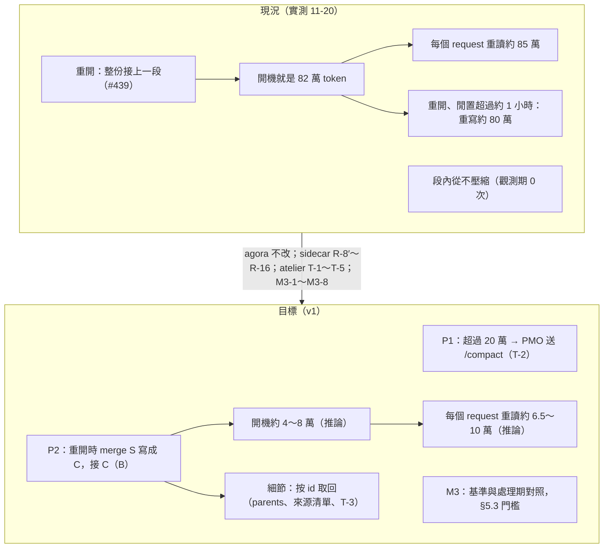

# #462 v1：用召回取代每輪重送（長對話成本收斂）

- 單：#462（MAS，層級 b）。父：期八 M4「長對話成本收斂」（PMO 派工，本人 2026-11-21 要求）。量測靠 M3（MyPMO#453）。
- 作者：專案架構師（作者模式，myaistorage-arch-w1-1，Claude Opus 5.5），2026-11-21。基準：main `fbdd60f`。
- 修正第 1 輪（2026-11-21）：回應非作者審查的中 1～4、低 1～3，以及 PM 提的三個風險點（`/compact` 前提鏈、門檻寬嚴、品質守門的上限）。改了 §0、§1.1、§2.1、§2.3、§4.1、§4.3（R-11′、R-14、S-16～S-18）、§4.4（T-1、T-2）、§4.5、§5.1（K-7、K-8）、§5.2、§5.3、§5.6、§5.7（M3-3、M3-6）、§6（Q-B、Q-E、Q-F）、§7、§11。
- 範圍：**只設計**。不改 `src/`、`tests/`、`openspec/specs/`、`atelier/`。sidecar 與 M3 在別的 repo，本稿只寫「對 sidecar 的要求」（R-編號）和「對 M3 的要求」（M3-編號），不描述它們的內部設計。
- 和 v0 的關係：v0 是 `462-session-editing-and-consolidation.md`（11-15；本人同意方向 B：重開時用 `agora merge` 沉澱，預設關閉）。v0 的 agora 側 C-1～C-6 已經實作並 merge（PR #465、#467，測試在 `tests/unit/test_cli.py:1948` 起）。v0 **原檔不改**，只在檔頭加一行指向本稿。逐項的「v0（11-15）→v1」對照放在 §9。
- **為什麼另開新檔、不就地改寫**：(1) v0 是本人核准方向時看的版本，程式（`cli.py:835` 的註解）、測試（`test_cli.py:1948-1952`）和 D-29 都用「462 §10.3 C-1」這種編號引用它；就地改寫會讓這些引用指到不同的內容。(2) v1 的目標換了（從「重開時接得短」變成「每個 request 少重讀」），被取代的地方遍布全篇，逐段標「v0→v1」會比新寫一份還難讀。(3) 舊檔留著不動，非作者審查可以直接 diff 兩份。
- 資料紀律：用到的真資料只有 sidecar `/costs` 用量帳的**數字**（團隊目錄的 `costs/costs-all.jsonl`），以及第一版大小探針的字數統計（`exp462/size-probe.csv`）。沒有讀任何 session 內容。每個數字都標「實測」或「推論」。

## 0. 給本人的一頁

**結論**：長對話的錢花在**長壽 PM 每個 request 都重讀約 85 萬 token**（實測）。其中 93% 是**開機時就已經在 context 裡、從前幾段整份接過來的舊對話**（實測：這一段第一個 request 是 82.2 萬，結束時 88.0 萬）。段內每個 request 只多約 1,300 token（實測）。所以問題不在「段內長得快」，而在 **#439 每次重開都把整條舊對話接回來**，而且從來沒有被壓縮過（這段資料裡看不到任何壓縮）。把重開時接回來的東西換成「一份要約加上來源 id，要細節再按 id 取回」，PM 每個 request 的快取讀取預估少 87～92%（推論）。

**一個要先講清楚的地方（實測）**：「快取讀取佔 token 的比例」不適合當驗收指標。PM 現在是 0.954，就算做完，預估也只會降到約 0.95（推論）：agent 每一步都會重讀前綴，比例天生就高；真正變小的是**重讀的量**。所以驗收建議改看**長壽角色每個 request 的快取讀取 token 數**和**加權成本裡快取讀取的佔比**（現在 0.50～0.61，預估會降到 0.24～0.49，推論），見 Q-A。

| 方案 | 做法 | PM 每個 request 的快取讀取（推論） | 改哪裡 | 主要風險 |
|---|---|---|---|---|
| 現況 | #439 整份接，段內不壓縮 | 中位數 85.0 萬（實測） | — | 每重開一次（或閒置超過約 1 小時），就要重寫約 80 萬 token 的快取（實測兩次，見 §1） |
| A `/compact` 當政策 | 超過門檻 N，由 PMO 在安全點送 `/compact` | −85～−90%（前提：壓縮後重開不會漲回來，**未驗**） | atelier；驗證 poke 能不能送斜線指令 | 壓縮後重開會不會漲回來沒驗過；沒有 by-id 連結 |
| **B 重開時沉澱（v0 方向）** | 重開時 `merge S` 寫成要約 C，接 C；細節用 `agora show session <id>` 取回 | −87～−92% | sidecar R-8′～R-14；**agora 不改** | 要約會漏細節（PM 的 28 段裡有 15 段超過 6 萬字的截斷門檻，實測）；MLP 側有阻力 |
| C 段內門檻 | 超過 N 時，在安全點關閉、沉澱、重開 | 建在 B 之上；PM 現況大多數段落觸發不到（推論） | sidecar 自動化 | 會打斷工作，多一層協調 |
| D 隊員召回 | — | 會變長 | — | 混進別張單的內容 |
| E 冷啟動＋交接檔 | 重開時不接舊對話，只讀交接檔 | −88～−92% | 不用寫程式（#439 R-1 的取值 (2)） | 失去對話記憶，和本人 11-10「預設記」相反 |

**建議（Q-B）**：**營運規矩先上；B 要不要做，等 V-1 的結果再定**。
- **第一步（不用寫程式）**：長壽角色的 context 超過 N＝20 萬時，由 PMO 在安全點送 `/compact`（A）；同時用 M3 開始收基準期資料。**前提未驗**：PMO 用 poke 送的 `/compact` 會不會被當成斜線指令執行、壓縮能不能撐過重開。先在拋棄式測試 agent 上驗（V-1a），過了才碰 PM（§7）。
- **決策點（V-1 之後）**：壓縮撐得過重開 → A 已拿到大部分的省，看 P1 的 M3 結果再由本人決定要不要做 B；撐不過或斜線指令不被執行 → 直接做 B。
- **第二步**：B 由 sidecar 實作。啟動方對長壽角色預設「沉澱後接」。

B 比「只做營運規矩」值得的理由（都是推論）：
1. 壓縮撐不過重開時，每次重開省下約 170 萬基本 token 等值的重寫；撐得過時，這一項的差距變小（所以 B 要不要做看 V-1）。
2. 要約是另一個可以檢查的 Session，`parents` 連到原版，這就是本人要的 by-id 網狀。
3. 不依賴 agent 怎麼壓縮（claude 和 opencode 都一樣），也不必往跑著的 agent 裡打字。

**不值得**的情況：離線重播裡，B（A1）的探針正確率不比冷啟動（A2）好。那時改走 E 就好（§5.6）。

**要本人決定的點**（括號內是預設；細節見 §6）：
- Q-A：驗收指標（**每個 request 的快取讀取 token＋加權佔比**；不用 token 比例）
- Q-B：v1 範圍（**營運規矩先上；V-1 之後決定 B**）
- Q-C：長壽角色重開的預設（**沉澱後接**，由啟動方設定；v0 是預設關閉）
- Q-D：段內門檻 N 與動作（**20 萬，`/compact`**）
- Q-E：成功門檻（**PM 每段平均快取讀取 ≤ 基準的 50%，而且 4 段對 4 段全部比基準低；加權成本 ≤ 60%（扣掉段內閒置重寫也要過）；品質不退步**）

## 1. 根因與資料（回答第 1 問）

**資料**：sidecar `/costs` 的列，在這台 worker 上由 PM 拉到團隊目錄。`usage` 列 143 筆，時間是 2026-11-20 15:03～21:49 UTC（JST 11-21 00:03～06:49），加上 `life_start` 列 24 筆（11-18～11-20）。在 11-20 15:03 UTC 以前拉的時候，`unattributed_count` 有 502～850 筆（實測，`costs/pull-log.jsonl`），也就是那之前的用量歸不到 agent。**所以基準期實際上只有 PM 的一段**（life `…94QDM`，44 個 request）。

### 1.1 實測

| 量 | PM（claude-sonnet-5-5） | 審查者（claude-sonnet-5-5） | 實作（deepseek-v4.1-flash，opencode） |
|---|---|---|---|
| 這段的 request 數 | 44 | 29 | 68 列（`requests` 是 null，見 §5.4） |
| 每個 request 的 context（input＋cached＋cache_write）：第一個 → 最後一個 | 821,914 → 879,741 | 37,176 → 83,280 | 20,397 → 119,625 |
| context 中位數 | 853,290 | 68,583 | 80,753 |
| 每多一個 request，context 增加多少（最小平方斜率） | 1,319 | 1,732 | 1,294 |
| cached_tokens：中位數／最大 | 849,936／877,220 | 67,170／82,818 | 80,448／119,424 |
| 快取讀取佔 token 的比例 Σcached／Σ(input＋cached＋cache_write) | 0.954 | 0.961 | 0.986 |
| cache_write 合計 | 1,731,359 | 72,942 | 0（不回報） |
| 其中「整段重寫」（單一 request 的 cache_write 超過 10 萬） | 2 次：811,576（開機的第一個 request）、862,333（閒置約 4 小時 18 分之後）；合計 1,673,909，佔 96.7% | 0 | — |

表註（實測）：
- `usage` 143 筆＝PM 44＋審查者 29＋實作 68＋測試隊員 `myaistorage-test-w1-1` 2 筆。測試隊員那 2 筆是 deepseek-v4.1-flash（opencode，`requests` 是 null），量太小，不進上表。
- 143 筆的 `provider` 欄位**全是 null**。表頭只寫 model；§1.2 套 Anthropic 的倍率，是從 `model` 推斷供應商（推論）。M3 要拿到真的 provider（M3-2）。

**推論**：

- **PM 的 context 有 93.4% 是開機時帶進來的**（821,914／879,741）。段內 44 個 request 只多了 57,827。#439 的召回把整條舊對話接回來（`439-role-session-recall.md:15`「記憶的單位是整個 agora Session，不切、不摘要、不編輯」），而且舊對話從沒被壓縮過。PM 從 11-18 09:25 到 11-20 15:02 開了 4 段（實測，`life_start`），每段都接著上一段，所以會越接越長。
- **審查者和實作是冷啟動**（`remember:false`，`pm/v7.md:99`）。它們的 context 只在段內長，最多約 12 萬。
- **快取的 TTL 看起來是 1 小時**：間隔約 24 分、約 59 分的兩次仍然命中，約 4 小時 18 分的那次沒命中。`at` 可能是收集的時刻而不是 request 的時刻（同一分鐘有很多列），所以間隔只是近似。
- **BRIEF 寫「`/compact` 之後下一個 request 只有約 1 萬」是誤讀**。那一個 request（seq 40）的 cached 是 10,336，但 cache_write 是 862,333，context 合計 872,671，和前一個差不多。這是**閒置超過 TTL、快取過期之後的整段重寫**，不是壓縮。這段資料裡**沒有看到任何壓縮**（同一段裡 context 一次掉超過 50% 的情況是 0 次）。至於 10,336，PM 和審查者的第一個 request 都是這個數字的 cached，推論是 Claude Code 共用的系統提示前綴。
- **PM 的 cache_write 合計約 173 萬，是「重開」加「閒置過期」造成的**，不是壓縮後的重寫。

### 1.2 換算成本（推論：倍率用 Anthropic 的標準值，cache 讀 0.1、寫 1.25（5 分鐘 TTL）或 2.0（1 小時 TTL）、輸出 5；實際以 M3 的價目表為準，M3-5）

| 量 | PM | 審查者 |
|---|---|---|
| 這一段的加權成本（基本輸入 token 等值；5 分鐘／1 小時） | 5,895,431／7,193,950 | 344,152／398,858 |
| 平均每個 request | 133,987／163,499 | 11,867／13,754 |
| 加權成本裡快取讀取的佔比 | 0.606／0.497 | 0.517／0.446 |
| 加權成本裡快取寫入的佔比 | 0.367／0.481 | 0.265／0.366 |

- **PM 佔兩個 Claude 角色加權成本的 94.5%～94.7%**；每個 request 的成本是審查者的 11.3～11.9 倍。
- **重寫一次（約 86 萬）的成本**，等於 20.3 個（1 小時 TTL）或 12.7 個（5 分鐘 TTL）request 的快取讀取。所以「閒置超過一小時」和「重開」兩件事一樣貴，都和 context 的大小成正比。
- deepseek 的價目在這裡沒有資料，只報 token 比例（0.986）。期七分析的「快取讀取佔加權成本 63.1%」是 PMO 的數字，本稿沒有重算。

### 1.3 第一版大小探針被什麼取代

`REPORT-462-size-probe.md` 量的是閱讀版的字數，有三個限制：(i) 閱讀版只是下界；(ii) relation 全是 import，分不出接續；(iii) 定不出重開點。`/costs` 把這三點都解掉了：

- **(i)**：直接量到 agent 每個 request 實際送出的 context。PM 的閱讀版最長 338,276 字（約 9.7 萬 token，chars／3.5），實際送出的 context 卻是 82～88 萬 token。推論：工具結果、系統提示這些閱讀版不收的東西，佔了大頭。兩邊不一定是同一段，`session_ref` 和 agora id 對不上（M3-3），所以這只是量級。
- **(ii)、(iii)**：`life_id` 加上 `life_start` 列就能定出段落和重開點，第一個 request 的 context 就是「重開時接回來的量」。

探針留著一個仍然有用的數字：**PM 的 28 段裡有 15 段的閱讀版超過 6 萬字**（`SOURCE_MAX`，`cli.py:752`）。其他角色：arch 42 段裡 2 段，impl、rev 0 段。這是 B 的品質風險（§2.3）。

## 2. 候選機制與取捨（回答第 2 問）

### 2.1 估算方法（推論）

用 PM 這一段的 44 個 request 重算。保留每個 request 的增量、輸出和兩次整段重寫的位置，只把開機時的 context 從 821,914 換成 s，s 是新做法開機時的 context。

- **s 的估法**：系統前綴加 harness 加交接檔加要約。審查者冷啟動的第一個 request 是 37,176（實測），要約最長約 5 萬字（`SECTION_SCHEMA`，v0 §2 第 1 點），所以取 s＝4 萬／6 萬／8 萬三個值。
- **m 是寫要約的成本**。最好的情況是有快取，0 次 AI 呼叫（C-1a）。最壞的情況是三次都送滿 6 萬字（推論約 6 萬 token），再加輸出，取 42 萬基本 token 等值當上界。

| s | m | 每個 request 的平均 cached | 降多少 | 一段的加權成本（1 小時 TTL）降多少 | token 比例 | 加權裡快取讀取的佔比 |
|---|---|---|---|---|---|---|
| 基準 | — | 811,876（實測） | — | — | 0.954 | 0.497 |
| 4 萬 | 0～42 萬 | 65,504 | −91.9% | −83.3～−89.1% | 0.945 | 0.24～0.37 |
| 6 萬 | 0～42 萬 | 84,594 | −89.6% | −81.0～−86.8% | 0.947 | 0.27～0.39 |
| 8 萬 | 0～42 萬 | 103,685 | −87.2% | −78.7～−84.6% | 0.949 | 0.30～0.41 |

（腳本：團隊目錄 `exp462v1/a4.py`，只輸出數字。兩次整段重寫（seq 1、40）保留實測的 cached 10,336（系統前綴命中），只把其餘的部分算成寫入；第一版把它們的 cached 設成 0，數字偏保守約 0.5 個百分點，已更正。5 分鐘 TTL 時加權降幅是 −77.2～−88.9%。）

**敏感度一：段內閒置重寫（K-5）**（推論，團隊目錄 `exp462v1-fix1/a5.py`）。基準段裡 seq 40 那次閒置 4 小時 18 分後的整段重寫，單獨就佔這一段加權成本的一大塊：把它改算成「命中，只有增量是寫入」，基準每個 request 的加權成本從 163,499 降到 126,278（−22.8%，1 小時 TTL）。處理期如果剛好沒有長閒置、基準卻有，比較就會偏向處理期。兩邊都扣掉段內 K-5 再比，降幅是 −84.1～−88.7%（m＝0），和不扣的 −84.6～−89.1% 差不到 1 個百分點；最不利的組合（處理期有、基準扣掉）仍有 −80.0～−85.9%。所以這個偏差不會讓 60% 的門檻翻盤，但 M3 要把兩個數都報出來（§5.3 第 2 點、M3-6）。**限制**：基準只有 1 段，「多久會閒置超過 TTL 一次」完全不知道。

**敏感度二：按 id 取回（T-3）留在 context 裡的量**（推論，`exp462v1-fix1/a5.py`）。PM 的 28 段裡有 15 段的閱讀版超過截斷門檻（§1.3），上線後 T-3 推論一定會用到。取回的內容會留在該段之後每個 request 的 context 裡。設每次取回帶入 x token、一段取回 k 次（平均分散在 44 個 request 裡），s＝6 萬、1 小時 TTL：

| x（每次取回） | k＝1 | k＝3 | k＝6 |
|---|---|---|---|
| 2 千（grep 幾行） | −89.5%／−80.8～−86.7% | −89.2%／−80.5～−86.3% | −88.9%／−80.0～−85.8% |
| 1 萬 | −89.0%／−80.2～−86.0% | −87.9%／−78.5～−84.3% | −86.2%／−76.0～−81.8% |
| 3 萬（整節讀進來） | −87.9%／−78.5～−84.3% | −84.5%／−73.5～−79.3% | −79.5%／−66.0～−71.8% |

（每格：每個 request 的平均 cached 降多少／加權成本降多少，m＝0～42 萬。）照 T-3 只取幾行（x ≤ 1 萬、k ≤ 3）時，降幅從 −89.6% 收斂到 −87.9～−89.5%，影響很小；最壞的一格（每段讀進 18 萬）收斂到 −79.5%／−66.0～−71.8%，仍過 §5.3 的 50%、60% 門檻，而且那一段的 K-1 會到約 30 萬，會先碰到 T-2 的 N。所以 T-3「只取幾行」是成本上的必要條件，不只是建議；取回的量用 K-8 看（§5.1）。

### 2.2 比較表

| | A `/compact` 當政策 | **B 重開時沉澱** | C 段內門檻 | D 隊員召回 | E 冷啟動＋交接檔 |
|---|---|---|---|---|---|
| **預期省多少（推論）** | 和 B 同一個量級。**前提**：壓縮後重開時 agent 從壓縮點載入。前提不成立的話，每次重開仍要讀一次、重寫一次約 80 萬（約 170 萬基本 token 等值／次） | §2.1：每個 request 的快取讀取 −87～−92% | 建在 B 之上。PM 段內每個 request 約 +1,300，一天約 +6 萬（推論，只有一段資料），N＝20 萬時大多數段落觸發不到 | 負的（context 變長） | 比 B 略多（沒有要約、沒有 m） |
| **改動面** | atelier（PMO 規矩）；要驗證 sidecar 的 poke 能送斜線指令（R-16） | sidecar R-8′～R-14；atelier T-1～T-5；**agora 不改**（C-1～C-6 已完成） | sidecar 加自動門檻與安全點判斷 | 改 PM harness | atelier（啟動方改帶 #439 R-1 的 (2)）；不用寫程式 |
| **風險** | 壓縮的保留性沒驗；壓縮摘要不經 schema 驗證，也不是獨立的 Session；要往跑著的 tui 打字 | 要約漏細節（PM 段 15/28 超過截斷門檻）；連續沉澱會漂移；MLP 阻力（merge 走不到、跑在 HTTP 執行緒、900 秒＜1800 秒，依 PM 轉述 MyLinuxPool#1272 的結論） | 打斷工作；多一層協調；安全點難定 | 序號重用時混進別張單的內容（v0 §7） | 失去對話記憶；與 11-10「預設記」相反；全靠交接檔寫得好 |
| **可逆性** | 停送就好 | 啟動方改回「整份接」就好（T-1）。已沉澱的線接的是 C，要回到原線就在 open 時明指 `session`＝S（#439 U-12） | 關掉自動化就好 | — | 改回預設 (1) 就好 |
| **by-id** | 只有「自己的 id」：壓縮前的內容推論仍在同一個 Session 的 raw 裡，但 agent 不知道自己的 agora id | **有**：C 的 `parents`、內文的來源清單（`cli.py:803`） | 同 B | — | 只能靠交接檔手寫 id（T-4） |

### 2.3 v1 範圍（建議）

**做**：

1. **第一步，營運規矩（不用寫程式，可以馬上做）**：
   - T-2：長壽角色最近一個 request 的 context 超過 N＝20 萬時，由 PMO 在安全點送 `/compact <保留重點>`（A）。現在的 PM（約 88 萬）第一次就會被觸發。
   - 送之前先做 V-1 驗證（§7）：斜線指令真的會被執行；壓縮後 context 變多小；下一次重開的第一個 request 會不會漲回來。先在拋棄式測試 agent 上驗（V-1a），過了才對 PM 試一次（V-1b）。
   - V-1 的結果決定要不要做第二步（§7 的決策點）。
2. **第二步，B**：
   - sidecar 實作 R-8′～R-14。
   - 啟動方（PMO 開 PM、PM 開架構師）預設帶「沉澱後接」（T-1）。sidecar 自己的預設仍是「整份接」，相容 #439。
3. **by-id 的取回規矩（T-3、T-4）**：怎麼取細節、取不到怎麼辦，見 §3。
4. **量測**：M3-1～M3-8 從現在開始收基準。品質守門用離線重播的最小版（§5.6）。

**不做**（v1）：

- C 的自動化（只留「PMO 手動關閉後以 B 重開」這條營運路徑，T-2 的備案）。
- D。
- E 不當作正式做法，只當離線重播的 A2 組，用來判斷 B 值不值得。
- 不加 agora 的指令、旗標、header 欄位。
- R-12 換線掃描延後。
- map-reduce 長來源（v0 §11 的理由不變，§9 另有說明）。

**為什麼 N＝20 萬**（推論）：
- 每重置一次的成本取 15～50 萬（m 加上重寫 s），段內增長 g≈1,319／request。
- 最小化「平均讀取＋攤提的重置成本」，得到 N−s ≈ √(重置成本×g／0.05) ≈ 6.3～11.5 萬，也就是 s＝6 萬時 N 約 12～18 萬。
- 取 20 萬，偏向少打斷。
- 這個模型沒有算進打斷工作和漂移的代價，所以門檻由本人定（Q-D）。

## 3. by-id 網狀：id 在哪、誰能解、解不開怎麼辦、循環與重複

**原則**：一份真相。id 和出處只存在 agora 的 header 裡（Drive）。其他地方（sidecar 的紀錄、M3、交接檔）都只是索引或給人看的副本，兩邊不一致時以 agora 為準。這延續 v0 §2 第 2 點。

| 問題 | 答案 | 依據 |
|---|---|---|
| **id 存在哪** | (1) C 的 header `agora.parents: [{id: S, raw_md5}]`，是系統欄位，使用者不能改。(2) C 的內文每一節都有一行「`<id>`（原版：`agora show session <id>`）」，前面有 MERGE_NOTE「需要細節時，只用清單裡的 `agora show session <id>` 取原版」。(3) sidecar 的紀錄（R-11′）寫進 `/costs` 的 `life_start` 列，由 M3 長期保存（M3-1、M3-3）。(4) 交接檔的最新一節寫「本段接自 C（來源 S）」（T-4，給人看） | (1) `header.py:212-216` `check_user_fields` 擋系統欄位；`test_cli.py:859` `test_header_cannot_touch_system_fields`。(2) `cli.py:803`、`cli.py:2526-2527` |
| **誰能解** | 任何有 agora CLI、而且設好同一個 Drive 的行程：`agora show session <id>`。本機沒有這個 id 時會整份同步一次（`cli.py:290-298`），所以別台機器上傳過的也解得開。**模型限制**：取回的是真的對話內容，只有輪換表准碰真資料的模型能取（`pm/v7.md:165`）；長壽角色（PM、架構師）本來就是 | `cli.py:290-298`、`cli.py:2804` |
| **解不開** | (a) 不存在，或別台還沒上傳（還在 outbox，exit 3）→ `show` exit 1「找不到」（`cli.py:309-313`）。(b) Drive 上已刪、本機有舊副本 → exit 0，stderr 會說它不在雲端（`cli.py:2808-2809`；`test_cli.py:1296`）。(c) 同步出錯 → 非 0。**取回方的規矩（T-3）**：只要非 0 就當作取不到，在回報裡寫「細節取不到：<id>」，照要約和交接檔繼續做，不要猜，也不要為了補細節重跑 merge。**刪除保護**：S 有子 Session（C）時不能刪（v0 C-5，`test_cli.py` 的 `test_c5_…`），所以整個網只能從葉子（最新的）往回刪，被引用的節點不會先消失 | C-9（新測試）、v0 C-5 |
| **循環** | 不可能發生。`parents` 只在建立時寫（merge、fork），而且只能指向已經存在的 id；之後 `continue` 不改 `parents`（v0 C-4），使用者也改不了（系統欄位）。所以這個網是一個依建立時間排序的有向無環圖。取回方另外有跳數上限：沿 `parents` 最多往回 3 層（T-3） | C-8、C-10 |
| **重複** | (i) 同一個 S 被沉澱兩次：sidecar 在 merge 之後、continue 之前死掉的話，下次重開時 `role:R` 底下最新的是還沒接過的 C，照 R-9 直接接它，不會再 merge。merge 只給一個來源、而它是還沒接過的要約時，agora 會拒絕（v0 C-1）。就算真的重跑，要約快取讓第二次不叫 AI（v0 C-1a）。(ii) 同一個 id 在一次 merge 裡給兩次 → exit 1「重複了」（`cli.py` 的 `cmd_merge`）。(iii) 連續沉澱時，C2 的來源 C′ 的閱讀版第一則就是上一份要約，所以內容會遞迴包含上一份。這是漂移，不是 id 重複，用離線重播的 A3 量（§5.6） | v0 §5.3、R-9 |
| **取回的成本** | 取回的內容會進 context，而且整段都留著。整份 `show` 一段 PM 的閱讀版，最多約 34 萬字（實測最大值）。規矩（T-3）：用 `agora show session <id> \| grep -n <關鍵字>` 或 `sed -n` 只取需要的幾行，不要整份讀進來 | 推論 |

## 4. v1 的介面與契約（回答第 3 問）

### 4.1 誰負責什麼

| 模組 | v1 負責 | 不做 |
|---|---|---|
| **agora**（本 repo） | 儲存、搜尋、接續、`merge` 寫要約、`show` 按 id 取回。**v1 沒有程式變更**：C-1～C-6 已完成；C-7～C-10 只補測試，把 by-id 依賴的既有行為鎖住 | 不判斷什麼時候沉澱；不量 token；不新增指令、旗標、欄位 |
| **sidecar**（MLP） | open 時依選項沉澱（R-8′～R-10）；把每一段怎麼開的寫進 `/costs`（R-11′）；merge 的時間上限和 agora 一致（R-13）；沉澱期間其他請求照常、沉澱中查得到、同一個角色同時只跑一個 merge（R-14）；`/costs` 的資料品質（R-15）；確認 poke 能送斜線指令（R-16） | 不寫要約；不改 Session header；不自己判斷要不要退回整份接 |
| **atelier**（本 repo 的 harness，由 PMO／PM 照 harness 流程改） | 什麼時候沉澱、什麼時候壓縮、怎麼按 id 取回、交接檔記 id、接手確認的評分（T-1～T-5） | 不放對話記憶 |
| **M3**（MyPMO#453） | 收、存、算、出週報（M3-1～M3-8） | — |
| **PMO** | 依 T-1、T-2 開 PM、壓縮 PM；評接手確認（T-5） | — |

**依賴方向**（不變，沒有環）：

```
PMO／PM（啟動方）→ sidecar →（CLI）agora → Drive
                    sidecar →（/costs）→ M3 → 週報 → PMO／本人
agent（PM、架構師）→（shell）agora show（按 id 取回）
```

agora 不認識 sidecar 和 M3。`docs/architecture/overview.md` 的模組地圖**不變**，所以本 PR 不改它。

### 4.2 agora 側契約（本 repo，`tests/unit/`，假 agent、假 rclone、`isolated_home`）

**C-1～C-6 沿用**，已實作，見 v0 §10.3 與 `test_cli.py:1948` 起的 `test_c1_…`～`test_c6_…`。v1 新增的都是**既有行為的新測試，不改 `src/`**：

| # | 輸入 → 輸出或錯誤 | 測試層 | 新／既有 |
|---|---|---|---|
| C-7 | **按 id 取回**：前提是 S 是 import 來的，假 agent 第一次就回合格的要約。`merge session S --agent opencode` 得到 C，然後：(a) `show session C` exit 0，header 的 `agora.parents` 只有一筆，`id` 等於 S；(b) 內文含 `` `S`（原版：`agora show session S`） `` 這一行（`cli.py:803`），也含 MERGE_NOTE 的「只用清單裡的 `agora show session <id>` 取原版」；(c) `show session S` exit 0，輸出和 merge 之前位元組相同 | unit | 既有行為，新測試 |
| C-8 | **鏈可以走完**：S → `merge` 得到 C → `continue C`（假 agent 加一則）→ `merge session C` 得到 C2。(a) 第二次 merge 有叫 summarize（C 已經是 `relation: continue`，不沿用，`cli.py:856`）；(b) C2 的 `parents` 是 `[C]`，C 的 `parents` 是 `[S]`，從 C2 沿 `parents` 兩跳到 S，每一跳 `show` 都是 exit 0；(c) 每一跳的 ULID 毫秒，父都早於子 | unit | 既有行為，新測試 |
| C-9 | **解不開**：`show session agora:<格式合法、但本機和假 Drive 都沒有的 ULID>` → exit 1，stderr 含「找不到」，stdout 是空的；假 Drive 上沒有、本機有舊副本 → exit 0，stderr 說它不在雲端（既有 `test_cli.py:1296`，引用就好） | unit | (a) 新測試；(b) 既有 |
| C-10 | **出處不可改**：`edit session C --header agora=…` 或 `--header-file` 裡帶 `agora` → exit 1，C 的 `parents` 不變。既有的 `test_cli.py:859`、`tests/unit/test_header.py:68` 已經涵蓋，**只引用、不新增**；`continue` 不改 `parents` 由 v0 C-4 涵蓋 | unit | 既有 |

### 4.3 對 sidecar 的要求（接在 #439 R-1～R-7、v0 R-8～R-12 之後）

#439 的 R-1～R-7（`439-role-session-recall.md:394-400`）**全部沿用**。v0 的 R-8～R-12（v0 `462-session-editing-and-consolidation.md:439-443`）逐項如下：

| # | 要求 | 和 v0 的關係 |
|---|---|---|
| R-8′ | open 要有一個「沉澱」選項，只在記憶為真、沒帶 `session` 時有效。取值是「整份接」和「沉澱後接」。**sidecar 的預設維持整份接**（不改 #439 的行為）；長壽角色的「預設沉澱」由啟動方每次帶上（T-1）。啟動方包括 PMO 開 PM 的工具，所以 PMO 那邊的開啟工具也要能帶這個選項。欄位名由 MLP 定 | **改**：v0 只說預設關閉、啟動方每次選；v1 明訂由啟動方帶、預設值寫在 atelier |
| R-9 | 沉澱後接時：S 被鎖 → 不沉澱，照常接（得到 409）；S 是還沒接過的 merge → 直接接；其他情況 → `agora merge session S --agent <目標> --header tags=[role:R]` | 沿用 |
| R-10 | merge 的結果只看 exit code：0 或 3 → 取 stdout 第一欄的 C，接 C；其他非 0 → 回錯誤給啟動方，不自動整份接、不開新的。**v1 補一條**：這個錯誤要能和其他 open 錯誤分開辨認（碼由 MLP 定），讓啟動方照 T-1 處理 | 沿用＋補辨認 |
| R-11′ | 每一段的 `/costs` `life_start` 列（或同一個 `life_id` 的事件列）要帶：(a) 怎麼開的（全新／整份接／沉澱後接）；(b) 接的 agora id（S 或 C）；(c) 沉澱時的 S 和 C；(d) merge 的 exit code 與秒數；(e) 寫要約用的 agent 與 model，以及 merge 自己的 usage（拿得到的話），和該段 agent 的 usage 分開記，不混在一起；拿不到就明寫拿不到（Q-F）。M3 每次拉資料都會長期保存（M3-1），所以**不需要撐過容器重建**。依 MyLinuxPool#1272 的結論，撐過 sidecar 重啟是可行的 | **改**：v0 只說「記一行、存在哪由 MLP 定」，給換線掃描用；v1 的用途是量測，存在 `/costs` |
| R-12 | 換線掃描 | **延後**：v1 不需要它；需要時沿用 v0 原文 |
| R-13 | merge 的時間上限要和 agora 的最壞情況一致：三次嘗試 × `AGORA_SUMMARIZE_TIMEOUT`，加上同步與上傳。做法二選一：sidecar 帶較小的 `AGORA_SUMMARIZE_TIMEOUT`（例如 240 秒，3×240＋餘裕＜900），或把上限提高到超過 agora 的最壞情況。**超過上限時，要先讓 merge 子行程結束（或等它結束），才能回錯誤**；不准在 merge 可能還會產生 C 的時候就去接 S | **新**（MyLinuxPool#1272 指出 900 秒小於 1800 秒）。理由：還在跑的 merge 之後才寫出 C，C 會變成最新，破壞 #439 E-1 |
| R-14 | 沉澱的時候：(a) **照常回應**：sidecar 的其他請求（`GET /agents`、poke、close、別的 id 的 open）照常回應。(b) **狀態查得到**：呼叫方不用重送 open，就能查到這個 id 是「沉澱中」「已接上（接的是 C）」還是「失敗（R-10 的碼）」。形狀由 MLP 選，兩種都可以：`open` 先回「已受理」再讓呼叫方輪詢；或 `open` 照舊同步，但沉澱期間 `GET /agents`／`GET /agents/<id>` 就看得到這個 id 是「沉澱中」（附開始時刻）。(c) **同一個 `role:R`（R 就是 id，#439）同時只有一個進行中的 merge**：沉澱中又來一個同 id 的 open（包括呼叫方逾時後重送），不得再叫一次 `agora merge`（也就是不得再叫一次寫要約的 AI）；要回一個能和其他錯誤分開辨認的「沉澱中」，或掛到進行中的那一次、拿同一個結果（MLP 選）。(d) **呼叫方逾時不改結果**：呼叫方斷線或逾時，merge 照跑完，照 R-9、R-10 接 C 或記失敗，照 R-11′ 記一筆；不取消、不重做。(e) 沉澱中收到 close：照 R-13 先收掉（或等完）merge 子行程，再回；之後不接 C。已經寫出的 C 留著，下次 open 照 R-9 直接接 | **新**（MyLinuxPool#1272 指出同步跑在 HTTP 執行緒）。(c) 的理由：v0 C-1a 的要約快取只在第一次 merge 寫完之後才有效，第一次還在跑時重送，會再叫一次 AI |
| R-15 | `/costs` 的資料品質：(a) usage 列要有 request 本身的時刻；如果 `at` 是收集時刻，就另外給一個欄位。(b) opencode 的 `requests` 不能是 null，要給數字，或明文寫「一列就是一個 step，也就是一次模型呼叫」。(c) agent 有回報時，cache_write 依 TTL 分開（5 分鐘、1 小時）。(d) ring 被擠掉時要有計數（現在有 `evicted`，保留就好） | **新**（給 M3） |
| R-16 | 驗證（不一定要寫程式）：poke 的 `text` 以 `/` 開頭時（例如 `/compact …`），claude 和 opencode 的 tui 會把它當成斜線指令執行，不是當成一般訊息；agent 正在跑一輪時，不中斷的 poke 會等那一輪結束再送。不成立的話，T-2 改走「關閉後以沉澱後接重開」 | **新**（給 A 用） |

**sidecar 側的驗收**：沿用 v0 的 S-6～S-12（v0 §10.4）。S-13 隨 R-12 延後。新增：

- S-14（R-11′）：三種開法各一次，`/costs` 的 `life_start` 都帶對種類和 id。
- S-15（R-13）：假 agora 的 merge 超過上限 → 先收掉子行程，再回錯誤，而且不呼叫 continue。
- S-16（R-14 (a)(b)）：假 agora 的 merge 卡住期間，`GET /agents` 在 1 秒內回應，而且這個 id 顯示「沉澱中」；merge 結束後變成「已接上」或 R-10 的失敗碼。
- S-17（R-14 (c)）：假 agora 的 merge 卡住期間，同一個 id 再 open 兩次（其中一次是呼叫方逾時斷線後重送）→ 假 agora 記到的 merge 呼叫只有 1 次；重送拿到可辨認的「沉澱中」或同一個結果；最後只開起一個 agent、只接一個 C。
- S-18（R-14 (d)(e)）：呼叫方在 merge 中途斷線 → merge 照跑完、接 C、`/costs` 只記一筆 R-11′；沉澱中送 close → 先收掉 merge 子行程再回，之後不呼叫 continue。

S-14～S-18 都是 sidecar 的測試（MLP），用會睡、會記呼叫次數的假 agora 執行檔，不碰真的 agora 與 Drive。

### 4.4 atelier 的程序改動（由 PMO／PM 照 harness 流程改，不在本 repo 的設計 PR 裡）

| # | 改哪一份 | 加什麼規矩 |
|---|---|---|
| T-1 | `atelier/pmo/pm/v8.md:68`、`atelier/worker-team/pm/v7.md:99`（兩處都是「長期角色（PM／架構師）照預設」那一句，改成下面這條） | 開長壽角色（PM、架構師）一律帶「沉澱後接」（R-8′），除非本人或 PMO 明示這次要整份接。open 逾時或沒拿到結果時，先照 R-14 (b) 查狀態；還在沉澱就等，不重送。沉澱失敗（R-10）時重試一次；還是失敗就用「整份接」開，並在通道回報「沉澱失敗，改整份接」和 merge 的 exit code，不要靜默換 |
| T-2 | `atelier/pmo/pm/v8.md` | 每次看 M3 或 `/costs`，長壽角色最近一個 request 的 context（input＋cached＋cache_write）超過 N（預設 20 萬）時，要在安全點處理。安全點是：它剛回完話、沒有提問框（`awaiting_answer_since` 是空的）、沒有自己在跑的長指令。處理步驟：先請它更新交接檔，再 poke `/compact 保留：目前的單、決定與理由、未決、下一步；交接檔路徑是 <路徑>`。如果 R-16 驗證不成立：MLP-1 部署之前沒有可用的動作（關掉再整份接，接回來的還是一樣長），只記錄、不處理；MLP-1 部署之後改成照 Close SOP 關掉，再以沉澱後接重開（C 的手動版）。每次處理都記在 M3（M3-4） |
| T-3 | `atelier/worker-team/pm/v7.md`、`atelier/worker-team/arch/v4.md`、`atelier/pmo/pm/v8.md` 的 know（接手） | 開機的第一則是 merge 要約的話：要約是參考資料，**交接檔的最新一節才算數**（不改 `pm/v7.md:39`、`arch/v4.md:42` 的原則）。需要細節時用 `agora show session <id> \| grep -n <關鍵字>` 只取需要的幾行，不要整份讀進來。沿 `parents` 最多往回 3 層。exit 非 0 就寫「細節取不到：<id>」，不要猜，不要重跑 merge |
| T-4 | 同 T-3 的三份 | 開機時如果接的是要約，就在交接檔的最新一節寫「本段接自 <C>（來源 <S>）」，只寫 id，不寫內容 |
| T-5 | `atelier/pmo/pm/v8.md`（接手確認） | 長壽角色重開後的「一兩句現況確認」（`pm/v7.md:39`）由 PMO 對照交接檔評分：對／部分對／錯，記到 M3（M3-8） |
| — | 隊員（impl、rev） | **不改**：照舊 `remember:false`。v0 Q-5 建議改成「存、不查找」的理由是「M2 要量隊員的 token」，現在 `/costs` 已經量到了，這個理由不在了（§9） |

### 4.5 SOLID 與該層級的檢查

- **單一職責**：要不要沉澱、什麼時候壓縮，是啟動方的政策（atelier）；怎麼沉澱、要約長什麼樣，是 agora `merge`；執行與記錄是 sidecar；量測是 M3。每一塊都只有一個理由要改。
- **開閉**：#439 的召回規則和 E-1～E-5 不變；沉澱是在第 2、3 步之間插一步（v0 §6）；sidecar 的預設不變，新行為要靠選項打開。
- **里氏替換**：一個來源的 merge 能用在任何能用 merge 的地方（v0 C-4）；按 id 取回對 import、continue、merge 出來的 Session 都一樣（C-7、C-8）。
- **介面隔離**：sidecar 只依賴 exit code、stdout 第一欄、`search --json` 的欄位；agent 只依賴 `show` 的 exit code 和文字；M3 只依賴 `/costs` 的欄位。
- **依賴反轉**：啟動方的政策只看 M3 的指標（context 大小），不看 agent 內部。
- **不符合的地方**：無。T-2 的 `/compact` 要往 agent 的 tui 打字，依賴 agent 的 UI 行為。這是**營運備案**，不是介面，所以用 R-16 驗證（V-1a）把它擋住，驗不過就等 MLP-1 部署後改走 sidecar 的 close／open（§7 決策點的③）。

## 5. 證明：用 M3 度量（回答第 4 問）

### 5.1 指標（全部從 `/costs` 算）

| # | 指標 | 算法 | 角色 |
|---|---|---|---|
| K-1 | 每個 request 的 context | input＋cached＋cache_write（null 當 0） | 輔 |
| K-2 | **每個 request 的快取讀取** | cached_tokens | **主** |
| K-3 | 快取讀取的 token 比例 | Σcached／Σ(input＋cached＋cache_write) | 只報告，不當門檻（§0、§2.1：預估只從 0.954 動到約 0.95，即 0.945～0.949） |
| K-4 | **加權成本裡快取讀取的佔比**，以及每個 request 的加權成本 | 0.1×cached ÷（input＋0.1×cached＋w×cache_write＋5×output），倍率照 M3-5 的價目表 | **主**（本人說的「比例」建議用這個，Q-A） |
| K-5 | 整段重寫 | 單一 request 的 cache_write ≥ 0.5×K-1。分兩類：段首（重開）、段內（閒置超過 TTL） | 輔 |
| K-6 | 壓縮 | 同一段裡 K-1 比前一個 request 掉超過 50%，而且不是 K-5 | 輔（辨認用） |
| K-7 | 沉澱的成本 | R-11′ 的 merge 秒數、exit code；token 優先用 R-11′(e) 記下的 merge 自己的 usage，沒有才用 §2.1 的上界 42 萬 | 輔 |
| K-8 | 段內大增量 | 同一段裡 K-1 比前一個 request 多 1 萬以上的次數與合計。是按 id 取回（T-3）的代理指標，也會算到大的工具輸出（推論） | 輔 |

**對到角色與段落**：
- **角色**從 `agent` 解析（`<專案>-<角色>-<team>[-<序號>]`；`pm`、`arch` 是長壽角色，`impl`、`rev`、`test` 是隊員）。
- **段落**是 `life_id`。`life_start` 列帶 R-11′ 的開法。
- **重開**：同一個 agent 出現新的 `life_id`；段首的 K-5 就是重開時的重寫。
- **壓縮**是 K-6。PMO 送的 `/compact` 要另外記（M3-4），兩邊對得上才算。

### 5.2 前後比較的協定

- **分析單位是一段（life）**，不是一個 request。同一段裡的 request 高度相關（PM 一段內 K-1 的標準差只有 16,808，因為大部分是同一份前文），當成獨立樣本會把信心高估。
- **基準期**：從現在開始，到第一步（T-2）生效為止。要求 PM 至少 **4 段**、每段 ≥ 20 個 request。現在只有 1 段合格（11-20 15:03 以前的用量歸不到 agent）。PM 大約每天一段（推論，11-18～11-20 有 4 次 `life_start`），所以**至少**要再等約 3～4 天。實際可能更久：11-18 那兩段只隔 33 分鐘（09:25、09:58），像這樣的短段不滿 20 個 request 就不算（那幾段的 usage 歸不到 agent，request 數不知道）。等待期間 PM 每個 request 仍重讀約 85 萬，每多等一段約多花一段的成本（基準段約 720 萬基本 token 等值，推論）。**上限**：基準期開始 7 天後仍不滿 4 段合格，PMO 帶現有的段數向本人確認要不要開始 P1；滿 3 段就用 3 對 3（p＝0.05），只有 1～2 段就只能報前後的數字，不做秩的判讀。
- **處理期**分兩期，各要 PM 至少 4 段：
  - P1：營運規矩（T-2，A）
  - P2：B 上線（T-1 生效）
  - 每一期的起點記在 M3（M3-7）。
- **對照**：
  - (a) **同期對照**：別的 team 的 PM 晚一期才換（階梯式），M3 要能讀到它們的 `/costs`；讀不到就只能做前後比較。
  - (b) **負對照**：隊員（impl、rev）不開沉澱。它們的 K-1、K-2 前後變動應該在 ±30% 以內；超出就是平台變了（harness 變大、模型換了），要先查。
- **樣本量**（推論）：
  - 預期效果大約 −90%。段之間的變異現在量不到（只有 1 段）。
  - 用秩的規則：**處理期 4 段全部低於基準期 4 段**，在無效果的假設下機率是 1／C(8,4)＝1／70≈0.014（單尾）。3 對 3 是 1／20＝0.05。
  - 所以建議每期 4 段。如果基準期段之間的差異很大（變異係數 > 0.5），改成每期 6 段。
- **混淆**：
  - **工作量**：每段的 request 數、輸出 token 不同。主指標是「每個 request」，另外報每段的 request 數和輸出，對不上就註明。
  - **模型**：只比同一個 (provider, model)。PM 換模型的話，該期重新起算。
  - **harness 版本**：系統前綴變大會讓 s 變大。記在 M3-7。
  - **`requests` 是 null**：隊員才有這個問題，主指標不受影響。照 R-15(b) 處理；在那之前一列算一個 request（推論）。
  - **TTL**：只影響加權，不影響 token。
  - **閒置時間**：K-5 的段內重寫次數會受作息影響，分開報。
  - **基準本來就在長**：PM 的舊對話會繼續變長，對「處理後比較好」有利，所以門檻要定保守一點（Q-E 取 50%，預期效果是 90%）。

### 5.3 成功門檻（建議值，Q-E）

1. **主**：PM 處理期每段的平均 K-2，中位數 ≤ 基準期中位數的 **50%**，而且 4 段全部低於基準期的 4 段。秩的比較只算**真的照該期做法開的段**（P2 就是沉澱後接成功的段）；T-1 失敗改整份接的段另外報，每期最多 1 段，超過就延長該期，補到 4 段。
2. **主**：PM 每個 request 的加權成本（含 K-7）≤ 基準的 **60%**。K-4 下降至少 **10 個百分點**。
   - **主指標用不扣的**（含段內 K-5）：這是真的帳單，而且 B 也會讓閒置後的重寫變小（重寫的是 s，不是 82 萬）。
   - **輔助指標**：兩邊都扣掉段內 K-5（該列改算成命中，只有 K-1 的增量算寫入；段首的 K-5 不扣），也要 ≤ 60%。主指標過、輔助指標沒過，表示省下來的主要是作息（閒置）的差，不是機制：**不判通過**，兩個數都報，延長該期 2 段再判（兩個數都用延長後的全部段重算）。延長後兩個都過就判通過；主指標沒過就判不通過；**仍是主過、輔不過時，不判通過、不再延長**，由 PMO 把兩個數（附段內 K-5 的次數與閒置時間）帶回本人決定。理由：再延長不會讓「省下的是作息還是機制」自己分清楚，只會讓這一期沒有終點；要不要接受「主要省在作息」是取捨，不是量測。
   - **限制**：基準只有 1 段，裡面剛好有 1 次閒置 4 小時 18 分。扣掉它，基準的每個 request 加權成本少 22.8%（§2.1 敏感度一），所以基準期收滿之前，「60%」是對著一個未知的閒置頻率定的。
3. **品質（線上）**：處理期每次重開的接手確認（T-5）最多 1 次「錯」；每張單的退回次數（設計、實作）不比基準期多；「細節取不到」（T-3）的次數要報告，不設門檻。
4. **品質（離線，§5.6）**：A1 的探針正確率 ≥ A0 − 10 個百分點。A3 每一輪相對 F 的差距、相對首輪的累積下降，都不超過 10 個百分點（沿用 v0 §8.2 第 6 點）。
5. **負對照**：隊員的 K-1 變動在 ±30% 以內。

**理由**：預期大約 −90%（§2.1），門檻取一半，留空間給 s 的不確定和工作量的差異。品質門檻沿用 v0 的 10 個百分點。

**這組門檻會不會太嚴或太鬆**（推論；基準只有 PM 1 段）：
- **K-2 的 50%**：預期 −87～−92%；最壞的取回情況（§2.1 敏感度二）也有 −79.5%。只有機制沒生效（例如靜默退回整份接，K-2 回到約 100%）時才會不過，所以不算太嚴，也擋得住「沒做事」。
- **「4 段全部低於」**：效果這麼大時，不是統計上的瓶頸。會讓它不過的是營運上的例外段（沉澱失敗改整份接），所以上面第 1 點把例外段分開算。
- **加權的 60%**：最壞的取回情況是 −66.0～−71.8%，最不利的閒置組合是 −80.0%，都還有餘裕。比較會讓它變鬆的是：基準的舊對話一直在長（§5.2 混淆的最後一項）。
- **基準收滿之後重看**：段之間的變異係數 > 0.5 時改每期 6 段（§5.2）；基準的中位數 K-2 和這一段（81.2 萬）差超過 30% 時，PMO 把 §5.3 帶回給本人重確認。

### 5.4 opencode 的 `requests` 是 null

實作的 68 列都是 `opencode-sse`、`requests` 是 null；`seq` 從 1 連續到 68，cached 逐列遞增（實測）。**推論**：一列就是一個 step，也就是一次模型呼叫。M3 在 R-15(b) 落地之前，先用「一列＝一個 request」，並在週報上標「推論」。主指標只看長壽角色（claude），所以不受影響。

### 5.5 離線重播和 M3 線上度量的分工

| | 離線重播（v0 §8.2、`exp462/PROTOCOL.md`） | M3 線上度量 |
|---|---|---|
| 回答什麼 | **品質的因果**：同一個凍結起點，整份接（A0）、沉澱（A1）、冷啟動（A2）三組答得一樣好嗎？連續沉澱（A3）會漂移嗎？ | **成本的效果**：真實工作量下，每個 request 的重讀量和加權成本，前後差多少 |
| 為什麼要它 | 線上看不到反事實，而且沉澱不可逆（v0 §8.3 的 carryover） | 離線樣本少、不是真實的工作量 |
| 由誰做 | PM 手動跑，用既有的 `merge`、`continue --fork`、`exp:462` tag | M3（MyPMO#453） |
| 什麼時候 | 現在就能跑（C-1 已經 merge）；**在 T-1 生效之前跑完** | 基準期從現在開始 |

### 5.6 品質守門的最小可行版

v0 的離線重播是 10 個樣本、每個 10 題、四組，太重。最小版是：

- **樣本**：PM 的重開點 N＝3，每個 K＝6 題（目前在做的單、做到哪、最近兩個決定和理由、一個未決、下一步、一題拒答），A0、A1、A2 三組。
- **漂移**：A3 一條鏈三輪，用同樣的 6 題，加上更新題和廢止題。
- **衛生**：照 `exp462/PROTOCOL.md` 的 0.3 節，每一步之後都檢查。
- **判讀**：
  - A1 對 A0：守門（§5.3 第 4 點）。
  - A1 對 A2：**B 值不值得**。A1 沒有比 A2 好的話，建議 v2 改成 E，也就是不寫要約、直接冷啟動加交接檔，省掉 MLP 的工。
  - A 組（`/compact`）要不要加一組 A4（fork S 之後在 headless 裡壓縮）：要看 headless 接不接受斜線指令（推論，未驗）。不行就不加，改由線上的 T-5 評分。
- **成本與人力的上限**（推論）：
  - **次數**（headless 跑不經 sidecar，`/costs` 看不到，所以用次數管）：
    - 帶整段舊對話的跑：A0 每個重開點 1 次，F 鏈 6 次（3 次接 P、3 次評估 fork），合計 **≤ 9 次**；
    - merge：A1 3 次、A3 3 次，合計 **≤ 6 次**（每次最多 3 次嘗試）；
    - 小跑（A1 的評估 fork、A2、A3 的接 P 和評估 fork）**≤ 12 次**。
    - 衛生檢查沒過要重跑時，也算進這些次數。
  - **token**：每次整段的跑約 170～210 萬基本 token 等值（寫入約 82 萬×2.0，加幾個 request 的讀取）；merge 每次 ≤ 42 萬；小跑每次約 20 萬。合計約 2,400 萬，**上限 3,000 萬**，大約是基準 PM 4 段的成本。B 上線後每段約省 610 萬（§2.1），回本約 4～5 段。探針 6 題用一則訊息送，不要一題一個 request。
  - **人力**：PM 寫題與答案表、跑、評分（照 v0 §8.2）。評分約 100 項（3 個重開點×3 組×6 題，加 A3 的 3 輪×C、F 兩條×8 題）。PM 投入上限是**一個工作段**；做不完就停在已經做完的重開點，報 N＝已完成的數字。
  - **提早停**：第一個重開點的 A1 比 A0 低 30 個百分點以上，就停下回報 PMO（守門已經確定不過），不要把三個點跑完。
  - **超過任何一個上限**：停下，經通道回報 PMO，不要自己加量。

### 5.7 要 M3（MyPMO#453）提供的（只寫要求）

| # | 要求 |
|---|---|
| M3-1 | 每台 worker 的 `/costs` 列**長期保存**：照 id 去重；拉資料的間隔要比 ring 被擠掉的時間短；每次拉都記 `evicted`、`unattributed_count` |
| M3-2 | 每個 request 的欄位：agent、角色（從 id 解析）、life_id、provider、model、request 時刻（R-15(a)）、input、cached、cache_write（有的話依 TTL 分開）、output、requests（opencode 照 §5.4） |
| M3-3 | 每段一列：life_id、agent、model、開始與結束、request 數、開法與 S、C（R-11′）、merge 的 exit code 與秒數、第一個 request 的 K-1、平均和中位數的 K-1、K-2、K-5 次數與 token、K-6 次數、K-8 次數與合計。`session_ref` 和 agora id 對得上的話也一起給 |
| M3-4 | 事件：K-5（分段首、段內）、K-6；PMO 依 T-2 送 `/compact` 的時刻（由 PMO 寫進 M3，對 K-6） |
| M3-5 | 各 (provider, model) 的價目或倍率：輸入、cache 讀、cache 寫（5 分鐘、1 小時）、輸出。沒有價目的標「未知」，不要猜 |
| M3-6 | **週報**：依角色類別（長壽、隊員）分開列：段數、request 數、K-1、K-2（平均、中位數）、K-3、K-4、每個 request 的加權成本（**兩個版本**：不扣的，和兩邊都扣掉段內 K-5 的，算法見 §5.3 第 2 點）、K-5（段首、段內分開）、K-6、K-8、沉澱次數、沉澱失敗次數、沉澱秒數、K-7（沉澱的 usage 和該段 agent 的 usage 分開列，R-11′(e)）；基準期、處理期、對照組的對照表，並逐條列出 §5.3 的門檻有沒有過；資料品質（歸不到的列、null 的 request、空檔） |
| M3-7 | 期別標記：每個角色的基準期、P1、P2 的起點（來自決定紀錄），以及每段的 harness 版本 |
| M3-8 | 品質訊號：接手確認的評分（T-5）、每張單的退回次數、「細節取不到」的次數（T-3，從回報裡記） |

## 6. 要本人決定的點（回答第 5 問；括號是預設）

| # | 問題 | 選項 | 建議（預設） | 理由 |
|---|---|---|---|---|
| Q-A | 驗收的「快取讀取比例」怎麼定義 | (a) token 比例 K-3；(b) **每個 request 的快取讀取 K-2（主）＋加權佔比 K-4（主）** | **(b)** | K-3 預估只從 0.954 動到約 0.95（0.945～0.949），雜訊裡看不出來（§2.1） |
| Q-B | v1 範圍 | (1) 只做營運規矩（A＋T-3～T-5）；(2) **營運規矩先上，V-1 之後決定 B**；(3) 只做 B（v0 的計畫）；(4) B 加上 C 的自動化 | **(2)**：V-1 結果是②或③時直接做 B；是①時先看 P1 的 M3 結果，再由本人在 (1) 和 B 之間選（§7 決策點） | §0、§2.3。(1) 最便宜，但壓縮能不能撐過重開沒驗過，也沒有 by-id；(4) 現在的資料看不出有必要 |
| Q-C | 長壽角色重開時的預設（取代 v0 Q-2） | (a) **沉澱後接，由啟動方帶（T-1）**；(b) 維持整份接 | **(a)** | 成本的大頭就是重開時帶回來的 82 萬。要回頭只要改規矩，原線還能明指 `session` 接回去 |
| Q-D | 段內門檻 N 和動作 | N：**20 萬**（或 15 萬、30 萬）；動作：**`/compact`**（R-16 驗不過就改成關閉後沉澱重開） | **20 萬、`/compact`** | §2.3 的最適點約 12～18 萬，取偏少打斷的那一邊 |
| Q-E | 成功門檻 | §5.3 | **照 §5.3** | 預期效果的一半；基準只有 1 段，收滿後差太多就重確認（§5.3 末） |
| Q-F | 寫要約的模型和供應商（沿用 v0 Q-6） | (a) 該 agent 的 summarize 預設，由啟動方確認供應商可以收 PM 的對話 | **(a)** | PM 的對話會送到寫要約的那家（v0 §10.6）。**費用歸屬**：寫要約的模型或計價路徑可能和主對話不同，§2.1 用同一組倍率估的 m 會和實際有差；所以沉澱的 usage 要和該段 agent 的 usage 分開記（R-11′(e)），M3 才分得出沉澱成本（M3-6、K-7） |
| Q-G | 隊員（取代 v0 Q-5） | (a) **不改，照舊 `remember:false`**；(b) 存、不查找 | **(a)** | (b) 的理由（量隊員的 token）已經由 `/costs` 做到 |
| Q-H | 沉澱失敗時（沿用 v0 Q-7，補程序） | sidecar 回錯誤（R-10）；**啟動方重試一次，還是失敗就整份接並回報**（T-1） | **照 T-1** | 不靜默換線，也不讓 PM 開不起來 |

## 7. 分 PR 的切法與閘門（回答第 6 問）

| 步 | 內容 | repo | 只合這一步，main 會不會更糟 | 閘門 |
|---|---|---|---|---|
| PR-0（本 PR） | 本稿；v0 檔頭加一行指向本稿；`decisions.md` 加待決 P-15 | MAS | 不會：只有文件 | 非作者審查；PMO 向本人說明 §6 |
| M3-a | M3-1～M3-3、M3-5 先上，開始收基準期 | MyPMO | 不會：只讀 | 不用等本人（只是量測）；要 PMO 排程 |
| PR-1（d） | C-7～C-9 的測試（C-10 只引用），**不改 `src/`** | MAS | 不會：只加測試 | 本人核准本稿（Q-B） |
| 重播 | §5.6 的最小版離線重播（PM 手動跑，結果不進 repo） | — | 不會：守 `exp:462` 的衛生 | 現在就能跑；**在 T-1 生效之前跑完** |
| V-1a | 在**拋棄式測試 agent**（記憶為真的測試 id，內容只有公開的 repo 檔案，用完照 `exp:462` 的方式清掉）上驗 R-16 的前提鏈：(1) 送 poke 的那一方（PMO）叫得到 PM 所在 worker 的 sidecar；(2) poke 的 `text` 被當成使用者輸入打進 tui；(3) tui 把開頭的 `/` 當成斜線指令、帶參數執行 `/compact`（不是被選單吃掉 Enter，也不是當成一般訊息送給模型）；(4) agent 正在跑一輪時，不中斷的 poke 會等那一輪結束；(5) 壓縮後關閉、以整份接重開，第一個 request 的 K-1 是壓縮後的大小還是漲回來。claude 和 opencode 各一次 | 操作，不是 PR | — | 不用本人（沒有真資料）；PM 照 harness 開隊員 |
| V-1b | V-1a 的 (1)～(4) 都過了，才對 PM 試一次 `/compact`，看壓縮後 K-1 多小，再看下一次重開的第一個 request 有沒有漲回來。這一段不算基準段 | 操作，不是 PR | — | **要本人同意（經 PMO）**：會動到正在跑的 PM 的記憶 |
| T-2、T-3～T-5 | atelier 的規矩（P1 開始） | MAS（atelier，由 PMO／PM 照 harness 流程改） | 不會：只是規矩；要回頭就改回來 | V-1b 通過（V-1a 的結果是③時 P1 跳過，T-2 等 MLP-1 部署後改走關閉後重開）；基準期收滿（§5.2）；Q-B、Q-D |
| MLP-1 | R-8′～R-11′、R-13～R-15；S-6～S-12、S-14～S-18。**sidecar 的預設仍是整份接** | MyLinuxPool | 不會：預設行為和 #439 一樣 | MLP 自己的審查 |
| V-2 | 用真的 agora、Drive、要約供應商，對一個長壽角色的重開跑一次沉澱後接 | 操作 | — | **要真機驗證和本人單次授權**（PM 的對話會送到寫要約的供應商，Q-F） |
| T-1 | 啟動方預設帶沉澱後接（P2 開始） | atelier（PMO／PM） | 不會：要回頭就改回整份接 | V-2 通過；離線重播的 A1 ≥ A0 − 10 個百分點 |
| 判讀 | P1、P2 各滿 4 段後，M3 出 §5.3 的判讀 | — | — | 本人決定要不要保留；A1 對 A2 的結果決定 v2 要不要改成 E |

**順序**：
- PR-0 → M3-a、重播、V-1a 同時進行 → **決策點**（看 V-1a）→ PR-1 → 基準期收滿 → V-1b → T-2（P1）→ MLP-1 → V-2 → T-1（P2）→ 判讀。
- MLP-1 什麼時候開工看決策點：②、③ 在決策點之後就開工（和基準期、P1 並行）；① 要等 P1 的判讀。
- **跨 repo 的閘門**：T-1 要等 MLP-1 已經部署在 PM 所在的 worker 上，而且 V-2 已通過。

**決策點（V-1a 之後、MLP-1 開工之前）**：MLP-1 不再無條件和 P1 並行。依 V-1a 的結果（V-1b 在 PM 上重確認；V-1b 看到重開後漲回來，就改照②）：

| V-1 的結果 | 意思 | MLP-1（B） |
|---|---|---|
| ① 斜線指令會執行，而且壓縮撐得過重開 | A 已經拿到大部分的省：段內的重讀和重開的重寫都變小。B 剩下的價值是 by-id 網狀、不用往 tui 打字、不依賴 agent 怎麼壓縮 | **先不開工**。等 P1 滿 4 段、M3 出判讀，PMO 帶著數字請本人在 Q-B 的 (1) 和 B 之間選 |
| ② 斜線指令會執行，但壓縮撐不過重開 | A 只在段內有用；每次重開又是 82 萬起跳 | **開工**，可以和 P1 並行 |
| ③ 斜線指令不會執行（R-16 不成立） | MLP-1 部署之前，T-2 沒有可用的動作（§4.4 T-2） | **開工**；P1 跳過，V-1b 不做，基準期延到 P2 開始。要在這段時間止血，只有 E（冷啟動加交接檔），要本人另外同意（和 11-10「預設記」相反） |

## 8. 三張圖（回答第 7 問；語法未經機器驗證）

### 8.1 元件關係



### 8.2 一次沉澱與按 id 召回的時序



### 8.3 現況 → 目標



## 9. v0（11-15）→ v1 對照

| v0 的位置 | v1 | 理由 |
|---|---|---|
| §0「為什麼可能省」：只算重開時的快取寫入，以 36.8 萬當 X | **改**：主要的錢是**每個 request 的重讀**；X 實測是 82～88 萬（§1） | 有了 `/costs` 的實測 |
| §0 方案 A／B／C（B 建議、預設關閉） | **保留 B 的機制**；**改預設**（Q-C）；**加**營運規矩 A 當第一步（Q-B）；v0 的 C 現在叫 E，降為重播的 A2 組 | 目標從「接得短」變成「每輪少重讀」 |
| §2 原則（不加機制、一份真相、召回不改、失敗不靜默） | **保留** | — |
| §3、§3.3 E-1～E-5 | **保留** | 機制不變 |
| §4.1「一段＝一次開到關，重開時沉澱」 | **保留**，另外加段內門檻（T-2） | PM 的段很長，從不壓縮 |
| §4.2 例外：中途被打斷的重開用整份接 | **改**：一律沉澱，除非明示（T-1） | 被打斷的 PM 一樣帶著 82 萬；要細節可以按 id 取回 |
| §4.3「依大小自動沉澱：沒有大小資料」 | **改**：大小在 `/costs` 裡有了（K-1）；自動化仍延後，先手動（T-2） | 資料的限制已經不在 |
| §5 選什麼（`SECTION_SCHEMA`） | **保留**，不改 schema | — |
| §6 步驟 | **保留** | — |
| §7 隊員：建議存、不查找（Q-5 (b)） | **改**：維持 `remember:false`（Q-G） | 存下來是為了量 token，`/costs` 已經量到 |
| §8.2 離線重播（N＝10、K＝10、四組） | **縮小**到最小版（§5.6）；角色只剩品質守門，外加判斷「B 值不值得」 | 成本改由 M3 量 |
| §8.3 線上 ABAB | **改**成前後比較（以段為單位）＋階梯式同期對照＋負對照（§5.2） | ABAB 有 carryover，v0 自己也承認不能當因果證據 |
| §8.4 回本算式 | **保留**算式；數字換成實測（重寫一次＝20.3 個 request 的讀取，1 小時 TTL） | — |
| §8.5 要 M2 補的數字 | **改**成 M3-1～M3-8 | M2 → M3 |
| §9.2 一手資料（2896 筆、36.8 萬） | **補**上 §1 的 `/costs` 實測；size probe 被取代（§1.3） | — |
| §10.3 C-1～C-6 | **保留**（已實作）；**加** C-7～C-10（只補測試） | — |
| §10.4 R-8～R-12 | R-8 → R-8′、R-11 → R-11′；R-9、R-10 保留（R-10 補可辨認）；R-12 延後；**加** R-13～R-16 | §4.3 |
| §11 被否決的選項 | **保留**；「只靠 compact」從「保留給段內」改成「當作第一步的政策」 | 段內從沒壓縮過，政策比機制便宜 |
| §12 Q-1～Q-9 | Q-1 已定（B）；Q-2 → Q-C；Q-3 保留＋T-2；Q-4 → Q-D；Q-5 → Q-G；Q-6 → Q-F；Q-7 → Q-H；Q-8 → Q-E；Q-9 保留 (a)，隨 R-12 延後 | — |
| §14 PR 切法 | **改**成 §7 | — |

## 10. 被否決或延後的選項（v1）

| 選項 | 為什麼 |
|---|---|
| 新的 agora 指令或旗標（例如 `show --grep`、`merge` 回報 token） | shell 的 `grep`、`sed` 就做得到；merge 的 token 先用上界估，真的需要再另開 d 單 |
| 在 agora header 加 token 數或大小欄位 | 大小在 `/costs`（sidecar）已經有了；agora 不量 token（v0 §10.1） |
| sidecar 自動門檻（C 的自動化） | 現在的資料看不出段內會長到 N；先手動（T-2），M3 顯示超過 N 的段數多了再做 |
| 換線掃描（R-12） | 和成本目標無關 |
| E 當正式做法 | 和 11-10「預設記」相反；留在重播的 A2 組當判準 |
| 隊員沉澱或召回 | 段短、冷啟動，本來就是對照組 |
| 拿 token 比例（K-3）當門檻 | 不敏感（§0、§2.1） |
| map-reduce 長來源 | 先看重播的 A1 是不是因為截斷而退步；退步了再另開單 |

## 11. 沒驗到

- **`/compact` 的三件事都沒驗**：壓縮之後，agora 存回去、下一次整份接時，agent 是不是從壓縮點載入；poke 送的斜線指令會不會被執行（R-16、V-1a 的 (1)～(4)）；headless 接不接受斜線指令（§5.6 的 A4）。
- **R-14 的兩種形狀**（open 先回已受理再輪詢，或同步但查得到沉澱中）哪個適合 sidecar 現在的結構，沒讀 MLP 的內部，由 MLP 選。
- **§2.1 的兩個敏感度**（段內閒置重寫、按 id 取回）都是用這一段 44 個 request 模擬的；閒置頻率和取回的 x、k 都沒有實測。
- **§5.6 的成本上限**是用基準段的 context 大小推的；headless 跑的 token 不在 `/costs` 裡，量不到，所以只能用次數管。
- **TTL 是 1 小時**是推論：`at` 可能是收集時刻。
- **s（沉澱後開機的 context）** 是用審查者冷啟動的 37,176 和 schema 上限推的，沒有實測（V-2 會量到）。
- **m（寫要約的 token）** 只有上界。
- **基準期只有 PM 一段**，段之間的變異未知，所以 §5.2 的樣本量是用秩的規則保守估的。
- **opencode 一列是不是一次模型呼叫**（§5.4）。
- **`session_ref` 和 agora id 的對應**（M3-3）。
- **sidecar 的現況**：只用 PM 轉述的 MyLinuxPool#1272 結論，沒讀它的內部設計。
- **倍率**用的是 Anthropic 的標準值，沒有核對 claude-sonnet-5-5 實際的價目。
- **mermaid** 沒有在工具上渲染過。
