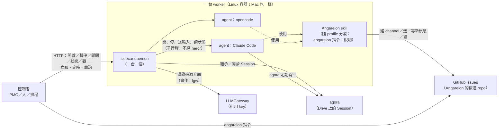
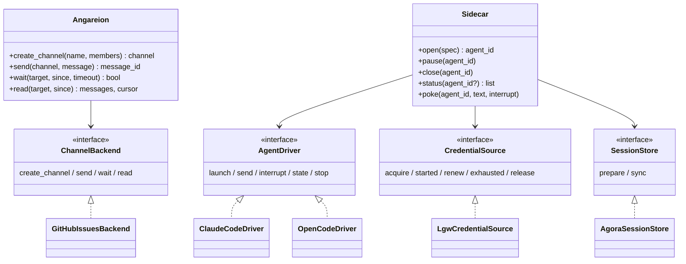
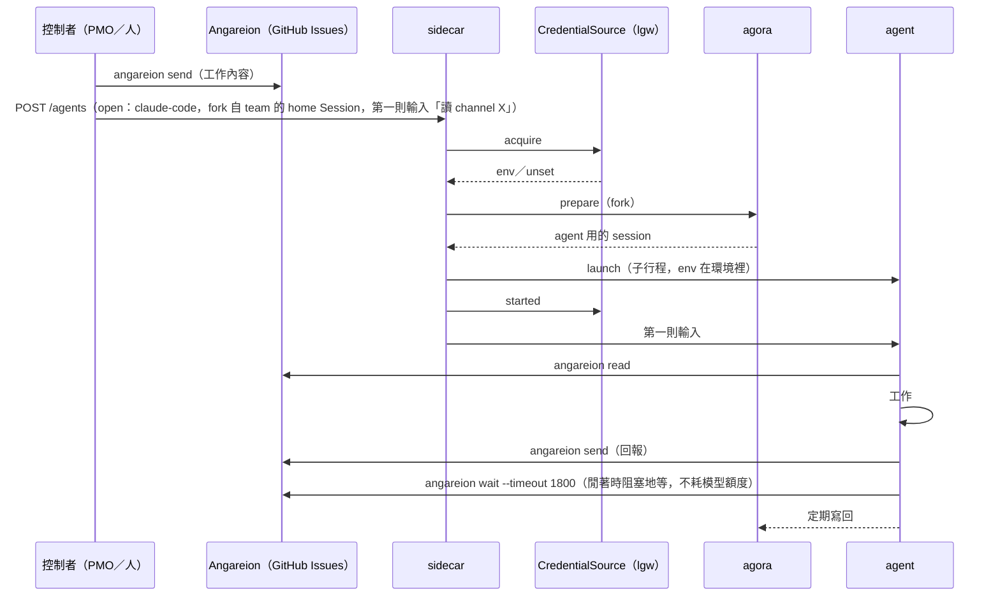
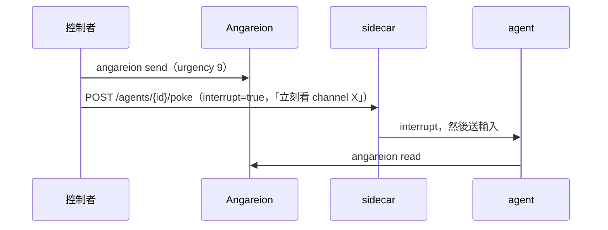
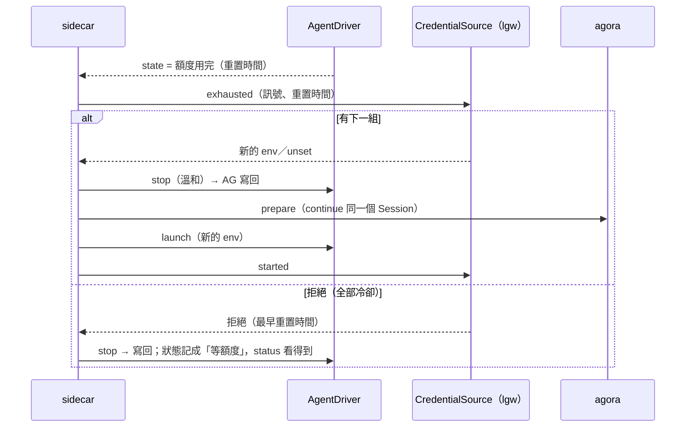

# AiCompany 期 1 設計提案 v2：Angareion（#30）與 sidecar（#31）

> 狀態：**提案**（2026-10-11，MyAiStorage PM）。本人 10-11 看完 v1 的設計後要求重新思考；這份是依本人的回饋重寫的方向，**還沒寫程式**。本人同意之後才改 OpenSpec change 與派工。

## 0. 前提（本人 10-11 的回饋）

1. 指令叫 `angareion`，不叫 `a2a`。
2. 現在不做限流，想發就發。
3. Angareion 把 GitHub Issues 的操作抽象成一般通訊軟體的基本動作，**必要而且只有**：建 channel、送訊息、確認有沒有新訊息（可以阻塞地等，也可以不阻塞直接回）、讀訊息。這次用 GitHub API＋Issues 實作。
4. sidecar 是 agent 生命週期控管，**必要而且只有**：開啟、暫停、關閉、搜集狀態（只限它開的）、戳。Claude Code、opencode 是實作。
   - 開啟時用 agora 指定繼承的 Session（continue／fork／merge）；隨時都可以用 agora 同步記憶。
   - 外部可以控制 sidecar（HTTP），三種形式：立即、定時、輪詢。
   - 一個 worker 一個；就是一個 Linux 跑得起來的 daemon，所以 Mac 也能直接用。
   - 不基於 herdr：sidecar 控制 agent、agent 之間的通訊都不經過 herdr（人要用 herdr 看是另一回事）。
5. agent 本身要有 Angareion 這個能力（skill／tool），隨 profile 分發。

設計原則：**相依少、介面簡潔、需要抽象的地方介面和實作分開**。

---

## 1. 實體圖：有哪些東西、誰控制誰

| 誰 | 控制誰 | 怎麼控制 | 不做什麼 |
|---|---|---|---|
| 控制者（PMO、人、排程） | sidecar | HTTP 的五個動作；立即、定時、輪詢 | 不直接碰 agent 行程 |
| sidecar | 它開的 agent | 子行程：開、送輸入、中斷、停；讀它的狀態 | **不收發 Angareion 訊息**、不中繼、不解讀內容 |
| sidecar | agora | 開啟時準備繼承的 Session；暫停／關閉時寫回 | 不自己拼 Session 原始檔 |
| sidecar | 憑證來源（介面） | 開啟前取得 agent 要的環境變數；額度用完時換一把 | 不保存 key；不知道是哪個服務 |
| agent | Angareion | 自己用 `angareion` 指令收發（skill） | 不經 sidecar |
| agent | agora | `agora continue` 的定期寫回（記憶同步） | — |

和 v1 的差別：sidecar **不再**替 agent 收信、排佇列、依緊急度投遞、中繼回報；agent 自己有 Angareion。herdr、relay socket、收信迴圈、持久佇列都拿掉。

---

## 2. 介面圖：每個模組的介面（必要而且只有這些）

### 2.1 Angareion（函式庫＋`angareion` 指令）

對外只有四個：

| 介面 | 參數 | 回傳 | 說明 |
|---|---|---|---|
| `create_channel` | 名稱、成員（位址清單） | channel | 開一個話題 |
| `send` | channel、訊息（六欄位：`from`／`to`／`channel`／`urgency`／`content`／`attachments`） | 訊息 id | 想發就發，不限流 |
| `wait` | 目標（某個 channel，或「寄給我的」）、游標、逾時（0＝不等直接回；N 秒；不設＝一直等） | 有沒有新訊息 | 不阻塞或阻塞地確認有沒有新訊息 |
| `read` | 目標、游標 | 訊息清單、新的游標 | 讀出新訊息 |

- 指令一對一：`angareion channel create`、`angareion send`、`angareion wait [--timeout N]`、`angareion read`。
- **拿掉 ack**：「讀到哪裡」是讀的人自己的游標（本機檔案），不在信道上留 ack。要回覆就送一則新訊息。
- **拿掉限流、本機收件匣重建**這些 v1 的機制；剩下的狀態只有游標。
- **實作分離**：`ChannelBackend` 介面就是這四個動作；`GitHubIssuesBackend` 是這次的實作（channel＝issue、訊息＝comment；`wait` 用條件式請求，阻塞時在實作裡定期查）。換成別的通訊軟體只換實作。
- 訊息格式（六欄位、front matter）是資料約定，不是介面。

### 2.2 sidecar（daemon `sidecar`，一台 worker 一個；Mac 也能跑）

對外只有五個（HTTP；指令列只是 HTTP 的薄包裝）：

| 介面 | 參數 | 說明 |
|---|---|---|
| `open` | agent 種類（claude-code／opencode）、工作目錄、**繼承的 Session**（`new`／`continue <id>`／`fork <id>`／`merge <id…>`）、第一則輸入（可省）、模型偏好（可省） | 開一個 agent，回 agent id |
| `pause` | agent id | 暫停（語意待本人定，見第 6 節 Q2） |
| `close` | agent id | 寫回 agora，結束 agent（先溫和、逾時再強制） |
| `status` | agent id（可省＝全部） | 只列它開的 agent：種類、Session、狀態（running／idle／paused／exited）、開始時間、最近活動、額度狀態；不含任何秘密 |
| `poke` | agent id、文字、是否中斷 | 送一則輸入給 agent；`中斷`＝先打斷這一輪再送 |

**外部控制的三種形式**（同一組 HTTP 端點）：

- 立即：`POST /agents`（open）、`POST /agents/{id}/pause|close|poke`、`GET /agents[/{id}]`；
- 定時：`POST /jobs {action, args, at: <時間>}`；
- 輪詢：`POST /jobs {action, args, every: <秒>, until?: <時間>}`；
- 另有 `GET /jobs`、`DELETE /jobs/{id}`。job 只是「什麼時候執行哪一個動作」，動作仍然只有那五個。

**內部的三個介面（介面和實作分開）**：

| 內部介面 | 動作 | 這次的實作 | 說明 |
|---|---|---|---|
| `AgentDriver` | `launch(env, session)`、`send(text)`、`interrupt()`、`state()`、`stop(graceful)` | `ClaudeCodeDriver`、`OpenCodeDriver` | 怎麼開、怎麼送字、怎麼看出「在跑／閒著／額度用完（含重置時間）」都在各自的實作裡，對 sidecar 只回正規化的狀態 |
| `SessionStore` | `prepare(mode, ids) → agent 用的 session`、`sync(agent session)` | `AgoraSessionStore`（呼叫 `agora`） | continue／fork／merge、寫回 |
| `CredentialSource` | `acquire(agent 種類, 模型偏好) → env／unset`、`started`、`renew`、`exhausted(訊號) → 下一組 env 或拒絕`、`release` | `LgwCredentialSource`（LLMGateway 的 `lgw` 客戶端） | sidecar 不知道 LLMGateway，只知道這個介面；本機開發可用「直接讀環境變數」的實作 |

- **agent 怎麼開（不經 herdr）**：sidecar 直接開子行程，環境變數用子行程的環境給（不上命令列）。建議用各 agent 的程式化模式，而不是開 TUI 再讀畫面：Claude Code 的 stream-json 模式（stdin 送訊息、stdout 回結構化事件）、opencode 的 server／API 模式。這樣送字、中斷、看狀態、看出額度用完都是結構化的，不必比對畫面文字（**要先 spike 驗證**，見第 6 節 Q3）。
- **換把在 sidecar 內部完成**：driver 回報「額度用完」→ `CredentialSource.exhausted` 拿下一組 → `close`（寫回）→ 用同一個 Session `continue` 重新 `open`。這不是第六個對外介面，是 `open`／`close` 的內部組合。
- **記憶同步**：agent 跑著時靠 `agora continue` 的定期寫回；`pause`／`close` 時再寫回一次；任何人隨時都能直接用 `agora` 同步，不經 sidecar。

### 2.3 agora（既有；sidecar 需要它多兩個能力）

- 「準備好繼承的 Session、但不開互動的 agent」：continue／fork／merge 之後回傳 agent 用的 session id，由 sidecar 用程式化模式開 agent。
- 「把 agent 的 session 寫回」：現有的 import／continue 寫回邏輯，提供成可以單獨呼叫的指令。

這兩個都在 MyAiStorage 裡，是 agora 的小改動。

---

## 3. 控制時序圖

### 3.1 派一件工作給某個 team（最常見）

### 3.2 緊急打斷

緊急度是訊息的資料；「要不要打斷 agent」是控制者對 sidecar 下的指令。sidecar 不讀訊息內容。

### 3.3 額度用完、換一把

### 3.4 定時與輪詢

- 定時：`POST /jobs {action: open, args: …, at: "2026-10-12T09:00+09:00"}`，例如每天早上開一個例行工作。
- 輪詢：`POST /jobs {action: poke, args: {id, text: "看一下有沒有新訊息"}, every: 1800}`。不過一般情況 agent 自己用 `angareion wait` 阻塞地等就好，不必輪詢戳它；輪詢留給「定期做某件事」。

### 3.5 sidecar 或容器重啟

sidecar 的子行程隨它一起結束。重啟後 sidecar 只留下「開過哪些 agent、各自的 Session」，以 agora 為準；要不要用 `continue` 重新開，由控制者決定（或由 job 設定），sidecar 不自動接續。

---

## 4. 介面和實作分離（總表）

| 抽象 | 介面（對外或對內） | 這次的實作 | 換實作時不受影響的部分 |
|---|---|---|---|
| 通訊 | Angareion 的四個動作（`ChannelBackend`） | GitHub API＋Issues | agent 的 skill、所有寄件者與收件者 |
| agent 生命週期 | sidecar 的五個動作（HTTP） | — | 所有控制者 |
| agent 種類 | `AgentDriver` | Claude Code、opencode | sidecar 本體、控制者 |
| 記憶／Session | `SessionStore` | agora | sidecar 本體 |
| 模型憑證 | `CredentialSource` | LLMGateway 的 `lgw` | sidecar 本體、agent driver |

---

## 5. 和 v1 已寫好的程式的關係

- Angareion：訊息模型、GitHub 後端（建 issue、留言、列出、ETag）、token 讀取（只限擁有者權限）沿用；限流、ack、本機收件匣重建拿掉；指令改名 `angareion`，子命令照四個介面改。
- sidecar：設定、registry（原子寫）、`check`、三段終止、ModelBroker 假實作的想法沿用（改成 `CredentialSource`）；herdr client、relay socket、收信迴圈、持久佇列、hand-off 投遞拿掉；新增 HTTP 控制面、job 排程、`AgentDriver` 兩個實作。
- 合併 PR 暫停；新設計定了以後重新開 OpenSpec change（或改寫現有的兩個 change）。

## 6. 要本人決定的事（附建議）

- **Q1 agent 的 Angareion 憑證**：agent 要自己收發，所以 worker 上的 agent 讀得到信道的 token（範圍只有信道 repo 的 Issues）。**建議：接受**，token 以唯讀方式放在 worker 上，隨 profile 讓 `angareion` 讀得到；這比再做一層代理簡單，爆炸半徑只有那個 private repo 的 issues。
- **Q2「暫停」是什麼意思**：(a) 寫回 agora 後停掉行程，之後用 `open`（continue 同一個 Session）接回——重啟、換機器都接得回來，也不需要第六個介面（**建議**）；(b) 行程凍結（SIGSTOP），之後要另一個「繼續」動作；(c) 不停行程，只是暫時不送它新的輸入。
- **Q3 agent 的開法**：用程式化模式（Claude Code stream-json、opencode server）而不是 TUI＋讀畫面（**建議**，要先 spike）。代價是沒有可以看的 TUI 畫面，人看進度要看 agora 的 Session 或 sidecar 的 log。
- **Q4 誰可以控制 sidecar**：HTTP 只綁本機（127.0.0.1 或 unix socket），用一個控制 token 認證；遠端的控制者經由既有的隧道。**建議**：控制 token 不給 agent，agent 不能開關別的 agent。
- **Q5 換把放在哪**：放在 sidecar 內部，經 `CredentialSource` 介面（**建議**；sidecar 不知道 LLMGateway，`lgw` 是實作）。另一個做法是 sidecar 外面再一個「換把器」行程，用 sidecar 的狀態／關閉／開啟來換；缺點是多一個常駐行程，而且「定時開啟」執行時拿不到憑證。
