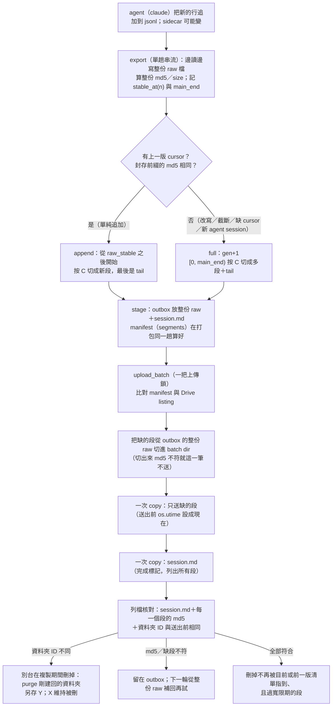
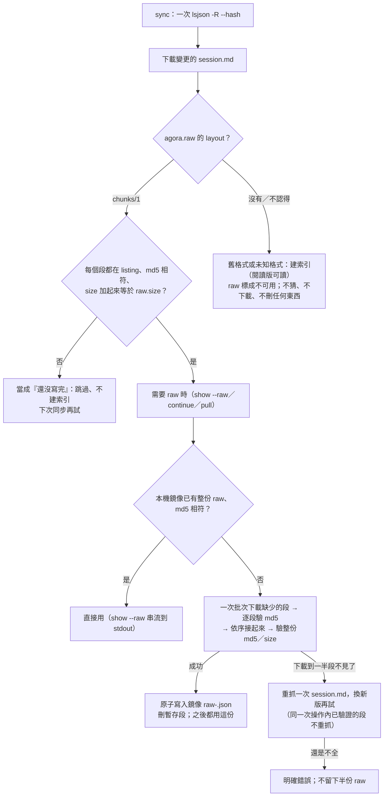

# agora raw 全部分段存（#109 第 7 版）：只送新增的段、大 session 串流匯入、一次搬遷

## 一頁摘要（給非技術讀者）

- **現況**：`agora continue` 每 5 分鐘把整份 session 重傳到 Google Drive；raw 不壓縮，活躍時每輪就是一份完整拷貝（`docs/design.md:130-148`；`src/agora/store.py:771-975`）。
- **改成**：**每一個** Session 的 raw 都按 4 MiB 切成段（`agora.raw.layout: chunks/1`），封存段不會再變；Drive 上只補「這一輪還沒有的段」。`session.md` 仍是最後上傳的完成標記，裡面列出所有段；讀的一方看到它才算這一版寫完。**沒有第二種格式**：舊的單檔 `raw-<md5>.json` 不再寫、也不再讀（唯一例外是遷移用的 `agora migrate adopt`，見 F.3）。
- **省多少（估）**：以 814 MB 的 raw、每輪新增 1 MB、閱讀版 2 MB 為例，現在每輪約 816 MB；新做法每輪的**上限是 `C＋I＋S`**（C＝段的切法 4 MiB、I＝新增 1 MB、S＝閱讀版 2 MB），約 7.2 MB；典型約 5.1 MB（tail 平均半段），**少 99.1%～99.4%**。一天 288 輪：約 235 GB → 約 1.5 GB（上限約 2.1 GB）。**這些數字不含**：第一次匯入（整份，一次）、`gen+1`（來源被改寫時整份）、**每次新開一個 `continue` 的第一次寫回**（`start_native` 換一個新的 agent session，`claude.py:749-780`）、以及整批搬遷的一次性全量上傳（總量未知，見 F）。Drive 垃圾桶保留 30 天，清掉的舊段仍占配額；listing 從「每個 session 一個 raw」變成「每個長 session 約 327 個檔」（第一次切段 195＋1、一路 append 的嚴格上限 391；A.1）。
- **代價**：Drive 上一個大 session 會有幾百個段檔（A.1）；每輪重傳「還沒封存的那一小段」；閱讀版 `session.md` 仍整份上傳，是剩下的地板。小 session（< 4 MiB）就是**一個 tail**，每輪重傳它——和今天重傳整份 raw 一樣，沒有變差。**非 claude 的 agent（opencode／agy／merge）沒有增量**，每輪仍是整份（切段後是新段）；加上 1 小時的寬限期，這類 session 在線上會同時留著最近約 12 輪的整份（5 分鐘一輪）——位元組與今天的垃圾桶累積同量級，只有線上檔案數放大（A.1）。
- **大 session 匯入是常駐能力**：`agora import` 不再把整份 jsonl 讀進記憶體（今天 `_read_lines` 會，`claude.py:210-234`）；改成單趟串流打包，**峰值不隨「不進閱讀版的部分」（例如工具輸出）成長**；剩下的界限是最大單行、sidecar、閱讀版（測試用固定形狀的假 session，讓閱讀版大小不變）。之後任何很長的外部 session 都走同一條路；**它也是這次搬遷用的那條路**（B.2、B.8、spec `session-sync`「匯入大 Session」）。
- **搬遷（一次性）**：舊的 agora session 全部丟掉，從 Mac 上 code agent 的原始紀錄重新匯入。**規則：替代版本已經在 Drive 上（`session.md` 與它列的每一個段都在）、而且內容與舊的相同（兩邊 header 的 `raw.md5` 相同），才丟舊的**；重匯得到不同內容（原檔變短、被改寫，或只是長大）的每一筆都要本人逐筆決定（`agora migrate inventory` 逐筆列出替代版本、兩邊大小與「同不同」；**動手丟之前再跑一次 `inventory`，以那一次的輸出為準**——`delete` 的預覽看不到「相同」；丟用既有的 `agora delete … --yes`，Drive 垃圾桶 30 天）。順序、可逆性、確認點在 F。
- **最大風險不是資料損壞，是搬家的順序與「沒有原始紀錄」的那些 session**：先丟後匯就不可逆；有些 agora session 在 Mac 上根本沒有原始紀錄（別台機器匯入的、merge 出來的、原檔被刪的……），丟掉就只剩垃圾桶 30 天。所以先盤點（G，只讀 metadata、不讀對話、**不觸發 sync 或下載**）、再決定，最後才丟。另一個風險是「複製期間被別台刪掉」的偵測要從名字差異換成資料夾 ID（R2），靠一個未驗的 Drive 假設，所以探針擋在它與格式換代之前（K.1、L9）。
- **不變**：本機仍留整份 raw；搜尋、預覽、`continue`、`show --raw` 的用法照舊；merge／fork／edit 的行為照舊（只是 raw 存法換了）。
- **要本人決定**：搬家要「重匯（丟掉重建）」還是「原地轉存（保留 tags／lineage）」、沒有原始紀錄的類別怎麼處理、重匯後內容與舊的**不同**的每一筆要不要丟、測試裡那個固定的「標準答案指紋」要更新（因為每個 Session 的檔案頭多了分段清單；對話內容本身的指紋不變）、段大小、垃圾桶 30 天、以及「搬遷窗口內舊 session 只能讀、不能 `show --raw`／`continue`」能不能接受（L1–L7、L9–L11）。
- **不需要本人決定（已定的預設）**：跨機器仍是後寫者贏、基準段不見就從整份 raw 補回（L8）；其他實作細節在 L12–L16。

### 圖① 寫入流程（一輪：從收集到 Drive 的分段與 manifest）



### 圖② 讀取接回流程與失敗時的退路



## 0. 範圍、名詞與前提

- **raw**：agent 匯出的整份位元組。claude 是 JSON 信封 `{"format": "claude-jsonl/1", "main": [每一行], "aux": {sidecar}}`（`src/agora/agents/claude.py:308-335`）；opencode 是 `export` 的整份 JSON（`src/agora/agents/opencode.py:1002-1032`）；agy 是 `agy-conversation/1` 信封＋整包 db 的 base64（`src/agora/agents/agy.py:163-186`、`agy_store.py:304-335`）。
- **session.md**：header（YAML）＋閱讀版；是「這個版本完成了」的唯一標記（`docs/design.md:116`、`:148`）。
- **段（segment）**：raw 的一個連續 byte 範圍，存成一個 Drive 檔。**封存段**不會再變；**tail** 是最後一段，每一版可能改。
- **世代（gen）**：同一個 session 的一組段。append 沿用；退回整份時 `gen+1`。
- **基準段（base）**：這一版沿用、沒有重送的舊段；它們必須在 Drive 上，不在就由本機的整份 raw 補回。
- **manifest**：`session.md` 的 `agora.raw.segments`。沒有另一個 manifest 檔（A.2）。
- **前一版清單（prev）**：這一版取代掉的那一份 `session.md` 的 `segments`。它**不是** `stage` 猜的——`stage` 看到的「上一版」常常是還沒上傳的本機版本（離線時連續 stage），不是 Drive 上公開的那一份。prev 來自**上次確認成功時留下的記錄** `state/published/<ULID>.json`（那一版 `session.md` 的 md5 ＋清單）；清理時只有「記錄的 md5 ＝送出前 Drive 上那份 `session.md` 的 md5」才把它當 prev（B.5.5）。
- **寬限期（grace）**：`AGORA_RAW_ORPHAN_GRACE` 秒（預設 3600）。Drive 上比它新的 `seg-*` 一律不刪——這同時保護別台剛傳上來的段與中斷的輪次留下的孤兒（B.5.5）。送出的段檔在送出前會被 `os.utime` 設成現在（B.5.2），所以這個時鐘是「上傳那一刻」，不是「切出那一刻」（K13）。
- **計畫（plan）**：adapter 告訴 store「這一版從哪個 byte 之後是新的」（`append_from`）與「main 內容到哪裡結束」（`seal_upto`）。
- **前提／推論**：814 MB 的案例是 claude session（推論：它用 `claude-jsonl/1` 信封；工單沒明說 agent）。**未知**：那個 session 每 5 分鐘實際新增多少、閱讀版多大、sidecar 多大、最大單行多大（K4、K5、K6、K14）。
- **本 change 只設計**：不改 `src/`、`tests/`；量測與探針只寫規格。

### 0.1 這一版拿掉的東西（每項一句理由）

| 拿掉 | 為什麼 |
|---|---|
| 寫端預設關閉（`AGORA_RAW_LAYOUT=legacy`）與 R4 翻預設 | 沒有相容期要等；留著開關只會製造第二種格式。 |
| 升級順序（R1 先裝到每台）與版本握手（舊 K15） | 舊版不是支援目標，不需要偵測別台版本。 |
| `repack`（段→單檔）與降級政策 | 沒有單檔格式要回去；回退路是 Drive 垃圾桶＋Mac 原檔（F.2）。 |
| 讀端同時支援單檔與分段、「兩種都在」的整份退路 | Drive 上不再有整份 raw，退路沒有意義（A.2）。 |
| 「舊版讀不到／消失」的一整組處理 | 舊版不是支援目標；只留搬遷窗口的一次性代價（F、L10）。 |
| 16 MiB 門檻 `AGORA_RAW_SEGMENT_MIN` | 留著就是第二種格式；小 session 切段仍是 1 個檔、每輪上傳量不變（A.5）。 |
| `agora.raw.file` | 它會指向 Drive 上不存在的檔——舊版就是因此把分段 session 判成「還沒寫完」（A.2）。 |
| `_replaced_raws`／`raw-*` 清理 | Drive 上不再有 `raw-*`；舊 raw 只由 `migrate adopt` 收尾時刪（B.5.5、L14）。 |
| 舊 `unfinished.json` v1 的 `raw_file`／`raw_md5` 形狀 | 改記 `raw_fingerprint`（＋`legacy`），不再有整份 raw 檔名（B.7）。 |

## A. Drive 上的佈局

### A.1 檔案與命名

```
sessions/<ULID>/
  session.md                         header＋閱讀版；完成標記，也是 manifest
  seg-<gen>-<seq>-<md5[:12]>.part     raw 的一段（同一層，扁平）
```

- **只有一種形狀**：每個帶 raw 的 Session 都有 `layout: chunks/1` 與 `segments`；Drive 上**沒有**整份 `raw-<md5>.json`。本機鏡像仍有整份（B.4），檔名由 `raw.md5` 推得：`raw-<md5[:12]>.json`。**`agora.raw.file` 不再寫**（理由見 A.2）。
- **扁平、不開子目錄**：`Drive.list_sessions` 只收 `Path` 兩段的路徑（`src/agora/store.py:239-252`），`list_one` 不遞迴（`254-256`）。放 `sessions/<ULID>/segs/…` 會讓 listing 看不到段，完整性判斷與清除都會失效。
- **`seg-` 前綴**：段不是 raw，也不能被當成一份可以單獨解析的 raw；`_replaced_raws`（`store.py:1103-1107`）只認 `raw-*`，而 Drive 上從此沒有 `raw-*`，所以那一條規則整個拿掉（B.5.5）。
- **檔名帶 md5**：內容定址；同樣的位元組不會因為換版本而改名。`gen` 讓一個世代可以被整組辨認、除錯；`seq` 是順序。tail 也是同一個命名規則，只是每版 md5 不同。
- **`.part`**：明確表示「這不是一份可以單獨解析的 raw」；不要用 `.json`。
- **大小**：`AGORA_RAW_CHUNK`（C）＝4 MiB（4194304 bytes；測試可調到 4 KiB）。**封存段一律按 C 切、每段 ≤ C；tail 是剩下的一個檔，不受 C 限制**（claude 的 tail 含 trailer 與 aux，所以可能比 C 大）：
  - **full**（新匯入、來源被改寫、沒有 cursor）：`[0, main_end)` 切成 `ceil(main_end/C)` 段——不是一段——加 `[main_end, size)` 的 tail。**任何 agent 都一樣**：非 claude 的 raw 沒有 `main` 的概念，就把 `main_end` 當成 `size`，整個 raw 按 C 切；最後一段就是 tail。**例外（小 session）**：`main_end ≤ C`（claude）或 `size ≤ C`（其他 agent）時**什麼都不封存**，整個 raw 就是一個 tail、`raw_stable = 0`；這樣小 session 的檔案數與今天相同（1 個），每輪重傳整份也與今天相同。第一次超過 C 的那一版才開始封存（`append_from = 0`，整份切段）。
  - **append**（單純追加，只有 claude）：`[append_from, main_end)` 切成 `ceil((main_end − append_from)/C)` 段，封存點仍然只有一個（`main_end`）；範圍不到 C 就不封存，全部留在 tail。下一次 append 從新的 `raw_stable` 再按 C 切。
  - **為什麼可以按 C 硬切**：段的邊界不需要是行邊界，接回只是 byte 串接；需要對齊行邊界的是**封存點**（`raw_stable`＝main 結尾），前綴驗證只驗到那裡（B.2）。
  - **數字**（1 MB＝10⁶ bytes、1 MiB＝2²⁰ bytes，與工單的 814 MB 同一個算法）：**第一次整份切段**是 `ceil(main_end/C)` 段，814 MB、4 MiB → 195 個封存段＋1 個 tail ≈ 196 個檔；8 MiB → 98＋1；4 GB → 954＋1。**一路 append 的段數不是 195，而是介於 `ceil(size/C)` 與 `2×ceil(size/C)` 之間**：每次封存把 `[append_from, main_end)` 按 C 切，範圍永遠不是 C 的整數倍，所以最後一個封存段通常很小；每輪新增越多，段數越接近一次整份切段，每輪新增越少，越接近兩倍。例：每輪新增 1 MB、C＝4 MiB 時，未封存累積到 5 MB 才封存，每次封 4.19 MB＋0.81 MB 兩段，814 MB 約 326 個封存段＋1 個 tail ≈ 327 個檔。嚴格上限 `2×ceil(size/C)+1`（814 MB ⇒ 391；4 GB ⇒ 1909）。這個「每次封存多出一個小尾段」是 v1 接受的成本；**不改切法的理由**在 D.1，調大 C 可以抵銷。
- **小 session 也一樣是這種格式**：`main_end ≤ C`（claude）或 `size ≤ C`（其他）的 session 就是**一個 tail**，每輪重傳它。**這和今天是同一個量**（今天每輪重傳整份 `raw-<md5>.json`），所以沒有變差；檔案數也一樣是 1（換了名字而已）。它仍然是 `layout: chunks/1`（**不是**「小 session 用舊單檔」），所以讀端只有一條路。**拿掉 `AGORA_RAW_SEGMENT_MIN`（16 MiB 門檻）的理由**見 A.5。
- **非 claude 的「每輪一份」（誠實寫出來）**：opencode／agy／merge 沒有增量（C.1），所以每一輪都是 full、每一輪 `gen+1`、每一輪的**每一個段都是新檔名**；清理又保留寬限期（1 小時）內的所有 `seg-*`（B.5.5），所以一個正在 `continue` 的這類 session，Drive 上會同時有最近一小時內每一輪的整份（5 分鐘一輪 ≈ 12 份；每份 `ceil(size/C)+1` 個檔）。今天同一個 session 每輪也是上傳一整份新的 `raw-<md5>.json`、舊的進垃圾桶（`_replaced_raws`→`store.py:1103-1107`，垃圾桶 30 天），所以**位元組與 30 天配額占用不是新問題**（兩邊最終都一樣多進垃圾桶）；放大的是「線上」的部分：今天同時只有 1 份在線上，新做法在那一小時內約 12 份都在線上（期滿才進垃圾桶），檔案數因此約 `12 × (ceil(size/C)+1)`。小 session（1 個 tail）可忽略；真的成為問題時，讓 full 的封存段沿用既有檔名（內容定址，拿掉 `gen`）就只換有變的段——**v1 不做，列後續**（tasks 6.8）。

### A.2 有沒有 manifest？

**沒有另一個 manifest 檔。`session.md` 的 header 就是 manifest。** `agora.raw` 長這樣：

```yaml
agora:
  raw:
    md5: <整份 md5>
    size: <整份位元組數>
    layout: chunks/1
    segments:
      - {file: seg-0001-0000-<md5[:12]>.part, size: 4194304, md5: <段 md5>}
      - {file: seg-0001-0001-<md5[:12]>.part, size: 4194304, md5: <段 md5>}
      - {file: seg-0001-0002-<md5[:12]>.part, size: 1234567, md5: <段 md5>}   # tail
```

- **為什麼不再有 `file`**：Drive 上從此沒有整份 raw 這個檔案；一個「指向 Drive 上不存在的檔」的欄位，正是舊版把分段 session 判成「還沒寫完」的原因（舊版只讀 `file`／`md5`／`size`）。拿掉它之後，「這一版完不完整」只有一條規則（清單），不必每個讀者特判。本機鏡像的檔名由 `raw.md5` 推得，不需要存。
- **單一完成標記**：現在的順序是「先 raw、後 `session.md`」，讀的一方用 `session.md` 的 md5 判斷版本完成（`docs/design.md:141-148`；`store.py:601-604`、`628-632`）。分段後完全不變：`session.md` 是最後上傳、最後核對的那一個；它列出的段在發布前必須先全部在 Drive 上、md5 相符（發布後被別台清成不完整是允許的，A.3）。
- **為什麼不另開 manifest 檔**：多一個檔就多一個「兩個標記不一致」的狀態；現在的原子性靠單一 `session.md`，保留它最省事。清單只有幾百個小項（第一次切段 ≈195 項，一路 append 的上限 ≈391 項），約 14–27 KB，塞進 header 不會讓 `session.md` 變大多少。
- **段順序＝清單順序**；接回就是依序串起來。不需要 offset 欄位（可以由前面的 `size` 加出來）；保留 `size` 是為了驗證「加起來等於 `raw.size`」與除錯。
- **全部段都是不可變的，除了最後一個**。tail 每版可能改（新增的 main 行、aux、結尾的 `]`），所以它是新檔名；舊 tail 在確認後被清掉（保留寬限期，B.5.5）。
- **前一版清單不進 header**：它是本機清理用的記錄（`state/published/<ULID>.json`，B.5.5），不隨 `session.md` 上傳。

### A.3 版本完成的三條檢查，與它真正的適用範圍

分段版本要算「完整」，三條都要成立：

1. `session.md` 列的每一個段都在 Drive 上，且 Drive 的 md5 等於清單裡的 md5；
2. 所有段的 `size` 加起來等於 `raw.size`；
3. 接起來的 md5 等於 `raw.md5`。

**這三條在單一寫者時恆成立，多寫者時只保證「不完整會被當成未完成」，不保證「任何時候都完整」。** 寫入端在發布 `session.md` 之前先送完段並用 listing 核對（B.5）；讀取端用 listing 的 md5 判斷（E.1）；接回時再驗一次（E.2）。

多寫者做不到「任何時候」的推演（可測試，I.2）：機器 A 把自己的新段傳上 Drive、還沒傳 `session.md`（A 離線或很慢）；這些段在 B 的眼中是「沒被任何清單指到的孤兒」，B 的清理**在寬限期內不會碰它們**（B.5.5），但超過寬限期（預設 1 小時）之後，下一次清理就會刪掉。A 之後才發布 `session.md`，Drive 上就有一個指到缺段的版本。這是刻意用寬限期換來的窄窗口，不是零。**本 change 把它寫成可測的敘述**：讀者一律當未完成（不建索引、鏡像不提供）；寫者下一次確認發現缺段，就從自己的整份 raw 補回（B.5.1），補不回才留在 outbox 並警告。最壞情況是那個版本在 A 補回之前對所有讀者不可見——不是讀到混合或半份的內容。

### A.4 檔案數與 API 次數

- **檔案數**：一個 814 MB 的 session，第一次整份切段 ≈195 個封存段＋1 個 tail ≈196 個檔；一路 append 的話介於 196 與 391 之間（每輪新增 1 MB 時約 327；A.1）；8 MiB 則大約一半。這是 Drive 資料夾裡的檔案數，不是每輪的上傳次數。以 `lsjson -R --fast-list --hash` 一次列全部（`store.py:239-252`），列檔成本主要在一次呼叫，不是檔案數（`docs/perf.md:27-29`、`:31-38`）。**未知**：幾千個檔案時 Drive 的 listing 與配額行為；N 個長 session 的 listing 總量（N×約 327 個檔）沒有量過（K1、K10）。
- **每輪 rclone 次數**：段與 `session.md` 各一次 `copy --files-from`，加上既有的列檔；與現在同一批（`docs/perf.md:82-104`）。不是「每段一次呼叫」——段是在同一次 `copy --files-from` 裡送。目錄 ID 併進既有列檔，不算新呼叫；若那個列檔不帶目錄項，送出前與確認各多一次 `--dirs-only`（B.5.7、L12）。
- **header 大小**：195 項 × 約 70 B ≈ 14 KB（一路 append 的上限 391 項 ≈ 27 KB）；`session.md` 的閱讀版本身通常是 MB 級，這點可忽略。`yaml.safe_dump` 的實際大小用測試釘住（K7）。

### A.5 為什麼拿掉 16 MiB 門檻

舊設計讓小於 16 MiB 的 claude session 留在單檔（`AGORA_RAW_SEGMENT_MIN`），理由是「golden bytes 不變、檔案數少」。在新方向下這是錯的交換：

1. **它會留下第二種格式**：讀端與寫端都要有「沒有 `layout` 就讀 `raw.file`」的分支，正是本人要拿掉的相容負擔；而且那個分支永遠不會消失（小 session 一直存在）。
2. **它保護的兩件事都不成立**：檔案數（< 4 MiB 的 session 切段就是 1 個檔，和今天一樣）與 golden bytes（見第 4 點）都不需要它。
3. **它多一個懸崖**：第一次超過 16 MiB 的那一版要整份切成多段（一次 814 MB），而且會多一個環境變數、多一種測試狀態。
4. **代價是 golden 測試的一個常數**：`tests/unit/test_mem_golden.py:56` 的 `GOLDEN_MD5_SESSION_MD`（以及 `:293`、`:358` 兩處斷言）會變，因為每個 session 的 header 多了 `layout`／`segments`。**raw 的兩個 md5（`:54-55`、`:297`、`:360`）MUST 不變**。那個檔案的註解寫明「改這些值要本人簽核」（`:49-53`），所以列進 L2。

## B. 寫入端

### B.1 介面：沿用 B2 的 `Increment`，縮小它的內容

```python
@dataclass
class Increment:
    exported: Exported            # 整份 raw（B1b-2 的 raw_file）
    append_from: int | None       # 這一版從哪個 byte 之後是新的；None = 整份
    seal_upto: int | None         # main 內容結束的 byte（tail 從這裡開始）；
                                  # None = 沒有 main 的概念（非 claude）：整個 raw 按 C 切
    cursor: dict | None           # 下一輪用的本機狀態
```

- `Agent.collect_increment(launch, cursor) -> Increment`；預設實作＝`collect()` 包成 `Increment(exported, None, None, None)`（opencode／agy／fake 不變，永遠走整份）。
- claude 實作 append／full 兩種。**段不再由 adapter 產生**：段是儲存層的決定（大小、tail、世代），adapter 只說「新的從哪裡開始、main 到哪裡結束」。這是與 B2 最大的不同（附錄）。
- `append_from is None` 且 `seal_upto` 有值／None＝「這一版是整份，store 自己按 C 切」（新匯入、新的世代、其他 agent）。
- **段的大小與切法完全是 store 的事**：`[append_from, seal_upto)` 一律按 `AGORA_RAW_CHUNK` 切成多段（A.1），不是一段。

### B.2 claude：單趟串流打包，同時算「新增的那一段」

**匯出改成單趟串流（常駐能力，不是遷移的附屬步驟）。** 今天 `_read_lines` 把每一行收進 `list[str]`（`claude.py:210-234`），`_scan` 再逐行解析（`412-454`），`_pack_raw_file` 最後把整份重寫到檔案（`308-335`）；峰值 ≈ 1.78×（B1b-2 對 20 MB session 的量測；814 MB 是推論 ≈1.4 GB）。新的做法是同一趟做完三件事：

1. 讀一行、驗一行（`_scan` 的規則不變：空白行跳過；**最後一個非空白行不是合法 JSON 就丟掉並警告**；其他位置的語法錯誤是 `AgentError`；`main.pop()` 的語意等價於「最後一行不寫進 raw」）。
2. 把這一行的 `json.dumps(line, ensure_ascii=False)` 直接寫進 raw 檔，格式與 `_pack_raw_file` 逐位元組相同（`{"format": ..., "main": [`, `", "` 分隔, `], "aux": `）。
3. 記 offsets：寫完第 n 個 main 元素後的 `stable_at(n)`、`main_end`（寫 `], "aux": ` 之前）、以及 rolling md5 的 `copy()`（`sealed_md5`／`main_md5`，O(1)）。這些都留在 adapter 裡：它用它們算出 `append_from`／`seal_upto` 與 cursor 的三個封存值，**不需要把它們塞進 `Exported`**。

**怎麼做到「最後一行不合法就丟掉」而不必留下所有行**：只緩衝**一行**——讀到第 i 行時才寫第 i−1 行（它確定不是最後一行）；EOF 時檢查緩衝的那一行，合法就寫、不合法就丟並警告。峰值因此是「最大單行 ×2」而不是「整份檔案」。

**峰值不隨「不進閱讀版的部分」成長的目標**（正式驗收在 I.2）：`O(最大單行 + sidecar + 閱讀版 + 固定開銷)`；工具輸出那幾百 MB 不留在記憶體。三項剩下的界限都寫出來：最大單行可以是幾 MB（一個 `tool_result`；K14）；`_pack_aux` 讀整個 sidecar 目錄（`claude.py:258-271`，K5）；閱讀版仍整份在記憶體（`format_reading` 用 `"\n".join`，`base.py:245-252`；估 1–10 MB，K6）。**測試形狀要讓閱讀版大小固定**（否則量到的是閱讀版的成長）；這一版不串流閱讀版：若 K.2 量到它主導，再開一個 change（I.2 的 ratio 測試會先擋住）。

**錯誤優先序 MUST 不變**：今天的 `_scan` 會「先記住第一個語意錯誤、繼續掃到檔尾，讓後面的語法錯誤贏」（`claude.py:441-453`）；串流版必須保留同樣的可觀察結果（丟出的例外類別與訊息），並用「舊 `_scan`＋`_pack_raw_file` vs 新串流」的雙跑測試釘住（I.2）。

每一輪（continue 的定期寫回）：

1. `export` 走上面的串流打包，得到整份 raw 檔、`main_end`、`stable_at(n)`、`sealed_md5`、`main_md5`。
2. **封存點**：cursor 記的是**上一次封存**的狀態，不是上一版的行數：
   - `sealed_line_count`：上次封存到第幾個 main 元素——**以解析後的 main 元素數為準**（最後一行不合法時它不算；下一輪那一行寫完了才成為新的 append）。
   - `sealed_md5`：上次封存前綴（raw 的 `[0, raw_stable)`）的 md5；
   - `raw_stable`：上次封存的 byte 長度（＝封存段加起來的大小）。
3. **前綴驗證**：這一輪在 `stable_at(sealed_line_count)` 的位置算出的 md5 要等於 `sealed_md5`，且 offset 等於 `raw_stable`。
   - 相同 → **append**：`append_from = raw_stable`。就算來源比上一版短，只要還包含封存的行數、而且是同樣的位元組，就是 append（新的 tail 較短）。
   - 不同／`len(main) < sealed_line_count`／沒有 cursor／`cursor.agent_session_id` 與這次的 `exported.session_id` 不同（新開的 `continue`，`claude.py:753`）→ **full**：`append_from = None`。
4. `seal_upto = main_end`（這次 main 的結尾，一定是行邊界）。
5. 交給 store 切段（A.1 的規則，這裡是唯一實作它的地方）：
   - `seal_upto - append_from >= AGORA_RAW_CHUNK`：把 `[append_from, seal_upto)` 按 C **切成 `ceil(範圍/C)` 段**（每段 ≤ C，最後一段可能比較小）；tail 是 `[seal_upto, size)`（只有 trailer＋aux）。
   - 範圍不到 C：不封存，tail 是 `[append_from, size)`（未封存的 main＋trailer＋aux）。
   - **full**：`[0, main_end)` 按 C 切成 `ceil(main_end/C)` 段，**不是一段**；tail 是 `[main_end, size)`。**但 `main_end ≤ C` 時什麼都不封存**（整份是 tail、`raw_stable = 0`、`sealed_line_count = 0`、`sealed_md5 = md5(空)`），小 session 因此只有一個檔。
   - **段的邊界可以落在任何 byte，封存點不行**：需要對齊行邊界的是 `raw_stable`；段內只是 byte 串接。
6. cursor 由 store 在 `stage` 成功後更新：adapter 把這次的 `main_line_count`／`main_md5` 也放進 cursor；有封存 → store 把 `sealed_line_count = main_line_count`、`sealed_md5 = main_md5`、`raw_stable = seal_upto`；沒封存 → 三個值都不動。`base_md5` 永遠是這一版整份 raw 的 md5。

**aux 變了不會退回整份**：aux 在 raw 的 `main` 之後（`], "aux": …`），不影響封存前綴。aux 只讓這一版的 tail 變，於是只重傳 tail（≤ 未封存的 main＋aux）。**aux 的序列化順序必須穩定，否則 tail 每輪都變**：`_pack_aux` 用 `sorted(sidecar.rglob("*"))` 走檔名（`claude.py:263`），`json.dumps` 保插入序，所以 sidecar 沒變時 aux 片段逐位元組相同。加一個測試釘住（I.2）。

**其他 agent 的匯出（常駐匯入的一部分，照程式現況）**：
- **opencode**：`opencode session export` 的 stdout 已經直接寫到檔案（`opencode.py:901-907`），但接著 `target.read_bytes()` 把整份讀回 bytes（`:913`），`export` 再把它放進 `Exported.raw`（`:1025`）。改成**回傳那個檔案路徑**（`raw_file`），事實摘要用 `json.load(open(path))`（`_read` 的等價物，`opencode.py:991-1000`）——少掉一份與 raw 同大小的 bytes，但 `json.load` 仍是 O(匯出)，**不能承諾與大小無關**。**同時 MUST 把 `turns` 一起放進 `Exported`**：opencode 現在是 `turns=None`，`reading_of` 會走 `agent.turns(exported.raw)`（`base.py:260-272`）把整份再讀一次；有了 `turns`，閱讀版就不再碰 `.raw`。opencode 的 session 通常小，這裡只承諾「不再有第二份整份拷貝」。
- **agy**：`pack_raw_file` 本來就串流（db 分塊讀、base64 以 3 的倍數寫，`agy_store.py:304-335`），所以 raw 已經與 db 大小無關；剩下的是 `scan_text(db)` 的清單與 `json.dumps(scan_text)` 的一個大字串（`agy_store.py:322`）——O(文字)，典型 db 35 MB（`docs/design.md:234`）。這一版不動它，列後續（K5 量到再決定）。

### B.3 cursor 放哪裡、什麼時候寫

- 位置：`<state>/cursors/<ULID>.json`（`store.Paths.state`，和 `pending/`、`outbox/` 同一個不能刪的地方；`store.py:52-69`）。
- **由 `stage` 在 swap 成功之後寫**（不是 `_write_one`）：`stage` 知道這一版有沒有封存、封到哪個 byte／第幾行。`_save` 把 adapter 的 cursor 與 `Increment` 一起傳給 `stage`。
- `stage` 失敗（含 swap 前丟例外）就不寫 cursor；否則這一輪的內容下一輪會被當成「沒有新內容」跳過。
- 這條路徑同時涵蓋 import（第一次 full 切段後就有 cursor，下一次 continue 可以直接 append）與 continue／edit。
- 從沒封存過的 cursor：`sealed_line_count: 0`、`raw_stable: 0`、`sealed_md5` 是空前綴的 md5；第一次封存（`main_end ≥ C`）會把整份 main 切段。
- 換機器、清 `~/.cache/agora`、cursor 檔壞掉 → 第一次寫回是整份（一次），之後差分。
- `delete`／`forget_local` 時一起刪 cursor，也刪 `state/published/<ULID>.json`（留著只會讓下一次同 id 的確認拿一份對不上的舊清單）。

### B.4 stage：outbox 放什麼

`stage` 現在把整份 raw 複製進 outbox，並把上一版指到的 raw 一起帶過來（`store.py:324-399`、`353-365`）。分段版本：

- **仍然只放整份 raw 與 `session.md`，不放段檔**。manifest（每個段的 `size`／`md5`）在 `stage` 打包那一趟就算好（`_stage_raw` 的 streaming reader 順便切段算 md5，`store.py:291-316`），寫進 header。**段檔等到上傳那一輪才從整份 raw 切進 batch dir**（B.5.1）。
  - 這樣 outbox 的形狀與今天完全相同：一個 `session.md` ＋一個 `raw-<md5>.json`；少掉「把上一版 entry 的 `seg-*` 帶過來」、「entry 裡的舊段誰清」這一整組狀態（舊設計為了讓 uploader 有檔可送而預切段；batch dir 本來就是那個地方）。
  - 本機仍有一份完整、可讀、可回退、可被掃描的 raw（`local-first-writes` 的「本機保留完整的一份」）；補回缺的段（B.5.1）、`show --raw`、`push`、`migrate adopt` 都靠它。
- **同一檔案系統時用 hard link**：`_stage_raw` 對 `Path` 來源目前是複製（`store.py:299-312`）；改成先試 `os.link`（匯出的暫存檔與 `~/.local/state` 通常同一個 APFS 卷），失敗才 `copyfileobj`。814 MB 的第一次匯入因此少一次整份寫入；內容與 fsync 的語意不變（link 之後仍 `fsync` 目錄）。
- **整份 md5 沒變（edit）**：header 變、raw 不變。`_save` 比對「這一版整份 raw 的 md5」（`Exported.raw_md5` 或對檔案算一次）與上一版 header 的 `raw.md5`；相同就沿用上一版的 `segments` 清單，不重切（否則同一個 raw 會因為這次的切法不同而整組換名、整份重上傳）；只上傳 `session.md`。
- **沒有上一版／第一次匯入**：`plan` 沒有可用的 base → `gen+1`（或 1），整份按 C 切成多段。**import 也走這條**：claude 的 `_import_one` 用 `collect_increment(launch=None, cursor=None)`（或等價的 `export`＋manifest），所以第一次匯入一個 814 MB 的 claude session 就已經是分段格式（spec `session-sync`「匯入大 Session」）。
- **但 continue 的第一次寫回仍是整份**：claude 的 `continue` 用 `start_native` 開一個新的 agent session（`claude.py:749-780`，`_rewrite_lines` 在 `757` 把每一行的 session id 換掉），來源 jsonl 是新的檔案、內容與舊的不同，cursor 的 `agent_session_id` 也對不上；同一輪 continue 之後的定期寫回才 append。fork 走 bytes（`cli.py:2049`）、merge 也走 bytes（`cli.py:751`），兩者都是新的 raw、都是 full。
- **上一版還沒被 Drive 確認**：不必特別處理。它的段不在 Drive，uploader 會把它們當「缺的段」從這一版的整份 raw 補回；這次上傳的量等於整份，但版本是自洽的。
- `stage` 讀上一版 header 的順序：outbox entry（若還在）→ 鏡像的 `session.md`（`remember` 在每次 stage 後同步，`store.py:503-525`）。兩邊都沒有 → full。
- 驗證上一版：`prev.raw.md5 == cursor.base_md5`、`sum(prev.segments[:-1].size) == append_from`、`append_from == cursor.raw_stable`。任一不符 → full。
- **本機 IO 的實話**：整份 raw 仍要進 outbox、`remember` 仍要複製進鏡像（hard link 成功時少一次），所以每輪本機寫入和現在同一個量級；manifest 在 `stage` 複製那一趟順便算（不另讀一次整份 raw）。這個 change 省的是 Drive 的上傳位元組，不是本機磁碟。

### B.5 upload_batch：只送缺的段、核對全部、清舊段

現行順序：raw → `session.md` → 列檔驗 md5 → `.done` 再比一次 → 清舊 raw（`store.py:771-975`；`docs/design.md:139-148`）。分段版本：

1. **這一輪要送哪些段**：對每一筆分段版本，比對 manifest 與 Drive listing，列出「不在 listing」或「md5 不符」的段。段不是預先存在的檔案——**從 outbox 的整份 raw 按 manifest 的 `size` 切出來**（段是 raw 的連續 byte 範圍，offset 由前面的 `size` 加總），放進本輪的 batch dir（和 `session.md` 快照同一個目錄），一次 `copy --files-from`。切出來的段 md5 與 manifest 不符 → 這一筆不上傳，warn（必要時 quarantine）；不要送一個對不上的版本。
   - 新建的 session 沒有基準段，manifest 裡的段都是這一版的新段。
   - 更新既有 id 的項目本來就會先列一次（`store.py:799-837`）；新建但帶基準段（離線匯入後又 continue）時，這一輪先列一次；列檔失敗 → 這一輪不送，下一次再試。
2. **一次 copy 從 batch dir 送**：把所有要送的東西放進本輪的 batch dir——新段與補回的基準段（切自整份 raw）、`session.md` 快照。**送出前對 batch dir 裡每個檔案 `os.utime(f, None)`**（見下）。先送段，再送 `session.md`。batch dir 是這一輪的穩定快照，`stage` 之後換掉 outbox 也不影響；**不要列整份 raw**。`store.py:724-734` 的 `_copy_batch` 已經吃 `source`，改成 batch dir 即可。
   - **為什麼要 `os.utime`**：rclone 預設把來源檔的 mtime 寫成 Drive 的 `ModTime`（推論：rclone 的一般行為，未對真 Drive 驗），而段的 mtime 是「切出來那一刻」。離線兩小時才上傳的段，一上傳就「超過寬限期」，別台下一次清理就會把它當孤兒刪掉——那正是寬限期要保護的情境（K13）。設成現在之後，Drive 的 `ModTime` 落在「上傳那一刻」；若 rclone 其實不寫 modifiedTime，Drive 的 `ModTime` 本來就是上傳時間，兩條路都成立。
   - **副作用（已查）**：hard link 共用 inode，`os.utime` 會把 outbox 那份的 mtime 一起改掉。outbox 的 mtime 沒有任何決策在用（`_entry_snapshot` 讀內容、`md5_file`、`stage` 按名字找檔、uploader 只看 `.done` 的存在），所以只影響「檔案看起來比較新」，不影響內容、cursor 或清理。`SIGKILL` 留下的 `state/batch-*` 由 `_write_batch_snapshot` 的舊目錄清掃處理（`store.py:736-748`）。
3. **`session.md` 一次 copy**：內容用本輪開頭讀到的快照（`_write_batch_snapshot`，`store.py:736-760`、`873-897`），放進同一個 batch dir。現行 `sessions = [u ... if not name or u in sent_raws]`（`store.py:879-880`）用「整份 raw 在這一輪」當代理；**分段版本要改成「manifest 裡的段都在 Drive 或這一輪送出」，沒有 raw 的 Session 照舊（`not name`）送**，不能用「送過 raw」當代理，因為整份 raw 從來不上傳。
4. **列檔核對**：`session.md` 的 md5 相符，**而且** manifest 裡每一個段的 md5 都相符（`store.py:899-922` 的檢查加上段）。任何一個不符 → 留在 outbox；下一輪從整份 raw 補回缺的段再試。**核對通過只代表「這一刻」**：另一台可能在一小時後把某個段當孤兒清掉（A.3），版本就變成未完成；那是允許的狀態，不是錯誤。
5. **清舊段（新規則，取代「刪所有不在新清單的 `seg-*`」）**：對**每一個**這一輪確認成功、離開 outbox 的項目，只在**同一次確認的 listing** 上決定：
   - **目前清單**：這一份 `session.md` 列出的段。
   - **前一版清單（prev）**：讀 `state/published/<ULID>.json`，只有當它的 `session_md5` 等於**送出前** Drive 上那份 `session.md` 的 md5（＝ `again[ulid]["session.md"]`）時才採用；對不上（別台在這期間寫過）就當沒有 prev。
   - **保留**：目前清單裡的段、prev 裡的段、以及 Drive `ModTime` 在寬限期（`AGORA_RAW_ORPHAN_GRACE`，預設 3600 秒）內的**所有** `seg-*`。
   - **刪**：其餘的 `seg-*`（含再上一個世代、失敗輪次的孤兒），用一次 `delete --files-from`。
   - **`raw-*`**：Drive 上從此不該有這種檔（新寫入不會產生）；`_replaced_raws`／`store.py:971-974` 的那條清理**拿掉**，改由遷移的 `adopt` 明確刪掉舊 raw（F.3、L14）。
   - 理由：舊規則會在另一台剛傳完新段、還沒傳 `session.md` 時把它們刪掉；保留「目前＋前一版」給慢速讀者（E.3），寬限期則讓別台的新段與孤兒都活過一輪以上。清理失敗只警告、下次再試。**多寫者的已知限度**：別的機器確認的那一版，本機沒有它的記錄，prev 就是空的——那一版的 tail 只靠寬限期，不是資料損壞。**listing 要帶 ModTime**：`lsjson --hash` 本來就有，`Drive.list_sessions` 目前只留 md5（`store.py:239-252`），分段清理要用保留 `(md5, mtime)` 的變體（同一次呼叫，不加 rclone 次數）。
   - **寫回記錄**：清理完、確認成功之後，把這一版寫成新的記錄 `{session_md5: 剛確認的 md5, segments: 這一版的清單}`。記錄寫失敗只警告：下一次的 prev 會是空的（那一輪只剩寬限期），不影響正確性。
6. **`.done` 的競態**：和現在一樣，只有這一輪送出去、Drive 確認、期間沒有新版本插進來的才離開 outbox（`store.py:941-970`）。**分段版本的版本身分就是 `session.md` 的 md5 ＋整份 raw 的 md5**（整份 raw 就在 entry 裡，manifest 是它的純函數），所以 `.done` 的第二次比對沿用 `_entry_md5s`，不必逐段比。段是內容定址，兩版可以同時存在；舊 tail 不會被新 tail 覆蓋。
7. **「被別台刪掉」的偵測改用資料夾 ID，不用名字差異**：現行 `upload_batch` 在送出後用「送出前 listing 有、送出後沒有的名字」判斷另一台把整個資料夾刪了（`store.py:925`：`any(n != "session.md" and n not in files for n in before)`），成立就 `purge` 整個資料夾（`store.py:932`）並 `_rescue_deleted`（`store.py:935`）。這個判斷有兩個問題：
   - **分段之後一定會誤觸發**：另一台每一輪都會把舊 tail 換名、`gen+1` 時一次讓上百個舊段名消失，listing 上看起來和「資料夾被刪掉」一樣。
   - **它抓的是複製期間的刪除，不是送出前的刪除**：送出前的兩次存在檢查（`store.py:812` 的 `gone`、`:837` 取 `again`、`:848` 的第二次檢查）**都在 `_copy_batch`（`:868`、`:890`）之前**；`:925` 才是「複製前有、複製後沒有」。所以停用名字判斷等於讓「複製期間被別台刪掉」完全沒有偵測——第一次匯入、`gen+1`、新開 `continue` 的第一次寫回都是約 814 MB、數分鐘，正是窗口最長的那一類。
   - **改用資料夾 ID**：Drive 的資料夾 ID 在 purge 後重建**預期**不同（**假設**，未對真 Drive 驗；K.1 的探針會驗），換名（tail 換名、`gen+1`）不變。做法：
     - 取名時點與 `again` 相同（`store.py:837`）：新加一個 listing 變體（`sync` 用的 `list_sessions` 不動，仍是 `--files-only`），用 `lsjson -R --hash` **不加 `--files-only`**，目錄項（`IsDir: true`、`Path` 是 ULID）就帶 `ID`；一次回 `{ULID: {name: (md5, mtime)}}` 與 `{ULID: folder_id}`，**不加呼叫**。`folder_id()` 已經在用同一個欄位（`lsjson --dirs-only` 讀 `ID`，`store.py:230-234`），所以「目錄項帶 `ID`」不是新的依賴；新的只有「遞迴模式也帶它」與「重建的資料夾是新 ID」。
     - **兩個假設與各自不成立的後果**：
       1. **Drive 對同名重建的資料夾給新 ID**。若不成立：ID 不變，複製期間被 purge 又建回來就偵測不到，復活會悄悄回來（這是唯一會失去保護的一條）。
       2. **我們的 `copy` 是新的 rclone 行程，不重用已刪資料夾的快取 ID**。若不成立（行程內快取指到垃圾桶裡的舊資料夾）：檔案被傳進垃圾桶那個資料夾、確認 listing 看不到 → `session.md` 的 md5 不符 → 留在 outbox，下一輪由存在檢查走既有 rescue；結果仍然安全，只是多一輪。
       兩者都由 K.1 的探針驗：`mkdir` → `purge` → `mkdir` 比較兩個 ID。
     - **拿不到 ID 時**：每次比較前補一次 `lsjson gdrive:sessions --dirs-only`（和 `folder_id()` 同一個呼叫形狀；送出前與確認各一次）；送出前補不到就不送這一筆更新（留在 outbox，警告「看不到資料夾，不能確認它沒被刪」，下一輪再試）；確認時補不到就留在 outbox、不算成功。連續每一輪都拿不到，代表這個環境的取 ID 路徑要修，不是無保護地送出去。**這個退路只解「取不到 ID」（可用性），不解假設 (a)**；假設 (a) 由 K.1 的探針驗，而且探針是 R2／R3 的前置（L9）。
     - 確認時（`:899` 那次 listing，同樣帶目錄 ID）：`ids_after[ulid] != ids_before[ulid]` → 資料夾在這一輪被刪掉、又被我們的 copy 建回來 → 照現在 `:925` 的後半處理：`purge`、`_rescue_deleted`、X 留在 outbox 或另存 Y。檢查要放在 `session.md` md5 相符（`:908`）之後、缺段檢查之前——先判「被刪掉」再判「不完整」，否則同一個競態會變成「下一輪補段再送」，X 還是被復活。
     - **存在檢查也要看 `session.md`**：送出前那兩次（`:812` 的 `gone`、`:848` 的 `again`）目前只看 ULID 在不在 listing。purge 後第一個大段 copy 中途失敗時，`sessions/X` 只剩孤兒段（沒有 `session.md`），下一輪會把它當成「還在」而把 X 補完復活。條件改成「ULID 在 listing **且**那個 ULID 的檔案裡有 `session.md`」；這一條不依賴 ID 假設，是另一個獨立的窗口。
     - 名字差異判斷**整個拿掉**（單檔與分段都一樣；R2 就做在還是單檔的路上，R3 沿用）。
   - **四種情境**：
     - **別台正常清理**（換 tail、`gen+1`、清舊世代）：資料夾 ID 不變 → 不算刪除，不 purge、不另存；缺的基準段照 B.5.1 補回。
     - **別台真的刪除**（`purge sessions/X`）：送出前的兩次檢查若看到就不送（現行行為）；若發生在複製期間，ID 預期變了（假設，K.1）→ purge 剛建回來的資料夾、另存 Y（B.5.7 的 `_rescue_deleted`），X 維持被刪。
     - **換世代**（我們自己的 `gen+1` 或別台的）：段名整組換掉、資料夾 ID 不變 → 不觸發。
     - **離線很久**（段是幾小時前切好的）：不影響這個判斷（ID 與時間無關）；寬限期靠 B.5.2 的 `os.utime`。
   - **已知限度**：兩台都在同一個窗口被 purge 誤導時，先確認的那台會 purge 另一台剛寫回的資料夾。另一台的 entry 已經確認、離開 outbox；它下一輪 sync 會看到 X「別台刪掉了」（`cloud_missing`：`store.py:1534` 標記、`:1546-1553` 的訊息），**不會自動再送**，要手動 `agora push session X --not-exist-upload` 才復原（內容仍在它的鏡像裡）。不是靜靜復活一個被刪掉的 Session，但也不是零成本。
   - **適用範圍**：這個偵測在 `upload_batch`（背景上傳，以及 `push` 先送 outbox 的那條）。`agora push session` 走 `_upload_checked`（`store.py:584-605`），是明確指令的「後寫者贏」：複製期間別台刪掉時會把 X 寫回去，不是背景自動復活；要避免就在指令前先確認。**`migrate adopt` 也是明確指令，但多一層發布前 CAS（F.3 的守則 4），不是無條件的後寫者贏**；它用與批次上傳同一條分段上傳路徑（段 → `session.md` → 核對每一段），不是 `_upload_checked` 的單檔 `copyto`。**`push_mirror` 也 MUST 用 batch dir＋一次 `copy --files-from` 送段**：`_upload_checked` 的 `drive.upload` 是一個檔一次 `copyto`（`:593-599`），revive 一個 814 MB 的 session 就是 195 次呼叫 ≈ 11 分鐘（`docs/perf.md` 的 3.5 秒／次）。
   - **`_rescue_deleted` 對分段項目**：entry 裡有整份 raw，另存的 Y 也是分段（走同一個 `stage`，所有段都是新的）；把 raw 以**檔案路徑**交給 `stage`（`store.py:325` 已經接受 `Path`），不要 `read_bytes()` 把 814 MB 讀進上傳器的記憶體（`store.py:997` 現在是 bytes）。

**離線開關**（rclone 包裝 exit 75）不變：`Drive._run` 把非零當 `StoreError`（`store.py:213-215`），entry 留在 outbox；下一輪照常。

### B.6 中途失敗怎麼收斂

| 失敗點 | 留在哪裡 | 下一輪怎麼收斂 |
|---|---|---|
| 打包／算 manifest 到一半（本機） | 匯出的暫存目錄；舊 entry 不動（`store.py:383-399`） | 舊 entry 照舊上傳；暫存清掉 |
| 切段到一半（batch dir） | batch dir（`state/batch-*`）；outbox 不動 | 清掉 batch dir，下一輪重切（已切好的段在 Drive 上的就不必再切） |
| 段傳完、`session.md` 沒傳 | 舊 `session.md` 仍在 Drive；新段是孤兒 | 下一輪比對 manifest 與 listing，只送缺的＋`session.md`；孤兒等寬限期過後才清（B.5.5） |
| 第一個大段 copy 中途失敗（別台剛 purge） | `sessions/X` 只剩孤兒段，沒有 `session.md` | 下一輪存在檢查看到沒有 `session.md` → 當成 X 不在了、另存 Y（B.5.7）；**不補完復活 X** |
| `session.md` 傳完、核對前崩 | outbox entry 還在（`.done` 或目錄） | 下一輪列檔核對；符合就完成，不符就重送 |
| 核對發現段不見（別台清掉／自己漏傳） | outbox 留著 | 下一輪從整份 raw 補回缺的段；補不回（md5 對不上）才 warn／quarantine |
| 兩台同時寫同一個 session | 最後一個 `session.md` 贏 | 輸的那台下一輪從自己的整份 raw 補回被清掉的基準段；讀者把輸的那一版當未完成 |
| 別台正常清理（tail 換名、`gen+1` 換整組） | 只是名字變動，資料夾 ID 不變 | **不算「被別台刪掉」**：不比名字、只比資料夾 ID（B.5.7），不會 purge／另存 |
| 複製期間別台刪掉 | 我們的 copy 把 `sessions/X/` 建回來，資料夾 ID 換了一個（**假設**，K.1） | 確認時比 ID → `purge` 剛建回來的那個資料夾、另存 Y（B.5.7）；X 維持被刪 |
| 清理失敗 | 舊段留著 | 每次確認成功都再試；只浪費空間，不影響正確性 |

**為什麼「補回缺的段」而不是「整份重來」**：段是整份 raw 的連續 byte 範圍，缺哪一段就從本機的整份 raw 切哪一段；只花缺的 bytes，不重傳已經在 Drive 的段。補不回（切出來的 md5 與 manifest 不符）才把這一筆 warn／quarantine，不發布對不上的版本。整份 generation 只留給「來源被改寫」這種真正需要新版本的情況（C）。

### B.7 與現有 outbox／pending／`unfinished.json` 的交互

- **outbox**：一個 entry 仍是一個資料夾，內含 `session.md` 與整份 `raw-<md5>.json`（**沒有**段檔、沒有 `.prev-*`）。前一版清單在 `state/published/<ULID>.json`（B.5.5）；cursor 在 `state/cursors/`（B.3）。`remember` 照舊只複製 `session.md` 與整份 raw 到鏡像（`store.py:513-525`），段不進鏡像。
- **entry 的完整性**：`_entry_header` 現在要求 `raw["file"]` 指到的檔在資料夾裡（`store.py:571-573`）；改成「有 `raw` 就要求 `raw-<md5[:12]>.json` 在資料夾裡」（名字由 `raw.md5` 推得）。少了 `file` 這個欄位，就沒有「欄位指到不存在的檔」這種壞狀態。
- **pending**：不變（`store.py:67`）；cursor 是另一個小檔，不進 pending。
- **`unfinished.json`**：現在記 `{session_md5, raw_file, raw_md5}`（`store.py:1395-1428`）。改成 `version: 2`，記 `{session_md5, raw_fingerprint}`：`raw_fingerprint` 是 manifest 裡每個 `(file, md5)` 加上 listing 裡實際的 md5（缺少＝空字串）的 canonical JSON 的 md5；`chunks/1` 以外的（舊格式、未知）另記 `legacy: true`，代表「這一筆不是還沒寫完，是這個版本不讀它的 raw」；legacy 的記錄只比 `session_md5`（沒有 manifest 可比）。v1 檔直接忽略（下一次多下載一次）。
  - **代價**：多寫者時段名每輪都可能變，fingerprint 就跟著變，下一次 sync 會重下載那個 `session.md` 再判斷一次（幾 KB，不是 raw）；這是流量，不是正確性。

### B.8 常駐匯入：大 Session 的記憶體、時間、上傳與失敗

`agora import` 不是只為搬遷存在（本人 2026-10-22：永遠會有很長的外部 session）。契約：

- **記憶體**：claude 單趟串流打包（B.2），**峰值不隨不進閱讀版的部分（工具輸出）成長**；剩下的界限是最大單行×2、sidecar、閱讀版（固定形狀的測試讓閱讀版不變）。opencode 少一份整份 bytes（`json.load` 仍 O(匯出)）；agy 的 raw 本來就串流（`agy_store.py:304-335`），剩下 `scan_text` 的 O(文字)。**量測與門檻**在 I.2、K.2；這是 R1 的驗收，**驗收要記下 100／400／800 MB 的實際秒數**（不設門檻，但要有數字；記在 `docs/perf.md`，R1 是草稿、R4 轉正）。
- **時間**：本地是「讀原檔一趟＋寫 raw 一趟＋進 outbox／鏡像各一趟＋切段進 batch dir 一趟」；814 MB 約 4–5 趟（推論，K.2 會量）。今天也是兩趟（讀進記憶體、寫出），差別在記憶體與磁碟峰值，不在 CPU 的量級。
- **上傳**：第一次就是分段（`ceil(main_end/C)` 段＋tail），一次 `copy --files-from`；中斷後下一輪只補 listing 缺的段（B.5.1），**不必重讀原檔**。
- **失敗**：`stage` 之前死 → Drive 什麼都沒有，重跑；`stage` 之後死 → outbox 有整份 raw，下一個指令會續送；`--as-new` 的重跑在「同來源的 `chunks/1` Session 已經存在」時是 no-op（不會產生第二份）。
- **已知限制**：**一般的 re-import**（同一個 `chunks/1` Session 的內容變了、又不是 `--as-new`）仍會為了「內容不能變少」的檢查把舊 raw 讀進記憶體（`cli.py:544-552`）；那不是這張的串流路徑，列後續（K14）。目標是**舊格式** Session 時不適用：一般 import 一律拒絕（C.3），不會去讀它的 raw。

## C. 非單純追加就退回整份

### C.1 觸發條件

| 條件 | 怎麼發現 | 結果 |
|---|---|---|
| 來源短到封存點之前 | `len(main) < cursor.sealed_line_count` | full |
| 封存前綴被改寫（同大小或更大） | `stable_at(sealed_line_count)` 的 md5 與 `cursor.sealed_md5` 不同 | full |
| 只砍掉封存點之後的內容 | 封存前綴仍相同，`len(main) >= sealed_line_count` | append；新的 tail 較短 |
| 換了一個 agent session（新開的 `continue`） | `cursor.agent_session_id != exported.session_id`（`claude.py:753`） | full（一次） |
| 沒有 cursor（換機器、清 cache、cursor 壞） | 檔案不存在／版本不符 | full（一次） |
| 上一版整份 md5 與 cursor 的 base 不同 | `prev.raw.md5 != cursor.base_md5` | full |
| 上一版的封存段加起來不等於 `append_from` | 計畫驗證 | full |
| adapter 不支援增量（opencode／agy／merge／fake） | `append_from is None` | full（整份按 C 切） |
| 要寫的 Session 不是 `chunks/1`（舊格式、未知） | header 的 `layout` | **拒絕寫入**（見 C.3），不是「自動升級」 |

**一般的 `agora import`（沒有 `--as-new`）也在這條規則裡**：它會更新的那一個 Session（`existing[0]`）不是 `chunks/1` 時 MUST 拒絕，不是「更新它」、也不是「分支成新的 Session」。細節與理由在 C.3。

### C.2 退回後 Drive 上怎麼處理

1. `gen+1`；manifest 重新從 `[0, main_end)` 按 C 切成多段（A.1）加 tail。
2. 上傳所有新段 → `session.md` → 核對全部段（B.5.4）。
3. 確認後清舊段，**規則與 B.5.5 同一個**：保留新清單、prev（`state/published` 的記錄，md5 對得上才是被取代的那一版）、以及寬限期內的所有 `seg-*`；其餘（含上一個世代）刪掉。
4. 刪除失敗：`warn` 一行（沿用 `_delete_batch` 的「下次再說」，`store.py:763-768`），下一次確認成功再試。孤兒段不影響正確性；最壞情況是每個失敗的世代都留一份，佔空間。
5. **誰負責**：拿到上傳鎖、把這一版確認成功的那個行程（背景上傳器或 `push`）。前景只 stage，不刪 Drive。

### C.3 遇到不是 `chunks/1` 的 Session

- **缺失或未知的 `layout`**（舊版留下的單檔 session、別台未來的新格式）：**MUST NOT 猜、MUST NOT 半讀**。讀端把閱讀版照常建進索引（搜尋與 `show` 可用），但 raw 標成不可用：`show --raw`／`continue`／`pull` 的下載／`edit` 都給一個明確錯誤（「這個 Session 的 raw 是舊格式或未知格式，請先遷移」）。**MUST NOT 因為這樣就把它從索引與鏡像刪掉**——那會在搬遷之前把資料弄不見，而搬遷是本人明確的動作（F）。
- **寫端**：`edit`／`continue` 對這種 Session 直接拒絕（它需要整份 raw 才能 stage）；要保留它就 `agora migrate adopt`（F.3）。
- **一般的 `agora import`（沒有 `--as-new`）**：`Index.by_source(agent, session_id)`（`store.py:1250-1261`）回的是「同來源、Drive 還在」的 Session，新的在前（`ORDER BY ulid DESC`）。**要更新的那一個（`existing[0]`）不是 `chunks/1` 時 MUST 拒絕**（exit 非 0），訊息指向 `--as-new`（丟掉重匯）與 `agora migrate adopt`（保留 header）。兩條現在會踩到的路都不行：
  - `cli.py:547-552` 的 fail-open：新版本裡 `fetch_raw(舊)` 對舊格式直接 `StoreError`（E.2），被 `except` 接住後「沒做變少比對就更新」——等於**靜靜原地升級**，違反這一節的 MUST NOT 自動升級。**對這種 Session MUST NOT 保留這條路**（目標是 `chunks/1` 時，fail-open 的既有行為不變，那是網路／md5 讀不到時的退路）。
  - `cli.py:566-573` 的分支路徑：目標「已經被 continue／merge 過」時會建一個**新的** Session，`parents` 指到舊的（`_auto_header("import", parents, …)`）。那會讓舊 Session 因為「有子 Session」而刪不掉（`cli.py:2369-2370`），正好卡死搬遷的第 4 步。**MUST NOT 走這條**。
  - 若 `existing[0]` 已經是 `chunks/1`（搬遷後的一般情況），照常更新它；同來源的舊格式兄弟（還沒丟掉的）不影響。
- 這不是「相容」：我們沒有讀舊 raw，也沒有寫舊格式；只是不替使用者刪東西、不替使用者升級。

## D. 壓實（compaction）

### D.1 v1：不壓實

固定大小的段本身就是壓實：每次封存切 `ceil(範圍/C)` 段，所以段數的嚴格上限是 `2 × ceil(size/C) + 1`（封存段 ≤ C、最後一段可能很小；`+1` 是 tail）。**典型值取決於每輪新增量與 C 的比**：每輪新增 ≳ C 時接近 `ceil(size/C)`；每輪新增 ≪ C 時接近 `2 × ceil(size/C)`。814 MB／4 MiB：第一次整份切段 195＋1；每輪新增 1 MB 時約 326＋1；上限 390＋1。4 GB：954＋1 到 1908＋1；8 MiB 時全部減半。**v1 不做定期合併**，理由：

- 合併需要第二個寫 `session.md` 的人（上傳器），和前景的 `stage` 競爭；要另外處理「哪個版本是基準」、清理、失敗回退。這是這個 change 裡風險最高的一塊，而它只省下「tail 重傳」的差額（估計每輪 1–2 MB），不是 814 MB 的主要來源。
- 兩三百個檔在一個資料夾裡不是問題；listing 一次拿全部（A.4）。真的到 1000+ 個檔，先把 `AGORA_RAW_CHUNK` 調大（8 或 16 MiB）比寫壓實簡單。
- **不改切法的理由**：把封存點改成「不大於 `append_from + k·C` 的最大元素邊界」（k＝`floor(範圍/C)`），讓餘數留在 tail，段數就會回到 ≈ `size/C`。代價是封存點可能落在比 `k·C` 更前面（差不到一行），而單行比 C 長時還要另一條退路；那要動 B.2 的游標語意，換來的是檔案數，不是流量。v1 先用誠實的兩倍上限；K1 真的顯示檔案數是問題再做。

### D.2 如果以後要做

- **觸發**：同一個 session 的段數 > 512（或 header > 64 KB），且本機沒有正在接續它（`store.continuing`，`store.py:1340-1357`）。
- **誰**：拿到上傳鎖、剛好確認完一批的 uploader；一次最多合併一個 run。
- **怎麼**：相鄰的封存段是整份 raw 的連續 byte 範圍，所以直接從**鏡像的整份 raw** 切出合併後的那一段（不用下載），寫成一個新段、上傳、發布新的 `session.md`（清單換成「合併段＋其餘」）、確認、再刪掉被合併的舊段。
- **讀者不會看到不完整**：和一般版本一樣，`session.md` 最後才換；舊段在新 `session.md` 確認前都還在。
- **清理**：被合併掉的舊段算「被取代」，清理照 B.5.5——所以它們要再過一個版本、或超過寬限期才真的消失。
- 不要合併 tail（它每版都變）。

## E. 讀取端

### E.1 sync／listing：只判斷完不完整，不下載

`sync` 現在用 listing 的 md5 判斷 `session.md` 指的 raw 在不在、md5 對不對（`store.py:1518-1525`；`mirror_one` `628-632`）。分段版本改用同一個 listing：

```python
def raw_complete(raw, files) -> bool:
    if not raw:                       # 沒有 raw 的 Session（例如手寫的）：本身完整
        return True
    if raw.get("layout") != "chunks/1":
        return None                   # 舊格式或未知：不猜，交給呼叫端標成 raw 不可用
    segs = raw.get("segments") or []
    return (bool(segs)
            and all(s["file"] == basename(s["file"]) for s in segs)
            and sum(s["size"] for s in segs) == raw["size"]
            and all(files.get(s["file"]) == s["md5"] for s in segs))
```

- `False` → 當「還沒寫完」：不出現在索引、鏡像的 `session.md` 拿掉、記進 `unfinished.json` v2（和現行 G3 的行為一樣，`store.py:1521-1525`）。
- `None` → **舊格式或未知**：建索引（閱讀版可讀）、標成 raw 不可用、**不刪鏡像、不刪索引**；記進 `unfinished.json` v2 的 `legacy: true`，下一次 sync 不再為它下載。`show --raw`／`continue`／`edit` 給明確錯誤（C.3）。這一條與「還沒寫完」是**兩種不同狀態**：一個是等 Drive，一個是等搬遷。
- `True` → 建索引；raw 等到 `continue`／`show --raw`／`pull` 才抓（`docs/design.md:161`）。
- **段檔名安全**：`segments[].file` MUST 是安全的 basename（不含 `/`、`\`、`..`、不以 `.` 開頭），否則這一版當成壞的（未完成／`StoreError`），MUST NOT 用那個名字下載或刪除。
- **已建索引的版本不會被每輪重驗**（現行行為：`sync` 只下載 md5 變了的 `session.md`，`store.py:1484-1485`）。所以「別台事後清掉一個段」不會馬上被 sync 發現；發現的時機是下次接回（E.2）或 `session.md` 換版。這是既有性狀。

### E.2 接回整份：`ensure_raw_file`

新增 `store.ensure_raw_file(paths, drive, ulid, header) -> Path`（`fetch_raw` 改成用它，再讀 bytes；`show --raw` 直接串流檔案）：

1. 鏡像已有 `raw-<md5[:12]>.json` 且 md5 等於 `raw.md5` → 直接回傳（最常見：自己寫的版本、剛 pull 過）。**零網路。**
2. `layout != "chunks/1"` → `StoreError`（「舊格式或未知格式，raw 不可用；請先遷移」）；不猜、不半讀。
3. 否則：
   - 把缺少的段用**一次** `copy --files-from` 下載到 `<cache>/segments/<ULID>/`（不是每段一次呼叫）。**「缺少」是相對本次操作已有的暫存檔**：同一次操作內已下載且 md5 驗過的段不重抓（重試時只補缺的）。
   - 逐段驗 md5；任何一個不符 → 丟掉那一個暫存檔、`StoreError`（不拼半份）。
   - 依 manifest 順序串接到鏡像目錄的暫存檔，邊串邊算整份 md5；驗 `md5`／`size`。
   - `os.replace` 成 `mirror/<ULID>/raw-<md5[:12]>.json`（原子），刪暫存段與其他舊 `raw-*.json`。
   - 回傳路徑。
4. **下載到一半被寫的一方改了**：某個段 404（另一台確認了新版本、清掉舊段）→ 重抓一次 `session.md`；**保留仍在新 manifest 裡（同名且 md5 相同）的暫存段**，只下載新的 manifest 多出來的段，再試一次。仍失敗 → 明確 `StoreError`，不留下半份。**換世代是最壞情況**：新舊 manifest 沒有共同的段，等於整份重下（814 MB）——只發生在寫端剛好 `gen+1`，不是常態。
5. **快取**：保留接好的整份 raw（鏡像的既有規則）；**暫存段只活在這次操作裡**——成功接好就刪，失敗也刪。
6. `show --raw`：有整份就 `shutil.copyfileobj` 串流到 stdout，不再 `sys.stdout.buffer.write(fetch_raw(...))` 把 814 MB 放進記憶體（`cli.py:2584-2586`）。`continue` 的 `fetch_raw` 仍回 bytes（`start_native` 的介面沒改），這是既有的記憶體限制，不在這張。

### E.3 讀到一半被寫的一方改了

- 讀者拿到的是某個 `session.md` 的快照；它列的段是內容定址的。寫入端只有在新的 `session.md` 確認後才清舊段，而清理會保留「前一版清單」與寬限期內的段（B.5.5），所以「讀者看到舊 header、段還在」是常態而不是巧合。
- 會被刪的是：前一版以前的段（`gen+1` 的舊世代）、以及超過寬限期的孤兒。讀者若在 listing 之後、下載之前剛好遇到（例如下載整份要超過一小時），就 404 → 重抓 `session.md` → 用新版；同一版的段已在暫存區的不重抓（E.2.4）。最壞是多重抓一次 header，或換世代時整份重下，不是讀到混合版本。
- 讀者**不會**把兩版的段混在一起：段名、manifest、整份 md5 都來自同一個 header。

### E.4 失敗時的退路

| 情況 | 行為 |
|---|---|
| 段不完整（寫到一半） | 當未完成：跳過、不建索引、下次再試（`raw_complete` 假） |
| 舊格式／未知 `layout` | 建索引、raw 不可用、明確錯誤；不猜、不刪（C.3） |
| 下載段失敗（網路） | `StoreError`；`pull` 記一個失敗；`continue` 不開 agent（exit 2） |
| 段 404（被新版取代／別台清理） | 重抓 `session.md` 一次，用新版再試；已驗過的段不重抓 |
| 段被別台清掉但 `session.md` 沒換（別台只清孤兒） | 同一個 404 路徑；重抓的 header 一樣，仍缺 → 明確 `StoreError`，不拼半份；下一次 sync 若 `session.md` 換版就自動恢復 |
| 整份 md5／size 不符 | `StoreError`；不安裝半份；暫存清掉 |
| 本機鏡像的整份 md5 不對 | 視為沒有，重新下載／接回 |

## F. 遷移（一次性；用 B.2 的常駐匯入）

舊方向的所有「相容」產物都拿掉了，所以**沒有格式共存期**：新版本只讀 `chunks/1`，舊 session 在搬完之前是「閱讀版可讀、raw 不可用」（C.3）。搬遷是本人一次性的動作，不是每次升級都要做的事。

### F.1 順序（每一步都有確認點）

1. **升級這台機器**到含 R3（格式換代）的版本。從此舊 session 是「讀得到閱讀版、`show --raw`／`continue` 會明確說要遷移」。**這一步不刪任何東西。**
2. **盤點**：先跑一次正常指令（例如 `agora sync`），讓 `Index` 的版本升級重建完成——那個重建會讀鏡像裡的 `session.md`（本機快取；見 G.2）。然後 `agora migrate inventory --json`（G.2）。只讀 metadata，輸出每筆的類別、來源 agent／host／external id、以及**替代版本在不在、內容一不一樣**。**確認點 ①：本人看過數量與類別。**
3. **重新匯入**：對「本機有原始紀錄」的那些，`agora import session --agent <agent> --external-session-id <id>… --as-new`（既有指令＋一個遷移用的開關；一次幾個、逐個匯入；失敗不擋下一個，`cli.py:490-500`）。每一個都是**第一次匯入就是分段**（B.2、B.4、B.8），用的是同一條常駐串流路徑。**確認點 ②：`inventory` 再跑一次，這些類別的 `replacement` 都出現、而且 `relation_to_old` 是 `identical`；不是 `identical` 的逐筆處理（第 4 步）。**
   - 匯入指令在「上傳排隊」時就回來；`inventory` 只有在**替代版本就是 Drive 上那一份**（索引的 `session.md` md5 等於 listing 的，而且它列的每一個段都在 listing，見 G.2）且 `raw.md5` 相同時才說 `identical`。所以確認點 ② 之前要讓上傳成功（指令自己會回報；沒成功就 `agora push session <新 id>`），否則會看到 `drive-version-elsewhere`。
   - **為什麼一定要 `--as-new`（這是一個坑）**：一般的 import 會先用 `Index.by_source(agent, session_id)` 找同一個來源（`cli.py:527`、`store.py:1250-1261`）；舊 session 這時還在本機索引裡（我們刻意不先刪），所以它會被當成「同一個 Session 重新匯入」——內容沒變就印出**舊的 id 並什麼都不做**（`cli.py:530-535`），內容變了就拿舊的來比「不能變少」（`cli.py:544-552`）。兩條路都不會產生新的分段 Session，搬遷會靜靜地什麼都沒做。**第 7 版起一般 import 對舊格式直接拒絕（C.3），所以這條路不會再靜靜地壞掉；但也不會幫你重匯。**
   - `--as-new` 的語意：**忽略「同一個來源的舊格式 Session」**；如果已經有一個**同來源的 `chunks/1` Session**，就回它（重跑是 no-op；`inventory` 用同一個查詢找 `replacement`，但它另外要求那一版已在 Drive 上、段都在，見 G.2）；否則建立一個新的 Session（`relation: import`、**不設 parents**——見 F.3 的 lineage）。舊 Session 一個位元組都不動。
4. **丟掉舊的**：**動手之前緊接著再跑一次 `agora migrate inventory --json`，以那一次的輸出為準**——`delete` 的預覽只列 id、標題與「使用中」（`cli.py:2436-2447`），看不到「相同／不同」；第 2 步（或確認點 ②）的 `identical` 在重匯與上傳的窗口內可能過期（還有舊版機器在跑、改了舊 Session 的 `session.md` → 條件 3 變成 `different`；別台把替代版本的某一段當孤兒清掉 → 條件 2 變成 `different`）。確認點 ③ 用的就是這一份清單。**丟掉的單位是一條 lineage**——把同一個連通集合（`old_children` 串起來的那些）一起給 `delete`，因為父 Session 只要有批外的子 Session 就會被拒絕（`cli.py:2369-2370`）。如果某個子孫要走 adopt（保留），那它的祖先也只能 adopt、不能刪；混著做會讓祖先永遠刪不掉。`agora delete session <舊 id>… --yes`（既有指令：本機立刻忘掉、Drive 進垃圾桶、佇列可續跑，`cli.py:2357-2517`、`background.py:56-73`）。**只丟 `replacement.relation_to_old == "identical"` 的**（兩邊都是 Drive 上那一份、替代版本的每一個段都在 listing、整份 `raw.md5` 與舊的相同）；照剛剛那次 `inventory` 的清單給 id（G.2）。
   - **`different` 的每一筆（附兩邊 `raw_size`）要本人逐筆決定，不進預設清單**：原檔可能只是長大（新的是超集），也可能被截短／改寫（新的少了東西）。**不讀內容分不出這兩種**，所以不自動丟；本人看大小（與需要時自己比對內容）再決定。`null`（無法比較，例如舊的沒有 raw）與沒有替代版本的，照 G.3。
   - **一條 lineage 裡只要有一個不是 `identical`，整條先留著**：父 Session 會被批外的子 Session 擋下（`cli.py:2369-2370`），所以那一筆的決定等於整條的決定。
   - **整組要在同一次指令裡給**：子 Session 只在「同一次請求裡」才會先刪，批外的子 Session 會讓父被拒絕（`cli.py:2369-2370`）；搬遷前也要確認沒有 `continue` 在跑（使用中的會被跳過，`cli.py:2388-2397`）。Drive 的 purge 是一個 ULID 一次呼叫（背景、可續跑，`background.py:56-73`），N 個約 N×3.5 秒。**確認點 ③：`delete` 自己的預覽（`--yes` 之前會列出要刪的與被跳過的，`cli.py:2436-2446`）。**
5. **驗收**：`inventory` 再跑一次 → 舊格式且「本機有原始紀錄」的應該是 0（`different` 的那幾筆逐筆處理完之後）；抽幾個新 session `show --raw` 對 md5。
6. **其他機器**：同一台／同一份 Drive 的其他機器也要升級，並且**各自**跑 2–4（它們的原始紀錄在它們身上，`agora.source.host` 記的是匯入當時的 hostname，`cli.py:185-190`）。
7. **沒有原始紀錄的類別**（G.3）：不進第 4 步；先由本人決定 adopt／保留／丟掉。

**為什麼是這個順序**：第 4 步的條件是「**內容相同**的替代版本已在 Drive」（`identical`），所以先丟不會丟掉東西；反過來（先丟後匯）在匯入失敗時就只剩垃圾桶 30 天。第 3 步用的是常駐能力，所以「搬遷」本身沒有自己的匯入程式。

**第 7 版加這一條的理由（B1）**：第 6 版的條件只有「有替代版本」。可是 `replacement` 原本只是「同一個 agent session id 已經有一個 `chunks/1` 的 Session」（`Index.by_source`，`store.py:1250-1261`），而 `--as-new` 又刻意繞過「重匯內容比原本少就不覆蓋」（`cli.py:530-552` 只保護一般 import）。原檔在匯入後被截短／改寫時，重匯得到**較短**的新版本，盤點會把它當替代品，第 4 步照清單刪舊的 → 本機鏡像立刻消失、Drive 只剩 30 天垃圾桶，而**沒有任何一個確認點看得到「新的比舊的短」**。現在丟的門檻是「兩邊都是 Drive 上那一份、段都在、而且整份 `raw.md5` 相同」，不讀內容就能判，而且判錯的方向只會是「不丟」。**代價**：原檔只是長大也會是 `different`，要本人逐筆看（K18）。

### F.2 可逆性

- **Drive**：`agora delete` 走 `purge`，rclone 的 `drive.use_trash` 預設 true（`store.py:1585-1587` 的註解），所以**垃圾桶 30 天內可以還原**；30 天後沒有。
- **本機**：`delete` 會 `forget_local`（索引列＋鏡像整個資料夾，`store.py:1562-1565`），**本機那份整份 raw 立刻消失**，不像 Drive 有垃圾桶。所以「本機鏡像」不是第 4 步的回退路；回退路是 Drive 垃圾桶＋（對可重匯的類別）Mac 上的原始紀錄。
- **不可逆的是**：舊 session 的**使用者 metadata**（`tags`／`refs`／`case`／`description`／`status` 與自訂欄位）與 **lineage**（`relation`／`parents`）——重匯會產生全新的 header（`_auto_header("import", [], …)`，`cli.py:566-570`）；原始紀錄裡沒有這些東西。**除非**走 F.3 的「原地轉存」。
- **為什麼重匯的 `parents` 是空的**（不是「留著 lineage 比較好」）：`parents` 會讓舊 Session 變成「有子 Session」而被 `agora delete` 拒絕（`cli.py:2369-2370`、`docs/design.md:216`），那正是第 4 步要刪的東西。要 lineage 就走 F.3 的 B 路徑；A 路徑是刻意平坦的。

### F.3 兩條路徑（本人選）

| | **A. 丟掉＋重匯**（本人原話的方向） | **B. 原地轉存 `agora migrate adopt`** |
|---|---|---|
| 做什麼 | 舊 session 刪掉；從 Mac 原檔重新 `import --as-new` | 同一個 ULID、同一份 header **與同一份閱讀版 body**；把 Drive 上的舊整份 raw 轉成分段（下載→切段→上傳→刪舊 raw） |
| 保留 | raw 內容（重新從原檔打包，逐位元組可能與舊 raw 相同） | **全部**：id、tags、refs、case、description、status、relation、parents、`source` |
| 失去 | **使用者 metadata、lineage**；merge 不能重匯；沒有原檔的類別不能走這條 | 無（代價是舊的雜亂結構原樣留著） |
| 成本 | 一次性全量上傳（＝所有原檔的大小，未知）＋本機重打包 | 每個 session 下載＋上傳各一份（本機有整份 raw 時只上傳） |
| 風險 | 匯入失敗／原檔不在 → 只剩垃圾桶 30 天；重匯出來的內容可能與舊的**不同**（截短／改寫／只是長大）——**不同的不進預設丟掉清單**，逐筆決定（F.1 第 4 步） | 舊 raw 的 md5 必須等於 header 的 `md5`，否則拒絕；唯一會讀舊 `raw.file` 的路徑。多機一致性與收尾的守則在下面 |
| 建議 | 對「不在乎 metadata、想要乾淨重建」的多數 session | 對有 tag／case／lineage 的、merge、沒有原檔的 |

兩條都讓 Drive 上只剩 `chunks/1`。**`adopt` 是唯一讀舊 `raw.file` 的地方**（下載時驗 md5），不在 sync／pull／show／continue 的路徑上；它也是唯一會刪 Drive 上舊 `raw-*.json` 的地方。**`adopt` MUST 沿用 Drive 上那一份 `session.md` 的閱讀版 body（不重新從 raw 產生）**：那是唯一能保留「手改過 body 再 `push`」的路徑（`edit` 只改 header，不會有這個問題）。

**`adopt` 的五條守則（第 7 版補；多機一致性與收尾的缺口）**：

1. **取上傳鎖**（`store.hold_upload_lock`，與背景上傳器、`push` 同一個）：adopt 是「讀舊版 → 花幾分鐘下載／切段／上傳 → 發布」的長動作，不能和別的寫入交錯。
2. **跳過接續中的 Session**：`store.continuing_details(paths, ulid)`（`cli.py:2388-2397` 對 `delete` 用的是同一個檢查）不是 `None` 就**跳過並列出**（那台 agent 會在同一時間寫回同一個 id），其他照做；不要用 `--force` 那套（adopt 沒有那個旗標）。
3. **不要動到還在 outbox 的版本**：`outbox/<ULID>`（含 `.done-`、`.old-` 的 set-aside 版本）存在時**拒絕這一筆**。那個 entry 是舊版（整份 `raw-*.json`＋舊 header），背景上傳器之後會把它送上去，把剛 adopt 好的版本蓋回舊格式。訊息：先讓它上傳完／處理掉再 adopt。
4. **compare-and-swap（不是原子 CAS，是窄窗）**：開始時先用 `list_one(ulid)` 拿 Drive 上 `session.md` 的 md5，**用它當基準**；鏡像／索引的那一份 md5 與它不同時，MUST 先下載 Drive 上那一份 `session.md` 並用它的 header（否則 adopt 會拿一份過期的 header 把別台的 tag／description 蓋回去；那是閱讀版，一次而已）。**發布新 `session.md` 之前**再 `list_one(ulid)` 一次，md5 與基準不同 → **中止這一筆、不動 Drive**（重跑即可）。`_upload_checked`（`store.py:584-605`）本身沒有前置比對，是後寫者贏；這條把「幾分鐘的窗口」縮成「最後一次 copy 的窗口」。
5. **只刪記下來的那個檔名**：收尾刪舊 raw 時**只刪 adopt 當時讀到的那個 `raw.file`**，MUST NOT 掃整個資料夾刪其他 `raw-*`（別台同時寫回的新 raw 名字不同，掃了會誤刪）；`seg-*` 用與批次上傳同一條清理規則（目前＋前一版＋寬限期），不另外掃。

確認成功後 adopt 也寫一份 `state/published/<ULID>.json`（和 `upload_batch` 同一個形狀），下一次清理才有「前一版」可保護——它自己的段不會只靠寬限期。**沒有 cursor**：adopt 之後的第一次 `continue` 寫回是整份（B.3、C.1），這是固定成本。

### F.4 這一章用的是常駐的匯入能力

搬遷的第 3 步就是一個一個 `agora import … --as-new`；**沒有另一套「搬遷用的匯入」**。記憶體上限、時間、第一次上傳就是分段、失敗重試與續傳的契約在 B.8 與 spec `session-sync`「匯入大 Session 不把整份 raw 放進記憶體」；`--as-new` 在 spec `session-sync`「重匯既有來源時另存」。

## G. 沒有原始紀錄的 agora session：盤點與處理選項

### G.1 哪些類別（欄位名稱照程式）

每個 Session 的 header 只有這幾個欄位能回答「原始紀錄在哪」：`agora.relation`（`import`／`continue`／`merge`／`fork`）、`agora.source`（`agent`、`session_id`、`dir`、`host`、`agent_version`、`created_at`；`cli.py:185-190`）、`agora.previous_sources`（`"agent:session_id"` 字串清單；`cli.py:1373-1379`）、`agora.parents`、`agora.merge`（`cli.py:742-750`）。**沒有「machine」以外的來源機器欄位**；機器就是 `source.host`（`socket.gethostname()` 的字串）。

| # | 類別 | header 長什麼樣 | 本機檢查 | 為什麼可能沒有原檔 |
|---|---|---|---|---|
| 1 | **別台機器匯入／接續的**（worker 上 team PM／隊員的 session） | `source.host` ≠ 這台的 hostname；`source.agent` 是 claude／opencode／agy | 原檔不在這台 | 原始紀錄在那一台；`host` 是字串，改機名或同名機器會誤分類 |
| 2 | **從 agy 匯入的** | `source.agent == "agy"`；`source.session_id` 是 trajectory id | `agy_store.db_path(id).is_file()`（`agy_store.py:65-79`） | agy 的 db 只在跑它的機器；而且 agy 是唯讀的（`cli.py:687-690`），沒有「接續後就有新原檔」這條路 |
| 3 | **merge 產生的** | `relation == "merge"`、**沒有 `agora.source`**（`_auto_header` 沒收到 `exported`／`agent`，`cli.py:742`）；`agora.merge.kind == "sections"`；raw 是 `{"sections": …}`（`cli.py:750`） | 沒有 agent 原檔可查 | 它本來就不是任何 agent session；來源是 `parents` 指的那些 session |
| 4 | **fork 產生的** | `relation == "fork"`；`agora.source` 是 fork 自己新開的 agent session（`cli.py:1926-1936`） | `find_jsonl(id, dir)` 或對應的 agent 查詢 | 若 fork 在這一台跑，原檔在；在別台跑就是第 1 類 |
| 5 | **原檔在 Mac 上被刪掉／被 agent 自己清掉** | `source.host` ＝ 這台；`source.agent`／`session_id` 完整 | `find_jsonl` 找不到（claude 會先試 `dir` 再 glob 全部 project，`claude.py:177-187`）；opencode 不在 `list_sessions()`（`opencode.py:1247-1288`）；agy 的 db 檔不在 | 使用者刪了、專案搬走、code agent 自己的清理政策（**未知**） |
| 6 | **header 改過／缺 `source`** | `agora.source` 不存在、不是 dict、`agent` 不在 `("opencode","claude","agy")`（`cli.py:46`）、或 `session_id` 不是字串 | 無從查起 | 手改 `session.md` 後 `push`；很舊的 v1 header（`upgrade()` 只搬欄位，不會生 `source`，`header.py:61-75`） |
| 7 | **`host` 缺欄位**（無法判斷哪台） | `source.host` 不在 | 只能查本機 | 早期寫的 header（**未知**：`_source` 從哪一版開始有 `host`；`git log -S gethostname` 只有一個 commit，推論大多數有） |
| 8 | **只在 Drive 上、這台沒 sync 過** | 這台的索引沒有這一筆 | 只能從 Drive listing 看到 ULID | 從沒在這台 sync／別台剛建立 |

**兩件要說清楚的**：
- `agora.previous_sources` 只是「這個 continue 之前用過哪些 agent session」的**字串清單**，沒有 host；它**不是**現在的 raw 的來源，不能拿來當替代版本。
- `agora` 是系統欄位，`--header`／`agora edit` 改不到（`header.py:20`、`:212-218`），所以「header 改過」實際上是手改 `session.md` 再 `push`，或很舊的 header。

### G.2 盤點：只讀 metadata 的規格（不實作、不跑）

**指令**：`agora migrate inventory [--json]`（新；唯讀）。

- **讀什麼**（全部是 metadata，**不讀對話內容、不印 title／description／body**）：
  1. 本機索引的 `sessions` 表：`ulid`、`agent`、`source_id`、**`md5`**（那一版 `session.md` 的 md5）、以及 `header` JSON 裡的 `agora` 區塊（`store.py:1182-1189`、`:1206-1218`）。**不 SELECT `body`**（那是閱讀版）；`agora` 區塊用 **`json_extract`** 只取需要的部分（`$.agora.source`／`$.agora.relation`／`$.agora.raw.md5`／`.size`／`.layout`／`.file`／`.segments`（只留檔名／md5／size，判「段都在」用），lineage 另用 `$.agora.parents`；本機 Python 的 SQLite 3.51.0 已實測可用），**MUST NOT 把整個 `header` 載進來**——那會把 `title`／`description`／`tags` 一起讀進記憶體（內容雖不輸出，底線是不要碰）。
  2. Drive 的 listing（`lsjson -R --fast-list --hash --files-only` 的等價物；只有檔名、大小、md5）：哪些 ULID 在 Drive 上、`session.md` 在不在（**md5**）、raw 檔的形狀（`chunks/1` 的段數／大小，或舊的單一 `raw-*`）。
  3. 本機 agent store 的**存在性**：claude `find_jsonl(id, dir)`（`claude.py:177-187`）；opencode `list_sessions()` 的 id 集合（只讀 listing 欄位，`opencode.py:1247-1288`）；agy `agy_store.db_path(id).is_file()`（`agy_store.py:65-79`）。
- **MUST NOT 觸發 sync**：只列 Drive、不下載、不更新鏡像、不啟動上傳器。**MUST NOT 呼叫 `store.sync`**（它會 `kick_uploader`（`store.py:1458`）、`download_many`／`download` 下載有變的 `session.md`（`:1503`、`:1511`）、改索引（`index.put`，`:1526`）與 `cloud_missing`（`:1527-1535`）、再 `_index_outbox`（`:1536`））；**MUST NOT 呼叫 `kick_uploader`／`_index_outbox`**。做法是**先查索引的 `PRAGMA user_version`**（不符就報錯，見下一句），再直接開 `Index(paths)`（唯讀查詢）＋一次 `Drive.list_sessions()`。**`Index` 的版本升級重建**：`__init__` 看到 `PRAGMA user_version` 不符就清表、從鏡像的 `*/session.md` 重建（`store.py:1176-1201`），那個重建會讀鏡像裡的 `session.md`（含 body；那是**本機自己的快取**，不是 Drive）。所以**升級後先跑一次正常指令讓重建完成，再跑 `inventory`**（F.1 第 2 步）；`inventory` 自己不觸發、也不依賴這次重建（**索引版本不符時直接報錯、要求先跑一次正常指令**）——這樣它才真的「只讀 metadata、不讀內容」。測試用 fake rclone 的 `calls.log`：**不得有任何 `copy`／`copyto`（下載或上傳）**，只允許 `lsjson`（R4 的 4.2）。
- **不讀什麼**：不下載任何 `session.md`（那是閱讀版）；不開 claude 的 jsonl、不讀 opencode 的訊息、不讀 agy 的 db 內容。**因此不碰真對話**。
- **輸出**（`--json` 只含這些；人看的版本只有數字與 id）：
  ```json
  {"host": "<gethostname>", "counts": {"local-present": 14, "other-machine": 9, ...},
   "sessions": [{"ulid": "…", "agent": "claude", "external_id": "…", "host": "…",
                 "relation": "import", "layout": "legacy|chunks/1|unknown|none",
                 "raw_size": 123, "class": "local-present",
                 "replacement": {"ulid": "…", "relation_to_old": "identical|different|null",
                                 "raw_size": 456, "reason": "md5-equal|md5-differs|drive-version-elsewhere|segments-missing|old-drive-version-elsewhere|old-not-on-drive|old-has-no-raw|new-has-no-raw|no-old-md5"},
                 "old_children": ["…", "…"]}]}
  ```
  `replacement` 沒有替代版本時是 `null`。沒有 title、沒有 description、沒有 tags、沒有 body。`old_children` 是「`parents` 指到這一筆的其他舊 Session」（只有 id），因為丟掉的最小單位是一條 lineage（F.1 第 4 步）。**`old_children` MUST NOT 用 `Index.children`**：它 `SELECT ulid, header FROM sessions` 把每個 header 都解析一次（`store.py:1263-1274`），正好違反上面「不把整個 header 載進來」；改用一個專用查詢（`json_each(header, '$.agora.parents')` 找 `$.id = 'agora:<ULID>'`，再排除 `cloud_missing`），語意與 `Index.children` 相同。`raw_size`（外層）是**舊的**整份 raw 大小；`replacement.raw_size` 是**新的**。`layout` 的 `none` 是「這個 Session 沒有 raw」（例如手寫的）：它沒有 raw 可丟，`replacement` 的比較也無從做起（`null`）。
- **分類**：`local-present`（原檔在）、`local-missing`（host 是這台但原檔不在）、`other-machine`（host 不是這台）、`host-unknown`、`no-source`（類別 3、6）、`agent-unavailable`（這台沒裝那個 agent 的 CLI／store）、`drive-only`（類別 8）、`new-format`（已經是 `chunks/1`，不用處理）。
- **`replacement` 怎麼算（B1 的修法）**：用 `Index.by_source(agent, session_id)`（`store.py:1250-1261`）找同來源、Drive 還在的 Session，**只取 `layout: chunks/1` 的**（新的在前）；它只回 id，替代版本的 `md5`／`raw.md5`／`segments`／`layout` 直接從上面那張表的結果取，**不用再查一次、也不用解析 header**。通常只有一個（`--as-new` 重跑是 no-op）；多個時，**任何一個 `identical` 就回報那一個**（那是最安全的一個），否則回報最新的一個並標 `different`。然後**不讀內容**判四件事：
  1. **兩邊的整份 `raw.md5` 相同**（舊的在外層那筆的 header，新的在替代版本的 header；`raw.size` 也一起比）。**`raw.md5` 不同就是 `different`**——不管新的比較大還是比較小。
  2. **替代版本就是 Drive 上那一份**：索引裡那一筆的 `md5`（`session.md` 的 md5）等於 listing 裡同一個 ULID 的 `session.md` md5。不相同（還在 outbox、還沒上傳完、別台又寫了新版）→ `different`、`reason: drive-version-elsewhere`。**而且那一版列的每一個段都在 listing**（重用 E.1 的 `raw_complete`：檔名是 basename、`size` 加起來等於 `raw.size`、md5 相符；段清單來自 header，listing 已經在手，零成本）；少任何一個 → `different`、`reason: segments-missing`——`session.md` 發布時段一定都在（I2），但 **A.3 允許別台事後把段當孤兒清掉**，所以「`session.md` 在 Drive 上」不保證「讀得回來」。**這一條讓 `identical` 真的代表「內容相同的版本已經在 Drive 上、而且讀得回來」**，而不是「本機有另一份」。
  3. **舊的那一筆也還是 Drive 上那一份**：索引裡舊那一筆的 `md5` 等於 listing 裡舊 ULID 的 `session.md` md5。不相同 → `different`、`reason: old-drive-version-elsewhere`（本機對舊版的認知過期：可能別台還在跑舊版、寫了更新的版本；這時我們不知道 Drive 上那份的 `raw.md5` 是什麼，不能拿本機的 md5 當等價證明）。舊的完全不在 listing（別台已經刪了）→ `different`、`reason: old-not-on-drive`（Drive 上沒有東西會被刪，但本機鏡像可能是最後一份，**不要順手丟**）。
  4. 兩邊任何一邊沒有 `raw.md5`（例如沒有 raw 的 Session）→ `relation_to_old: null`（無法比較，不是「相同」）。
  - `identical` 是**前三條都成立**（1、2、3）。**預設丟掉清單只含 `identical`**；`different` 與 `null` 都不進（F.1 第 4 步）。
  - **這個判準為什麼成立（前提已對照程式）**：重匯同一份沒有變的原檔，新的 `chunks/1` 版整份 raw 的位元組必須等於舊的單檔 raw。claude 的 raw 是 `{"format": "claude-jsonl/1", "main": [...], "aux": {...}}`，由 `_pack_raw_file` 逐位元組寫出（`claude.py:308-335`）：分段的接回等於整份（I1、I6），而 R1 的「舊三段式 vs 新單趟串流」雙跑測試要求位元組完全相同（I.2）；`test_mem_golden` 的三個常數也把「同一份來源 → 同樣的 raw 位元組」釘在版本之間（`:44-56`）。所以「同一份原檔、同一個 sidecar、同樣的打包規則」⇒ md5 相同。**不成立的情況都會落在 `different`**（保守）：sidecar 在匯入後被改過（`aux` 是 raw 的一部分）、舊 raw 是很久以前的版本打包的、opencode／agy 的匯出重新產生時位元組不同、原檔長大或截短、本機索引比 Drive 舊。**所以 `identical` 主要是 claude、而且原檔沒動過、兩邊索引都跟得上 Drive 的那些；其餘都要逐筆決定**（K18）。
  - **`identical` 保證的是 raw 的位元組，不是「閱讀版沒被手改過」**：如果舊 Session 的 `session.md` body 被手改過再 `push`（`edit` 只改 header，不會發生），那一份改動不在 raw 裡，會跟著舊 Session 一起消失。這種情況很少；**要保留就走 `adopt`**（它沿用 Drive 上那一份 body，F.3）。
- **誰跑**：**本人**在這台 Mac 上跑（碰真索引與 Drive listing，屬「真資料」，照規則要本人授權／執行）。其他機器由本人在該機跑（或授權 PM 只跑這一條唯讀指令；輸出不含對話）。**PM 只彙整 `--json`**，不碰原始檔。
- **覆蓋限制**：`drive-only` 那類在這台查不到詳情（要下載 `session.md` 才知道類別）；要嘛在擁有它的機器上跑，要嘛本人明確同意下載那一份 `session.md`（那就會傳輸閱讀版；仍然不印內容）。**預設不下載。**
- **什麼時候跑**：搬遷前（F.1 第 2 步）、重匯後（確認點 ②、第 5 步）、**丟之前緊接著再跑一次（第 4 步；以那一次為準）**、以及決定 adopt 之前。

### G.3 每一類的處理選項（附建議、成本、風險）

| 類別 | 選項 | 成本 | 風險 | 建議 |
|---|---|---|---|---|
| **local-present** | ① 重匯（A 路徑）② adopt（B 路徑）③ 丟掉 | ①一次全量上傳 ②下載＋上傳（或只上傳）③0 | ①失去 tags／lineage；重匯後 `different` 的不能自動丟 ②舊結構原樣留著 ③失去內容 | **①重匯**；有 tag／case／lineage 的少數用②。重匯後只有 `identical` 的才進丟掉清單（F.1） |
| **other-machine** | ① 在那一台跑 inventory＋重匯 ② 把那一台的原檔帶過來、在這台 import ③ adopt（機器不在了）④ 丟掉 | ①一次全量上傳 ②複製原檔（大小同 raw）③下載＋上傳 ④0 | ①要能碰到那台 ②要處理別人的機器與授權 ③保留舊 metadata ④只剩垃圾桶 | **①**；那台不在了才③ |
| **local-missing** | ① adopt ② 丟掉 ③ 手動從備份（Time Machine 等）找回原檔再重匯 | ①下載＋上傳 ②0 ③未知 | ①舊 metadata 留著、raw 要驗 md5 ②失去內容 ③看備份 | **①adopt**（沒有原檔時唯一保留內容的路）；不建議直接丟 |
| **no-source（merge）** | ① adopt ② 重新 merge（`parents` 還在就跑一次）③ 丟掉 | ①下載＋上傳 ②AI 呼叫＋非決定性 ③0 | ①舊要約原樣留著 ②要約會變、可能更差 ③失去 | **①adopt**；②只在本人想要新要約時 |
| **no-source（header 壞）** | ① adopt ② 丟掉 | ①下載＋上傳 ②0 | ①沒有 lineage 可還原 ②失去 | **①**，除非本人確定不要 |
| **host-unknown** | ① 當 local-missing → adopt ② 丟掉 | 同上 | 同上 | **①**（保守） |
| **agent-unavailable** | ① 裝回那個 CLI 再盤點 ② adopt ③ 丟掉 | ①小 ②下載＋上傳 ③0 | ①要裝東西 ②保留舊 metadata | **①**；裝不回來才② |
| **drive-only** | ① 到有它的機器 sync＋盤點 ② 本人同意下載那份 `session.md` 再分類 ③ 先不動 | ①小 ②一份閱讀版的下載 ③0 | ②會傳輸閱讀版 | **①**；②只在①不可能時 |
| **new-format** | 不用處理 | 0 | — | — |

**adopt 的成本與風險**（F.3 的 B 路徑）：本機有整份 raw 時只上傳（`ceil(size/C)` 段）；沒有時先下載舊 raw 再上傳（最多 2×）。舊 raw 的 md5 必須等於 header 的 `md5`，不符就拒絕（不猜）。它是唯一讀舊 `raw.file` 的程式，所以**只有在本人決定要保留某一類時才做**（L6）。多機一致性與收尾的五條守則（上傳鎖、跳過接續中、拒絕 outbox 中的版本、發布前比對 `session.md` 的 md5、只刪記下來的那個檔名）在 F.3。

**丟掉的三種狀態**（F.1 第 4 步照這個分流）：

| `replacement` | 意思 | 動作 |
|---|---|---|
| `null` | 沒有同來源的 `chunks/1` Session | 不丟；照 G.3 這一類的選項（重匯／adopt／保留） |
| `{relation_to_old: "different", …}` | 有替代版本，但內容不同（新的比較大／比較小）、還沒上傳完，或本機對舊版的認知已經過期 | **本人逐筆決定**（附兩邊 `raw_size` 與 `reason`）；不進預設清單 |
| `{relation_to_old: "identical", …}` | 兩邊都是 Drive 上那一份、替代版本的每一個段都在 listing，整份 `raw.md5` 相同（讀得回來） | **預設丟掉清單**（丟之前再跑一次 `inventory`，仍要過確認點 ③ 的預覽） |

### G.4 這裡要本人決定的事

- 見 L6、L7：盤點結果要怎麼處理每一類（尤其 `other-machine` 要不要等那台、`local-missing` 要不要 adopt、merge 要不要 adopt）。
- **`different` 的每一筆要不要丟**：這是逐筆決定，不是一條政策——看兩邊 `raw_size` 與需要時自己比對內容（例如 `show --raw` 兩邊各算一次 md5／行數）；原檔只是長大（新的是超集）與被截短要分清楚，設計不替本人猜（F.1 第 4 步）。

## H. session.md（閱讀版）也要差分嗎？

**v1 不差分，閱讀版仍整份上傳。** 理由：

1. **它是完成標記**：`session.md` 最後上傳、內容被 Drive md5 確認（`store.py:598-604`）。把它拆成「header＋body 段」等於再造一個 manifest，所有讀者（sync、預覽、搜尋索引、edit、merge）都要改；風險與收益不成比例。
2. **header 每一輪都變**：`agora.updated_at`、`source`、`raw.md5/size/segments` 都在最前面。要做 byte 前綴差分，得先把 header 與 body 拆開，這本身就是另一個設計。
3. **body 的最後一個合併 turn 會被新增內容改動**（`format_reading` 會把相鄰同角色 turn 合併；`base.py:245-252`、`:231-242`）。所以 body 也不是單純追加。
4. **相對大小**：20 MB 的合成 session，`format_reading` 的峰值約 0.6 MB（B1b-2 的量測；`tests/perf/measure_continue_mem.py` 可重跑）；真實 814 MB session 的 `session.md` 大小**未知**，估 1–10 MB（K6）。以 2 MB 估，每輪 ≈ 7.2 MB；閱讀版是剩下的地板。
5. **成本**：不做的好處是「零讀者改動」；代價是每輪多傳 S。如果量測發現 S 主導（例如 > 10 MB），再開一個 change 把 body 拆成「小 header＋body 段」。

## I. 正確性底線與測試策略

### I.1 不變式（測試要逐條釘住）

- **I1 重組等於整份**：Drive 上目前 `session.md` 的 manifest 依序串起來，逐位元組等於本機的 `raw-<md5[:12]>.json`；md5／size 相等。
- **I2 完成標記單一（單寫者時）**：單一寫者時，任何時候讀者看到一個 `session.md`，它列的每個段都在 Drive 上且 md5 相符。多寫者時**允許短暫不完整**（A.3）：讀者一律當未完成、不建索引；寫者下一輪補回。
- **I3 不猜、不刪**：`layout` 不是 `chunks/1` 的 Session，讀者 MUST NOT 用它的 raw、MUST NOT 把它從索引或鏡像刪掉；`show --raw`／`continue`／`edit` 都給明確錯誤。這是搬遷安全，不是相容。
- **I4 失敗不前進**：`stage` 失敗時 cursor 不更新、舊 outbox entry 不動；下一輪還會看到同樣的新內容。
- **I5 清理在確認之後**：舊段只在新的 `session.md` 確認成功後刪；刪的集合只含「不在目前 manifest、不在 prev（`state/published` 的記錄，md5 對得上才算）、且過寬限期」的段；清理失敗只警告。
- **I6 raw 位元組不變**：chunking 只切不改；`test_mem_golden` 的兩個 raw md5（`tests/unit/test_mem_golden.py:54-55`、`:297`、`:360`）MUST 不變；`session.md` 的 md5（`:56`）因為 header 多了 `layout`／`segments` 而變，**要本人簽核**（L2）。
- **I7 名字變動不是刪除**：另一台正常的清理（tail 換名、`gen+1`）MUST NOT 觸發 `purge`／`_rescue_deleted`；判斷只看**送出前後的資料夾 ID**，以及「送出前那個 ULID 已經不在了**，或那個資料夾裡沒有 `session.md`**」（B.5.7）。ID 在確認時變了，就是複製期間被刪掉又建回來（**假設**：Drive 對重建的同名資料夾給新 ID，K.1），MUST `purge` 並另存。
- **I8 匯入的峰值不隨不進閱讀版的部分成長**：同一形狀的假 claude session（閱讀版大小固定），800 MB 的峰值 RSS ≤ 1.2 × 100 MB 的峰值（I.2）；raw 的 md5 與逐位元組串流版相同。
- **I9 每個帶 raw 的 Session 都是 `chunks/1`**：寫端沒有任何路徑會產生沒有 `layout` 的 header；Drive 上沒有整份 `raw-*`（`adopt` 的收尾除外，見 F.3、L14）。

### I.2 金標準、屬性測試與記憶體測試

- 以 `tests/unit/test_mem_golden.py` 的 `_Gen` 產生含 CJK、大 `tool_result`、sidecar、壞行、半行的 claude session（`test_mem_golden.py:80-202`）。
- **串流打包等於舊路徑**：同一份來源，舊 `_read_lines`＋`_scan`＋`_pack_raw_file` 與新的單趟串流版比 bytes、md5、`main_end`、`stable_at(n)`、例外類別與訊息。語料要含：最後一行半寫、中間壞行、非 dict 行、空白行、`/clear` 換檔、sidecar 變動。
- **完整路徑 vs 分段路徑**：對同一份來源，先 `export` 得到整份；再走 `collect_increment`＋`stage`，把 outbox 的整份 raw 依 manifest 接起來；斷言 `bytes` 相同、md5 相同。對 N 輪（每輪隨機追加 1 行～數 MB）重複。
- **隨機切點屬性測試**：`AGORA_RAW_CHUNK` 隨機取 4 KiB～1 MiB；來源在任意行邊界切；含空行、最後一行半寫、`/clear` 後的新檔、aux 變動。每次都要 I1。
- **記憶體（常駐匯入的驗收）**：假 claude session 三份（100／400／800 MB），形狀固定：一小段對話＋大量 `tool_result`（**閱讀版大小固定**，否則量到的是閱讀版的成長）。用 `resource.getrusage(RUSAGE_SELF).ru_maxrss`（或 `/usr/bin/time -l`）量 `agora import` 的峰值；斷言 `peak(800) ≤ 1.2 × peak(100)`，且 ≤ 256 MiB。另量時間、outbox／鏡像／batch dir 的磁碟峰值。**這一項是 K.2 的規格，也是 R1 的驗收。時間不設門檻，但三份的秒數都要記下來**（寫進 `docs/perf.md` 的草稿，R4 轉正），否則「大致線性」沒有數字可對。
- **改壞驗證**（每條都要紅）：
  1. `append_from` 差一個 byte；
  2. manifest 漏一個段；
  3. 兩個段的名字對調；
  4. 段檔改一個 byte；
  5. 先上傳 `session.md` 再上傳段；
  6. 確認只比 `session.md`、不比段；
  7. 清理在確認前跑；
  8. 補回的段 md5 與 manifest 不符，仍被上傳；
  9. 舊格式被當成 `chunks/1` 讀（要紅：必須拒絕）；
  10. 舊格式被 sync 從索引與鏡像刪掉（要紅：不刪）；
  11. cursor 在 `stage` 失敗後仍前進（下一輪漏寫）；
  12. 清理刪掉「不在目前 manifest、但在寬限期內」的段；
  13. 用「名字消失」判斷被別台刪掉（一個正常的 `gen+1` 就誤觸發 purge）；
  14. 確認時不比資料夾 ID（複製期間被 purge 的那一輪，X 被靜靜復活）；
  15. 送出前不對 batch dir 的段檔 `os.utime`；
  16. 清理用的 prev 直接拿 `stage` 當下的上一版（離線連續 stage 時保錯段）；
  17. 存在檢查只看「ULID 在 listing」、不看那個資料夾有沒有 `session.md`；
  18. 串流打包把「最後一行半寫」寫進 raw（要紅）；
  19. 串流打包讓一個原本會贏的語法錯誤被語意錯誤蓋掉（要紅）；
  20. `import` 把整份 raw 讀進記憶體（800 MB 的峰值超過 1.2 × 100 MB，要紅）；
  21. `inventory` 觸發 sync／下載（`calls.log` 出現 `copy`／`copyto`，要紅）；
  22. 把 `different` 的替代版本當成可以丟（原檔變短後重匯 → 舊的被 `delete`，要紅）；
  23. `adopt` 發布前不比對 Drive 上的 `session.md`（別台改過仍覆蓋，要紅）；
  24. 一般的 `import` 遇到舊格式 Session 仍然更新／分支（要紅：必須拒絕）；
  25. `inventory` 在替代版本少一個段時仍判 `identical`（舊的被 `delete`，要紅）；
  26. `inventory` 自己觸發 `Index` 的版本升級重建、讀鏡像的 `session.md`（要紅：索引版本不符就報錯）。
- **故障注入**：在 `store._fault` 加 `after-manifest`、`after-segment-cut`、`after-segment-upload`、`after-session-upload`（已有）、`after-confirm`、`before-cleanup`、`after-cleanup`；用 `AGORA_TEST_FAULT` 在每個點 `os._exit(137)`，斷言舊版仍完整、下一輪收斂（`store.py:86-89` 的機制）。
- **跨機器（五個要分開測）**：
  1. A 上傳分段版本，B sync 後 continue、append；B 的基準段在。
  2. A 寫一版並清掉 B 的基準 → B 下一輪從整份 raw 補回缺的段，兩邊最後都完整。
  3. **別台的正常清理不算刪除**：A 每輪換 tail、以及 A `gen+1` 讓整組段名消失，B 的 `upload_batch` 都 MUST NOT `purge`／`_rescue_deleted`（I7）；反過來，A 真的把整個資料夾 purge 時 B 仍然要 rescue。
  4. **複製期間被刪**：A 正在送分段版 X（基準段在 Drive）；fake rclone 在第一個 `copy`（段）之後把 `sessions/X` purge 掉，第二個 `copy`（`session.md`）把資料夾建回來 → A 確認時資料夾 ID 與送出前不同 → MUST `purge` 剛建回來的那個資料夾、另存分段的 Y、**Drive 上沒有 X**。用 `FAKE_RCLONE_PURGE_AFTER`（`tests/fakes/fake_rclone.py:16-20`）做，不要用 sleep。
  5. **purge 後第一次 copy 失敗（跨輪）**：fake 在第一個 `copy` 之後 purge、並讓那次 `copy` 失敗 → 資料夾只剩孤兒段（沒有 `session.md`）；下一輪的存在檢查 MUST 當成「X 不在了」→ 另存 Y，MUST NOT 把 X 補完復活。
- **資料夾 ID 的 fake**：`tests/fakes/fake_rclone.py:148` 現在用資料夾名當 `ID`，purge 後重建會拿到同一個 ID，上面第 4 點測不出來——fake 要讓「同一個路徑重建」拿到新的 ID（每個資料夾一個存起來的序號），而且 `lsjson` 在不加 `--files-only` 時要列出目錄項。
- **`_rescue_deleted` 對分段項目**：outbox entry 有整份 raw → 另存的 Y 也是分段、內容等於那一版整份 raw、`parents` 指向 X；另存時用檔案路徑（`store.py:325` 接受 `Path`），不要把 814 MB 讀進記憶體（`store.py:997` 現在是 bytes）。
- **寬限期與 mtime**：fake 的 `copy` 要保留來源 mtime（現在用 `shutil.copyfile`，`tests/fakes/fake_rclone.py:163`、`:173`，mtime 會變成複製那一刻），`lsjson` 要回 `ModTime`；測試：段檔的 mtime 是兩小時前 → 送出的那一輪之後 listing 的 `ModTime` 是「現在」→ 別台的清理不刪它。
- **前一版清單的記錄**：離線連續 stage 三代（Drive 上公開的是第一代）→ 確認第三代之後，`state/published` 的 md5／清單是第三代、而清理保住的是**第一代**的 tail；另一台在中間寫過的話記錄對不上、prev 是空的、只剩寬限期。
- **孤兒段**：崩在 `session.md` 之前留下的段 → 寬限期內不被刪；之後任何一次成功確認會刪掉它。
- **慢速讀者**：讀者拿到 v1 manifest，v2 發布並清掉（或保留）v1 的 tail；用 fake remote 把「下載到一半 tail 404」做出來 → 重抓 header、已驗的段不重抓、最後接回 v2；v1 的段在寬限期內仍可下載（E.3）。
- **重啟**：刪掉 cursor／模擬新行程 → 第一輪 full；第二次 append；I1 都成立。
- **舊格式**：手工造一個沒有 `layout` 的 `session.md` ＋ `raw-*.json` → sync 建索引、`show` 可讀、`show --raw` 明確錯誤、鏡像與索引**都還在**、`unfinished.json` 記 `legacy`；下一次 sync 不再下載它。
- **aux 序列化順序**：同一個 sidecar 連續 export 兩次，aux 片段逐位元組相同；加一個檔案後既有項目的相對順序不變（`sorted` 的性質，`claude.py:263`）。
- **半行→完成**：最後一行半寫時它不被寫進 raw、cursor 的元素數不含它；補完之後下一輪是 append，封存點前移一個元素。

### I.3 量測

- **上傳位元組**：fake rclone 記錄每一次 `copy --files-from` 的來源檔名與大小（`tests/fakes/fake_rclone.py` 已經記 `calls.log`；加總 `src` 檔大小）。目標：814 MB session 的第 2 輪起，每輪 ≤ `C + I + S`，且封存段不重送。
- **rclone 次數**：`calls.log` 的 `copy`／`lsjson`／`delete` 次數；目標與現在同一數量級（4–7 次，`docs/perf.md:82-104`）。資料夾 ID 併進既有的 `lsjson`（不加 `--files-only`），**不加呼叫**；只有 listing 沒帶目錄 ID 時，送出前與確認各多一次 `--dirs-only`（K.1）：更新路徑上限從 7 變 9（只有一邊缺 ID 則 8）。
- **輪耗時**：`tests/perf/measure_continue_mem.py` 的 `seconds`；分段只增加切段的區域 IO，不應該讓輪變慢（本機仍整份打包）。
- **子行程峰值**：`--round-mode child` 的 RSS；分段不應該增加峰值。
- **匯入的峰值與時間**：I.2 的三份假 session（K.2）。
- **Drive 檔案數／listing 時間**：探針（K.1）。**listing 總量**（N 個長 session × 約 327 個檔，上限 391）也記下來（K.10）。

### I.4 隱私與憑證掃描

- agora 自己不掃憑證；掃描在外部流程，對**整份 raw** 做（`docs/design.md:233` 的 agy `scan_text` 是 raw 裡的明文面；掃描不在 `src/agora`）。
- 分段是整份 raw 的 byte 切分，**一個 token 可能橫跨兩個段**。所以規則只有一條：**掃描整份 raw，不掃單一段檔**。本機在 stage／remember 之後仍有整份 raw（B.4），掃描流程照舊。
- 段檔名只有 md5 前 12 碼與序號，沒有內容；和現在的 `raw-<md5[:12]>.json` 同等程度的指紋。
- 段檔在 batch dir／鏡像的權限與現在相同；`SIGKILL` 留下的 `.tmp` 段是既有殘留限制，不新增處理。

## J. 切成幾個實作單

整張是 **b**（#109）；下面是**同一個 change 內的 PR 切片**，不是各自開一個 b。若 PMO 要開 sub-issue，層級與依存如下。

### J.1 舊→新的對應

| 舊 | 新 | 為什麼 |
|---|---|---|
| R1 讀端＋`repack` | 併入 **R3**（讀端）；`repack` 刪除 | 只有一種格式，沒有單檔要轉回去；讀端單獨發會讓所有舊 session 讀不到 raw |
| R1b 刪除偵測 | **R2**（內容不變，仍單獨 review） | 與格式無關；它動的是當時還活著的單檔上傳路徑 |
| R2a cursor／append | 併入 **R3**（寫端） | 要改同一個打包迴圈與 `_save`；單獨發只是死碼 |
| R2b 分段寫入 | 併入 **R3** | 與讀端同一個 release，否則中間那段時間沒有可用的版本 |
| R3 文件／驗收／量測 | **R4** | 併入搬遷 |
| R4 翻預設 | **取消** | 沒有預設開關可翻（只有一種格式） |
| （新）串流匯出 | **R1** | 常駐能力；也是 R3／R4 匯入的必經路徑 |

### J.2 新的切片

| PR | 層級（若獨立開單） | 範圍 | 依存 | 驗收 | 解掉最痛的？ |
|---|---|---|---|---|---|
| **R1 串流匯出（常駐）** | d | claude：單趟串流打包（`_read_lines`／`_scan`／`_pack_raw_file` 合成一趟），同時算 `stable_at(n)`／`main_end`／`sealed_md5`／`main_md5`；opencode：`export` 回 `raw_file`（不再 `read_bytes()`＋`Exported.raw`）；測試含「舊路徑 vs 新路徑」雙跑、假 session 100／400／800 MB 的記憶體 ratio；量測腳本 | 無（不動 Drive、不改格式） | I8；raw md5 與舊路徑逐位元組相同；語料（半行、壞行、非 dict、空白、aux）例外與訊息相同；800 MB 峰值 ≤ 1.2 × 100 MB 且 ≤ 256 MiB；**100／400／800 MB 的秒數要記進 `docs/perf.md` 的草稿（不設門檻）** | 部分（匯入不再吃 1.78× 記憶體）；**這是搬遷的前置** |
| **R2 刪除偵測加固** | d | `upload_batch` 的「被別台刪掉」：資料夾 ID 取代名字差異＋存在檢查要求 `session.md`＋`--dirs-only` 退路與 fail-closed；listing 變體（一次回 md5、mtime、目錄 ID）；fake 的資料夾 ID 與失敗注入；`docs/design.md` 的刪除偵測段落與 release note | **K.1 探針**；可與 R1 平行；與 R3 同一個 release、先於 R3 | 別台正常清理（換 tail／`gen+1`／清被取代的檔）不 purge、不另存；複製期間被 purge → 確認時 ID 不同 → purge＋另存；只剩孤兒段的資料夾 → 下一輪 rescue、不復活；拿不到 ID → 更新留在 outbox 並警告 | 否（R3 的前置；它自己不改變存法） |
| **R3 格式換代（讀端＋寫端）** | c | **R3a 讀端／格式**：`raw_complete`、manifest 解析與檔名安全、`ensure_raw_file`（含已驗段不重抓）、`show --raw` 串流、`sync`／`mirror_one`／`unfinished` v2（含 `legacy`）、舊格式的「建索引但 raw 不可用」、pull／push 的分段路徑；用手工造的段 fixture 測試。**R3b 寫端**：`Increment`／`collect_increment`、cursor、`stage` 的 manifest 與整份 raw、`upload_batch` 只送缺的段（從整份 raw 切進 batch dir）／核對全部／清理（目前＋prev＋寬限期）／`os.utime`／沿用 R2 的刪除偵測、`state/published`、`_rescue_deleted` 的分段版、`AGORA_RAW_CHUNK`／`AGORA_RAW_ORPHAN_GRACE`、故障注入。**測試改動面（第 7 版寫明，實作者用它估工）**：`grep` `tests/` 有 **15 個檔案、61 行／63 處**直接引用 `raw-*` 檔名或 `["raw"]["file"]`——`test_upload_batch.py`(13)、`test_cli_sync.py`(14)、`test_store.py`(6)、`test_store_raw_copy.py`(6)、`test_cache.py`(4)、`test_cli_more.py`(6)、`test_store_more.py`(3)、`test_cli.py`(2)、`test_mem_golden.py`(2)、`test_continue_start_child.py`(1)、`test_agent_agy.py`(1)、`tests/integration/test_store_drive.py`(1)、`test_pull_push.py`(2)、`test_e2e_opencode.py`(1)、`tests/perf/measure_continue_mem.py`(1)。這些斷言要改成「Drive 上的段＋`session.md`」與「本機整份 raw 檔名由 `md5` 推得」；`test_mem_golden.py` 的 `raw-*.json` 是 glob **鏡像**的檔案（`:294`、`:359`），鏡像仍留整份 raw，所以**它的找法不用改**，只有 `GOLDEN_MD5_SESSION_MD`（`:56`）要重算 | **R1、R2（含 K.1 探針）**；R3a 先、R3b 後，同一個 release | 814 MB 的第 2 輪起每輪 ≤ `C+I+S`；Drive 段完整；舊格式不被猜、不被刪；崩在任何點都不發布壞版本；跨機器補回收斂；換 tail／`gen+1` 不誤觸發、複製期間被 purge 會 rescue；**golden 的兩個 raw md5 不變、`session.md` 的常數經本人簽核** | **是** |
| **R4 搬遷、盤點、文件、量測** | c | `agora migrate inventory`（G.2，只讀 metadata、**不觸發 sync**）、`agora migrate adopt`（F.3，條件式，含五條守則）、搬遷步驟（F.1）寫進 `docs/` 與 release note、`docs/design.md` 4.1／4.3／5.10、`README.md` 的目錄表、`docs/acceptance.md`、`docs/perf.md` 的新量測、探針規格（K.1、K.2）與乾跑；`unfinished.json` 的 migration 說明 | R1、R3；**K.1 已過**；adopt 還要本人先決定要保留哪些類別 | inventory 對假索引輸出正確類別、不含 body、`replacement` 的 `identical`／`different` 判對（含「原檔變短」、「替代版本還沒上傳」與「替代版本少一段」）、**`calls.log` 沒有任何下載**；adopt 後是同一個 id、`chunks/1`、舊 `raw-*` 已刪（垃圾桶）、別台改過 `session.md` 時中止；搬遷步驟照做可在隔離環境走完（F.1 的六步與三個確認點） | 否（收尾） |
| **R5 翻預設** | — | **取消** | — | — | — |

- **順序**：R1 可以單獨先發（它只改本機的匯出，位元組不變）；R2 與 R3 同一個 release，先 R2 後 R3（兩個 PR，分開 review），R4 最後。**R1／R2 不動 Drive 的寫入格式**；R2 動的是刪除偵測（單檔路徑那時還活著），所以 R2 與 R3 都 MUST 在 **K.1 探針**通過之後才發。
- **哪一張完成就先解掉最痛的**：**R3 完成**（R1／R2 在同一個 release）。R1 單獨上線只讓匯入變省記憶體，使用者看不到差別；R2 單獨上線只讓刪除偵測變準。
- **搬遷的執行**不是一個 PR：是 R4 之後由本人照 F.1 跑一次（inventory → import → delete → verify），每台有原始紀錄的機器各跑一次。
- **後續（不在本 change）**：段壓實（D.2）、aux 獨立成 range reference（K5）、opencode 的串流解析（B.2 的界限）、`session.md` 的 body 差分（H）、重匯長 session 的「內容不能變少」檢查改成串流（B.8 的已知限制）、agy 的 `scan_text` 串流（B.2）。

## K. 風險與未知

| # | 未知／風險 | 為什麼重要 | 便宜的驗證（不碰真資料） | 若成立怎麼辦 |
|---|---|---|---|---|
| K1 | Drive 上大量小檔的 per-file overhead、`--files-from` 的行為、`lsjson -R --fast-list --hash` 在幾千檔時的成本 | 決定 4 MiB 還是 8／16 MiB；決定 listing 會不會變慢 | **探針腳本規格**（K.1）：專用測試資料夾，N=1／100／500／1000／2000 個 4 KiB 檔（4 GB session 一次整份切段 ≈954 段，一路 append 的嚴格上限 ≈1908 段，2000 就是上限情境），量 copy／listing／delete／一致性的中位數 | 調大 `CHUNK`；或把段數上限寫成文件；或改封存點（D.1） |
| K2 | Drive 的 listing 一致性延遲（上傳後立刻列，md5 是否已出現） | 現在的確認就依賴它（`store.py:899-922`）；段變多，視窗變多 | 同 K1，上傳後立刻 `lsjson`，重複 20 次記失敗率 | 確認失敗就留在 outbox（已設計）；必要時加一次短重試 |
| K3 | Drive API 配額（每輪多幾個 PUT、listing 的 file count） | 大量小檔可能比一個大檔多花 quota | K1 的呼叫計數；對照 `docs/perf.md` 的 3.5 秒／次 | 調大 `CHUNK`；把段合併（D.2） |
| K4 | 真實 Claude Code 的 jsonl 是否真的只追加（`/compact`、跨版本 resume、模型切換） | 若不是，會常常退回整份，節省變小 | 本機 watcher 規格：只記 `(size, mtime, 首尾各 4 KiB 的 hash)`，不印內容 | 退回整份的路徑已安全；必要時把「改寫」也做成 range reference |
| K5 | 真實的 `aux`（sidecar）大小與變動頻率；agy 的 `scan_text` 大小 | aux 在 tail 裡，每一輪都會重傳；agy 的記憶體是 O(scan_text) | 對已匯入 session 的 sidecar 目錄做 `du -sb`（只看大小）；agy 的 db 檔大小 | 把 aux 拆成獨立的段（後續）；agy 列後續 |
| K6 | 真實 814 MB session 的 `session.md`（閱讀版）大小與每輪增量 | 它是剩下的地板；也是匯入記憶體的一項 | `lsjson` 看 `session.md` 的 size（只看 metadata）；Import 量測（K.2） | 若主導，開 body 差分的 change（H）；或串流閱讀版 |
| K7 | 4 MiB 段的 manifest（195 項、上限 391 項）在 YAML／`session.md` 的實際大小與 `yaml.safe_dump` 行為 | header 太大會讓每輪 `session.md` 變大 | 用 391 項的假 header 寫一個單元測試量 bytes | 調大 `CHUNK`；或把清單改成較緊的格式 |
| K8 | 跨機器同時寫同一個 session 的頻率 | 每次衝突可能要多補回一些段（最壞 814 MB） | 目前沒有統計；先用現有 `pending`／last-writer-wins 的行為推理 | 可加一個「補回 bytes」的 log 欄位，觀察一週 |
| K9 | macOS／Windows 的檔案系統行為（`fsync`、rename、`os.link`、長檔名） | 段名比現在長（`seg-0001-0194-<12>.part` 約 30 字元），仍遠低於上限；`os.link` 跨卷會失敗 | 現有測試在 macOS／Linux 跑；Windows 未驗；`os.link` 有 fallback | 不支援的平台上仍可用（fallback 複製），但要補測試 |
| K10 | N 個長 session 的 listing 總量（N×約 327 個檔，上限 391）與 sync 的反應大小 | 每次 sync 都列全部；N 大時可能是新的延遲來源 | K1 的 listing 量測加上 N=1／5／20 個模擬 session | 調大 `CHUNK`、分資料夾（要改 `list_sessions`）、或接受 |
| K11 | `rclone` 對 `.part` 名稱有沒有特殊處理 | 應該沒有（它只是檔名） | K1 的探針用 `.part` 名稱 | 改成 `.bin` 之類（只是命名） |
| K12 | 段檔被 Drive 垃圾桶保留 30 天 | 清理後空間不會立刻回來；被刪的 tail／舊世代仍在垃圾桶裡（隱私面） | 既有行為（`delete_session` 也用垃圾桶，`store.py:1585-1587`） | 文件說明；要不要改用永久刪除是 L11 |
| K13 | Drive 回報的 `ModTime` 到底是不是「上傳那一刻」 | 寬限期靠它；若它是別的東西，會刪到剛上傳的段 | **預設成立，已用 `os.utime` 緩解**（B.5.2）：送出前把 batch dir 的檔案 mtime 設成現在，rclone 預設把它寫成 Drive 的 modifiedTime（推論）；就算 rclone 不寫，Drive 的 `ModTime` 就是上傳時間 | K.1 的探針：上傳後立刻 `lsjson`，比較本機 `stat` 與 Drive 的 `ModTime`，隔一小時再看一次；若兩者都不是上傳時間，改成由本機 state 記「第一次看到這個名字」的時間 |
| K14 | 真實 814 MB jsonl 的**最大單行**長度（一個 tool_result 可能有幾 MB） | 串流匯入的峰值是「最大單行 ×2」；太大就不只是常數 | K.2 的假資料用不同行長（1 KB／1 MB／10 MB）各量一次 | 把單行也切成段（raw 的 `main` 元素可以跨段，接回是 byte 串接，格式不變）；或接受 |
| K15 | 串流匯入的實際峰值與時間（比例、絕對值、磁碟峰值） | 這是常駐能力的驗收，也是搬遷可行性 | **K.2**：假 claude session 100／400／800 MB，本機、假 rclone；量 RSS／秒數／磁碟 | 若比例不過（閱讀版主導）→ 串流閱讀版；若時間太慢→ 量到再說，不改設計 |
| K16 | `agora migrate inventory` 的分類正確率（`host` 改機名、同名機器、舊 header 沒 `host`） | 分類錯＝丟錯東西 | 先用假索引（手工造的 header）跑單元測試；真的盤點由本人看 | 輸出附上 `host` 原字串讓本人判斷；分類不確定的一律不進丟掉清單 |
| K17 | ① 遞迴 `lsjson -R --hash`（不加 `--files-only`）的目錄項會不會回 `ID`；② Drive 對 purge 後同名重建的資料夾會不會給**新** `ID`；③ 我們的 `copy` 會不會重用已刪資料夾的快取 ID | ① 沒有 ID 就多一次 `--dirs-only`；② 不成立 → 複製期間被 purge 又建回來偵測不到（唯一會失去保護的一條）；③ 不成立 → 檔案進垃圾桶的舊資料夾、確認看不到 → 下一輪走既有 rescue（安全） | 同 K1 的探針：`lsjson gdrive:sessions -R --hash` 看目錄項；再 `mkdir sessions/probe` → 記 `ID` → `purge` → `mkdir` → 再記 `ID`，比較兩個 ID。同一欄位在非遞迴 `--dirs-only` 已用（`store.py:230-234`） | ① 拿不到就每次比較前多一次 `--dirs-only`（B.5.7）；② 不成立就不能把 ID 當唯一證據（要保留或另找第二條證據），**R2／R3 不發**（L9）；③ 照既有 rescue，不改設計 |
| K18 | 搬遷時「重匯出來的內容與舊的相同」（`identical`）的比例 | 只有 `identical` 進預設丟掉清單（B1）；比例低就變成大量逐筆決定，搬遷變慢 | 先用假索引＋兩份假 raw 跑 `inventory` 的單元測試；真的盤點由本人看 | 若 `identical` 很少（claude 的 sidecar 在匯入後變過、opencode 重新匯出的位元組不穩、原檔只是長大），本人要接受逐筆決定，或對那些 Session 改用 `adopt`（保留原本的 raw 位元組，沒有「內容等不同」這個問題） |

### K.1 探針腳本規格（只寫規格，不對真 Drive 跑）

`experiments/agora-chunks/probe_drive.sh`（或 Python；不放進 `tests/`，不被 CI 跑）：

- **隔離**：自己的 `--config <temp>/rclone.conf`、`--drive-root-folder-id <測試 folder>`；不讀 `~/.config/agora`、不碰真正的 `agora/`。跑完 `rclone purge` 測試 folder。
- **資料**：`sessions/<ULID>/` 下建 N 個 4 KiB 檔（N = 1、100、500、1000、2000），外加一個 100 MB 的檔切成 25 個 4 MiB 段與一個不切的 100 MB 檔。
- **量**（每項 5 次取中位數，記 stderr）：
  1. `copy --files-from` 送 1／100／1000 個小檔；
  2. `lsjson -R --fast-list --hash --files-only` 列 1k／5k 個檔；同一個資料夾**不加 `--files-only`** 再列一次，看目錄項有沒有 `ID`（K17）；
  3. `delete --files-from` 刪 1000 個檔；
  4. 上傳後立刻 listing，記 md5 出現的延遲與失敗次數（一致性）；同時記那幾個檔的 `ModTime` 與本機 `stat` 的差，隔一小時再列一次（K13）；
  5. 100 MB 單檔 vs 25 段的下載＋接回時間；
  6. **重建的資料夾 ID**（K17）：`mkdir sessions/probe` → `lsjson` 記 `ID` → `purge sessions/probe` → `mkdir sessions/probe` → 再記 `ID`；比較兩者，並在不加 `--files-only` 的遞迴列檔裡找同一個資料夾的 `ID`。重複 3 次。
- **輸出**：只有時間、次數、bytes、檔案數、`ModTime` 與 `ID` 的有無；不印檔名內容、不印 config、不印 token。
- **誰跑**：本人或 PM，一次；**必須在 R2 與 R3 之前跑完**（L9）。K1–K3 的答案只影響 `CHUNK` 預設與段數上限。
- **為什麼它擋在 R2／R3 之前**：R2 會把單檔路徑今天唯一的「複製期間被別台刪掉」偵測（名字差異，`store.py:925`）整個拿掉，換成資料夾 ID 比較；若假設 (a) 不成立，這個檢查永遠不觸發，保護悄悄消失，而 R2 比 R3 先上線。`--dirs-only` 的退路解的是「取不到 ID」（可用性），不是這個假設。若 (a) 不成立：R2 不能照現在的樣子發（要保留名字差異或另找第二條證據），R3 也不發。

### K.2 匯入量測規格（本機、假內容；是 R1 的驗收）

`tests/perf/measure_import_mem.py`（或同一個量測腳本的新模式）：

- **資料**：三份假 claude jsonl（100／400／800 MB），形狀固定：一小段對話＋大量 `tool_result`（**閱讀版大小固定**）；另兩份「行很長」的（單行 1 MB／10 MB）用來量 K14。
- **環境**：假 HOME、`AGORA_CLAUDE_HOME` 指到假 projects、`AGORA_UPLOAD=inline`＋假 rclone（不連真 Drive）、`AGORA_CACHE_DIR`／`AGORA_STATE_DIR` 指到暫存目錄。
- **量**：`ru_maxrss`（峰值）、牆上時間、`stage` 前後的磁碟占用（outbox／鏡像／batch dir）、上傳位元組與檔案數。
- **驗收**：`peak(800) ≤ 1.2 × peak(100)` 且 ≤ 256 MiB；時間大致線性（**三份的秒數都記下來**，不設門檻）；第一次上傳的檔案數 ＝ `ceil(main_end/C)+1`。
- **誰跑**：任何人（CI 或本機；不碰真資料）。

## L. 要本人決定的事

### 真取捨（要本人決定）

（編號跳過 8 是刻意的：L8 已改列實作細節，其他文件用 L 編號指路。）

1. **只先做 claude 的差分？** 建議是。**分段存**對所有 agent 生效（A.1），但「只送新增的段」只有 claude 做；opencode／agy／merge 每輪仍是整份（切段後是整份的新段，節省 0%，但它們本來就不是主要成本）。理由：append-only 的證明與 cursor 都只為 claude 做。
2. **測試裡那個固定的「標準答案指紋」要更新，可以嗎？** 建議可以。白話：測試裡有一個固定的「標準答案指紋」（`GOLDEN_MD5_SESSION_MD`，`tests/unit/test_mem_golden.py:56`／`:293`／`:358`），因為每個 Session 的檔案頭多了分段清單而必須更新；**對話內容本身的指紋不變**（raw 的兩個 md5，`:54-55`／`:297`／`:360`），所以不是行為改變。需要你點頭，因為那個測試檔的註解規定改這個指紋要本人同意（`:49-53`）。連帶的理由是拿掉 16 MiB 門檻（A.5）：留著它等於留第二種格式。
3. **段大小 4 MiB（`AGORA_RAW_CHUNK`）？** 建議是。814 MB → 第一次切段約 195＋1 個檔；一路 append 時 196～391 個（每輪新增 1 MB 時約 326＋1）；8 MiB → 大約一半，但每輪重傳的上限從 4 MiB 變 8 MiB；16 MiB 更省檔案數、更費流量。等 K.1 的探針結果再定案也可以；先定 4 MiB 是保守的預設。
4. **本機仍留整份 raw（只省 Drive 流量）？** 建議是。整份 raw 是回退、掃描、`adopt`、以及「任何段都能重建」的基礎；拿掉它會把這個 change 變成另一個更大的重構（鏡像、edit、fetch、scan 都要改）。代價是每輪本機仍寫一份 814 MB（現在就是這樣）。
5. **閱讀版 `session.md` 不做差分？** 建議是。它是完成標記，且 header 每輪都變；閱讀版估 1–10 MB，是剩下的地板。若量測（K6）顯示它主導，再開一個 body 差分的 change。
6. **搬遷：A（丟掉重匯）還是 B（原地轉存）？** 建議：**多數用 A，少數用 B**。A 失去 tags／refs／case／description／status 與 relation／parents，但得到乾淨重建；B 全部保留，代價是舊結構原樣留著、每個 session 要下載＋上傳一次、而且要多做 `agora migrate adopt`（唯一讀舊 `raw.file` 的程式）。**如果 tags／lineage 對你不重要，全部用 A 最省事**（F.3）。走 A 之後，只有重匯內容**與舊的相同**（`identical`：替代版本的 `session.md` 與每一個段都在 Drive 上、兩邊 `raw.md5` 相同）的才進丟掉清單，而且**丟之前再盤點一次**；**不同的每一筆要你逐筆看兩邊大小再決定**（F.1 第 4 步）。
7. **沒有原始紀錄的類別怎麼處理？**（G.3）建議：`local-present` 重匯；`other-machine` 先到那一台重匯；`local-missing`／`no-source`／`host-unknown`／`agent-unavailable` 用 adopt（保留內容與 metadata）；`drive-only` 先到有它的機器盤點；**不建議直接丟掉任何沒有替代版本的 session**。adopt 要不要做（＝R4 的範圍）由這個決定決定。**`different` 的逐筆決定**也從這裡來：看 G.3 的「丟掉的三種狀態」。
9. **K.1 的 Drive 探針：要不要在改 Drive 寫入的版本之前，先用一個測試資料夾驗三件 Drive 行為？** 建議**要**（本人已同意「探針擋在會改 Drive 寫入的那一張之前」；新切法裡會改 Drive 寫入的是 R2 與 R3）。三件事、為什麼不能只擋 R3、失敗時怎麼辦：都在 K.1。代價：R2／R3 這個 release 要等探針跑完（一次、throwaway 資料夾）。**它不擋 R1**（R1 只在本地重寫匯出，不動 Drive）。
10. **搬遷窗口內舊 session「閱讀版可讀、`show --raw`／`continue` 明確錯誤」能不能接受？** 建議接受：這是「不做舊格式相容」的直接結果；窗口只有搬遷那幾個小時，而且不刪任何東西（C.3）。替代方案是保留舊 raw 的讀路徑到搬遷完——那正是要拿掉的相容負擔。
11. **Drive 垃圾桶保留 30 天**：被清掉的舊 tail、`gen+1` 的整個舊世代、搬遷刪掉的舊 session 都進垃圾桶，30 天內仍占配額，而且被刪的內容仍留在垃圾桶（隱私面；K12）。建議接受（沿用既有行為）；要改成永久刪除是另一個決定。

### 實作細節（已定預設，不占本人的注意力）

- **L12 驗收門檻**：814 MB session 的第 2 輪起，每輪上傳 ≤ `C＋I＋S`（以量到的 I≈1 MB、S≈2 MB ≈ 7.2 MB），且 rclone 次數 ≤ 7（資料夾 ID 併進既有 listing，不算新呼叫）；**listing 沒帶目錄 ID 的環境，送出前與確認各多一次 `--dirs-only`，上限 ≤ 9（只有一邊缺則 ≤ 8）**；任何崩潰點都不會讓讀者看到半份（I1–I3）。作為 R3 的驗收門檻。
- **L8 跨機器維持「後寫的贏」，基準段不見就從整份 raw 補回**（沿用既有行為，不占本人的注意力）：不引入新的衝突偵測；補回只花缺的 bytes；補不回才 quarantine。最壞情況仍是罕見的一次 814 MB。
- **L13 v1 不做段壓實**：以 C 為段大小已把段數壓在 `2·ceil(size/C)+1`（第一次切段是 `ceil(size/C)+1`）；壓實要第二個寫 `session.md` 的人，風險高、收益小（每輪 1–2 MB）。真的到 512 段以上再開（D.2）。
- **L14 `adopt` 的收尾**：確認成功後用同一條清理規則刪舊段，並明確刪掉 Drive 上那份舊 `raw-*.json`（一次 `delete --files-from`，進垃圾桶）；MUST 在確認之後。**只刪 adopt 開始時讀到的那個檔名**（F.3 的守則 5）。
- **L15 匯入的記憶體驗收**：I8／K.2；800 MB 的峰值 ≤ 1.2 × 100 MB 且 ≤ 256 MiB，**並記下三份的秒數**（不設門檻）。若記憶體不過，先看是不是閱讀版（K6）主導，再決定要不要串流它。
- **L16 `adopt` 的多機一致性**（第 7 版）：上傳鎖、跳過接續中的 Session、拒絕 outbox 中的版本、發布前比對 Drive 上 `session.md` 的 md5（F.3 的五條守則）。這是「後寫者贏」唯一被收窄的地方，因為 adopt 會覆蓋**整個 header**（tags／description），不只 raw。

### PM 排程

- **K.1 的執行**：本人拍板 L9 之後，PM 排一次 K.1 的 Drive 探針（本人或 PM 跑，throwaway 資料夾），**必須在 R2 送 review 之前完成**；不跑就不發 R2（也就沒有 R3）。
- **搬遷**：R4 合併、文件寫好之後，PM 提醒本人照 F.1 跑；**第一個確認點（盤點）與第三個（delete 的預覽）都要本人看過**。PM 只彙整 `inventory --json` 的數字，不碰原始檔。

## 附錄：與 #105 B2 的沿用／修改

| B2 的東西 | 這張怎麼處理 | 為什麼 |
|---|---|---|
| `Cursor{path,size,mtime_ns,offset,blocks,tail_role,aux_fp,parts}` | **沿用概念，縮小欄位**：`{version, agent_session_id, path, source_size, sealed_line_count, sealed_md5, raw_stable, base_md5, main_line_count, main_md5}` | v1 仍整份打包，所以不需要 `offset`／`blocks`（封存前綴的 md5 已足夠且 O(1)）；不差分閱讀版，所以不需要 `tail_role`／`parts`；aux 在 tail，不需要 `aux_fp` 來決定 full |
| `Segment{start,end,sha256}` | **改成 store 產生的 `{file,size,md5}` 清單** | 段的大小／tail 是儲存策略，不是 adapter 的事；Drive 給的是 md5，全案用一個 hash |
| `is_append_only(cursor, current)` | **沿用條件＋新的封存前綴 md5 檢查** | 短到封存點之前、封存前綴改寫、格式不符、cursor 不見都退回；只砍掉封存點之後的內容可 append；「aux 變了」不再退回（只換 tail） |
| `collect_increment(launch, cursor) -> Increment` | **沿用**；預設＝整份 `collect` | 其他 agent 不動；claude 實作 append／full |
| `Increment{kind, exported, cursor, segment}` | **改成** `{exported, append_from, seal_upto, cursor}` | `kind` 可由 `append_from is None` 推得；`segment` 由 store 算 |
| `Exported.raw: bytes` → `Exported.raw_file`／`raw_md5`／`raw_size` | **已由 B1b-2 完成**（`base.py:40-99`）；這張再把 claude 的**產生**也串流化 | 之前只是「寫到檔案」，現在是「產生時就不留整份」 |
| 「只解析新增行」的記憶體優化 | **這一版就是它的一半**：串流打包讓匯出與每輪都不再留整份行；「只解析新增行」（continue 不重讀前綴）仍列後續 | 搬遷與常駐匯入靠的是串流，不是增量解析；continue 仍整份重打包（B.2） |
| `blocks` 的 rsync 式「對方已有哪些」 | **不用**；用 Drive listing 的檔名＋md5 | 段的檔名是內容定址，listing 已經回答「Drive 有哪些」；不需要另外的 block 索引 |
| 兩片（B1 先、B2 後） | **B1 已合併；B2 拆成 R1／R2／R3／R4**，R5（翻預設）取消；R1 新增串流匯出 | 沒有相容期，讀端與寫端必須同一個 release |
