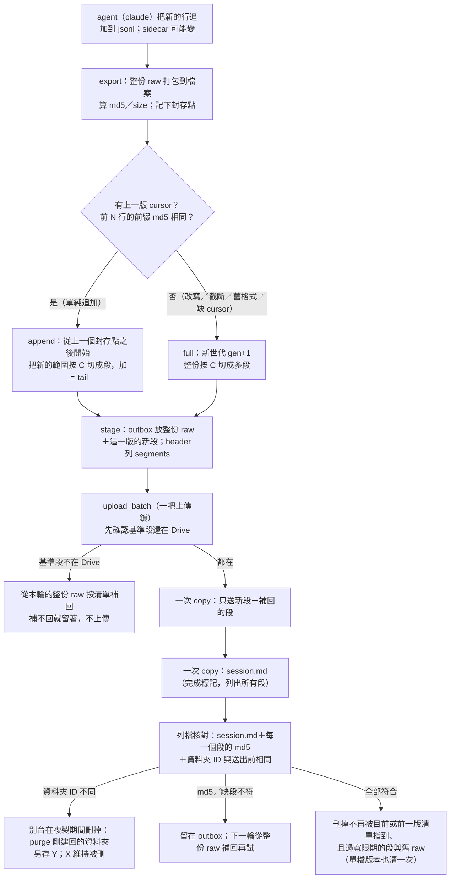
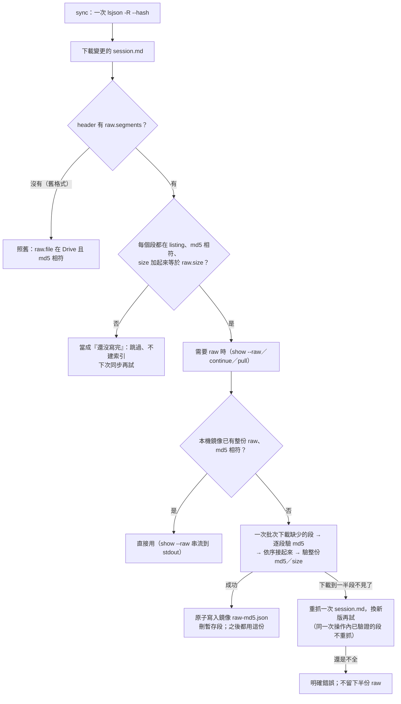

# agora 差分上傳（#109）：只送新增的 raw、Drive 上分段存

## 一頁摘要（給非技術讀者）

- **現況**：`agora continue` 每 5 分鐘把整份 session 重傳到 Google Drive；raw 不壓縮，活躍時每輪就是一份完整拷貝。
- **改成**：把 raw 按 4 MiB 切成段（封存段不會再變；最後一個 tail 每版可能變），Drive 上只補「這一輪新增的段」；`session.md` 仍是最後上傳的完成標記，裡面列出所有段，讀的一方看到它才算這一版寫完。
- **省多少（估）**：以 814 MB 的 raw、每輪新增 1 MB、閱讀版 2 MB 為例，現在每輪約 816 MB；新做法每輪的**上限是 `C＋I＋S＋aux`**（C＝段的切法、I＝新增 1 MB、S＝閱讀版 2 MB、aux＝sidecar），aux 大小未知（K5），先當 0 才是約 7.2 MB；典型約 5.1 MB，**少 99.1%～99.4%**。一天 288 輪：約 235 GB → 約 1.5 GB（上限約 2.1 GB）。**這些數字不含**：升級（第一次切段）、降級（repack）、退回整份（`gen+1`）、**每次新開一個 `continue` 的第一次寫回**（`start_native` 換一個新的 agent session，`claude.py:749-780`）——每一個長 session 各多一次 814 MB 上傳；Drive 垃圾桶保留 30 天，清掉的舊段仍占配額；listing 從「每個 session 一個 raw」變成「每個長 session 約 327 個檔」（第一次整份切段 196、一路 append 的嚴格上限 391；A.1），N 個長 session 的總量是 N×約 327，實際大小未知（K1、K13）。
- **代價**：Drive 上一個大 session 會有幾百個段檔（4 MiB 一段：第一次整份切段 195＋1 個；一路 append 的段數介於 `ceil(size/C)` 與 `2×ceil(size/C)` 之間，每輪新增 1 MB 時約 326＋1 個，嚴格上限 390＋1；A.1、D.1）；每輪重傳「還沒封存的那一小段」，上限是 C 加上 aux；閱讀版 `session.md` 仍整份上傳，是剩下的地板。
- **不變**：本機仍留整份 raw；搜尋、預覽、`continue`、`show --raw`、鏡像的位置與用法照舊；舊的單檔 session 照常可讀。
- **最大風險是升級順序，不是資料損壞**：分段 session 對還沒升級的機器等於**從索引與鏡像消失**（新版 sync 會 `index.drop` 並刪掉鏡像的 `session.md`，`store.py:1519-1525`），不是「看得出來但跳過」；Drive 上的段沒壞，但舊版沒有任何指令能把它救回來。所以寫端預設**關閉**（`AGORA_RAW_LAYOUT=legacy`），先讓每台機器都有讀得懂的新版（R1）與安全的刪除偵測（R1b），再翻預設（F.4）。**R1 這個 release 先上不是零風險**：R1 也含新的寫入指令 `repack`（會覆蓋 `session.md` 與整份 raw，寫的仍是舊格式）、`state/published` 記錄與 `unfinished.json` v2；同一個 release 的 **R1b** 還把「被別台刪掉」的判斷從名字差異改成資料夾 ID（並要求資料夾裡有 `session.md`），對單檔更新立刻生效——這是行為變更，靠一個未驗的 Drive 假設（重建的同名資料夾拿到新 ID）。它換掉的正是**今天單檔路徑唯一**的「複製期間被刪」偵測（`store.py:925`，只在 `ulid in updates` 時比名字）；長 session 的單檔更新仍是數分鐘的複製窗口，不是秒級。若假設不成立，ID 永遠不變、檢查永遠不觸發，這一層保護會悄悄消失，而 R1b 比 R2b 先上線。所以建議把探針擋在 **R1b**（也就擋住 R2b；L14 的方案 A；替代方案 B 見 L14），不能只擋 R2b。風險低，但 R1／R1b 的測試與審查要把它們列進去（F.4）。
- **降級**：降級前 MUST 先在新版跑 `agora repack session --all` 把長 session 轉回單檔（R1 就提供）；直接降級會讓那些 session 在舊機器上消失（F.3）。
- **要本人決定**：升級順序與預設開關、降級政策、舊版讀不到的代價、段大小、本機留整份、垃圾桶 30 天、第一次整份重傳的時機（L1–L10）、**K.1 探針要不要當 R1b／R2b 的前置條件**（L14；建議要；替代方案是 R1b 先保留名字差異當備援）。

### 圖① 寫入流程（一輪：從收集到 Drive 的分段與 manifest）



### 圖② 讀取接回流程與失敗時的退路



## 0. 範圍、名詞與前提

- **raw**：agent 匯出的整份位元組。claude 是 JSON 信封 `{"format": "claude-jsonl/1", "main": [每一行], "aux": {sidecar}}`（`src/agora/agents/claude.py:308-335`）；opencode 是 `export` 的整份 JSON（`src/agora/agents/opencode.py:1002-1032`）；agy 是 `agy-conversation/1` 信封＋整包 db 的 base64（`src/agora/agents/agy.py:163-186`、`agy_store.py:305-335`）。
- **session.md**：header（YAML）＋閱讀版；現在是「這個版本完成了」的唯一標記（`docs/design.md:116`、`:148`）。
- **段（segment）**：raw 的一個連續 byte 範圍，存成一個 Drive 檔。**封存段**不會再變；**tail** 是最後一段，每一版可能改。
- **世代（gen）**：同一個 session 的一組段。append 沿用；退回整份時 `gen+1`。
- **基準段（base）**：這一版沿用、沒有重傳的舊段；它們必須在 Drive 上，不在就由本機的整份 raw 補回。
- **前一版清單（prev）**：這一版取代掉的那一份 `session.md` 的 `segments`。它**不是** `stage` 猜的——`stage` 看到的「上一版」常常是還沒上傳的本機版本（離線時連續 stage），不是 Drive 上公開的那一份。所以 prev 來自**上次確認成功時留下的記錄** `state/published/<ULID>.json`（這一版 `session.md` 的 md5 ＋ 清單）。清理時只有「記錄的 md5 ＝ 送出前 Drive 上那份 `session.md` 的 md5」才把它當 prev（那才真的是被取代的那一版）；對不上就沒有 prev，只剩寬限期（B.5.5）。
- **寬限期（grace）**：`AGORA_RAW_ORPHAN_GRACE` 秒（預設 3600）。Drive 上比它新的 `seg-*` 一律不刪——這同時保護別台剛傳上來的段與中斷的輪次留下的孤兒（C.2）。送出的段檔在送出前會被 `os.utime` 設成現在（B.5.2），所以這個時鐘是「上傳那一刻」，不是「切出那一刻」（K16）。
- **計畫（plan）**：adapter 告訴 store「這一版從哪個 byte 之後是新的」（`append_from`）與「main 內容到哪裡結束」（`seal_upto`）。
- **前提／推論**：814 MB 的案例是 claude session（推論：它用 `claude-jsonl/1` 信封；工單沒明說 agent）。**未知**：那個 session 每 5 分鐘實際新增多少、閱讀版多大、sidecar 多大。
- **本 change 只設計**：不改 `src/`、`tests/`；量測與探針只寫規格。

## A. Drive 上的佈局

### A.1 檔案與命名

```
sessions/<ULID>/
  session.md                         header＋閱讀版；完成標記，也是分段清單
  raw-<md5[:12]>.json                舊格式：整份 raw（新寫入的小 session 仍用這個）
  seg-<gen>-<seq>-<md5[:12]>.part    新格式：raw 的一段（同一層，扁平）
```

- **扁平、不開子目錄**：`Drive.list_sessions` 只收 `Path` 兩段的路徑（`src/agora/store.py:239-252`），`list_one` 不遞迴（`254-256`）。放 `sessions/<ULID>/segs/…` 會讓 listing 看不到段，完整性判斷與清除都會失效。
- **`seg-` 前綴**：`remember` 會刪掉鏡像裡不是目前 raw 的 `raw-*`（`store.py:522`），`_replaced_raws` 也只認 `raw-*`（`1103-1107`）。段用 `seg-` 才不會被舊清理規則誤刪；段有自己的清理規則（C.2、B.5.5）。
- **檔名帶 md5**：內容定址；同樣的位元組不會因為換版本而改名。`gen` 讓一個世代可以被整組辨認、除錯；`seq` 是順序。尾巴的段也是同一個命名規則，只是每版 md5 不同。
- **`.part`**：明確表示「這不是一份可以單獨解析的 raw」；不要用 `.json`。
- **大小**：預設 `AGORA_RAW_CHUNK`（C）＝4 MiB（4194304 bytes；測試可調到 4 KiB）。**封存段一律按 C 切、每段 ≤ C（最後一段可能比較小）；tail 是剩下的一個檔，不受 C 限制**（它含 trailer 與 aux，所以可能比 C 大）：
  - **full**（新 import、第一次超過門檻、來源被改寫）：`[0, main_end)` 切成 `ceil(main_end / C)` 段——不是一段——加 `[main_end, size)` 的 tail。
  - **append**（單純追加）：`[append_from, main_end)` 切成 `ceil((main_end − append_from) / C)` 段，封存點仍然只有一個（`main_end`）；範圍不到 C 就不封存，全部留在 tail。下一次 append 從新的 `raw_stable` 再按 C 切。
  - **為什麼可以按 C 硬切**：段的邊界不需要是行邊界，接回只是 byte 串接；需要對齊行邊界的是**封存點**（`raw_stable`＝main 結尾），前綴驗證只驗到那裡（B.2）。
  - **數字**（1 MB＝10⁶ bytes、1 MiB＝2²⁰ bytes，與工單的 814 MB 同一個算法）：**第一次整份切段**（full）是 `ceil(main_end/C)` 段，814 MB 的 session、4 MiB → 195 個封存段＋1 個 tail ≈ 196 個檔；8 MiB → 98＋1；4 GB → 954＋1。**一路 append 的段數不是 196，而是介於 `ceil(size/C)` 與 `2×ceil(size/C)` 之間**：每次封存把 `[append_from, main_end)` 按 C 切，範圍永遠不是 C 的整數倍，所以最後一個封存段通常很小；每輪新增越多，段數越接近一次整份切段，每輪新增越少，越接近兩倍。例：每輪新增 1 MB、C＝4 MiB 時，未封存累積到 5 MB 才封存，每次封 4.19 MB＋0.81 MB 兩段，814 MB 約 326 個封存段＋1 tail ≈ 327 個檔。嚴格上限 `2×ceil(size/C)+1`（814 MB ⇒ 391；4 GB ⇒ 1909）。這個「每次封存多出一個小尾段」是 v1 接受的成本；**不改切法的理由**與替代方案在 D.1，調大 C 可以抵銷。
- **為什麼封存點一定在行邊界**：封存的範圍是「上次封存點到這次 main 結束」，main 結束一定在最後一個 main 元素之後；前綴驗證因此可以只驗到這個行邊界。段內不需要再對齊行，接回只是 byte 串接。
- **小 session 不切**：`AGORA_RAW_SEGMENT_MIN = 16 MiB`；小於它的 claude raw 仍寫單檔。這樣既有 golden bytes 不變（`tests/unit/test_mem_golden.py:54-56` 的三個 md5），小 session 也不會多出一堆檔。第一次超過門檻的那一版是整份切成多段（一次 814 MB），之後才差分。

### A.2 有沒有 manifest？

**沒有另一個 manifest 檔。`session.md` 的 header 就是 manifest。** `agora.raw` 長這樣：

```yaml
agora:
  raw:
    file: raw-<整份 md5>.json      # 本機的整份檔名；分段時 Drive 上沒有這個檔
    md5: <整份 md5>
    size: <整份位元組數>
    layout: chunks/1               # 只有分段時才有；舊版忽略它
    segments:
      - {file: seg-0001-0000-<md5[:12]>.part, size: 4194304, md5: <段 md5>}
      - {file: seg-0001-0001-<md5[:12]>.part, size: 4194304, md5: <段 md5>}
      - {file: seg-0001-0002-<md5[:12]>.part, size: 1234567, md5: <段 md5>}   # tail
```

- **單一完成標記**：現在的順序是「先 raw、後 `session.md`」，讀的一方用 `session.md` 的 md5 判斷版本完成（`docs/design.md:141-148`；`store.py:601-604`、`628-632`）。分段後完全不變：`session.md` 是最後上傳、最後核對的那一個；它列出的段在發布前必須先全部在 Drive 上、md5 相符（發布後被別台清成不完整是允許的，A.3）。
- **為什麼不另開 manifest 檔**：多一個檔就多一個「兩個標記不一致」的狀態；現在的原子性靠單一 `session.md`，保留它最省事。清單只有幾百個小項（第一次切段 ≈195 項，一路 append 的上限 ≈391 項），約 14–27 KB，塞進 header 不會讓 `session.md` 變大多少。
- **段順序＝清單順序**；接回就是依序串起來。不需要 offset 欄位（可以由前面的 `size` 加出來）；保留 `size` 是為了驗證「加起來等於 `raw.size`」與除錯。
- **全部段都是不可變的，除了最後一個**。tail 每版可能改（新增的 main 行、aux、結尾的 `]`），所以它是新檔名；舊 tail 在確認後被清掉（保留寬限期，C.2）。
- **舊欄位留著**：`raw.file`／`md5`／`size` 仍指「整份」。本機的 outbox 與鏡像真的有一份整份（B.4）。Drive 上的分段版本沒有 `raw.file`，所以舊版會把它當成未完成——**而 sync 會把那一筆從索引與鏡像拿掉**，不只是「跳過」（F.1、F.3）。
- **前一版清單不進 header**：它是本機清理用的記錄（`state/published/<ULID>.json`，B.5.5），不隨 `session.md` 上傳，header 只有一份清單，舊讀者不需要知道它。

### A.3 版本完成的三條檢查，與它真正的適用範圍

分段版本要算「完整」，三條都要成立：

1. `session.md` 列的每一個段都在 Drive 上，且 Drive 的 md5 等於清單裡的 md5；
2. 所有段的 `size` 加起來等於 `raw.size`；
3. 接起來的 md5 等於 `raw.md5`。

**這三條在單一寫者時恆成立，多寫者時只保證「不完整會被當成未完成」，不保證「任何時候都完整」。** 寫入端在發布 `session.md` 之前先送完段並用 listing 核對（B.5）；讀取端用 listing 的 md5 判斷（E.1）；接回時再驗一次（E.2）。

多寫者做不到「任何時候」的推演（可測試，I.2）：機器 A 把自己的新段傳上 Drive、還沒傳 `session.md`（A 離線或很慢）；這些段在 B 的眼中是「沒被任何清單指到的孤兒」，B 的清理**在寬限期內不會碰它們**（C.2），但超過寬限期（預設 1 小時）之後，下一次清理就會刪掉。A 之後才發布 `session.md`，Drive 上就有一個指到缺段的版本。這是刻意用寬限期換來的窄窗口，不是零：舊的規則（刪掉所有不在自己清單裡的檔）連一秒都不給。這也不是新增的壞處——現行的 `_replaced_raws` 早就會刪掉別台剛傳上來的 `raw-*`（`store.py:1103-1107`），`docs/design.md:148` 那句話在多寫者下一直是 best-effort。**本 change 把它寫成可測的敘述**：讀者一律當未完成（不建索引、鏡像不提供）；寫者下一次確認發現缺段，就從自己的整份 raw 補回（B.5.1），補不回才留在 outbox 並警告。最壞情況是那個版本在 A 補回之前對所有讀者不可見——不是讀到混合或半份的內容。

### A.4 檔案數與 API 次數

- **檔案數**：一個 814 MB 的 session，第一次整份切段 ≈195 個封存段＋1 個 tail ≈196 個檔；一路 append 的話介於 196 與 391 之間（每輪新增 1 MB 時約 327；A.1）；8 MiB 則大約一半。這是 Drive 資料夾裡的檔案數，不是每輪的上傳次數。以 `lsjson -R --fast-list --hash` 一次列全部（`store.py:239-252`），列檔成本主要在一次呼叫，不是檔案數（`docs/perf.md:27-29`、`:31-38`）。**未知**：幾千個檔案時 Drive 的 listing 與配額行為；N 個長 session 的 listing 總量（N×約 327 個檔）沒有量過（K1、K13）。
- **每輪 rclone 次數**：段與 `session.md` 各一次 `copy --files-from`，加上既有的列檔；與現在同一批（`docs/perf.md:82-104`）。不是「每段一次呼叫」——段是在同一次 `copy --files-from` 裡送。目錄 ID 併進既有列檔，不算新呼叫；若那個列檔不帶目錄項，送出前與確認各多一次 `--dirs-only`（B.5.7、L13）。
- **header 大小**：195 項 × 約 70 B ≈ 14 KB（一路 append 的上限 391 項 ≈ 27 KB）；`session.md` 的閱讀版本身通常是 MB 級，這點可忽略。`yaml.safe_dump` 的實際大小用測試釘住（K9）。

## B. 寫入端

### B.1 介面：沿用 B2 的 `Increment`，縮小它的內容

```python
@dataclass
class Increment:
    exported: Exported            # 整份 raw（B1b-2 的 raw_file）
    append_from: int | None       # 這一版從哪個 byte 之後是新的；None = 整份
    seal_upto: int | None         # main 內容結束的 byte（tail 從這裡開始）；
                                  # None = 這一版不切段（走舊的單檔）
    cursor: dict | None           # 下一輪用的本機狀態
```

- `Agent.collect_increment(launch, cursor) -> Increment`；預設實作＝`collect()` 包成 `Increment(exported, None, None, None)`（opencode／agy／fake 不變，永遠走單檔）。
- claude 實作 append／full 兩種。**Segment 不再由 adapter 產生**：段是儲存層的決定（大小、tail、世代），adapter 只說「新的從哪裡開始、main 到哪裡結束」。這是與 B2 最大的不同（附錄）。
- `append_from is None` 且 `seal_upto` 有值＝「這一版是整份，但請切成段」（新 import、新的世代）；`seal_upto is None`＝「不要切段」（舊行為）。
- **段的大小與切法完全是 store 的事**：`[append_from, seal_upto)` 一律按 `AGORA_RAW_CHUNK` 切成多段（A.1），不是一段。adapter 只給兩個 byte 位置。
- 為什麼不是 B2 的 `Segment{start,end,sha256}`：adapter 不該知道 Drive 的段大小與 tail 策略；而且 B2 的 `blocks`／`aux_fp`／`tail_role` 在 v1 不需要（附錄）。

### B.2 claude：怎麼算「新增的那一段」

v1 **仍然整份重新打包**（`_read_lines`（`claude.py:210`）→ `_scan`（`claude.py:412-454`）→ `_exported`（`457-477`）→ `_pack_raw_file`（`claude.py:308-335`）），所以 B1a／B1b-2 的記憶體峰值不變（約 1.78×；B1b-2 的量測，`tests/perf/measure_continue_mem.py` 可重跑）。差分只改 Drive 流量，不改本機 CPU／記憶體。這是刻意的範圍取捨：先把最痛的上傳解掉，B2 的「只解析新增行」另列後續。

每一輪：

1. `export` 讀完整份 jsonl（既有路徑），`_pack_raw_file` 邊寫邊算整份 md5／size；同時記下：
   - `main_end`：寫完最後一個 main 元素、還沒寫 `]` 的位置（`_pack_raw_file` 目前在 `claude.py:325-331` 寫 `main` 陣列與 `], "aux": `，在這裡插入記錄）。
   - `stable_at(n)`：寫完第 n 個 main 元素後的 offset。
   - 兩個 rolling md5 快照：`sealed_md5`（寫完第 `cursor.sealed_line_count` 個元素時）與 `main_md5`（寫完最後一個元素時）。都是 `digest.copy()`，O(1)。
2. **封存點**：cursor 記的是**上一次封存**的狀態，不是上一版的行數：
   - `sealed_line_count`：上次封存到第幾個 main 元素——**以解析後的 main 元素數為準**：`_scan` 會把最後一行不完整的那一行 `main.pop()` 掉（`claude.py:429-433`），只有留下來的元素會被封存；下一輪那一行寫完了才成為新的 append。cursor 與下一輪的元素數必須用同一個定義（I.2 的「半行→完成」案例）。
   - `sealed_md5`：上次封存前綴（raw 的 `[0, raw_stable)`）的 md5；
   - `raw_stable`：上次封存的 byte 長度（＝封存段加起來的大小）。
3. **前綴驗證**：這一輪在 `stable_at(sealed_line_count)` 的位置算出的 md5 要等於 `sealed_md5`，且 offset 等於 `raw_stable`。
   - 相同 → **append**：`append_from = raw_stable`。就算來源比上一版短，只要還包含封存的行數、而且是同樣的位元組，就是 append（新的 tail 較短）。
   - 不同／`len(main) < sealed_line_count`／沒有 cursor／`cursor.agent_session_id` 與這次的 `exported.session_id` 不同（新開的 `continue`，`claude.py:753`）／layout 不是 `chunks/1` → **full**：`append_from = None`。
4. `seal_upto = main_end`（這次 main 的結尾，一定是行邊界）。
5. 交給 store 切段（A.1 的規則，這裡是唯一實作它的地方）：
   - `seal_upto - append_from >= AGORA_RAW_CHUNK`：把 `[append_from, seal_upto)` 按 C **切成 `ceil(範圍/C)` 段**（每段 ≤ C，最後一段可能比較小）；tail 是 `[seal_upto, size)`（只有 trailer＋aux）。
   - 範圍不到 C：不封存，tail 是 `[append_from, size)`（未封存的 main＋trailer＋aux）。
   - **full**（`append_from is None`）：`[0, main_end)` 按 C 切成 `ceil(main_end/C)` 段，**不是一段**；tail 是 `[main_end, size)`。814 MB 的舊 session 第一次轉換因此得到約 195 個段，不是一個 814 MB 的段——這樣「補回缺的段」才只花一個 C，下載與重試也有粒度。
   - **段的邊界可以落在任何 byte，封存點不行**：需要對齊行邊界的是 `raw_stable`（＝`seal_upto`＝main 結尾），前綴驗證只驗到那裡；段內只是 byte 串接。
6. cursor 由 store 在 `stage` 成功後更新：adapter 把這次的 `main_line_count`／`main_md5` 也放進 cursor；有封存 → store 把 `sealed_line_count = main_line_count`、`sealed_md5 = main_md5`、`raw_stable = seal_upto`；沒封存 → 三個值都不動。`base_md5` 永遠是這一版整份 raw 的 md5。

**這比 B2 的 block 指紋便宜**：B2 每輪要重讀整份來源前綴算 block 指紋（O(檔案大小) 的 IO）；這裡的整份打包本來就會算整份 md5，前綴只是同一個 hash 的 O(1) 快照。代價是「仍然整份打包」，但這是 B1a／B1b-2 已經接受的成本。

**aux 變了不會退回整份**：aux 在 raw 的 `main` 之後（`], "aux": …`），不影響封存前綴。aux 只讓這一版的 tail 變，於是只重傳 tail（≤ `未封存的 main`＋`aux`）。B2 原本的規則是 `aux_fp` 變了→整份；在分段上傳這一點不再需要。**aux 的序列化順序必須穩定，否則 tail 每輪都變**：claude 目前已經是穩定的——`_pack_aux` 用 `sorted(sidecar.rglob("*"))` 走檔名（`claude.py:263`），`json.dumps` 保插入序，所以 sidecar 沒變時 aux 片段逐位元組相同。加一個測試釘住這個性質（I.2），不要讓以後的改動把 tail 變成每輪都不同。

**為什麼封存點是「main 結尾」而不是固定 byte 切**：固定 byte 切可能落在某一行中間；下一次 append 的前綴驗證只能驗到行邊界，封存點若在中間，就無法保證那半行沒被改寫。封存在 main 結尾讓「封存前綴」和「前綴 md5」對齊同一個位置，驗證是完備的。**但段與段之間的邊界可以在任何 byte**：它不參與前綴驗證，只影響「補回缺段時要重傳幾個 byte」。

### B.3 cursor 放哪裡、什麼時候寫

- 位置：`<state>/cursors/<ULID>.json`（`store.Paths.state`，和 `pending/`、`outbox/` 同一個不能刪的地方；`store.py:52-69`）。
- **由 `stage` 在 swap 成功之後寫**（不是 `_write_one`）：`stage` 知道這一版有沒有封存、封到哪個 byte／第幾行，所以它能把 cursor 的 `sealed_line_count`／`sealed_md5`／`raw_stable` 更新到正確的值。`_save` 把 adapter 的 cursor 與 `Increment` 一起傳給 `stage`。
- `stage` 失敗（含 swap 前丟例外）就不寫 cursor；否則這一輪的內容下一輪會被當成「沒有新內容」跳過。
- 這條路徑同時涵蓋 import（第一次 full 切段後就有 cursor，下一次 continue 可以直接 append）與 continue／edit。
- 換機器、清 `~/.cache/agora`、cursor 檔壞掉 → 第一次寫回是整份（一次），之後差分。
- `delete`／`forget_local` 時一起刪 cursor，也刪 `state/published/<ULID>.json`（B.5.5 的前一版記錄；留著只會讓下一次同 id 的確認拿一份對不上的舊清單）。

### B.4 stage：outbox 裡放什麼

`stage` 現在把整份 raw 複製進 outbox，並把上一版指到的 raw 一起帶過來（`store.py:324-399`、`353-365`）。分段版本：

- **仍然放整份 raw**（`raw-<md5>.json`），因為：
  - 本機要有一份完整可讀、可回退、可被掃描的 raw（`local-first-writes` 的「本機保留完整的一份」）；
  - 任何一個段都可以由整份 raw 的 byte 範圍重新切出來，段不需要另外長期保存；
  - 補回缺的段（B.5.1）、`repack`（F.3）都靠它。
  - **它不會讓舊版「自動回退」**：uploader 成功後會把 entry 整個刪掉（`store.py:973`），穩定狀態下 outbox 是空的，整份 raw 只在鏡像；舊版的 sync 不推鏡像（F.3）。
- **只產生這一版的新段**：切法照 A.1／B.2.5——`[append_from, seal_upto)` 按 C 切成 `ceil(範圍/C)` 段，tail 是 `[seal_upto, size)`；範圍不到 C 就不封存，tail 是 `[append_from, size)`（未封存的 main＋trailer＋aux）。**full（含第一次超過門檻）是 `[0, main_end)` 按 C 切成多段**，不是一段。基準段不複製進 outbox——它們已經在 Drive 上，且可由整份 raw 重建；這避免本機多一份 814 MB。
- **把上一版 entry 的段檔帶過來**：和現在的 raw 一樣（`store.py:353-365`），`stage` 把上一個 outbox entry 裡的 `seg-*` 也帶進新的 tmp。這樣一個正在讀舊 entry 的 uploader 不會在 `copy --files-from` 時 source not found；段檔最多是 `C + I`，不是整份。`.done-`／`.old-` 由 uploader 自己持有，`stage` 不碰。
- **不記前一版清單**（舊設計的 `.prev-segments.json` 拿掉了）：`stage` 當下看到的「上一版」可能是還沒上傳的本機 entry，不是 Drive 上公開的那一份；離線時連續 stage，它會記到上一個**未確認**的版本，清理時保錯段、真正公開的那一版 tail 反而只剩寬限期。所以 prev 改成在**確認成功**時記（`state/published/<ULID>.json`，B.5.5），entry 裡不再有這個本機檔。
- **整份 md5 沒變（edit）**：header 變、raw 不變，直接沿用上一版的 `segments` 清單，不產生任何段；只上傳 `session.md`。
- **沒有上一版／第一次超過門檻**：`plan` 有 `seal_upto` 但沒有可用的 base → `gen+1`（或 1），整份按 C 切成多段。**import 也走這條**：claude 的 `_import_one` 用 `collect_increment(launch, cursor=None)`（不是 `export`），所以第一次匯入一個 814 MB 的 claude session 就已經是分段格式。**但 continue 的第一次寫回仍是整份**：claude 的 `continue` 用 `start_native` 開一個新的 agent session（`claude.py:749-780`，`_rewrite_lines` 在 `757` 把每一行的 session id 換掉），第一次寫回的來源 jsonl 是新的檔案、內容與舊的不同，cursor 的 `agent_session_id` 也對不上；同一輪 continue 之後的定期寫回才 append。fork 走 bytes（`cli.py:2049`）、merge 也走 bytes（`cli.py:751`），維持單檔。
- **寫端關閉（`AGORA_RAW_LAYOUT=legacy`）**：`stage` 不切段，`agora.raw` 整個換成新的 `{file, md5, size}`（`store.py:350`），`layout`／`segments` 自然消失——**這一版等於自動 repack**。下一次開啟分段時，上一版不是 `chunks/1` → full（C.1），會再切一次。
- **上一版還沒被 Drive 確認**：不必特別處理。它的段不在 Drive，uploader 會把它們當「缺的段」從這一版的整份 raw 補回；這次上傳的量等於整份，但版本是自洽的，不需要多一輪。
- `stage` 讀上一版 header 的順序：outbox entry（若還在）→ 鏡像的 `session.md`（`remember` 在每次 stage 後同步，`store.py:503-525`）。兩邊都沒有 → full。
- 驗證上一版：`prev.raw.md5 == cursor.base_md5`、`sum(prev.segments[:-1].size) == append_from`、`append_from == cursor.raw_stable`。任一不符 → full。
- **本機 IO 的實話**：整份 raw 仍要複製進 outbox、`remember` 仍要複製進鏡像，所以每輪本機寫入和現在同一個量級；第一次整份切段會多讀一次整份 raw 來切段。這個 change 省的是 Drive 的上傳位元組，不是本機磁碟。

### B.5 upload_batch：只送新段、核對全部、清舊段

現行順序：raw → `session.md` → 列檔驗 md5 → `.done` 再比一次 → 清舊 raw（`store.py:771-975`；`docs/design.md:139-148`）。分段版本：

1. **這一輪要送哪些段**：對每一筆分段版本，比對清單與 Drive listing，列出「不在 listing」或「md5 不符」的段。新段在 outbox 裡；缺的基準段由 outbox 的整份 raw 按清單的 `size` 切出來（段是 raw 的連續 byte 範圍，offset 由前面的 `size` 加總）。全部放進本輪的 batch dir（和 `session.md` 快照同一個目錄），一次 `copy --files-from`。切出來的段 md5 與清單不符 → 這一筆不上傳，warn（必要時 quarantine）；不要送一個對不上的版本。
   - 新建的 session 沒有基準段，清單裡的段都是這一版的新段。
   - 更新既有 id 的項目本來就會先列一次（`store.py:799-837`）；新建但帶基準段（離線匯入後又 continue）時，這一輪先列一次；列檔失敗 → 這一輪不送，下一次再試。
2. **一次 copy 從 batch dir 送**：把所有要送的東西放進本輪的 batch dir——legacy 的整份 raw 用 `os.link`（同一個檔案系統；失敗才 `copyfile`）、新段用 `os.link`、缺的基準段由整份 raw 按 `size` 切、`session.md` 快照寫進去。**送出前對 batch dir 裡每個檔案 `os.utime(f, None)`**（見下）。先送 raws／segments，再送 `session.md`。batch dir 是這一輪的穩定快照，`stage` 之後換掉 outbox 也不影響；不要列整份 `raw.file`（分段版本），也不要漏掉 legacy 的 raw。`store.py:724-734` 的 `_copy_batch` 已經吃 `source`，改成 batch dir 即可。
   - **為什麼要 `os.utime`**：rclone 預設把來源檔的 mtime 寫成 Drive 的 `ModTime`（推論：rclone 的一般行為，未對真 Drive 驗），而段的 mtime 是 `stage` 切出來那一刻。離線兩小時才上傳的段，一上傳就「超過寬限期」，別台下一次清理就會把它當孤兒刪掉——那正是寬限期要保護的情境（K16）。設成現在之後，Drive 的 `ModTime` 落在「上傳那一刻」；若 rclone 其實不寫 modifiedTime，Drive 的 `ModTime` 本來就是上傳時間，兩條路都成立。
   - **副作用（已查）**：hard link 共用 inode，`os.utime` 會把 outbox 那份的 mtime 一起改掉。outbox 的 mtime 沒有任何決策在用（`_entry_snapshot` 讀內容、`md5_file`、`stage` 按名字找檔、uploader 只看 `.done` 的存在），所以只影響「檔案看起來比較新」，不影響內容、cursor 或清理。`SIGKILL` 留下的 `state/batch-*` 由 `_write_batch_snapshot` 的舊目錄清掃處理（`store.py:745-751`）。
3. **`session.md` 一次 copy**：內容用本輪開頭讀到的快照（`_write_batch_snapshot`，`store.py:736-760`、`873-897`），放進同一個 batch dir；現行 `sessions = [u ... if not name or u in sent_raws]`（`store.py:879-880`）用「整份 raw 在這一輪」當代理；**分段版本要改成「清單裡的段都在 Drive 或這一輪送出」**，不能用 `raw.file` 當代理，否則分段的 `session.md` 永遠不會被送。
4. **列檔核對**：`session.md` 的 md5 相符，**而且**清單裡每一個段的 md5 都相符（`store.py:899-922` 的檢查加上段）。任何一個不符 → 留在 outbox；下一輪從整份 raw 補回缺的段再試。**核對通過只代表「這一刻」**：另一台可能在一小時後把某個段當孤兒清掉（A.3），版本就變成未完成；那是允許的狀態，不是錯誤（讀者會跳過，這台下一輪會補回）。
5. **清舊段（新規則，取代「刪所有不在新清單的 `seg-*`」）**：對**每一個**這一輪確認成功、離開 outbox 的項目（分段的**和單檔的都算**），只在**同一次確認的 listing** 上決定：
   - **目前清單**：這一份 `session.md` 列出的段（單檔版本是空集合）。
   - **前一版清單（prev）**：讀 `state/published/<ULID>.json`，只有當它的 `session_md5` 等於**送出前** Drive 上那份 `session.md` 的 md5（＝ `again[ulid]["session.md"]`，B.5.7）時才採用；對不上（別台在這期間寫過）就當沒有 prev。
   - **保留**：目前清單裡的段、prev 裡的段、以及 Drive `ModTime` 在寬限期（`AGORA_RAW_ORPHAN_GRACE`，預設 3600 秒）內的**所有** `seg-*`。
   - **刪**：其餘的 `seg-*`（含再上一個世代、失敗輪次的孤兒），用一次 `delete --files-from`。
   - **單檔版本為什麼也跑**：`repack`（F.3）、`AGORA_RAW_LAYOUT=legacy` 的寫回（B.4）、R1 機器上的 `edit`，都會把一個分段 session 寫成單檔；這幾條路徑之後沒有「分段項目」可以觸發清理，舊 `seg-*` 就永遠沒人管（舊的 `_replaced_raws` 只認 `raw-*`，`store.py:1103-1107`）。用同一條規則（目前清單＝空集合）就一起清掉。`repack` 的確認也走這個函式（F.3）。
   - **寫回記錄**：清理完、確認成功之後，把這一版寫成新的記錄 `{session_md5: 剛確認的 md5, segments: 這一版的清單}`（單檔版本 segments 為空）。記錄寫失敗只警告：下一次的 prev 會是空的（那一輪只剩寬限期），不影響正確性。
   - **`raw-*`**：照舊只刪不是 `raw.file` 的（`_replaced_raws`／`_delete_batch`，`store.py:971-974`、`1103-1107`、`763-768`）。
   - 理由：舊規則會在另一台剛傳完新段、還沒傳 `session.md` 時把它們刪掉（B2 的競態）；保留「目前＋前一版」給慢速讀者（E.3），寬限期則讓別台的新段與孤兒都活過一輪以上。清理失敗只警告、下次再試；孤兒段不影響任何讀者。**多寫者的已知限度**：別的機器確認的那一版，本機沒有它的記錄，prev 就是空的——那一版的 tail 只靠寬限期（最壞是慢速讀者重抓一次 header，E.3），不是資料損壞。**listing 要帶 ModTime**：`lsjson --hash` 本來就有，`Drive.list_sessions` 目前只留 md5（`store.py:239-252`），分段清理要用保留 `(md5, mtime)` 的變體（同一次呼叫，不加 rclone 次數）。ModTime 的時鐘是「上傳那一刻」（送出的段檔先 `os.utime`，B.5.2；K16）。
6. **`.done` 的競態**：和現在一樣，只有這一輪送出去、Drive 確認、期間沒有新版本插進來的才離開 outbox（`store.py:941-970`）。**分段版本不比 `raw.file`（Drive 上沒有它），要比清單裡的每一個段**：實作上把 `_entry_md5s` 對分段回「整份 raw=None、另帶 segments」，`.done` 第二次讀到的 header 清單與 listing 逐一比對。段是內容定址，兩版可以同時存在；舊 tail 不會被新 tail 覆蓋。
7. **「被別台刪掉」的偵測改用資料夾 ID，不用名字差異**：現行 `upload_batch` 在送出後用「送出前 listing 有、送出後沒有的名字」判斷另一台把整個資料夾刪了（`store.py:925`：`any(n != "session.md" and n not in files for n in before)`），成立就 `purge` 整個資料夾（`store.py:932`）並 `_rescue_deleted`（`store.py:935`）。這個判斷有兩個問題：
   - **分段之後一定會誤觸發**：另一台每一輪都會把舊 tail 換名、`gen+1` 時一次讓上百個舊段名消失，listing 上看起來和「資料夾被刪掉」一樣。
   - **它抓的是複製期間的刪除，不是送出前的刪除**：送出前的兩次存在檢查（`store.py:812` 的 `gone`、`:837` 取 `again`、`:848` 的第二次檢查）**都在 `_copy_batch`（`:868`、`:890`）之前**；`:925` 才是「複製前有、複製後沒有」。所以停用名字判斷等於讓「複製期間被別台刪掉」完全沒有偵測——分段項目的第一次轉換、`gen+1`、新開 `continue` 的第一次寫回都是約 814 MB、數分鐘，正是窗口最長的那一類。那一段時間裡別台 purge 了 X，我們的 `copy` 會把 `sessions/X/` 建回來（rclone `copy` 會建目的資料夾；`:928` 的註解就是這個行為），確認只會看到自己剛送的東西，X 被靜靜復活。
   - **改用資料夾 ID**：Drive 的資料夾 ID 在 purge 後重建**預期**不同（**假設**，未對真 Drive 驗；K17 的探針會驗），換名（tail 換名、`gen+1`）不變。做法：
     - 取名時點與 `again` 相同（`store.py:837`）：新加一個 listing 變體（`sync` 用的 `list_sessions` 不動，仍是 `--files-only`），用 `lsjson -R --hash` **不加 `--files-only`**，目錄項（`IsDir: true`、`Path` 是 ULID）就帶 `ID`；一次回 `{ULID: {name: (md5, mtime)}}` 與 `{ULID: folder_id}`，**不加呼叫**。`folder_id()` 已經在用同一個欄位（`lsjson --dirs-only` 讀 `ID`，`store.py:230-234`），所以「目錄項帶 `ID`」不是新的依賴；新的只有「遞迴模式也帶它」與「重建的資料夾是新 ID」。
     - **兩個假設與各自不成立的後果**：
       1. **Drive 對同名重建的資料夾給新 ID**。若不成立：ID 不變，複製期間被 purge 又建回來就偵測不到，N1 的復活會悄悄回來（這是唯一會失去保護的一條）。
       2. **我們的 `copy` 是新的 rclone 行程，不重用已刪資料夾的快取 ID**。若不成立（行程內快取指到垃圾桶裡的舊資料夾）：檔案被傳進垃圾桶那個資料夾、確認 listing 看不到 X → `session.md` 的 md5 不符 → 留在 outbox，下一輪由存在檢查走既有 rescue；結果仍然安全，只是多一輪。
       兩者都由 K17 的探針驗：`mkdir` → `purge` → `mkdir` 比較兩個 ID。
     - **拿不到 ID 時**：每次比較前補一次 `lsjson gdrive:sessions --dirs-only`（和 `folder_id()` 同一個呼叫形狀；送出前與確認各一次）；送出前補不到就不送這一筆更新（留在 outbox，警告「看不到資料夾，不能確認它沒被刪」，下一輪再試）；確認時補不到就留在 outbox、不算成功。連續每一輪都拿不到，代表這個環境的取 ID 路徑要修，不是無保護地送出去。**這個退路只解「取不到 ID」（可用性），不解假設 (a)「重建後 ID 不同」**；假設 (a) 由 K17 的探針驗，而且探針是 R1b 的前置（L14），因為 R1b 就是把單檔路徑的名字差異偵測換成這個 ID 比較。
     - 確認時（`:899` 那次 listing，同樣帶目錄 ID）：`ids_after[ulid] != ids_before[ulid]` → 資料夾在這一輪被刪掉、又被我們的 copy 建回來 → 照現在 `:925` 的後半處理：`purge`、`_rescue_deleted`、X 留在 outbox 或另存 Y。檢查要放在 `session.md` md5 相符（`:908`）之後、缺段檢查之前——先判「被刪掉」再判「不完整」，否則同一個競態會變成「下一輪補段再送」，X 還是被復活。
     - **存在檢查也要看 `session.md`**：送出前那兩次（`:812` 的 `gone`、`:848` 的 `again`）目前只看 ULID 在不在 listing。purge 後第一個大段 copy 中途失敗時，`sessions/X` 只剩孤兒段（沒有 `session.md`），下一輪會把它當成「還在」而把 X 補完復活。條件改成「ULID 在 listing **且**那個 ULID 的檔案裡有 `session.md`」；這一條不依賴 ID 假設，是另一個獨立的窗口。
     - 名字差異判斷**整個拿掉**（單檔項目也一樣）：單檔項目今天的同一個誤判——別台清掉被取代的 `raw-*` 就 `purge` 加另存——也一併消失。
   - **四種情境**：
     - **別台正常清理**（換 tail、`gen+1`、清舊世代）：資料夾 ID 不變 → 不算刪除，不 purge、不另存；缺的基準段照 B.5.1 補回。
     - **別台真的刪除**（`purge sessions/X`）：送出前的兩次檢查若看到就不送（現行行為）；若發生在複製期間，ID 預期變了（假設，K17）→ purge 剛建回來的資料夾、另存單檔的 Y（F.3），X 維持被刪。
     - **換世代**（我們自己的 `gen+1` 或別台的）：段名整組換掉、資料夾 ID 不變 → 不觸發。
     - **離線很久**（段是幾小時前切好的）：不影響這個判斷（ID 與時間無關）；寬限期靠 B.5.2 的 `os.utime`，見 K16。
   - **已知限度**：兩台都在同一個窗口被 purge 誤導時，先確認的那台會 purge 另一台剛寫回的資料夾。另一台的 entry 已經確認、離開 outbox；它下一輪 sync 會看到 X「別台刪掉了」（`cloud_missing`：`store.py:1534` 標記、`:1546-1553` 的訊息），**不會自動再送**，要手動 `agora push session X --not-exist-upload` 才復原（內容仍在它的鏡像裡——確認成功的那台一定有一份整份 raw）。不是靜靜復活一個被刪掉的 Session，但也不是零成本：那台機器要多一個手動步驟。X 的資料夾可能只剩孤兒段（沒有 `session.md`，讀者看不到）；沒有自動清理路徑，會占空間到有人再寫 X 或清掉它。
   - **適用範圍**：這個偵測在 `upload_batch`（背景上傳，以及 `push` 先送 outbox 的那條）。`agora push session` 與 `repack` 走 `_upload_checked`（`store.py:584-605`），是明確指令的「後寫者贏」：複製期間別台刪掉時會把 X 寫回去，不是背景自動復活；要避免就在指令前先確認。
   - **`_rescue_deleted` 對分段項目**：entry 裡有整份 raw，另存的 Y 是單檔（F.3）：把它當「新 Session、沒有 cursor」處理，所有段都是新的，Drive 上沒有基準段可補。實作上把 `raw` 以**檔案路徑**交給 `stage`（`store.py:325` 已經接受 `Path`），不要 `read_bytes()` 把 814 MB 讀進上傳器的記憶體（`store.py:997` 現在是 bytes）。

**離線開關**（rclone 包裝 exit 75）不變：`Drive._run` 把非零當 `StoreError`（`store.py:213-215`），entry 留在 outbox；段已在 outbox，下一輪照常。

### B.6 中途失敗怎麼收斂

| 失敗點 | 留在哪裡 | 下一輪怎麼收斂 |
|---|---|---|
| 產生段到一半（本機） | `stage` 的 `.tmp-<ULID>`；舊 entry 不動（`store.py:383-399`） | 舊 entry 照舊上傳；暫存清掉 |
| 段傳完、`session.md` 沒傳 | 舊 `session.md` 仍在 Drive；新段是孤兒 | 下一輪重送缺少的段＋`session.md`；孤兒要等寬限期過後才被清掉（B.5.5） |
| 第一個大段 copy 中途失敗（別台剛 purge） | `sessions/X` 只剩孤兒段，沒有 `session.md` | 下一輪存在檢查看到沒有 `session.md` → 當成 X 不在了、另存 Y（B.5.7）；**不補完復活 X** |
| `session.md` 傳完、核對前崩 | outbox entry 還在（`.done` 或目錄） | 下一輪列檔核對；符合就完成，不符就重送 |
| 核對發現段不見（別台清掉／自己漏傳） | outbox 留著 | 下一輪從整份 raw 補回缺的段；補不回（md5 對不上）才 warn／quarantine |
| 兩台同時寫同一個 session | 最後一個 `session.md` 贏 | 輸的那台下一輪從自己的整份 raw 補回被清掉的基準段；這期間讀者把輸的那一版當未完成，不是讀到壞的清單 |
| 別台正常清理（tail 換名、`gen+1` 換整組） | 只是名字變動，資料夾 ID 不變 | **不算「被別台刪掉」**：不比名字、只比資料夾 ID（B.5.7），不會 purge／另存 |
| 複製期間別台刪掉（分段或單檔） | 我們的 copy 把 `sessions/X/` 建回來，資料夾 ID 換了一個（**假設**，K17） | 確認時比 ID → `purge` 剛建回來的那個資料夾、另存 Y（B.5.7）；X 維持被刪 |
| 清理失敗 | 舊段留著 | 每次確認成功都再試；只浪費空間，不影響正確性 |

**為什麼「補回缺的段」而不是「整份重來」**：段是整份 raw 的連續 byte 範圍，缺哪一段就從本機的整份 raw 切哪一段；只花缺的 bytes，不重傳已經在 Drive 的段。補不回（切出來的 md5 與清單不符，代表整份 raw 與清單不一致）才把這一筆 warn／quarantine，不發布對不上的版本。整份 generation 只留給「來源被改寫」這種真正需要新版本的情況（C）。

### B.7 與現有 outbox／pending／`unfinished.json` 的交互

- **outbox**：一個 entry 仍是一個資料夾，內含 `session.md`、整份 raw、這一版的新段、`.update` 標記。前一版清單不在 entry 裡（B.4），改記在 `state/published/<ULID>.json`（B.5.5）；cursor 在 `state/cursors/`（B.3）。`remember` 照舊只複製 `session.md` 與 `raw.file` 到鏡像（`store.py:513-525`），段不進鏡像。
- **pending**：不變（`store.py:67`）；cursor 是另一個小檔，不進 pending，因為 pending 會在接續結束時刪掉，而 cursor 要活到同一輪 continue 的下一輪（進程重開也讀得到）。
- **`unfinished.json`**：現在記 `{session_md5, raw_file, raw_md5}`（`store.py:1395-1428`）。分段版本的「還沒寫完」不是單一 raw pair，改成記 `{session_md5, raw_fingerprint, layout}`：`raw_fingerprint` 是清單裡每個 `(file, md5)` 加上 listing 裡實際的 md5（缺少＝空字串）的 canonical JSON 的 md5；`layout` 是那一份 header 的 `agora.raw.layout`（單檔是 `null`）。檔案格式 `version: 2`；v1 檔直接忽略（下一次多下載一次）。`layout` 是給 `repack --all` 用的：不完整的 `chunks/1` session 不在索引裡（`sync` 會 `index.drop`，`store.py:1495`、`:1521`），只掃索引會漏掉它們（F.3）。**代價**：多寫者時段名每輪都可能變，fingerprint 就跟著變，下一次 sync 會重下載那個 `session.md` 再判斷一次（幾 KB，不是 raw）；這是流量，不是正確性。

## C. 非單純追加就退回整份

### C.1 觸發條件

| 條件 | 怎麼發現 | 結果 |
|---|---|---|
| 來源短到封存點之前 | `len(main) < cursor.sealed_line_count` | full |
| 封存前綴被改寫（同大小或更大） | `stable_at(sealed_line_count)` 的 md5 與 `cursor.sealed_md5` 不同 | full |
| 只砍掉封存點之後的內容 | 封存前綴仍相同，`len(main) >= sealed_line_count` | append；新的 tail 較短 |
| 上一版不是 `chunks/1`（舊單檔、第一次升級） | header 沒有 `layout`／`segments` | full（新 gen） |
| 換了一個 agent session（新開的 `continue`） | `cursor.agent_session_id != exported.session_id`（`claude.py:753`） | full（一次；下載本來就是整份） |
| 沒有 cursor（換機器、清 cache、cursor 壞） | 檔案不存在／版本不符 | full（一次） |
| 上一版整份 md5 與 cursor 的 base 不同 | `prev.raw.md5 != cursor.base_md5` | full |
| 上一版的封存段加起來不等於 `append_from` | 計畫驗證 | full |
| 寫端關閉（`AGORA_RAW_LAYOUT=legacy`） | 環境變數 | 單檔、不切段（這一版等於 repack；下一次開啟分段會 full 一次） |
| adapter 不支援增量（opencode／agy／merge／fake） | `append_from is None`／`seal_upto is None` | full（單檔，不切段） |

### C.2 退回後 Drive 上怎麼處理

1. `gen+1`；清單重新從 `[0, main_end)` 按 C 切成多段（A.1）加 tail。
2. 上傳所有新段 → `session.md` → 核對全部段（B.5.4）。
3. 確認後清舊段，**規則與 B.5.5 同一個**：保留新清單、prev（`state/published` 的記錄，md5 對得上才是被取代的那一版）、以及寬限期內的所有 `seg-*`；其餘（含上一個世代）刪掉。不再「刪掉所有不在新清單裡的段」——那會刪掉別台剛傳的段，也會讓慢速讀者在換世代時讀不到。
4. 刪除失敗：`warn` 一行（沿用 `_delete_batch` 的「下次再說」，`store.py:763-768`），下一次確認成功再試。孤兒段不影響正確性；最壞情況是每個失敗的世代都留一份，佔空間。
5. **誰負責**：拿到上傳鎖、把這一版確認成功的那個行程（背景上傳器或 `push`）。前景只 stage，不刪 Drive。

### C.3 舊版讀者會不會看到壞資料

不會，但也**讀不到**：舊版看到分段版本時 `raw.file` 不在 Drive，`mirror_one` 的 `files.get(raw.file) != raw.md5` 成立（`store.py:628-632`），**sync 會把那一筆從索引與鏡像拿掉**（`store.py:1519-1525`），下一次 sync 也會因為 `unfinished.json` 記的 `(session_md5, raw_file, raw_md5)` 沒變而跳過（`store.py:1486-1498`）；`fetch_raw` 下載 `raw.file` 會失敗（`StoreError`，`store.py:1600-1619`），`continue` 不會開 agent。它看到的是「這個 session 不見了」，不是「還沒寫完」也不是半份 raw。本機鏡像還留著一份沒有 header 指到的 `raw-<md5>.json`，但舊版沒有任何指令會用它（F.3）。

## D. 壓實（compaction）

### D.1 v1：不壓實

固定大小的段本身就是壓實：每次封存切 `ceil(範圍/C)` 段，所以段數的嚴格上限是 `2 × ceil(size/C) + 1`（封存段 ≤ C、最後一段可能很小；`+1` 是 tail）。**典型值取決於每輪新增量與 C 的比**：每輪新增 ≈ C 時接近 `ceil(size/C)`；每輪新增 ≪ C 時接近 `2 × ceil(size/C)`。814 MB／4 MiB：第一次整份切段 195＋1；每輪新增 1 MB 時約 326＋1；上限 390＋1。4 GB：954＋1 到 1908＋1；8 MiB 時全部減半。**v1 不做定期合併**，理由：

- 合併需要第二個寫 `session.md` 的人（上傳器），和前景的 `stage` 競爭；要另外處理「哪個版本是基準」、清理、失敗回退。這是這個 change 裡風險最高的一塊，而它只省下「tail 重傳」的差額（估計每輪 1–2 MB），不是 814 MB 的主要來源。
- 兩三百個檔在一個資料夾裡不是問題；listing 一次拿全部（A.4）。真的到 1000+ 個檔，先把 `AGORA_RAW_CHUNK` 調大（8 或 16 MiB）比寫壓實簡單。
- **不改切法的理由**：把封存點改成「不大於 `append_from + k·C` 的最大元素邊界」（k＝`floor(範圍/C)`），讓餘數留在 tail，段數就會回到 ≈ `size/C`。代價是封存點可能落在比 `k·C` 更前面（差不到一行），而單行比 C 長時還要另一條退路；那要動 B.2 的游標語意與「封存點＝main 結尾」的推論，換來的是檔案數，不是流量。v1 先用誠實的兩倍上限；K1 真的顯示檔案數是問題再做，那時段壓實（D.2）也已經在檯面上。

### D.2 如果以後要做

- **觸發**：同一個 session 的段數 > 512（或 header > 64 KB），且本機沒有正在接續它（`store.continuing`，`store.py:1340-1357`）。
- **誰**：拿到上傳鎖、剛好確認完一批的 uploader；一次最多合併一個 run，避免一輪做太多。
- **怎麼**：相鄰的封存段是整份 raw 的連續 byte 範圍，所以直接從**鏡像的整份 raw** 切出合併後的那一段（不用下載），寫成一個新段、上傳、發布新的 `session.md`（清單換成「合併段＋其餘」）、確認、再刪掉被合併的舊段。
- **讀者不會看到不完整**：和一般版本一樣，`session.md` 最後才換；舊段在新 `session.md` 確認前都還在。
- **清理**：被合併掉的舊段算「被取代」，清理照 B.5.5（目前＋前一版＋寬限期）——所以它們要再過一個版本、或超過寬限期才真的消失，慢速讀者不會被夾在中間。
- **跨機器**：另一台若以舊清單為基準，B.5 會從自己的整份 raw 補回被清掉的段；補不回才 quarantine。不需要換世代。
- 不要合併 tail（它每版都變）。

## E. 讀取端

### E.1 sync／listing：只判斷完不完整，不下載

`sync` 現在用 listing 的 md5 判斷 `session.md` 指的 raw 在不在、md5 對不對（`store.py:1518-1525`；`mirror_one` `628-632`）。分段版本改用同一個 listing：

```python
def raw_complete(raw, files) -> bool:
    layout = raw.get("layout")
    whole = bool(raw.get("file")) and files.get(raw["file"]) == raw["md5"]
    if layout == "chunks/1":
        segs = raw.get("segments") or []
        chunks = (bool(segs)
                  and sum(s["size"] for s in segs) == raw["size"]
                  and all(files.get(s["file"]) == s["md5"] for s in segs))
        return chunks or whole
    if layout:
        return whole          # 未知 layout：只有整份可用時才接受，不猜段
    return not raw.get("file") or whole
```

- 不完整 → 不出現在索引、鏡像的 `session.md` 拿掉、記進 `unfinished.json` v2（和現行 G3 的行為一樣，`store.py:1521-1525`）。
- 完整 → 建索引；raw 等到 `continue`／`show --raw`／`pull` 才抓（`docs/design.md:161`）。
- **舊格式**：`layout` 不在 → 走 `raw.file`，行為與現在完全相同。
- **未知 `layout`**（例如 `chunks/9`）：不猜段格式；`raw.file` 在 listing 且 md5 等於 `raw.md5` 時當完整、讀整份（header 的 `md5` 就是整份），整份不可用（沒有 `raw.file` 或 md5 不符）才當未完成／拒絕。**不是「看到未知 layout 就一律拒絕」**：Drive 上有完整整份時讀整份是安全的。
- **兩種都在**（舊版寫回後／`repack` 後，Drive 同時有整份與段）：先看段；段完整就用段，否則看 `raw.file` 的 md5，兩者都不完整才算未完成。這樣舊版寫回或 repack 上傳的整份也能讀。
- **已建索引的版本不會被每輪重驗**（現行行為：`sync` 只下載 md5 變了的 `session.md`，`store.py:1484-1485`）。所以「別台事後清掉一個段」不會馬上被 sync 發現；發現的時機是下次接回（E.2 逐段驗）或 `session.md` 換版。這是既有性狀，不是這個 change 新加的（現在 raw 被別台刪掉也一樣）。

### E.2 接回整份：`ensure_raw_file`

新增 `store.ensure_raw_file(paths, drive, ulid, header) -> Path`（`fetch_raw` 改成用它，再讀 bytes；`show --raw` 直接串流檔案）：

1. 鏡像已有 `raw.file` 且 md5 等於 `raw.md5` → 直接回傳（最常見：自己寫的版本、剛 pull 過）。**零網路。**
2. 否則：
   - **未知 `layout`**（不是 `chunks/1`、也不是沒有 `layout`）：不走段路徑，直接走下面的整份退路；沒有可用的整份（`raw.file` 不在 listing 或 md5 不符）就 `StoreError`，不猜段格式、不讀半份。
   - 把缺少的段用**一次** `copy --files-from` 下載到 `<cache>/segments/<ULID>/`（不是每段一次呼叫）。**「缺少」是相對本次操作已有的暫存檔**：同一次操作內已下載且 md5 驗過的段不重抓（重試時只補缺的）。
   - **整份的退路**：段下載或驗證失敗時，若 header 有 `raw.file` 且 listing 的 md5 等於 `raw.md5`（舊版寫回／`repack` 後「兩種都在」的情況），改用**一次** `download` 取整份、驗 md5／size、原子寫入鏡像後回傳；段完整時仍優先用段（E.1 的順序；兩者位元組相同）。整份也失敗才 `StoreError`，不拼半份。
   - 逐段驗 md5；任何一個不符 → 丟掉那一個暫存檔、`StoreError`（不拼半份）。
   - 依清單順序串接到鏡像目錄的暫存檔，邊串邊算整份 md5；驗 `md5`／`size`。
   - `os.replace` 成 `mirror/<ULID>/raw-<md5>.json`（原子），刪暫存段與其他舊 `raw-*.json`。
   - 回傳路徑。
3. **下載到一半被寫的一方改了**：某個段 404（另一台確認了新版本、清掉舊段）→ 重抓一次 `session.md`；**保留仍在新清單裡（同名且 md5 相同）的暫存段**，只下載新的清單多出來的段，再試一次。仍失敗 → 先走上面的整份退路（若 `raw.file` 可用），再不行才明確 `StoreError`，不留下半份。這和現行「continue 抓不到 raw 就重抓 session.md 再試一次」同一個形狀（`store.py:1609-1616`）。**換世代是最壞情況**：新舊清單沒有共同的段，等於整份重下（814 MB）——只發生在寫端剛好 `gen+1`，不是常態。
4. **快取**：保留接好的整份 raw（鏡像的既有規則）；**暫存段只活在這次操作裡**——成功接好就刪，失敗也刪（E.2.3 的重試在同一次操作內完成，所以 E.2.3 與這條不衝突）。下次同一版直接用整份；換版才重抓缺少的段。
5. `show --raw`：有整份就 `shutil.copyfileobj` 串流到 stdout，不再 `sys.stdout.buffer.write(fetch_raw(...))` 把 814 MB 放進記憶體（`cli.py:2584-2586`）。`continue` 的 `fetch_raw` 仍回 bytes（`start_native` 的介面沒改），這是既有的記憶體限制，不在這張。

### E.3 讀到一半被寫的一方改了

- 讀者拿到的是某個 `session.md` 的快照；它列的段是內容定址的。寫入端只有在新的 `session.md` 確認後才清舊段，而清理會保留「前一版清單」與寬限期內的段（B.5.5），所以「讀者看到舊 header、段還在」是常態而不是巧合。
- 會被刪的是：前一版以前的段（`gen+1` 的舊世代）、以及超過寬限期的孤兒。讀者若在 listing 之後、下載之前剛好遇到（例如下載整份要超過一小時），就 404 → 重抓 `session.md` → 用新版；同一版的段已在暫存區的不重抓（E.2.3）。最壞是多重抓一次 header，或換世代時整份重下，不是讀到混合版本。
- 讀者**不會**把兩版的段混在一起：段名、清單、整份 md5 都來自同一個 header。

### E.4 失敗時的退路

| 情況 | 行為 |
|---|---|
| 段不完整（寫到一半） | 當未完成：跳過、不建索引、下次再試（`raw_complete` 假） |
| 下載段失敗（網路） | `StoreError`；`pull` 記一個失敗；`continue` 不開 agent（exit 2） |
| 段 404（被新版取代／別台清理） | 重抓 `session.md` 一次，用新版再試；已驗過的段不重抓 |
| 段被別台清掉但 `session.md` 沒換（別台只清孤兒） | 同一個 404 路徑；重抓的 header 一樣，仍缺 → 明確 `StoreError`，不拼半份；下一次 sync 若 `session.md` 換版就自動恢復 |
| 整份 md5／size 不符 | `StoreError`；不安裝半份；暫存清掉 |
| 未知 `layout` | 不猜段格式；整份（`raw.file`）在 listing 且 md5 等於 `raw.md5` 時當完整、讀整份；整份不可用時才拒絕（當未完成跳過，`sync` 印一行原因） |
| 本機鏡像的整份 md5 不對 | 視為沒有，重新下載／接回 |

## F. 相容與遷移

### F.1 四種組合

| 讀者 | 寫者 | 結果 |
|---|---|---|
| 新版 | 舊版（單檔 `raw-<md5>.json`） | 照舊讀；`layout` 不在 → `raw.file` 路徑 |
| 新版 | 新版（分段） | 用清單接回；段不完整就退到整份（若 Drive 上有），否則未完成 |
| 舊版 | 舊版 | 完全不受影響 |
| 舊版 | 新版（分段） | `raw.file` 不在 Drive → sync **把它從索引與鏡像拿掉**（使用者看到的是消失），`show --raw`／`continue` 明確錯誤；**不會讀出壞資料，但沒有舊版指令能修**（F.3） |

舊版的三個實際行為（都已在程式裡，不用改舊版）：

- `mirror_one`：`files.get(raw["file"]) != raw["md5"]` → 把 session.md 與索引拿掉，回報未完成（`store.py:628-632`）。
- `sync`：同一個判斷之後 `index.drop`、刪鏡像的 `session.md`、記進 `unfinished.json`（`store.py:1519-1525`）；下一次 sync 因為 `(session_md5, raw_file, raw_md5)` 沒變而跳過（`store.py:1486-1498`）。**這是「消失」而不是「跳過」的證據。**
- `fetch_raw`：先找鏡像的 `raw.file`；本機沒有的話下載 Drive 的 `raw.file` → 不存在 → `StoreError`；重抓一次 `session.md` 再試 → 仍失敗 → 錯誤（`store.py:1600-1619`）。`continue` 的載入在子行程裡，錯誤會以 exit 2 結束（`docs/design.md:324`）。
- `push`：只有本機/鏡像還有 `session.md` 時才送得出去（`cache.py:336-338`）——**降級後鏡像的 `session.md` 剛被刪掉，所以 `agora push session X` 會說「本機沒有這個 Session」**（`cache.py:328-344`、`store.py:608-613`）。outbox 還留著那一版時舊版可以傳整份回去，但穩定狀態下 outbox 是空的（`store.py:973`），所以這不是可依賴的回退路徑。

### F.2 需不需要格式版本號？

**要，放在 `agora.raw.layout`，v1 是 `chunks/1`。** 理由：`raw.format` 已經是 raw 內部的信封欄位（claude 的 `claude-jsonl/1`、agy 的 `agy-conversation/1`），不要混用；`layout` 是「這份 raw 在 Drive 上怎麼存」。規則：

- 未知 `layout`：新 reader MUST NOT 猜段格式、MUST NOT 半讀；整份可用（`raw.file` 在 listing 且 md5 等於 `raw.md5`）時 MAY 當成完整並讀整份，整份不可用時 MUST 拒絕（`StoreError`／當未完成）。
- 舊 reader 忽略未知的 `raw` 子欄位（它只讀 `file`／`md5`／`size`），所以加 `layout`／`segments` 不會讓舊版解析失敗——它只會因為 `raw.file` 不在 Drive 而把那一筆從索引與鏡像拿掉（F.1）。
- 變更段格式（例如加 range reference）→ `chunks/2`；reader 同時支援 1 與 2，或明確拒絕 1。

### F.3 降級（rollback）：先轉回單檔，再降級

**實話**：降級後，Drive 上的分段 session 對所有舊版機器都會**從索引與鏡像消失**——不是「看得出來但跳過」。Drive 上的資料沒壞，但**沒有任何舊版指令能把它救回來**：舊版 sync 已經刪掉鏡像的 `session.md`（`store.py:1522`），`agora push session X` 因此只會說「本機沒有這個 Session」（`cache.py:336-338`）；`agora pull` 也只會再把它判成未完成（`mirror_one` → `None`，`cache.py:249-252`）。所以降級的政策是：**降級前先在新版執行 `agora repack session --all`**，把每一個分段 session 轉回單檔；轉不回的（本機沒有整份 raw 又連不上 Drive）不允許降級。

`agora repack session <id>…`（新指令；`--all` 表示本機索引裡所有 `chunks/1` 的 session，加上 `unfinished.json` 記的那些；不是把 Drive 上每一個 `session.md` 都下載一次）：

1. 只處理 `layout: chunks/1` 的 session；已經是單檔的就說「已經是單檔」，不算失敗。
2. 取得整份 raw：outbox（這一版還沒上傳就用它）→ 鏡像（`raw.file` 的 md5 相符）→ 否則用 `ensure_raw_file` 從段接回（一次 814 MB 下載，必要）。
3. 用同一個 header 與閱讀版，走一般的 `stage`（**明確 plan=None → 單檔**，不受 `AGORA_RAW_LAYOUT=chunks` 影響；`stage` 會把 `agora.raw` 整個換成 `{file, md5, size}`，`layout`／`segments` 自然消失；`update=True`，讓背景的存在檢查照常生效）→ `remember` → 上傳整份 raw → `session.md` → 用 `_upload_checked` 核對兩個 md5（`store.py:584-605`）。等於一次普通的整份寫回。
4. 確認成功後刪掉舊 `seg-*`：用同一條清理規則（B.5.5；目前清單是空的，prev 是這次取代的舊清單，md5 在 `_upload_checked` 之前讀到的那一份），一次 `delete --files-from`；順便掃掉同一個資料夾裡「不被任何清單指到、且過寬限期」的孤兒 `seg-*`（例如 R1 機器寫回時留下的），失敗只警告。新 header 已指到完整的整份，刪段不會讓任何讀者失去資料；慢速讀者若還握著舊 header，重抓 `session.md` 就會拿到單檔版本。
5. 需要上傳鎖（和 `push` 同一把，`cache.py:276-284`），避免和背景上傳器同時寫同一個 session。**它只往一個方向（段 → 單檔）**。
6. `--all` 的範圍與判定用**本機索引的 header**，不是把 Drive 上每個 `session.md` 都下載一次（那要每檔 3.5 秒）：先做一次完整 sync，逐一 repack 索引裡 `chunks/1` 的 session，**再做一次完整 sync 重新確認**；還有 `chunks/1`（例如那台機器離線、或另一台剛寫了新的分段版本）就逐個列出並 exit 2。**範圍要加上 `unfinished.json`**：不完整的分段 session 會被 `sync` 從索引拿掉（`store.py:1495`、`:1521`），只掃索引會漏掉它們，而那些正是「轉不回單檔、降級後舊版看不到」的一類；v2 記錄帶 `layout`（B.7），所以只挑 `layout: chunks/1` 的，轉不了（本機沒有整份 raw、段也接不回）就逐個列出並 exit 2。收尾那一次 sync 的 listing 也順便掃一遍「單檔 header 但資料夾還有 `seg-*`」的孤兒（R1 寫回留下的），套同一條清理規則（B.5.5）一次刪掉，失敗只警告。**exit 0 才代表「可以降級」**。這是 Drive 層級的轉換：在**任何一台**有 R1／R1b 的機器跑一次，所有機器的舊版就都讀得到。**已知限制**：沒有任何鎖能阻止另一台在 `--all` 之後才寫出新的分段版本；所以降級前的那一刻要再看一次 `--all` 的結果，而不是幾小時前的。

`AGORA_RAW_LAYOUT=legacy` 是「先關行為、不降程式」：新版從此寫單檔，遇到分段 session 的下一版寫回時就是自動 repack（B.4）。它**不能代替** repack——在沒有人再寫回那些 session 之前，段還在，舊版還是看不到。

舊版之後再 continue 會寫出沒有 `layout` 的 header＋整份 raw；新 reader 照舊讀。整份與段可能同時存在；下一次新版的成功上傳會清掉不再被指到的段（B.5.5）。

### F.4 升級順序（誰先、什麼時候翻預設）

1. **R1／R1b 先單獨發同一版**：R1 是讀端＋`repack`，R1b 是刪除偵測（J）。R1 不寫任何新格式，但**不是零風險**：它含一個新的寫入指令 `repack`（會覆蓋 `session.md` 與整份 raw，寫的仍是舊格式）、`state/published` 記錄的寫入，以及 `unfinished.json` v2 的升級（v1 會被忽略、下一次多抓一次 header）。R1b 會改 `upload_batch` 的「被別台刪掉」判斷（資料夾 ID＋`session.md` 存在檢查，對單檔更新生效）——這是**行為變更**，不是新格式；它拿掉的「名字差異」是今天單檔路徑唯一的複製期間刪除偵測，換上的 ID 比較靠一個未驗假設，所以探針擋在 **R1b**（也就擋住 R2b；L14）。裝到**每一台**會碰同一個 `agora/` 的機器。R1 的寫端遇到別台寫的分段 session 時，會寫回單檔（它根本沒有切段的路徑）——效果等於自動 repack，但不會清舊段（那些段變成孤兒，由之後的清理或 `repack --all` 處理）；所以它不能代替 `repack --all` 的「一次確認全部」。
2. **R2b 發佈時寫端預設關閉**：`AGORA_RAW_LAYOUT` 預設 `legacy`。要開啟分段的機器明確設 `AGORA_RAW_LAYOUT=chunks`；開啟的前提是「其他機器都已有 R1／R1b」。這是人遵守的規則，程式無法從 Drive 看出別台的版本——**未知**：沒有任何版本握手，也沒有可靠的「對方程不懂」訊號（K15、L7）。
3. **確認每一台都有 R1／R1b 之後**，用一個小 release（R4）把預設翻成 `chunks`；release note 寫明「先確認每台機器的 `agora --version` 有 R1／R1b，再升這版」。
4. 為什麼要等：第一個寫分段的機器會讓還沒升級的機器看不到那些長 session（F.1 第 4 列）。R1 讓「看不到」變成「看得到」；在那之前翻預設，等於用別人的搜尋結果當測試。
5. 同一個 session 不要一台舊、一台新同時 continue。舊機會把分段版本從索引拿掉（安全），但它若在同一時間寫回，會用整份蓋掉分段版本（last writer wins），下一次新版又會以整份為基準重新切成新世代（一次 814 MB）。不是損壞，只是浪費。
6. 升級後第一次寫回長 session：一次整份按 C 切成多段（814 MB）。之後才差分。文件要寫明，避免以為「升級後第一輪就變快」。
7. **每次新開一個 `continue` 的第一次寫回也是整份**：claude 的 `continue` 用 `start_native` 開一個新的 agent session（`claude.py:749-780`），來源 jsonl 是新的檔案；同一輪 continue 之後的定期寫回才 append。這是本設計的固定成本，不是 bug。
8. 舊 session 不需要事先遷移；第一次被新版 continue 時自然變成新格式。repack 也只在要降級時才需要。

## G. 哪些 agent 適用

| agent | raw 的形狀 | 單純追加？ | v1 走哪條 | 預期節省 |
|---|---|---|---|---|
| **claude** | JSON 信封；`main` 是每一行原字串，`aux` 是 sidecar | **是**（`main` 逐行獨立；`_turns` 一行→0～1 個 turn，`claude.py:495-510`）。**未知**：真實 Claude Code 的 `/compact`、跨版本 resume 是否會改寫既有行；改寫就退回整份 | 差分（`chunks/1`） | 長 session raw 上傳約 **99%**；地板是閱讀版＋tail |
| opencode | 一份 `export` 的 JSON（`messages[]`、`info`） | **未驗，先當不是**：`info` 與最後一則訊息可能每輪變；沒有穩定的前綴承諾 | 整份（單檔） | 0% |
| agy | `agy-conversation/1` 信封＋整包 db 的 base64 | **不是**：SQLite 是頁級改動，base64 又把整包放大；不是追加 | 整份（單檔） | 0% |
| merge | `sections.json`（模型寫的各節要約） | **不是**：每次重新產生 | 整份（單檔） | 0% |
| fake／其他 | adapter 定義 | 沒有 `collect_increment` 的 append 承諾 | 整份（預設） | 0% |

- **為什麼只先做 claude**：814 MB 的痛點是 claude；其他 agent 的 session 通常小得多，差分帶來的複雜度（各自的穩定前綴證明）不值得。opencode 若以後被證明有穩定前綴，可以接同一個 `collect_increment` 介面，不用改 Drive 格式。
- agy 的 raw 是 `db_b64`，即使 SQLite 的頁面追加，base64 的邊界也與頁面無關；不適用。

## H. session.md（閱讀版）也要差分嗎？

**v1 不差分，閱讀版仍整份上傳。** 理由：

1. **它是完成標記**：`session.md` 最後上傳、內容被 Drive md5 確認（`store.py:598-604`）。把它拆成「header＋body 段」等於再造一個 manifest，所有讀者（sync、預覽、搜尋索引、edit、merge）都要改；風險與收益不成比例。
2. **header 每一輪都變**：`agora.updated_at`、`source`、`raw.md5/size/segments` 都在最前面（`cli.py:1367-1394`）。要做 byte 前綴差分，得先把 header 與 body 拆開，這本身就是另一個設計。
3. **body 的最後一個合併 turn 會被新增內容改動**（B2 的觀察：`format_reading` 會把相鄰同角色 turn 合併；`format_reading` 在 `base.py:245-252`，實際合併在 `merge_turns`，`base.py:231-242`）。所以 body 也不是單純追加；它需要「穩定前綴＋最後一個 turn 重寫」，和 raw 的 tail 不同。
4. **相對大小**：20 MB 的合成 session，`format_reading` 的峰值約 0.6 MB（B1b-2 的量測；`tests/perf/measure_continue_mem.py` 可重跑）；真實 814 MB session 的 `session.md` 大小**未知**，估 1–10 MB。以 2 MB 估，每輪 `tail 約 3.1 MB（C/2＋1 MB）＋ aux（未知）＋ session.md 2 MB ≈ 5.1 MB＋aux`；閱讀版是剩下的地板，但不是主要成本。
5. **成本**：不做的好處是「零讀者改動」；代價是每輪多傳 S（1–10 MB）。如果量測發現 S 主導（例如 > 10 MB），再開一個 change 把 body 拆成「小 header＋body 段」，那時才處理最後 turn 的 tail。

## I. 正確性底線與測試策略

### I.1 不變式（測試要逐條釘住）

- **I1 重組等於整份**：Drive 上目前 `session.md` 的清單依序串起來，逐位元組等於本機的 `raw-<md5>.json`；md5／size 相等。
- **I2 完成標記單一（單寫者時）**：單一寫者時，任何時候讀者看到一個 `session.md`，它列的每個段都在 Drive 上且 md5 相符。多寫者時**允許短暫不完整**（A.3）：讀者一律當未完成、不建索引；寫者下一輪補回。測試要分別釘住這兩件事，不要把「任何時候」寫成斷言。
- **I3 舊版不讀壞資料**：舊版的 `mirror_one` 判定與 `fetch_raw` 在分段版本上都是「未完成／明確錯誤」，不是半份；而且那一筆會從索引與鏡像消失（F.1）。
- **I4 失敗不前進**：`stage` 失敗時 cursor 不更新、舊 outbox entry 不動；下一輪還會看到同樣的新內容。
- **I5 清理在確認之後**：舊段／舊 raw 只在新的 `session.md` 確認成功後刪；刪的集合只含「不在目前清單、不在前一版清單（`state/published` 的記錄，md5 對得上才算）、且過寬限期」的段；單檔版本的確認也跑同一條；清理失敗只警告。
- **I6 小 session 位元組不變**：低於門檻的 claude session 仍走單檔，`test_mem_golden` 的三個 md5 不變（`tests/unit/test_mem_golden.py:54-56`）。
- **I7 名字變動不是刪除**：另一台正常的清理（tail 換名、`gen+1`）MUST NOT 觸發 `purge`／`_rescue_deleted`；判斷只看**送出前後的資料夾 ID**，以及「送出前那個 ULID 已經不在了**，或那個資料夾裡沒有 `session.md`**」（B.5.7）。ID 在確認時變了，就是複製期間被刪掉又建回來（**假設**：Drive 對重建的同名資料夾給新 ID，K17），MUST `purge` 並另存。第二條證據不依賴那個假設。
- **I8 repack 之後舊版讀得到**：`agora repack session <id>` 之後，Drive 上那一筆沒有 `layout`／`segments`、`raw.file` 在 listing 且 md5 相符；用舊版的兩個 predicate 模擬都通過（F.3）。

### I.2 金標準與屬性測試

- 以 `tests/unit/test_mem_golden.py` 的 `_Gen` 產生含 CJK、大 `tool_result`、sidecar、壞行、半行的 claude session（`test_mem_golden.py:80-202`）。
- **完整路徑 vs 分段路徑**：對同一份來源，先 `export` 得到整份；再走 `collect_increment`＋`stage`，把 outbox 的段依清單接起來；斷言 `bytes` 相同、md5 相同。對 N 輪（每輪隨機追加 1 行～數 MB）重複。
- **隨機切點屬性測試**：`AGORA_RAW_CHUNK` 隨機取 4 KiB～1 MiB；來源在任意行邊界切；含空行、最後一行半寫、`/clear` 後的新檔、aux 變動。每次都要 I1。
- **改壞驗證**（每條都要紅）：
  1. `append_from` 差一個 byte；
  2. 清單漏一個段；
  3. 兩個段的名字對調；
  4. 段檔改一個 byte；
  5. 先上傳 `session.md` 再上傳段；
  6. 確認只比 `session.md`、不比段；
  7. 清理在確認前跑；
  8. 補回的段 md5 與清單不符，仍被上傳；
  9. 舊版完整性判定（`files.get(raw.file) != raw.md5`）在分段 listing 上回 True（應該 False）；
  10. cursor 在 `stage` 失敗後仍前進（下一輪漏寫）；
  11. 清理刪掉「不在目前清單、但在寬限期內」的段（別台剛傳的）；
  12. 用「名字消失」判斷被別台刪掉（一個正常的 `gen+1` 就誤觸發 purge）；
  13. 確認時不比資料夾 ID（複製期間被 purge 的那一輪，X 被靜靜復活）；
  14. 送出前不對 batch dir 的段檔 `os.utime`（離線兩小時的段，上傳後 ModTime 仍是兩小時前）；
  15. 清理用的 prev 直接拿 `stage` 當下的上一版（離線連續 stage 時保錯段）；
  16. 單檔版本確認後不清 `seg-*`（`repack`／`legacy` 寫回留下的孤兒永遠不消失）；
  17. `repack --all` 只掃索引（`unfinished.json` 裡的不完整分段 session 漏掉，仍 exit 0）；
  18. 存在檢查只看「ULID 在 listing」、不看那個資料夾有沒有 `session.md`（purge 後第一個大段 copy 中途失敗、只剩孤兒段 → 下一輪 X 被復活）。
- **故障注入**：在 `store._fault` 加 `after-segment-generation`、`after-segment-upload`、`after-session-upload`（已有）、`after-confirm`、`before-cleanup`、`after-cleanup`、`before-repack-cleanup`；用 `AGORA_TEST_FAULT` 在每個點 `os._exit(137)`，斷言舊版仍完整、下一輪收斂（`store.py:86-89` 的機制）。
- **跨機器（五個要分開測）**：
  1. A 上傳分段版本，B sync 後 continue、append；B 的基準段在。
  2. A 寫一版並清掉 B 的基準 → B 下一輪從整份 raw 補回缺的段，兩邊最後都完整。
  3. **別台的正常清理不算刪除**：A 每輪換 tail、以及 A `gen+1` 讓整組段名消失，B 的 `upload_batch` 都 MUST NOT `purge`／`_rescue_deleted`（I7）；反過來，A 真的把整個資料夾 purge 時 B 仍然要 rescue。
  4. **複製期間被刪（N1 的迴歸測試）**：A 正在送分段版 X（基準段在 Drive）；fake rclone 在第一個 `copy`（段）之後把 `sessions/X` purge 掉，第二個 `copy`（`session.md`）把資料夾建回來 → A 確認時資料夾 ID 與送出前不同 → MUST `purge` 剛建回來的那個資料夾、另存單檔的 Y、**Drive 上沒有 X**，不是「留在 outbox 下一輪補段」（那樣下一輪 X 還是會被復活）。用 `FAKE_RCLONE_PURGE_AFTER`（`tests/fakes/fake_rclone.py:16-20` 的機制）做，不要用 sleep。
  5. **purge 後第一次 copy 失敗（跨輪）**：fake 在第一個 `copy` 之後 purge、並讓那次 `copy` 失敗 → 資料夾只剩孤兒段（沒有 `session.md`）；下一輪的存在檢查 MUST 當成「X 不在了」→ 另存 Y，MUST NOT 把 X 補完復活。
- **資料夾 ID 的 fake**：`tests/fakes/fake_rclone.py:148` 現在用資料夾名當 `ID`，purge 後重建會拿到同一個 ID，上面第 4 點測不出來——fake 要讓「同一個路徑重建」拿到新的 ID（每個資料夾一個存起來的序號），而且 `lsjson` 在不加 `--files-only` 時要列出目錄項。
- **`_rescue_deleted` 對分段項目**：outbox entry 是分段版（有整份 raw）→ 另存的 Y 是單檔、內容等於那一版整份 raw、`parents` 指向 X；Drive 上沒有 Y 的任何段可補（所有段都是新的）；另存時用檔案路徑，不要把 814 MB 讀進記憶體。
- **寬限期與 mtime**：fake 的 `copy` 要保留來源 mtime（現在用 `shutil.copyfile`，`tests/fakes/fake_rclone.py:163`、`:173`，mtime 會變成複製那一刻），`lsjson` 要回 `ModTime`；測試：段檔的 mtime 是兩小時前 → 送出的那一輪之後 listing 的 `ModTime` 是「現在」→ 別台的清理不刪它。
- **前一版清單的記錄**：離線連續 stage 三代（Drive 上公開的是第一代）→ 確認第三代之後，`state/published` 的 md5／清單是第三代、而清理保住的是**第一代**的 tail（因為記錄對上送出前的 md5）；另一台在中間寫過的話記錄對不上、prev 是空的、只剩寬限期（不刪錯、也不假裝知道）。
- **孤兒段**：R1 機器把分段 session 寫回單檔（`seg-*` 沒人指到）→ 之後任何一次確認（單檔版本）或 `repack` 都會在寬限期過後刪掉它們；`repack --all` 也會掃。
- **慢速讀者**：讀者拿到 v1 清單，v2 發布並清掉（或保留）v1 的 tail；用 fake remote 把「下載到一半 tail 404」做出來 → 重抓 header、已驗的段不重抓、最後接回 v2；v1 的段在寬限期內仍可下載（E.3）。
- **重啟**：刪掉 cursor／模擬新行程 → 第一輪 full；第二次 append；I1 都成立。
- **舊版模擬**：用舊版的兩個 predicate（`mirror_one` 的 `files.get(raw.file) != raw.md5`、`fetch_raw` 的 `drive.download(raw.file)` 失敗）寫成單元測試，斷言分段版本被跳過／報錯、且 sync 之後從索引與鏡像消失，而不是產出半份。**未知**：真正的舊 binary 沒有在測試裡跑；那是手動驗收（K7）。
- **aux 序列化順序**：同一個 sidecar 連續 export 兩次，aux 片段逐位元組相同；加一個檔案後，既有項目的相對順序不變（`sorted` 的性質，`claude.py:263`）。**半行→完成**：最後一行半寫時 `_scan` 丟掉它（`main.pop()`），cursor 的元素數不含它；補完之後下一輪是 append，封存點前移一個元素。

### I.3 量測

- **上傳位元組**：fake rclone 記錄每一次 `copy --files-from` 的來源檔名與大小（`tests/fakes/fake_rclone.py` 已經記 `calls.log`；加總 `src` 檔大小）。目標：814 MB session 的第 2 輪起，每輪 ≤ `C + I + S + aux`（aux 先當 0；量到就填），且 sealed 段不重送。
- **rclone 次數**：`calls.log` 的 `copy`／`lsjson`／`delete` 次數；目標與現在同一數量級（4–7 次，`docs/perf.md:82-104`）。資料夾 ID 併進既有的 `lsjson`（不加 `--files-only`），**不加呼叫**；只有 listing 沒帶目錄 ID 時，送出前與確認各多一次 `--dirs-only`（K17）：更新路徑上限從 7 變 9（只有一邊缺 ID 則 8）。
- **輪耗時**：`tests/perf/measure_continue_mem.py` 的 `seconds`；分段只增加切段的區域 IO，不應該讓輪變慢（本機仍整份打包）。
- **子行程峰值**：`--round-mode child` 的 RSS；分段不應該增加峰值（段是一次一小塊的複製；不要把整份段清單讀進記憶體）。
- **Drive 檔案數／listing 時間**：探針（K1）。**listing 總量**（N 個長 session × 約 327 個檔，上限 391）也記下來，這是這個 change 唯一會變大的讀取成本（K13）。

### I.4 隱私與憑證掃描

- agora 自己不掃憑證；掃描在外部流程，對**整份 raw** 做（`docs/design.md:233` 的 agy `scan_text` 是 raw 裡的明文面；掃描不在 `src/agora`）。
- 分段是整份 raw 的 byte 切分，**一個 token 可能橫跨兩個段**。所以規則只有一條：**掃描整份 raw，不掃單一段檔**。本機在 stage／remember 之後仍有整份 raw（B.4），掃描流程照舊。
- 段檔名只有 md5 前 12 碼與序號，沒有內容；和現在的 `raw-<md5[:12]>.json` 同等程度的指紋。不要用段檔名當內容摘要給人看。
- 段檔在 outbox／鏡像的權限與現在相同；`SIGKILL` 留下的 `.tmp` 段是 B1b-2 已記錄的殘留限制，不新增處理。

## J. 切成幾個實作單

整張是 **b**（#109）；下面是**同一個 change 內的 PR 切片**，不是各自開一個 b。若 PMO 要開 sub-issue，層級與依存如下。

| PR | 層級（若獨立開單） | 範圍 | 依存 | 驗收 | 解掉最痛的？ |
|---|---|---|---|---|---|
| **R1 讀取端＋`repack`** | d | `raw_complete`／`layout` 解析；`mirror_one`／`sync` 的完整性；`fetch_raw`／`ensure_raw_file` 接回（含已驗段不重抓）；`show --raw` 串流；`unfinished.json` v2（帶 `layout`）；header 名稱驗證；**`agora repack session <id>… [--all]`**（段 → 單檔，含 `--all` 的 `unfinished.json` 範圍與孤兒清掃，F.3）；`state/published` 記錄的寫入（repack 確認後）；用手工造的段 fixture 測試 | 無（可先單獨發一個 release；還沒有寫者會產生新格式） | 分段 fixture 可 sync／pull／show／continue；缺段跳過；舊格式照舊；repack 之後舊版 predicate 通過（I8）；I1／I3 | 否（前置，也是降級的唯一道路） |
| **R1b 刪除偵測加固** | d | `upload_batch` 的「被別台刪掉」：資料夾 ID 取代名字差異（單檔也一樣）＋存在檢查要求 `session.md`＋`--dirs-only` 退路與 fail-closed；`list_sessions`／`_listing_with_md5` 的變體（一次回 md5、mtime、目錄 ID）；fake 的資料夾 ID 與失敗注入；`docs/design.md` 的刪除偵測段落與 release note | **K.1 探針（L14）**；可與 R1 平行；**與 R1 同一個 release**，先於 R2b | 別台正常清理（換 tail／`gen+1`）不 purge、不另存；複製期間被 purge → 確認時 ID 不同 → purge＋另存 Y；只剩孤兒段的資料夾 → 下一輪 rescue、不復活；拿不到 ID → 更新留在 outbox 並警告 | 否（R2b 的前置之一；先讓單檔路徑累積使用） |
| **R2a cursor＋append 判定** | d | `Increment`／`collect_increment`；claude 的 `sealed_line_count`／`sealed_md5`／`stable_at`；cursor 檔；`_collect_new` 讀 cursor、`_save` 傳計畫；不動 Drive | R1 的格式常數（可平行） | `append(raw prefix) == full(file)` 的隨機切點；非追加退回；cursor 失敗不前進；golden bytes 不變；半行→完成；aux 順序 | 否（前置） |
| **R2b 分段寫入／上傳** | c | `stage` 的計畫與按 C 切段；outbox 新段；`upload_batch` 基準段檢查／只送缺的段／從整份 raw 補回／核對全部／清理（目前＋prev 記錄＋寬限期，單檔也跑）／**沿用 R1b 的刪除偵測（不重做）**／送出前 `os.utime`／batch dir；`state/published` 記錄；`push_mirror` 分段；`AGORA_RAW_LAYOUT`／`AGORA_RAW_CHUNK`／`AGORA_RAW_SEGMENT_MIN`／`AGORA_RAW_ORPHAN_GRACE`；故障注入 | R1、R1b（含 L14 探針）、R2a | 814 MB 的第 2 輪起每輪 ≤ `C+I+S+aux`；Drive 段完整；舊版消失但不讀壞；崩在任何點都不發布壞版本；跨機器補回收斂；分段版換 tail／`gen+1` 不誤觸發、複製期間被 purge 會 rescue | **是，但要明確開啟**（與 R1／R1b 同一個 release；寫端預設關閉，R4 之後才是預設） |
| **R3 文件／驗收／量測** | d | `docs/design.md` 4.1／4.3／5.10、`README.md` 的目錄表、`docs/acceptance.md` 相關列、`docs/perf.md` 的新量測；遷移與回退步驟（含 repack）；探針腳本規格 | R2b | 文件與行為一致；回退步驟可照做（含「repack 完 exit 0 才降級」）；量測表有前後 | 否（收尾） |
| **R4 翻預設** | d | `AGORA_RAW_LAYOUT` 預設從 `legacy` 改成 `chunks`；release note 與升級檢查清單（每台都有 R1／R1b）；量測附註 | R1／R1b／R2b 已發佈、且每台機器都裝了 R1／R1b（人工確認） | 在全部機器 ≥ R1／R1b 的環境下，升級後第一個寫回就切成段；舊機器仍讀得到（因為都有 R1／R1b） | 是（把差分變成預設） |

- **順序**：R1／R1b → R2a → R2b → R3 → R4。R1、R2a 可以並行（不同檔為主），R2b 一定要等三者。**R1b 必須先過 K.1 探針**（L14）：它把單檔路徑今天仍有效的「複製期間名字差異」偵測換成資料夾 ID，假設 (a) 不成立時這一層會悄悄消失；`--dirs-only` 只解「拿不到 ID」，不解 (a)。**探針不擋 R1／R2a**（R1 是讀端＋`repack`，走的不是這個偵測；R2a 不動 Drive），**但擋 R1b 與 R2b**。**R1 與 R1b 要先單獨發同一個 release 並裝到每一台**，這是 B1 的升級順序（F.4），不是可選項；探針沒跑完，這個 release 就不發。R1b 是獨立的 PR 而不是塞進 R1：它是**行為變更**（單檔更新也受影響），要單獨 review、單獨在 release note 說明；R1 保持「讀端＋repack」的範圍。
- **R2b 的預設是關的**：`AGORA_RAW_LAYOUT=legacy`（寫端不切段）。要用的機器明確設 `chunks`，前提是其他機器都有 R1／R1b。
- **哪一張完成就先解掉最痛的**：**R2b 完成、且 R1／R1b 在同一個 release、且該機器明確開啟 `chunks`**——那時長 claude session 的每輪上傳從 816 MB 降到 ≤ `C+I+S+aux`（aux 先當 0 約 7.2 MB）。R4 之後才是所有人都受益。R2a 單獨上線沒有任何使用者可見的變化（只是把介面與測試準備好）。
- **後續（不在本 change）**：段壓實（D.2）、aux 獨立成 range reference（G 的已知限制）、opencode 的穩定前綴探針、`session.md` 的 body 差分（H）、B2 的「只解析新增行」記憶體優化。

## K. 風險與未知

| # | 未知／風險 | 為什麼重要 | 便宜的驗證（不碰真資料） | 若成立怎麼辦 |
|---|---|---|---|---|
| K1 | Drive 上大量小檔的 per-file overhead、`--files-from` 的行為、`lsjson -R --fast-list --hash` 在幾千檔時的成本 | 決定 4 MiB 還是 8／16 MiB；決定 listing 會不會變慢 | **探針腳本規格**（K.1）：專用測試資料夾，N=1／100／500／1000／2000 個 4 KiB 檔（4 GB session 一次整份切段 ≈954 段，一路 append 的嚴格上限 ≈1908 段，2000 就是上限情境），量 copy／listing／delete／一致性的中位數 | 調大 `CHUNK`；或把段數上限寫成文件；或改封存點（D.1） |
| K2 | Drive 的 listing 一致性延遲（上傳後立刻列，md5 是否已出現） | 現在的確認就依賴它（`store.py:899-922`）；段變多，視窗變多 | 同 K1，上傳後立刻 `lsjson`，重複 20 次記失敗率 | 確認失敗就留在 outbox（已設計）；必要時加一次短重試 |
| K3 | Drive API 配額（每輪多幾個 PUT、listing 的 file count） | 大量小檔可能比一個大檔多花 quota | K1 的呼叫計數；對照 `docs/perf.md` 的 3.5 秒／次 | 調大 `CHUNK`；把段合併（D.2） |
| K4 | 真實 Claude Code 的 jsonl 是否真的只追加（`/compact`、跨版本 resume、模型切換） | 若不是，會常常退回整份，節省變小 | 本機 watcher 規格：只記 `(size, mtime, 首尾各 4 KiB 的 hash)`，不印內容；使用者跑一次真實 session | 退回整份的路徑已安全；必要時把「改寫」也做成 range reference |
| K5 | 真實的 `aux`（sidecar）大小與變動頻率 | aux 在 tail 裡，每一輪都會重傳；若 aux 很大，節省變小 | 對已匯入 session 的 sidecar 目錄做 `du -sb`（只看大小，不看內容）；使用者可跑 | 把 aux 拆成獨立的段或 range reference（後續） |
| K6 | 真實 814 MB session 的 `session.md`（閱讀版）大小與每輪增量 | 它是剩下的地板；估 1–10 MB，差距 5 倍 | `lsjson` 看 `session.md` 的 size（只看 metadata）；使用者可跑 | 若主導，開 body 差分的 change（H） |
| K7 | 真正的舊版 binary 行為 | 測試只模擬 predicate；真 binary 可能還有別的路徑 | 留一份舊 wheel／舊 `agora`，在 throwaway folder 手動 `show --raw`／`continue`／`push` | 有問題就修新版 reader 的相容，不改舊版 |
| K8 | 跨機器同時寫同一個 session 的頻率 | 每次衝突可能要多補回一些段（最壞 814 MB） | 目前沒有統計；先用現有 `pending`／last-writer-wins 的行為推理 | 可加一個「補回 bytes」的 log 欄位，觀察一週 |
| K9 | 4 MiB 段的 header（第一次切段 195 項、一路 append 的上限 391 項）在 YAML／`session.md` 的實際大小與 `yaml.safe_dump` 行為 | header 太大會讓每輪 `session.md` 變大 | 用 391 項的假 header 寫一個單元測試量 bytes | 調大 `CHUNK`；或把清單改成較緊的格式 |
| K10 | macOS／Windows 的檔案系統行為（`fsync`、rename、長檔名） | 段名比現在長（`seg-0001-0194-<12>.part` 約 30 字元），仍遠低於上限 | 現有測試在 macOS／Linux 跑；Windows 未驗 | 不支援的平台上仍可用（檔名短），但要補測試 |
| K11 | `rclone` 對 `.part` 名稱有沒有特殊處理 | 應該沒有（它只是檔名） | K1 的探針用 `.part` 名稱 | 改成 `.bin` 之類（只是命名） |
| K12 | 段檔被 Drive 垃圾桶保留 30 天 | 清理後空間不會立刻回來；被刪的 tail／舊世代仍在垃圾桶裡（隱私面） | 既有行為（`delete_session` 也用垃圾桶，`store.py:1585-1587`） | 文件說明；要不要改用永久刪除是 L9 |
| K13 | N 個長 session 的 listing 總量（N×約 327 個檔，上限 391）與 sync 的反應大小 | 每次 sync 都列全部；N 大時可能是新的延遲來源 | K1 的 listing 量測加上 N=1／5／20 個模擬 session | 調大 `CHUNK`、分資料夾（要改 `list_sessions`）、或接受 |
| K14 | 一次 814 MB 上傳／下載的實際時間（頻寬） | 「升級第一次」「新 continue 第一次」「repack」都是整份；決定使用者會不會以為壞了 | 用 K1 的測試 folder 上傳一個 814 MB 的假檔，記秒數 | 文件寫明；必要時加進度提示（不在這張） |
| K15 | 沒有版本握手：怎麼知道別台讀不讀得懂 `chunks/1` | 決定什麼時候能翻預設（F.4）；猜錯就是別人看不到 session | 沒有程式訊號；只能靠 `agora --version` 的人工檢查清單 | 先維持預設關閉；R4 的 release note 寫清單 |
| K16 | Drive 回報的 `ModTime` 到底是不是「上傳那一刻」 | 寬限期靠它；若它是別的東西，會刪到剛上傳的段 | **預設成立，已用 `os.utime` 緩解**（B.5.2）：送出前把 batch dir 的檔案 mtime 設成現在，rclone 預設把它寫成 Drive 的 modifiedTime（推論）；就算 rclone 不寫，Drive 的 `ModTime` 就是上傳時間。兩條路都落在「上傳那一刻」。剩下的未知是第三種可能（Drive 自己改寫它） | K1 的探針：上傳後立刻 `lsjson`，比較本機 `stat` 與 Drive 的 `ModTime`，隔一小時再看一次；若兩者都不是上傳時間，改成由本機 state 記「第一次看到這個名字」的時間 |
| K17 | ① 遞迴 `lsjson -R --hash`（不加 `--files-only`）的目錄項會不會回 `ID`；② Drive 對 purge 後同名重建的資料夾會不會給**新** `ID`（N1 的修法假設它會）；③ 我們的 `copy` 會不會重用已刪資料夾的快取 ID | ① 沒有 ID 就多一次 `--dirs-only`；② 不成立 → 複製期間被 purge 又建回來偵測不到，N1 的復活回來（唯一會失去保護的一條；今天單檔路徑靠名字差異，R1b 會把它換掉，所以探針擋在 R1b）；③ 不成立 → 檔案進垃圾桶的舊資料夾、確認看不到 → 下一輪走既有 rescue（安全） | 同 K1 的探針：`lsjson gdrive:sessions -R --hash` 看目錄項；再 `mkdir sessions/probe` → 記 `ID` → `purge` → `mkdir` → 再記 `ID`，比較兩個 ID。同一欄位在非遞迴 `--dirs-only` 已用（`store.py:230-234`） | ① 拿不到就每次比較前多一次 `--dirs-only`（B.5.7）；② 不成立就不能把 ID 當唯一證據（要保留或另找第二條證據），**R1b 不發（R2b 也就不發）**（L14）；③ 照既有 rescue，不改設計 |

### K.1 探針腳本規格（只寫規格，不對真 Drive 跑）

`experiments/agora-chunks/probe_drive.sh`（或 Python；不放進 `tests/`，不被 CI 跑）：

- **隔離**：自己的 `--config <temp>/rclone.conf`、`--drive-root-folder-id <測試 folder>`；不讀 `~/.config/agora`、不碰真正的 `agora/`。跑完 `rclone purge` 測試 folder。
- **資料**：`sessions/<ULID>/` 下建 N 個 4 KiB 檔（N = 1、100、500、1000、2000），外加一個 100 MB 的檔切成 25 個 4 MiB 段與一個不切的 100 MB 檔。
- **量**（每項 5 次取中位數，記 stderr）：
  1. `copy --files-from` 送 1／100／1000 個小檔；
  2. `lsjson -R --fast-list --hash --files-only` 列 1k／5k 個檔；同一個資料夾**不加 `--files-only`** 再列一次，看目錄項有沒有 `ID`（K17）；
  3. `delete --files-from` 刪 1000 個檔；
  4. 上傳後立刻 listing，記 md5 出現的延遲與失敗次數（一致性）；同時記那幾個檔的 `ModTime` 與本機 `stat` 的差，隔一小時再列一次（K16）；
  5. 100 MB 單檔 vs 25 段的下載＋接回時間；
  6. **重建的資料夾 ID**（K17）：`mkdir sessions/probe` → `lsjson` 記 `ID` → `purge sessions/probe` → `mkdir sessions/probe` → 再記 `ID`；比較兩者，並在不加 `--files-only` 的遞迴列檔裡找同一個資料夾的 `ID`。重複 3 次。
- **輸出**：只有時間、次數、bytes、檔案數、`ModTime` 與 `ID` 的有無；不印檔名內容、不印 config、不印 token。
- **誰跑**：本人或 PM，一次；**必須在 R1b 之前跑完**（L14；探針**不擋 R1／R2a**；R1b 的刪除偵測換的是單檔路徑今天仍有效的名字差異，假設 (a) 不成立時這一層會悄悄消失，所以不能等 R2b 才驗）。K1–K3 的答案只影響 `CHUNK` 預設與段數上限。

## L. 要本人決定的事

### 真取捨（要本人決定）

1. **只先做 claude？** 建議是。814 MB 的痛點是 claude；opencode／agy／merge 先維持整份（節省 0%，但它們本來就不是主要成本）。理由：append-only 的證明與 cursor 都只為 claude 做，其他 agent 沒有等價保證。
2. **接受「舊版 agora 讀不到新的分段 session」的代價？** 建議是，但**要把代價說清楚**：舊版的 sync 會把那一筆**從索引與鏡像拿掉**（`store.py:1519-1525` 的 `index.drop`）——使用者在舊機器上看到的是「這些長 session 不見了」，不是「還沒寫完」，而且舊版沒有任何指令能修（F.3）。所以配套是「降級前先 `repack`」（L8）。替代方案是「新舊格式都寫一份」，那等於每輪還是傳 814 MB，不可行。
3. **段大小 4 MiB（`AGORA_RAW_CHUNK`）？** 建議是。814 MB → 第一次切段約 195＋1 個檔；一路 append 時 196～391 個（每輪新增 1 MB 時約 326＋1），取決於每輪新增量與 C 的比（A.1、D.1）；8 MiB → 大約一半，但每輪重傳的上限從 4 MiB 變 8 MiB；16 MiB 更省檔案數、更費流量。等 K1 的探針結果再定案也可以；先定 4 MiB 是保守的預設。
4. **本機仍留整份 raw（只省 Drive 流量）？** 建議是。整份 raw 是回退、掃描、repack、以及「任何段都能重建」的基礎；拿掉它會把這個 change 變成另一個更大的重構（鏡像、edit、fetch、scan 都要改）。代價是每輪本機仍寫一份 814 MB（現在就是這樣）。
5. **閱讀版 `session.md` 不做差分？** 建議是。它是完成標記，且 header 每輪都變；閱讀版估 1–10 MB，是剩下的地板。若量測（K6）顯示它主導，再開一個 body 差分的 change。
6. **跨機器維持「後寫的贏」，基準段不見就從整份 raw 補回？** 建議是。不引入新的衝突偵測；補回只花缺的 bytes；補不回才 quarantine。最壞情況仍是罕見的一次 814 MB，和現在每輪一樣；而「別台正常清理」不再被誤判成刪除（B.5.7 比的是資料夾 ID，不是名字），「複製期間被別台刪掉」也還會被抓到（ID 變了 → purge＋另存，不是靜靜復活）。**ID 這一條依賴 K17 的假設**（重建的資料夾拿到新 ID）；還有一條不依賴假設的證據：那個資料夾裡沒有 `session.md`（只剩孤兒段）就當成不在了。
7. **升級順序與預設開關**：R1／R1b 先單獨發同一版、寫端預設**關閉**、確認每台有 R1／R1b 之後才用 R4 翻預設（F.4、J）。建議照這個順序；不接受「R2b 一上就預設開」。這條要本人同意，因為它會讓「差分上傳」晚一個 release 才變成預設。
8. **降級政策**：提供 `agora repack session <id>… [--all]`（段 → 單檔），而且**降級前必須先跑它**；`--all` exit 0 才代表可以降級（F.3）。建議照這個政策，代價是降級多一個步驟、且可能要先下載整份（814 MB）。
9. **Drive 垃圾桶保留 30 天**：每一輪被清掉的舊 tail、`gen+1` 的整個舊世代、repack 掉的段都進垃圾桶，30 天內仍占配額，而且被刪的內容仍留在垃圾桶（隱私面；K12）。建議接受（沿用既有行為），若要改成永久刪除是另一個決定（`--drive-use-trash=false`，不在這張）。
10. **第一次整份重傳的時機與頻寬**：升級後第一次寫回、`gen+1`、每次新開 `continue` 的第一次、repack（下載＋上傳）都各是一次 814 MB，而且**不能延後**（不切段就沒有差分）。建議接受「自動、不可延後」；頻寬未知（K14），量到再決定要不要加進度提示。
11. **L14：K.1 探針要不要當 R1b／R2b 的前置條件？** 建議**要，而且要在 R1b 之前跑**（方案 A）。探針驗三件 N1 修法依賴的事：遞迴 `lsjson` 的目錄 `ID`、`mkdir`→`purge`→`mkdir` 後的新 `ID`、`ModTime` 的語意（K16、K17）。**為什麼不能只擋 R2b**：R1b 會把單檔路徑今天唯一的「複製期間被別台刪掉」偵測（名字差異，`store.py:925`）整個拿掉，換成資料夾 ID 比較；長 session 的單檔更新仍是數分鐘的複製窗口。若假設 (a)「重建的同名資料夾拿到新 ID」不成立，ID 永遠不變，這個檢查永遠不觸發——保護悄悄消失，而 R1b 比 R2b 先上線。`--dirs-only` 退路解的是「取不到 ID」，不是這個假設。方案 A 的代價：R1／R1b 這個 release 要等探針跑完（一次、throwaway 資料夾）；若 (a) 不成立，R1b 不能照現在的樣子發（要保留名字差異或另找第二條證據），R2b 也不發。**它不擋 R1／R2a**（R1 是讀端＋`repack`，不走這個偵測；R2a 不動 Drive）。**方案 B**（不建議）：R1b 照發，但在 (a) 驗證前對單檔項目保留名字差異判斷當備援；代價是今天已知的誤判 purge 繼續存在（別台正常清掉被取代的 `raw-*` 就可能 purge＋另存），R1b 對單檔等於只多了一半好處；探針通過 (a) 之後要再開一個 PR 移除備援，若 (a) 不成立則名字差異必須永久保留給單檔路徑。由本人或 PM 在 throwaway 資料夾跑一次（K.1）；**建議選 A**。

### 實作細節（已定預設，不占本人的注意力）

- **L11 小於 `AGORA_RAW_SEGMENT_MIN`（16 MiB）的 claude session 維持單檔**：golden bytes 不變、檔案數少；第一次超過門檻時做一次整份切成多段。
- **L12 v1 不做段壓實**：以 C 為段大小已把段數壓在 `2·ceil(size/C)+1`（第一次切段是 `ceil(size/C)+1`）；壓實要第二個寫 `session.md` 的人，風險高、收益小（每輪 1–2 MB）。真的到 512 段以上再開（D.2）——一路 append 的 512 段大約是 1 GB（4 MiB 一段、接近兩倍的成長），不是 2 GB。
- **L13 驗收門檻**：814 MB session 的第 2 輪起，每輪上傳 ≤ `C＋I＋S＋aux`（以量到的 I≈1 MB、S≈2 MB、aux 先當 0 ≈ 7.2 MB），且 rclone 次數 ≤ 7（資料夾 ID 併進既有 listing，不算新呼叫）；**listing 沒帶目錄 ID 的環境，送出前與確認各多一次 `--dirs-only`，上限 ≤ 9（只有一邊缺則 ≤ 8）**；任何崩潰點都不會讓讀者看到半份（I1–I3）。作為 R2b 的驗收門檻。

### PM 排程

- **L14 的執行**：本人拍板「探針是 R1b／R2b 的前置條件」（建議方案 A）之後，PM 排一次 K.1 的 Drive 探針（本人或 PM 跑，throwaway 資料夾），**必須在 R1b 之前完成**；不跑就不發 R1b（也就沒有 R2b）。探針不擋 R1／R2a。若本人選方案 B（R1b 先發、保留名字差異當備援），探針仍必須在 R2b 之前完成，並另開一個移除備援的 PR。

## 附錄：與 #105 B2 的沿用／修改

| B2 的東西 | 這張怎麼處理 | 為什麼 |
|---|---|---|
| `Cursor{path,size,mtime_ns,offset,blocks,tail_role,aux_fp,parts}` | **沿用概念，縮小欄位**：`{version, agent_session_id, path, source_size, sealed_line_count, sealed_md5, raw_stable, base_md5, main_line_count, main_md5}` | v1 仍整份打包，所以不需要 `offset`／`blocks`（封存前綴的 md5 已足夠且 O(1)）；不差分閱讀版，所以不需要 `tail_role`／`parts`；aux 在 tail，不需要 `aux_fp` 來決定 full |
| `Segment{start,end,sha256}` | **改成 store 產生的 `{file,size,md5}` 清單** | 段的大小／tail 是儲存策略，不是 adapter 的事；Drive 給的是 md5，全案用一個 hash |
| `is_append_only(cursor, current)` | **沿用條件＋新的封存前綴 md5 檢查** | 短到封存點之前、封存前綴改寫、格式不符、cursor 不見都退回；只砍掉封存點之後的內容可 append；「aux 變了」不再退回（只換 tail） |
| `collect_increment(launch, cursor) -> Increment` | **沿用**；預設＝整份 `collect` | 其他 agent 不動；claude 實作 append／full |
| `Increment{kind, exported, cursor, segment}` | **改成** `{exported, append_from, seal_upto, cursor}` | `kind` 可由 `append_from is None` 推得；`segment` 由 store 算 |
| `Exported.raw: bytes` → `Exported.raw_file`／`raw_md5`／`raw_size` | **已由 B1b-2 完成**（`base.py:40-99` 的 `Exported`）；repo 裡沒有 `RawRef` 這個型別 | 這個 change 直接用它（`raw_file` 是 `Path`，`.raw` 只給真的需要整份 bytes 的呼叫者） |
| 「只解析新增行」的記憶體優化 | **不在這張**，列後續 | 這張只解 Drive 流量；本機峰值仍是 `_read_lines` 的 ~1.78×（B1b-2 已接受） |
| `blocks` 的 rsync 式「對方已有哪些」 | **不用**；用 Drive listing 的檔名＋md5 | 段的檔名是內容定址，listing 已經回答「Drive 有哪些」；不需要另外的 block 索引 |
| 兩片（B1 先、B2 後） | **B1 已合併；B2 拆成 R1／R1b／R2a／R2b**，另加 R4（翻預設）；R1 含 `repack`、R1b 含刪除偵測（J） | 讀取端可先單獨發佈，寫入端是最痛的那一片，但預設關閉；降級道路要先存在 |
