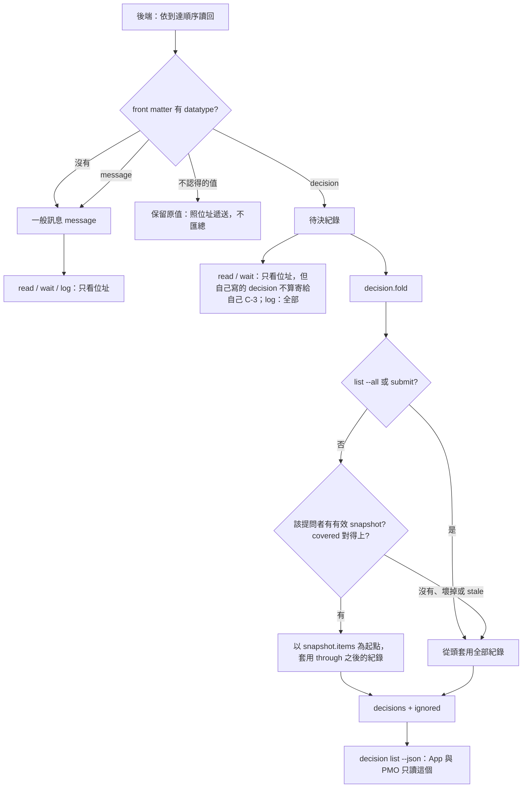
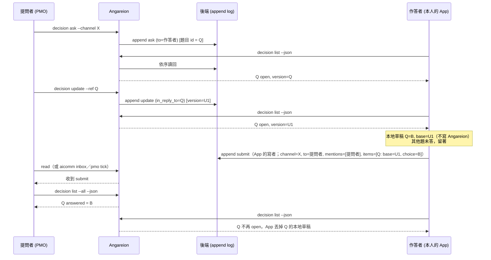
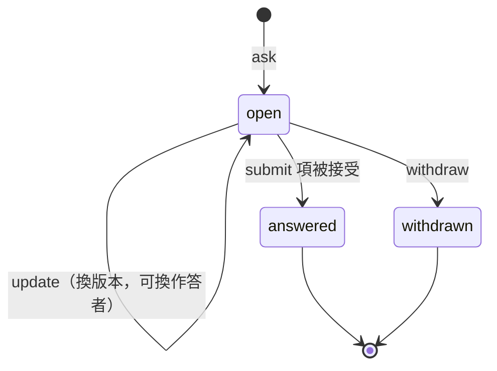

# Design: Angareion 待決（pending decision）（#468，b，作者模式）

作者：專案架構師（作者模式，親寫）。核准方式：非作者的審查者照本文 §15 的架構清單審，PMO 向本人說明，本人同意後才實作。
基準：main `0577584`。文中的 `file:line` 都以這個 commit 為準。
修訂：
- 第 1 輪修正：回應非作者審查 REVIEW-468 的 H1、H2、M1～M4、L1。
- 第 2 輪修正：照本人 2026-11-15 的裁定（#469，決定檔 MyPMO#402）改寫。
  - 拿掉 `answer` action 與通訊層的作答草稿（X-12：草稿只存 App）。
  - submit 直接帶答案。
  - 帶入第 2 輪審查 REVIEW-468-r2 的 L2-1～L2-3。
- 第 3 輪修正：回應非作者審查 REVIEW-468-r3（不改本人裁定）。
  - H3-1：`submit` 的規劃一律用完整匯總（`use_snapshot=False`），snapshot 不帶回已結束題目的答案（§7.5、§9.1、§13.3、C-28）。
  - M3-1：重跑略過的相等判斷含 `base`，缺省正規化成 null；先驗重複 `ref` 再略過（§9.1、C-29）。
  - M3-2：C-16 的交錯案例改用唯一標記當 `through`；C-26 改成比 open＋`seen`＋`closed`，已結束答案另以完整匯總驗。
  - L3-1：被拒項重送的說明（§6.4）；L-13 補 JSON／YAML 的界線與 TS 寫者的回讀驗證（R-A3）。
- 第 4 輪修正：回應非作者審查 REVIEW-468-r4。
  - M4-1：`FoldResult` 加 `complete`（只由 `use_snapshot` 決定）；`plan_submit` 的防呆改查它，不再從 `snapshot_used` 推（§7.3、§9.1、§13.3、C-16(e)、C-28(f)～(h)）。C-16 的 open 投影等價不變。

---

## §0 給本人看的一頁

**結論**：待決就是一則一般的 Angareion 訊息，只是 front matter 多了 `datatype: decision`，內文是固定格式的 YAML。新增、更新、撤回、送出、snapshot 都是**另外 append 一則**這種訊息，已經送出的訊息永遠不改。Angareion 讀回整串訊息，照到達順序**匯總**出每一題目前的狀態。後端只需要「append 一則」和「依序讀回」兩種能力，沒有用到 GitHub 的 label、關閉、編輯、reaction。

**做法（本人已核准，2026-11-15）**

1. 格式：front matter 加一個欄位 `datatype`。一般訊息寫 `message`；舊訊息沒有這個欄位，讀的時候當成 `message`。版本號 `angareion: 1` **不升**：舊讀者遇到不是 1 的版本會整則丟掉（§2 L-2）；新增欄位則會被舊讀者略過，訊息照樣送到。
2. 指令：`angareion decision <action>`，共 6 個 action：`ask`、`update`、`withdraw`、`submit`、`list`、`snapshot`。現有的 `send`／`read`／`wait`／`log` 就是 `message` 這個 datatype 的動作，不另外加 `angareion message …` 這種別名。
3. 待決存在**提問頻道**裡，綁定（頻道, 提問者）。每一題的 id 就是出題那則訊息的 id（ULID）。
4. 作答的過程（一題一題選、改、還沒送）只存在 App 本地，**不寫進 Angareion**（本人裁定 X-12）。本人按「送出」時，App 寫出 `submit`：
   - 已答的題按（頻道, 提問者）分組，每組至少一則；
   - 每一項直接帶答案（`choice`／`note`）和作答時看到的版本（`base`）；
   - 寄給提問者（`to` 與 `mentions` 都是提問者）。這一則就是「答案回到提問頻道並 mention 提問者」。
   未答的題不放進 submit，維持 open。
5. 權限：在不改後端權限的前提下，靠**匯總規則**判定。只有出題者能更新或撤回；只有題目指定的作答者能送出答案。不符的紀錄照樣留在後端（append-only），匯總時略過，並列在診斷裡。這只防誤用，不防冒名，因為 Angareion 本來就不做身分認證（spec「訊息格式」）。
6. snapshot：每個（頻道, 提問者）各自寫，只有提問者能寫。
   - 寫什麼時候：紀錄數超過門檻時自動寫，也可以手動寫。
   - 存什麼：「到 `through` 為止的完整前綴」匯總出來的 open 題目（含去重需要的版本 id），以及所有已結束題目的 id（墓碑）。
   - 怎麼讀：找最新一則有效的 snapshot，從它記的 `through` 之後往下匯總。snapshot 壞掉、找不到，或發現 `through` 之前有晚到的紀錄時，退回上一則有效的 snapshot 或從頭匯總。
   - **`list --all`（看已結束的題目與答案）和 `submit` 的規劃一律從頭完整匯總，不用 snapshot**，所以 PMO 確認答案的路徑、以及「重跑略過」要比對的已送答案，都不受 snapshot 影響。

**本人的裁定（2026-11-15，#469，決定檔 MyPMO#402；細節見 §17）**

- 整份核准。Q-1、Q-3、Q-4、Q-5、Q-6、Q-7 照建議。
- **Q-2**：「只有 PMO 出題」由 App 端過濾，Angareion 不守（R-A5）。
- **X-12**：作答草稿只存 App。Angareion 沒有 `answer`，只收 `submit`（§9、R-A3、R-A4）。
- **X-13**：照本設計。匯總在 Angareion，App 讀 `decision list --json`（P-3、R-A2）。
- **Q-5 的閘門已通過**：R-A1 已答，App 讀者會略過 `datatype`（MyAiEntry 提供證據在 PR #469）。

---

## §1 要件對照表

| # | 要件／已定事項 | 本文位置 |
|---|---|---|
| 1 | 待決綁定「頻道＋提出者」 | §4.3（`ask_channel`＋`asker`；v1 必須等於 front matter 的 `channel`＋`from`）、§6.1（匯總的鍵是（頻道, 提問者））、C-6 |
| 2 | 待決是一般訊息的特殊格式；一般訊息也有自己的格式，兩者可以區分 | §4.1、§4.2（`datatype: message`／`decision`）、C-1～C-3 |
| 3 | 寫入、刪除、更新都是 append；禁止改動已送出的訊息 | §3 P-1、§4.3（每個 op 都是一則新訊息）、§11（不用編輯或刪除）、C-4 |
| 4 | CRUD 由 Angareion 處理；後端只讀寫訊息，不依賴後端特有能力；Angareion 盡量簡單 | §5、§11 後端中立性表、§13 模組切割（後端介面不變）、C-20 |
| 5 | 用 datatype 區分；介面是 `angareion <datatype> <action>`；歷史匯總成目前狀態；太長時寫 snapshot，從 snapshot 往後匯總 | §4.1、§5、§6、§7、C-7～C-17 |
| 已定 | 目前只有 PMO 出題，格式仍保留「提問頻道＋提問者」 | 格式保留：§4.3（欄位保留；v1 限定相等）。「只有 PMO 出題」：本人裁定由 App 端過濾（Q-2、R-A5），Angareion 允許任何身分出題（§10） |
| 已定 | 一題一題作答，不是點了就送 | 由 **App 本地草稿**達成（本人裁定 X-12；R-A4）。Angareion 不存草稿，只收 `submit`（§9）。CLI 作答者一次給齊答案再送（§5 `submit`） |
| 已定 | 按送出時，已答的一次送出、未答的留著 | §9、C-12、C-13、C-14、C-28、C-29 |
| 已定 | 答案回到提問頻道，並 mention 提問者 | §4.3 `submit`（`channel`＝提問頻道，`to`／`mentions`＝提問者）、C-13、C-27 |
| 已定 | 待決內容是選擇題：背景、內文、選項、推薦選項、理由 | §4.3 `ask` 欄位（`background`、`body`、`options`、`recommended`、`reason`） |
| 已定 | App 只讀 Angareion 的匯總，不能反過來影響 Angareion | §12 R-A2～R-A4（App 只寫 `submit`，結果仍由 Angareion 的匯總判定） |

---

## §2 現況與限制（原樣引用）

- **L-1：訊息有六個欄位，再加 id 和 at。** `openspec/specs/angareion/spec.md:125`：「一則訊息 MUST 有 `from`、`to`、`channel`、`urgency`（0～9 的整數，預設 5）、`content`、`attachments`，加上寄件者產生的 `id`（ULID）與 `at`（含時區）；`id` 與 `at` 只用來辨識與顯示，MUST NOT 用來判斷新舊。」
- **L-2：版本號不是 1 的訊息，舊讀者整則丟掉。** `src/angareion/messages.py:195-198`：
  ```python
  if self.angareion != ANGAREION_VERSION:
      raise MessageValidationError(
          f"Unsupported angareion version: {self.angareion} (expected {ANGAREION_VERSION})"
      )
  ```
  非 strict 的 `parse_message` 遇到這個錯誤會回 `None`（`messages.py:433-436`），讀者就把那則跳過（`src/angareion/github.py:374-376`：`if parsed is None or not scope_matches(...): continue`）。所以**升版本號會讓所有舊讀者收不到新訊息**。
- **L-3：舊讀者會略過未知的 front matter 欄位。** `messages.py:405`：`required = {"angareion", "id", "at", "from", "channel", "urgency", "attachments"}`。只檢查這些欄位有沒有；`Message(...)` 也只取已知的鍵（`messages.py:418-430`）。多出來的鍵不會讓解析失敗。
- **L-4：log 快取只存 `message_to_dict`。** `src/angareion/log_cache.py:182`：`"message": message_to_dict(parsed),`。`message_to_dict`（`messages.py:235-248`）只輸出已知欄位，所以 front matter 的新欄位進不了舊快取，`content` 則完整保留。另外 `log_cache.py:18` 是 `LOG_CACHE_VERSION = 1`，spec 規定「版本不認得…MUST 整檔視為空並全量重建」（`spec.md:407`）。
- **L-5：收件範圍只看位址。** `src/angareion/backend.py:304-308`：
  ```python
  def recipient_matches(message: Message, recipient: str | None) -> bool:
      """Whether a message counts as "to me": addressed to me, a broadcast, or it mentions me."""
      if recipient is None:
          return True
      return message.to is None or message.to == recipient or recipient in message.mentions
  ```
  沒有 `to` 就是廣播，「寄給我的」每個人都會收到；也不會排除自己寄的。
- **L-6：判斷新舊只看後端。** `spec.md:66`：「判斷訊息新不新 MUST 只看後端（到達位置與後端記錄的時刻），MUST NOT 使用寄件者填的 `at` 或 `id`。」游標容許晚到的範圍是 `CURSOR_SEEN_MARGIN_SECONDS = 60.0`（`backend.py:19`）。
- **L-7：對外的介面現在固定只有六個。** `spec.md:224`：「Angareion 對外 MUST 只有六個介面…」。`spec.md:292-294` 的 scenario 也斷言頂層子指令「恰好是 `channel`、`send`、`wait`、`read`、`log`」。**本設計會改這條**（delta 見 §19 PR-4）。
- **L-8：後端協定。** `backend.py:247-300` 的 `ChannelBackend`（Protocol）只有六個方法：`create_channel`、`verify_channel`、`close_channel`、`send`、`check`、`read`。
  - **列舉不在協定裡**：`enumerate_conditional` 只有實作，在 `FakeBackend`（`backend.py:546-564`，回 `(到達位置, 後端時刻, 解析結果)`，依到達位置排序）和 `GitHubIssuesBackend`（`github.py:482`）。
  - `log_cache.py:168` 直接呼叫 `backend.enumerate_conditional(...)`，靠的是 duck typing，型別上沒有宣告（spec「後端可以替換」`spec.md:205` 有寫列舉這個動作）。
  - 這是現有的型別契約缺口，處置見 §13.1、C-20。
- **L-9：訊息長度有上限，單位是字元。** `messages.py:32`：`MAX_MESSAGE_LENGTH = 65536`；檢查在 `messages.py:336`：`if len(text) > MAX_MESSAGE_LENGTH:`。`text` 是含 front matter 的整則序列化文字；`len` 算的是 Python 字元數，不是 UTF-8 位元組。本文說「長度上限」一律指整則序列化文字 65536 字元（含 front matter）。
- **L-10：送出前會讀回檢查。** `messages.py:344-359`：送出前先把訊息讀回來，任何欄位不同就拒送。新增欄位必須一起進 `message_to_dict`，否則讀回比對時會少一欄。
- **L-11：TS 側也有讀者和寫者。**
  - `messages.py:300-302`（`serialize_message` 的 docstring）：「`mentions` is written as one flow-style line (`mentions: [a, b]`; the TS side's hand-written parser relies on it)」。
  - `messages.py:342-343`：「The TS side (MyAiEntry 801013c) only checks field by field and does not read it back」。
  - TS 讀者遇到未知欄位會怎樣，前一版列為 R-A1。本人裁定時 R-A1 已答（§12、§17 Q-5），本文沒有自己驗。
- **L-12：PMO 的收信輪。** `src/pmo/round.py:66-71`：team 階段收的是「不是秘書、也不是 PMO 自己寄的」訊息（`return sender != ctx.config.pmo_identity`）。讀 JSON 用的是 `data.get(...)`，多出來的欄位不影響。
- **L-13：PyYAML 不一定讀得懂 JSON 的轉義。** 本輪實測（`uv run --with pyyaml`，探針在 `/tmp` 下、只跑 `yaml.safe_load`）：含 emoji 的 payload 用 `json.dumps(ensure_ascii=True)` 寫出後，`yaml.safe_load` 讀回來和原值不相等；用 `ensure_ascii=False` 寫出就相等。
  - 原因：`ensure_ascii=True` 的 JSON 把 emoji 寫成一對 `\uXXXX` 代理字元，經 YAML 讀回會變成**兩個 surrogate 字元**；`ensure_ascii=False` 沒有這個問題（第 3 輪審查 REVIEW-468-r3 的 P-5 在隔離行程重驗，結果相同）。
  - 所以不是「所有 JSON 都不相容」，而是「JSON 的某些轉義寫法和 YAML 的讀法不一致」。為了不讓 TS 寫者去判斷哪些寫法安全，TS 寫者寫 submit 的內文時**一律寫 YAML**，並用 py 的 `yaml.safe_load` 回讀含 emoji、控制字元的案例驗證（R-A3）。

---

## §3 原則

- **P-1：一切都是 append。** Angareion 不編輯、不刪除、不關閉任何訊息，也不改後端的任何屬性。狀態完全由「依序讀回的訊息」算出來。
- **P-2：後端不認識 datatype。** 對後端來說，待決就是一則訊息。後端介面（`ChannelBackend`）一個方法都不加，也不改。
- **P-3：只有一份匯總規則，放在 Angareion。** App、PMO、`pmo` 模組都不自己匯總，只讀 `angareion decision list --json`（本人裁定 X-13）。
- **P-4：寫入嚴格，讀取寬鬆**（沿用 `messages.py:7-13` 的規矩）。寫的時候欄位不合就拒送；讀的時候壞紀錄（或 submit 的壞項目）只略過那一則（那一項）並記診斷，整份匯總不因此失敗。
- **P-5：位址規則不變。** `read`／`wait`／`aicomm inbox` 仍然只看位址，只多一條小規則：自己寫的待決紀錄不遞送給自己（C-3）。待決紀錄都有 `to`，**不是廣播**，所以不會吵到頻道裡的其他成員。
- **P-6：順序只看到達位置**（L-6）。`at` 和 ULID 不參與排序。
- **P-7：作答過程不進通訊層。** 還沒送出的選擇（App 本地草稿）只存在 App；Angareion 只看得到送出的 `submit`（本人裁定 X-12）。

---

## §4 訊息格式

### 4.1 datatype 欄位

- front matter 加一個欄位 `datatype`，值的文法是 `^[a-z][a-z0-9-]{0,31}$`。v1 只有兩個值：`message` 和 `decision`。它是**單行純量**；結構一律放內文。
- **寫入**：所有新寫的訊息一律寫 `datatype`。`send` 寫 `message`，`angareion decision …` 寫 `decision`。
  - 序列化時 front matter 的鍵順序是 `angareion`、`datatype`、`id`、`at`、`from`、`to`（有才寫）、`mentions`（有才寫）、`in_reply_to`（有才寫）、`channel`、`urgency`、`attachments`。
  - 也就是在現有順序（`messages.py:305-330`：`head`、手寫的 `mentions`／`in_reply_to` 兩行、`tail`）的 `angareion` 後面插入 `datatype`。
- **讀取**：
  - 沒有這個欄位，讀成 `message`（舊訊息）。
  - 值不是字串，或不符文法，也讀成 `message`，跟 `mentions` 一樣「壞值丟掉、訊息保留」（`messages.py:363-380`）。
  - 值合法但不認得（例如將來的 `poll`），照原字串保留：照位址遞送，匯總不理它。
- `angareion: 1` **不升版**（理由見 L-2）。
- attachments 的項目**不加新鍵**。
- `message_to_dict` 加 `"datatype"` 鍵，所以 `read --json` 和 `log --json` 都會輸出它。log 快取的版本升到 2，舊快取會整檔重建（L-4）。

### 4.2 一般訊息的格式

就是現在的格式，只是明寫 `datatype: message`：

```text
---
angareion: 1
datatype: message
id: 01J…
at: '2026-11-15T03:00:00+00:00'
from: myaistorage-pm-w1
to: myaistorage-arch-w1-23
channel: team-myaistorage-w1
urgency: 5
attachments: []
---
內文
```

**怎麼區分兩種訊息**：`datatype` 是 `decision` 的才是待決，其他都是一般訊息（含沒有這個欄位的舊訊息）。只看 front matter，不必解析內文。

### 4.3 待決的格式（payload 版本 1）

待決訊息的 front matter 照一般訊息寫（`datatype: decision`）。**內文是一個 YAML mapping**：
- py 用 `yaml.safe_dump(…, allow_unicode=True, sort_keys=False)` 寫出；
- TS 寫者照 R-A3 寫 YAML（L-13）；
- 前兩個鍵固定是 `decision: 1`（payload 版本）和 `op`。

payload 放在內文而不是 front matter，有兩個原因：

- 舊讀者和舊快取會完整保留內文（L-4）；
- TS 的 front matter 解析器是手寫的（L-11），放在內文就不必讓它學巢狀結構（推論：L-11 只說它依賴 flow 格式的 `mentions`，它能不能讀巢狀結構沒驗到）。

舊讀者看到的是可讀的 YAML 文字。

| op | `from` | front matter 的 `to`／`mentions` | `in_reply_to` | 內文的鍵（* 為必填） |
|---|---|---|---|---|
| `ask` | 提問者 | `to`＝作答者 | 無 | `decision`*、`op`*、`ask_channel`*、`asker`*、`answerer`*、`title`*、`background`*、`body`*、`options`*、`recommended`*、`reason`* |
| `update` | 提問者 | `to`＝更新後的作答者 | 題目 id | `decision`*、`op`*、`ref`*，以及 ask 的題目欄位全部重給（`answerer`*、`title`*、`background`*、`body`*、`options`*、`recommended`*、`reason`*）。不能改 `ask_channel` 和 `asker` |
| `withdraw` | 提問者 | `to`＝目前的作答者 | 題目 id | `decision`*、`op`*、`ref`*、`reason` |
| `submit` | 作答者 | `to`＝提問者、`mentions: [提問者]` | 無 | `decision`*、`op`*、`asker`*、`items`*。每一項：`ref`*、`base`*、`title`*、`choice`、`note`。同一則裡 `ref` 不得重複 |
| `snapshot` | 提問者 | `to`＝提問者自己 | 無 | `decision`*、`op`*、`asker`*、`through`*、`covered`*、`items`*（每一題 open 題目的完整狀態）、`closed`*（已結束題目的 id），見 §7.2 |

欄位規則。寫入時嚴格檢查，任何一條不符就 exit 1、什麼都不送；讀取時的處置見最後一條：

- **題目 id**：等於出題那則 `ask` 訊息的 `id`。`ref` 必須是 26 字的 ULID。
- **`ask_channel`、`asker`（綁定）**：v1 必須等於這則紀錄的 front matter `channel` 和 `from`。這兩個欄位**保留在格式裡**，將來放寬（例如由 PMO 代別人出題）時不必改格式，只要放寬這條等式（Q-6）。
- **`answerer`**：一個合法的 AI 名（當前文法）。
- **`title`**：單行，1～120 字。`background`、`body`、`reason` 是字串，`body` 不得為空。
- **`options`**：2～9 個 `{key, text}`。`key` 符合 `^[A-Z]$`，不得重複；`text` 不得為空。`recommended` 必須是其中一個 `key`。
- **`base`**：作答時看到的那一版的 id。`ask` 本身算第一版，之後每個被接受的 `update` 是新的一版，版本 id 就是那則紀錄的 `id`。App 要用本地草稿建立時 `list --json` 給的 `version` 當 `base`（R-A4），不是送出當下的版本。
- **submit 的一項（答案）**：恰好是下面兩種之一：
  - 給 `choice`（`base` 那一版 `options` 裡的某個 `key`），`note` 可有可無；
  - 不給 `choice`、只給 `note`（Q-3，本人已核准）。
  - `choice` 和 `note` 都沒有的項目不合法。App 裡「選了又取消」的題就是未答，不放進 submit（R-A4）。
  - `choice: null` 等同沒給 `choice`。
- **`note`**：有給就是 1～`NOTE_MAX`（4000）字元的字串，空字串不合法。設上限是為了讓任何一題的 submit 項單獨一則一定放得下（§9.1 的分塊靠這一點）。
- **`submit.items[].title`**：只是抄一份給人看，匯總時不當依據。
- **整則長度**：整則序列化文字（含 front matter）不得超過 `MAX_MESSAGE_LENGTH`，即 65536 字元（L-9）。
- **讀取時**：
  - 不認得的 `decision` 版本：整則紀錄略過，診斷 `unsupported_version`。
  - payload 裡多出來的鍵：略過不理。
  - submit 的某一項不合上面的答案規則：只略過那一項，診斷 `bad_item`（§6.2）。

範例（`ask` 的內文）：

```yaml
decision: 1
op: ask
ask_channel: <提問頻道>
asker: <提問者的 AI 名>
answerer: <Q-1 決定的 AI 名>
title: 要不要先合 PR-1
background: …
body: …
options:
- key: A
  text: 先合
- key: B
  text: 等 App 確認
recommended: B
reason: …
```

範例（`submit` 的內文，一組兩題，其中一題只寫文字）：

```yaml
decision: 1
op: submit
asker: <提問者的 AI 名>
items:
- ref: <題目 id Q1>
  base: <Q1 作答時的版本 id>
  title: 要不要先合 PR-1
  choice: B
  note: 等 MyAiEntry 的測試
- ref: <題目 id Q2>
  base: <Q2 作答時的版本 id>
  title: 命名
  note: 兩個都不好，用 X
```

---

## §5 指令：`angareion decision <action>`

這是新的第七個介面家族（L-7 要改）。旗標與輸出照現有的寫法，不出現後端的概念（spec「六個介面」第二段）。

| action | 用法 | stdout | 為什麼需要（能不加就不加） |
|---|---|---|---|
| `ask` | `--channel <ch> (--body <YAML> \| --body -)` | 新題目的 id | 新增。少了它就沒有待決 |
| `update` | `--channel <ch> --ref <ULID> (--body <YAML> \| --body -)` | 這則紀錄的 id | 本人要求「放太久的要能更新」。不能拿「撤回＋重出」代替：那樣題目 id 會變，討論串會斷，App 本地草稿也對不到同一題 |
| `withdraw` | `--channel <ch> --ref <ULID> [--reason <文字>]` | 這則紀錄的 id | 刪除。append-only 的世界裡，刪除就是一則撤回紀錄 |
| `submit` | `[--channel <ch>]… (--body <YAML> \| --body -)` | 每個 submit 紀錄的 id，一行一個；沒有可送的就不印 | 本人要求「一次送出」。給 CLI 作答者用；App 用自己的寫者寫出同樣格式的紀錄（R-A3） |
| `list` | `[--channel <ch>]… [--all] [--json]` | 匯總結果 | App 和 PMO 只讀這個（P-3）。不給 `--all` 只列 open 的題，可以用 snapshot；給 `--all` 列出本機鏡像裡**整個頻道歷史**的所有題目（open、answered、withdrawn），一律從頭完整匯總、不用 snapshot（§7.6） |
| `snapshot` | `--channel <ch>` | snapshot 紀錄的 id；沒有可涵蓋的就不印 | 手動壓縮，也方便測試。自動觸發見 §7 |

**不加的動作**：

- `show`：查一題的歷史，用 `angareion log --thread <題目 id>`，因為 `update`／`withdraw` 的 `in_reply_to` 都是題目 id。submit 可能一則含好幾題，所以沒有 `in_reply_to`；要找一題的答案用 `list --all`。
- `reopen`：已答或已撤回的題，要再問就重出一題。
- 逐題作答的 action：本人裁定作答草稿只存 App（X-12）。前一版的作答 action 已拿掉（§16）。
- `angareion message <action>` 別名：現有的頂層指令就是 `message` 的動作。

**共通規則**：

- `ask`／`update` 的 `--body` 給的是題目欄位的 YAML mapping（§4.3 那一列除了 `decision`、`op`、`ask_channel`、`asker`、`ref` 之外的鍵）。那幾個鍵由 Angareion 填；body 裡出現它們，或出現未知的鍵，都 exit 1。沒給 `--body` 也 exit 1（同 `send`，`spec.md:125`）。
- `submit` 的 `--body` 是 `{items: [{ref, base, choice?, note?}, …]}`。
  - `title`、`asker`、`channel`、分組、分塊都由 Angareion 從匯總填（§9）。
  - body 裡出現其他鍵，或 `items` 是空的，都 exit 1。
  - **`base` 必給**：CLI 不替作答者填目前的版本，否則題目在作答之後被改過，答案會默默套到新版本上（`stale_base` 就失去意義）。CLI 作答者從 `list --json` 的 `version` 取得。
  - `--channel` 不給時，範圍和 `list`、`log` 一樣是所有已登記的頻道（`spec.md` log 一節的「不給＝所有已登記 channel」）。`ref` 在範圍內找不到就 exit 1。
- **寫入前的預檢**：寫入的 action 會先照 `log` 的方式同步相關頻道的 log 快取（`spec.md:399-402`），用目前的匯總檢查前置條件，不符就 exit 1、什麼都不送。
  - 前置條件包括：題目不存在、已經結束、不是出題者、不是作答者、`base` 不是目前版本、答案不合 §4.3。
  - 預檢只是提早擋下；**最終的判定是匯總**（§6），因為兩個寫入者之間有競態。App 自己寫的 submit 沒有經過這個預檢，同樣由匯總判定。
- **結束碼**同 `spec.md:171`：0 成功；1 用法、輸入或前置條件錯（**保證什麼都沒送**）；2 後端、網路或設定錯（可能已送出一部分）。`submit` 的完整規則（重跑略過、分塊、整批預檢、部分已送、重送）見 §9.1。
- 寫入和讀取都**不讀、不動游標**，跟 `log` 一樣（`spec.md:301`）。
- 身分照 `send`：`from` 是解析出的身分（`src/angareion/cli.py:335`）。

`list --json` 的形狀（App 的契約）：

```json
{
  "decisions": [
    {"id": "<題目 id>", "channel": "…", "asker": "…", "answerer": "…",
     "status": "open|answered|withdrawn", "version": "<版本 id>", "revisions": 1,
     "title": "…", "background": "…", "body": "…",
     "options": [{"key": "A", "text": "…"}], "recommended": "A", "reason": "…",
     "asked_at": "<後端時刻>", "updated_at": "<後端時刻>",
     "submitted": {"record": "<submit id>", "from": "…", "base": "<id>", "choice": "A", "note": "…", "submitted_at": "<後端時刻>"},
     "withdrawn": {"record": "<id>", "reason": "…"}}
  ],
  "ignored": [{"record": "<訊息 id>", "channel": "…", "op": "submit",
               "ref": "<題目 id 或 null>", "item": 0, "code": "stale_base"}]
}
```

- `submitted`、`withdrawn` 沒有值時是 `null`。`submitted.choice`、`submitted.note` 沒給時是 `null`。
- `ignored` 每一筆是一個不被接受的單位：
  - 整則不接受時一筆，`item` 是 `null`；
  - `submit` 逐項判時，每個不被接受的項目各一筆，`item` 是它在 `items` 裡的索引（從 0 起），`ref` 是那一項的 `ref`；
  - `ref` 讀不出來（例如 `bad_payload`）時是 `null`。
- 不給 `--all` 時，`ignored` 只涵蓋實際被匯總的紀錄（snapshot 的 `through` 之後的，加上壞掉的 snapshot 本身）；要看全部用 `--all`。
- 排序：`(asked_at, channel, id)`，由舊到新，跟 `log` 跨頻道的排序鍵同一套（`spec.md:312`）。
- 文字模式：每題一塊，含狀態、題目、選項、推薦，已答的加答案。`ignored` 只在 stderr 印一行總數。

---

## §6 匯總規則

### 6.1 輸入、順序與鍵

- **輸入**：一個頻道裡，所有 `datatype: decision` 的訊息，照**到達位置**排序（log 快取已經是這個順序，`log_cache.py:197`）。`at` 和 ULID 不參與排序（L-6，P-6）。
- **鍵**：每一題以題目 id 識別，歸屬於（`ask_channel`, `asker`）。v1 的 `ask_channel` 一定是紀錄所在的頻道，所以各頻道分開匯總。
- 匯總是**純函式**：`fold(依到達順序排好的紀錄) → (題目狀態, 診斷)`。每次都用整個快照重算，不做增量累加；同一組輸入一定得到同一個結果。
- 誰寫的紀錄（py 的 CLI 或 App 的 TS 寫者）都照同一套規則判，匯總不看寫者是誰。

### 6.2 每一題的狀態

狀態轉移見 §14 圖 3。

| 收到的紀錄（依到達順序處理） | 接受條件 | 效果 | 不接受時的診斷碼 |
|---|---|---|---|
| `ask` | payload 合法；`ask_channel`＝`channel`；`asker`＝`from`；題目 id 不在「已知題目 id」裡（§6.4） | 新增 open 題目；版本＝這則的 id | `bad_payload`／`binding_mismatch`／`duplicate_id` |
| `update` | 題目存在而且是 open；`from`＝出題者；這則的 id 不在該題的版本 id 裡（§6.4） | 換掉題目欄位（含作答者）；版本＝這則的 id | `unknown_ref`／`closed_ref`／`not_owner`／`duplicate_id` |
| `withdraw` | 題目存在而且是 open；`from`＝出題者 | 狀態變 withdrawn（結束） | `unknown_ref`／`closed_ref`／`not_owner` |
| `submit` | 見下面「submit 逐項判」 | 被接受的那幾項：狀態變 answered（結束），答案就是那一項的 `choice`／`note` | 整則：`bad_payload`；逐項：見下面 |
| `snapshot` | 見 §7.3 | 決定該提問者從哪裡開始匯總 | `bad_snapshot`／`snapshot_stale` |

**submit 逐項判**：

1. **整則的檢查**：front matter 的 `to`＝`asker`，而且 `mentions` 含 `asker`；payload 合法（`items` 是非空的 list）。不符就整則不接受，`bad_payload`，`item` 是 `null`。
2. **逐項**：依 `items` 的順序，每一項照下面的順序檢查，第一條不符的就是它的診斷碼，後面不再看：

| 順序 | 檢查 | 診斷碼 |
|---|---|---|
| 1 | 這一項的 `ref` 沒在本則前面的項出現過（不論前面那項接不接受） | `duplicate_ref` |
| 2 | 題目存在 | `unknown_ref` |
| 3 | 題目是 open | `closed_ref` |
| 4 | `from`＝那題**目前的**作答者 | `not_answerer` |
| 5 | `asker`＝那題的提問者 | `binding_mismatch` |
| 6 | `base`＝那題目前的版本 | `stale_base` |
| 7 | 答案合 §4.3（`choice` 在目前版本的 `options` 裡、`note` 長度、兩者至少有一個） | `bad_item` |

通過全部檢查的項被接受：題目變 answered，`submitted` 記下這則的 id、`from`、`base`、`choice`、`note` 和後端時刻。

### 6.3 邊界情況

- **同一題多次更新**：依到達順序逐一套用，最後一則被接受的就是目前版本。`revisions` 是被接受的 ask 加 update 的數目。
- **同一秒**：到達位置是全序，同一秒也分得出先後。不看 `at`。
- **兩則互相競爭**：
  - `update` 和 `submit`：update 先到，submit 項判 `stale_base`；submit 先到，題目已經 answered，update 判 `closed_ref`。
  - `withdraw` 和 `submit`：一樣是先到的勝。
  - 兩個畫面（或 App 和 CLI）同時對同一題 `submit`：先到的那項被接受，後到的判 `closed_ref`。
  - 後到的題目狀態不會被改掉。重複的 submit 不會產生第二個答案（C-11）。
- **同一題多人答**：一題在任一時刻只有一位作答者（`answerer`，`update` 可以換）。不是目前作答者送的項判 `not_answerer`，不會折疊成多個答案。
  - 作答者被 `update` 換掉之後，舊作答者照舊版本送的項，第 4 條先判 `not_answerer`。
  - 新作答者照舊版本送的項判 `stale_base`。
- **送出之後改答案**：題目一被接受就結束，之後同一題的 submit 項都是 `closed_ref`。要改只能請提問者重出一題（不加 `reopen`，§5）。App 草稿提出的「同一人對同一題最新的一則作答就是目前答案」不採用（§20 X-12）。
- **亂序晚到**（到達位置比較小的紀錄晚一點才出現在列表裡）：因為每次都重算（6.1），它會被放回正確的位置。
  - 結果可能和前一次匯總不同，但一定等於「完整歷史的匯總」。
  - 晚到的紀錄落在某則 snapshot 的 `through` 之前時，那則 snapshot 的 `covered` 對不上而被判 `snapshot_stale`，退回從頭匯總（§7.4）。
  - 只有 log 鏡像本身收不到的晚到（超出增量同步的 `since` 窗，`spec.md:402`）才看不到，這和 `log` 的限制相同。
- **缺漏**：後端少給了某一則，Angareion 無從得知。引用不存在題目的紀錄判 `unknown_ref` 並略過；之後那一則出現了，重算就會修正。
- **後端上的內容被人改過**：Angareion 自己永遠不改（P-1）。若有人繞過 Angareion 在後端改了某則留言，log 快取會用新內容覆蓋（`spec.md:402`），匯總就照新內容算。這是**已知限制**，跟 log 的已知限制同類（`spec.md:410`），寫進 skill 說明。
- **不是 decision 的訊息**（一般訊息、不認得的 datatype）不參與匯總。

### 6.4 重複與 id 衝突

後端可能把同一則訊息給兩次（不同到達位置、相同 `id`），人或 App 的寄件匣也可能把同一則重送。規則只依「被接受過的紀錄」去重，不記被拒的紀錄：

- **已知題目 id**＝目前所有題目（open 和已結束）的 id。`ask` 的 id 在裡面 → `duplicate_id`，先到的那題不變；不論兩則內容是否相同（id 衝突也是先到者勝）。
- **每題的版本 id**＝這一題的 id，加上被接受的 `update` 的 id。`update` 的 id 在 ref 指向那題的版本 id 裡 → `duplicate_id`，題目不變。
- **submit 不另外記 id**：一項被接受，題目就結束了；同一則 submit 重送，那些項都判 `closed_ref`。
  - 同一則裡被拒的項，重送時照當下的狀態重判（不記被拒紀錄）。結果不一定相同：
    - 舊版的 `base` 不會因為一般的後續更新而自動變成有效：題目之後再被 `update`，目前版本只會更新，不會回到舊版，所以這種項重送仍判 `stale_base`。
    - 引用「當時還沒到達的版本或題目」的項（例如 submit 的 `base` 指向一則晚到的 `update`，或 `ref` 指向一則晚到的 `ask`），那一版或那一題到達之後重送，可能被接受。
- **已結束的題目**：任何引用它的 `update`／`withdraw`／`submit` 項都是 `closed_ref`，所以已結束題目的重送不必另記 id。
- **被拒的紀錄不留痕跡**：它重送時照當下的狀態重新判。
  - 例：`withdraw Q` 先到（題目還沒出現，`unknown_ref`），之後 `ask Q`，再來同一則 withdraw 重送 → 這次接受，Q 變 withdrawn。
  - 從頭匯總和從 snapshot 匯總都這樣判，所以兩條路徑一致。
- **檢查的範圍只到 ref 指向的那一題**：`update` 的 id 和別題的版本 id 撞到，不算重複（那是冒名或偽造，不防，§10）。
- 依這些規則，snapshot 只要帶「open 題目的版本 id」和「已結束題目的 id」（§7.2），從 snapshot 往後匯總就和從頭匯總判得一樣，已結束的題目不會因為重送而復活（C-16、C-26）。

---

## §7 snapshot

### 7.1 誰寫、什麼時候寫

- 每個（頻道, 提問者）各自有 snapshot，**只能由那位提問者寫**（`from`＝`asker`）。這樣跟「只有出題者能改題目」是同一條權限線。
- **自動觸發**：出題者的 `ask`／`update`／`withdraw` 寫成功之後，若該（頻道, 提問者）在目前有效 snapshot 的 `through` 之後的相關紀錄已經 ≥ `SNAPSHOT_EVERY`（200 則），就再寫一則 snapshot。
  - 「相關紀錄」指：該提問者的 ask，以及 ref 指向該提問者題目的 update、withdraw、submit 項。
  - 自動寫失敗只在 stderr 警告一次，結束碼和 stdout 不變（原本那筆寫入已經成功）。
  - 自動寫出的 snapshot id **不印**在 stdout（stdout 仍只有原本那筆的 id）。
- **手動**：`angareion decision snapshot --channel <ch>`，不看門檻。

### 7.2 格式與內容（前綴投影）

```yaml
decision: 1
op: snapshot
asker: <提問者>
through: <最後一則被涵蓋的紀錄 id>
covered: <到達位置 ≤ through 的 decision 紀錄則數（整個頻道，不分提問者）>
items:                     # open 的題目，依 (asked_at, id)
- id: <題目 id>
  version: <版本 id>
  revisions: 2
  versions: [<題目 id>, <update id>]   # 去重用：這題所有的版本 id（§6.4）
  answerer: …
  title: …
  background: …
  body: …
  options: [...]
  recommended: A
  reason: …
  asked_at: <後端時刻>
  updated_at: <後端時刻>
closed: [<題目 id>, …]     # 已結束（answered／withdrawn）題目的 id（墓碑），依 (asked_at, id)
```

- **內容的定義**：令 P＝列表中到達位置 ≤ `through` 的位置的所有紀錄（完整前綴，含不是這位提問者的）。
  - `items` 和 `closed` **等於** `fold(P)` 裡屬於這位提問者的題目的投影：open 的題目進 `items`（帶上表的全部欄位），已結束的題目只留 id 進 `closed`。
  - **不是**用「目前的匯總結果」去抄，`through` 之後的紀錄一筆都不能影響 snapshot 的內容（C-16 的交錯案例）。
- 去重只要 `versions` 和 `closed` 兩個集合（§6.4）。submit 不另記 id，所以 snapshot 也不帶答案或 submit 的 id。
- `closed` 只留 id，答案與撤回理由不放：snapshot 只服務「目前還 open 的題目」這個視圖。已結束題目的內容由完整匯總取得：`list --all`（§7.6）和 `submit` 的規劃（§9.1）都不用 snapshot。
  - **不得**為了讓 submit 用 snapshot，而把已結束題目的答案放回 snapshot：那會讓 snapshot 隨已結束題目的數量線性長大，破壞下面的容量估算。
- snapshot 本身也是一則 append 的 decision 訊息，同樣受 65536 字元的上限（L-9）。
  - 超過就不寫：手動觸發時 exit 1；自動觸發時 stderr 警告，匯總照舊從上一則有效 snapshot 算起。snapshot 只是加速，寫不出來不影響正確性。
  - 容量的粗估：`closed` 一項約 30 字元（26 字的 id 加 YAML 符號），約 2000 題以上才會因為墓碑寫不出來；open 題目多時會更早滿。到那時候要再設計（分段 snapshot 或修剪），列為已知限制。**不得**用丟掉最舊墓碑的方式擠進上限，那會讓已結束的題目復活。

### 7.3 讀者怎麼找到最新的 snapshot

- 讀者手上本來就有頻道的完整鏡像（log 快取）。匯總時，從尾端往前找該提問者**最新一則有效的** snapshot。有效的條件：
  - payload 合法；
  - `from`＝`asker`；
  - `through` 指向的紀錄在列表裡**恰好一則**（重複出現就判無效），而且排在這則 snapshot **之前**；
  - **列表中到達位置 ≤ `through` 的 decision 紀錄則數＝`covered`**。不相等代表 snapshot 寫出之後，`through` 之前又冒出（或少了）紀錄，這則 snapshot 不再等於前綴，判無效（診斷 `snapshot_stale`）。
- 不必去後端額外找「最新 snapshot 的指標」。因為只能 append，也不能有可改動的指標。
- 最新那則無效時，記診斷（`bad_snapshot` 或 `snapshot_stale`），改用前一則有效的；全部無效或根本沒有，就從頭匯總。
- 使用方式：
  - 起點：該提問者的題目狀態以 snapshot 的 `items`（含 `versions`）和 `closed` 為起點。
  - 往下：依到達順序套用 `through` **之後**的所有紀錄（§6 的規則，含 §6.4 的去重）。
  - `through` 之前的紀錄一概不看（「不無限往前追溯」）。
- 有效的定義只看列表裡有什麼，所以手上列表相同的讀者算出來都一樣。
- `fold` 回報每位提問者實際用了哪一則 snapshot（`FoldResult.snapshot_used`），以及實際套用了幾則紀錄（`FoldResult.folded`），給測試確認 snapshot 路徑真的被走到（C-16(d)、C-26）。結果是不是完整匯總另看 `FoldResult.complete`（只由 `use_snapshot` 決定，§9.1、§13.3），不從 `snapshot_used` 推。

### 7.4 涵蓋範圍、穩定窗與晚到的紀錄

- **cutoff 是時刻，`through` 是位置**，兩者的關係要明寫：
  - cutoff＝「列表中最新一則訊息的後端時刻 − 60 秒」。
  - `through` 取**最大的**到達位置 p，使得列表中**所有**到達位置 ≤ p 的紀錄（不只 p 那一則）後端時刻都 ≤ cutoff，而且 p 那一則是 decision 紀錄。
  - 不能只看 `through` 那一則的時刻：後端的時刻和位置不一定同步，位置小的紀錄時刻可能比較晚。
  - 找不到這樣的 p 就不寫（手動：exit 0、stdout 空）。
- **後端假設 A-1（新增依賴，明列）**：「一則紀錄 r 出現在列表裡之後，若列表最新的後端時刻已經比 r 晚 60 秒以上，到達位置比 r 小的紀錄都已經出現在列表裡。」
  - 60 秒沿用游標的 margin（L-6）。
  - log 快取的增量同步本來就帶 `since = 上次的後端時刻 − 60 秒`（`spec.md:402`），也就是 log 鏡像本身已經有類似的依賴。
  - 但 snapshot 是**又一處**依賴它，所以列在這裡，不當成已知事實。
- **A-1 失效時的語意**：有一則紀錄在 snapshot 寫出之後才出現，而且位置 ≤ `through`。
  - 這則 snapshot 的 `covered` 和列表對不上，讀者判 `snapshot_stale`，退回前一則有效的 snapshot 或從頭匯總。結果等於「用目前列表從頭匯總」，**不會**默默忽略晚到的紀錄。
  - 還在用舊列表的讀者（尚未同步到那則晚到紀錄）看不到它，這和沒有 snapshot 時一樣，同步之後就一致。
  - 偵測不到的情況：同時有一則晚到、一則從列表消失（則數相抵）。這需要後端刪除或改寫，屬 §6.3「後端上的內容被人改過」那一類已知限制。
- 後端若給不出後端時刻（將來別種後端），就不寫 snapshot，一律完整匯總（§11）。

### 7.5 誠實說明 snapshot 省下了什麼

在「只能依序讀回」的限制下，全新的讀者第一次還是要把整串讀一遍（log 快取的全量同步），snapshot 省不掉這一步。它省的是：

1. 預設的 `list`（只看 open）、出題端（`ask`／`update`／`withdraw`）寫入前的預檢，匯總時不必從頭走過所有歷史；
2. 很久以前的壞紀錄不再出現在預設 `list` 的 `ignored` 裡。

它**不**省 `list --all` 的匯總（§7.6），也**不**省 `submit` 的規劃：submit 要分辨「已經送過的同一個答案」和「別的結束方式」，需要已結束題目的答案，所以一律完整匯總（§9.1，第 3 輪的裁決）。代價是一次對本機鏡像的純記憶體匯總；鏡像本來就要完整讀一遍（上一段），不多一次後端讀取。將來 log 快取要不要修剪 snapshot 以前的紀錄，不在本單範圍；`list --all`、`covered` 檢查和退回從頭匯總都需要完整前綴，所以在另有設計之前**不能**修剪。

### 7.6 `list --all` 與 PMO 確認答案的路徑

- `list --all` **一律從頭完整匯總**本機鏡像裡該頻道的全部紀錄，不使用任何 snapshot。時間範圍＝頻道從建立到最近一次同步的整段歷史（log 快取是全量鏡像，spec「log 的本機快取」）。
- 所以已結束的題目和它們的答案、撤回理由，永遠查得到，不會因為 snapshot 而消失。PMO 照 R-P2 確認哪幾項被接受，走的就是這條路徑。
- 等價性因此分兩段寫：
  - 預設 `list` 的結果（open 題目，含版本、`revisions`、版本 id）＝`list --all` 結果裡 status 是 open 的那幾題（C-16）；
  - 從 snapshot 往後匯總時，已結束題目的集合（`closed` 加上 `through` 之後結束的）＝從頭匯總的已結束題目的 id 集合（C-16）。
  - `ignored` 不在等價的範圍內：兩條路徑看的紀錄範圍本來就不同（§5）。

---

## §8 相容矩陣

讀者：

- 「舊 py」＝main `0577584` 的 `angareion`；
- 「新 py」＝本設計完成後的版本；
- 「TS」＝MyAiEntry 的讀者。R-A1 已答（§12），本文沒有自己驗。

| 訊息 \ 讀者 | 舊 py `read`／`wait` | 舊 py `log`（快取 v1） | 新 py `read`／`wait` | 新 py `log` | 新 py `decision list` | TS 讀者 |
|---|---|---|---|---|---|---|
| 舊訊息（沒有 `datatype`） | 照舊 | 照舊 | 照舊；`datatype` 讀成 `message` | 同左；JSON 多一個 `datatype: "message"` | 不參與 | 照舊 |
| 新一般訊息（`datatype: message`） | 照舊（略過未知欄位，L-3） | 照舊（欄位不進快取，L-4） | 照舊 | 照舊 | 不參與 | R-A1（已答） |
| `ask`／`update`／`withdraw`（`to`＝作答者） | 作答者收到一則內文是 YAML 的訊息；其他人收不到（不是廣播） | 看得到，顯示成一般訊息 | 作答者收到（`wait` 會醒） | 看得到，標 `decision` | 匯總 | R-A1；App 改用 `decision list` |
| `submit`（`to`／`mentions`＝提問者；py CLI 或 App 寫） | 提問者收到（內文是 YAML，可讀） | 看得到 | 提問者收到；`--mentioned` 也收到 | 看得到 | 匯總 | 同上 |
| `snapshot`（`to`＝提問者自己） | 提問者自己的 `read` 會收到（雜訊，200 則才一次） | 看得到 | 不遞送給自己（C-3） | 看得到 | 匯總 | 同上 |
| `datatype` 是不認得的值 | 照舊 | 照舊 | 照位址遞送 | 照舊，標原值 | 不參與 | R-A1 |

其他讀者：

- **游標**：游標的格式和推進規則都不變。`decision` 的所有 action 不讀也不動游標（C-18）。`read`／`wait` 多的那條規則（自己寫的待決不遞送給自己）只影響「寄給我的」和「@ 我」兩種目標；`--channel` 仍然讀到全部（`spec.md:66`）。
- **`aicomm`**：`aicomm send` 呼叫 `angareion send`，所以寫的是 `datatype: message`。`aicomm inbox` 和 `aicomm log` 是薄包裝，照轉 JSON，不受影響（`src/aicomm/cli.py:682` 只判斷結果是不是空陣列）。
- **叫醒與 wait 命中**：待決紀錄由 `angareion decision` 或 App 寫，不經過 aicomm，所以**不會主動叫醒（poke）任何人**（Q-4，本人已核准 v1 不叫醒）。但「不 poke」不等於「不會讓人醒」：已經阻塞在 `angareion wait` 或 `aicomm inbox --wait` 的讀者，只要紀錄符合它的目標就會命中返回。具體是：
  - `ask`／`update`／`withdraw` 讓作答者的 wait 命中；
  - `submit` 讓提問者的 wait 命中（「寄給我的」和「@ 我」都算）；
  - `snapshot` 在新 py 不讓寫的人自己的「寄給我的」／「@ 我」wait 命中（C-3）；
  - 用 `--channel` 等整個頻道的 wait，任何一則紀錄都會命中（含自己寫的）。
  - App 本地草稿不寫進 Angareion，所以作答過程不讓任何人的 wait 命中。
- **`pmo` 模組**：PMO 是提問者，它收到的 `submit` 會在 team 階段印成 `[msg]`（`src/pmo/round.py:66-71`），有去處（D-18）。它自己寫的 snapshot 在新 py 不會遞送給自己；舊 py 會遞送，但 team 階段會把它濾掉（`sender != pmo_identity`）。
- **舊版寫者**：還沒升級的 py 寫者寫出沒有 `datatype` 的訊息，新讀者讀成 `message`，不受影響。舊版 py 寫者寫不出 decision。

---

## §9 作答與送出

1. **作答（不寫 Angareion）**：作答者在 App 一題一題選、改、取消，這些都只存在 App 本地草稿（R-A4）。草稿要記下作答當下 `list --json` 給的 `version`，送出時當 `base`。
   - CLI 作答者沒有草稿，一次把答案寫在 `submit --body` 裡。
2. **送出**：按「送出」等於寫出 `submit`。App 用自己的寫者照下面的規則寫（R-A3）；CLI 用 `angareion decision submit`。
   - 只放已答的題。未答的題（含「選了又取消」）不在任何 `items` 裡，維持 open。
   - 按（`ask_channel`, `asker`）分組，每組在 `ask_channel` append **一則或多則** `submit`（多則只在超長時，見 9.1）。每一則的 `to` 和 `mentions` 都是提問者，`items` 是那一組已答的題目，每一項直接帶 `ref`、`base`、`title`、`choice`／`note`。
   - 這幾則就是「答案回到提問頻道並 mention 提問者」。
3. **確認**：提問者用平常的 `read`、`aicomm inbox` 或 `pmo tick` 收到 `submit`。要確認哪幾項真的被接受（有沒有因為競態判成 `stale_base` 等），一律以 `decision list --all` 為準（R-P2；`--all` 從頭完整匯總，§7.6）。App 送出之後也照 `list --json` 更新畫面（R-A4）。
4. **不是原子操作**：一次送出寫成好幾則（每組至少一則）。但每一則各自完整，而且重跑不會重送（已經被接受的題已經結束，9.1 的「重跑略過」），所以不需要兩階段提交。

### 9.1 容量、分塊與部分失敗

以下是 CLI `submit` 的規則；App 的寫者也照這幾條（R-A3），匯總則不管一組被分成幾則。

- **長度單位**：65536 字元，算整則序列化文字（含 front matter），即 `messages.py:336` 的 `len(text)`（L-9）。
- **單題一定放得下**：`title` ≤ 120 字元、`note` ≤ `NOTE_MAX`（4000）字元（§4.3），所以只含一項的 submit 一定不超長。這是寫入 `submit` 時逐項檢查的。
- **用哪一份匯總**：`submit` 的規劃一律用**完整匯總**（`fold(use_snapshot=False)`，同 `list --all`），不用 snapshot（第 3 輪裁決，H3-1）。
  - 理由：snapshot 對已結束的題目只留 id（墓碑，§7.2），不知道它是 answered 還是 withdrawn、誰答的、答了什麼、`base` 是哪一版。重跑略過要的正是這些。
  - 被捨棄的做法：「只在輸入的 `ref` 碰到墓碑時才回放那幾題的完整歷史」。它省的只是本機的一次純記憶體匯總，卻多一條要和完整匯總保持一致的路徑；「snapshot 帶回所有已結束題目的答案」則破壞 snapshot 的容量設計（§7.2）。兩者都否決（§16）。
  - 附帶的好處：假 snapshot（§10）不影響 submit 的分組與預檢。
  - **防呆**：`FoldResult.complete` 記錄這份結果是不是完整匯總（只由 `use_snapshot` 決定，§13.3）；`plan_submit` 收到 `complete` 是 False 的結果就丟 `ValueError`。不能拿 `snapshot_used` 是不是 `None` 來判斷：`use_snapshot=True` 的 `decisions` 只留 open 題（C-16），沒有 snapshot 時也一樣（第 4 輪，M4-1）。
- **檢查的順序**（`plan_submit` 照這個順序，一次列出全部不過的項）：
  1. **重複 `ref`**：輸入裡同一個 `ref` 第二次以後的出現判 `duplicate_ref`（同 §6.2 第 1 條；第一次出現的那項照下面的步驟判，一起列出）。**先驗這條，再做重跑略過**：重複的 `ref` 即使全部已經送過，也是輸入錯，exit 1。
  2. **重跑略過**：輸入裡的某一題，若已經 answered，而且下面四個值都和 `submitted` 相同，這一項就略過（stderr 一行「已送出，略過」），不算錯。這讓「部分失敗之後原樣重跑」只送剩下的。
     - 比較的四個值：`from`（＝我）、`base`、`choice`、`note`。
     - 比較前先正規化：輸入裡沒給的 `choice`／`note`、和 `null`，都當成 `null`；`submitted` 裡沒給的也是 `null`（§5）。
     - 不比 `title`（只是抄一份給人看，§4.3）。
     - 任何一個值不同就**不**略過，照下一步判（通常是 `closed_ref`）。例：題目從 V1 更新成 U2，我對 U2 送了 A 而被接受；另一個裝置還拿著 `base=V1` 的 A 再送 → `base` 不同，不略過，`closed_ref`，exit 1。不能回報「已送出」，因為 V1 那一版的答案從來沒有被接受。
  3. **其他前置條件**（剩下的項，照 §6.2 逐項的第 2～7 條）：題目存在、open、我是作答者、`asker` 對得上、`base`＝目前版本、答案合 §4.3。
     - 其他已結束的情況（withdrawn；answered 但答案或 `base` 不同；不是我答的）都在這裡判 `closed_ref`，exit 1。
  - 任何一項不過 → exit 1，**什麼都沒送**，stderr 列出每一個不過的項（`ref` 和診斷碼，同 §6.2 的碼）。
- **整批組裝**：
  - 算出所有組、所有分塊、每一則完整的訊息文字（含序列化與讀回檢查，L-10），全部成功才開始送。任何一則組不出來 → exit 1，**什麼都沒送**。
- **分塊**：每組的項目依 (`asked_at`, `ref`) 排好，從頭依序裝進目前這一則；再加一項會超長時，這一則就結束，從下一項開一則新的。每一則各自完整（自己的 `to`、`mentions`、`asker`），項目逐項判（§6.2），所以分成幾則不改語意。
- **送的順序**：組依 (`channel`, `asker`)，組內依分塊的順序，一則一則送。
- **部分失敗**：第 k 則送出時後端錯 → 立刻停，不送後面的；stdout 是前 k−1 則的 id（一行一個），stderr 說明哪一則失敗；exit 2。
- **重送**：原樣重跑 `submit`，從完整匯總重算。
  - 已被接受的項照「重跑略過」不再送；剩下的照上面的規則重新分組、分塊。
  - 中間有人（提問者）寫了 snapshot，把已送的題收成墓碑也一樣：submit 不用 snapshot，所以照樣認得出已送的答案（C-28）。
  - 後端其實收到了、但回應失敗的那一則：同步之後它在列表裡，它的項已經結束，略過。
  - 同步還看不到它（A-1 的時窗內）的話，重跑可能再送一次。這時後到的那則逐項判 `closed_ref`，**不會產生第二個答案**（C-11）。
- **沒有可送的**（全部略過）：exit 0、stdout 空、stderr 一行說明。

---

## §10 權限

| 動作 | 誰可以 | 靠什麼 |
|---|---|---|
| 出題 | 任何身分。「只有 PMO 出題」由 App 端過濾（本人裁定 Q-2，R-A5），Angareion 不守 | — |
| 更新、撤回 | 只有出題者（`from`＝那題 ask 的 `from`） | 匯總規則（§6.2）＋CLI 預檢 |
| 送出答案 | 只有那題**目前的** `answerer` | 匯總規則（§6.2 逐項第 4 條）＋CLI 預檢；App 寫的 submit 只靠匯總 |
| snapshot | 只有該提問者 | §7.1、§7.3 |
| 作答過程（還沒送出的選擇） | 不在 Angareion 的範圍 | 只存在 App 本地（P-7、R-A4） |

- **不靠後端權限**：不用 issue 的鎖定、指派、label 等任何功能。
- **不防冒名**：spec 明寫「不做嚴格的身分認證（任何人可以用任何名字送）」（`spec.md:125`）。這裡的權限擋的是**誤用**，例如別的 AI 在頻道看到題目、自作主張去作答。題目指定 `answerer`，就是為了擋這種事。
- **snapshot 也可以被冒名**：任何人都能用提問者的名字寫一則 snapshot，`items` 寫成假的內容（語法合法、`covered` 也對得上）。
  - 有效的條件（§7.3）只檢查形狀、`from` 和位置，**檢查不出內容是錯的**。
  - 後果是預設 `list` 和出題端（`ask`／`update`／`withdraw`）的預檢看到假的 open 狀態。`submit` 用完整匯總（§9.1），不受影響。
  - `list --all` 不用 snapshot，不受影響，所以 PMO 照 R-P2 確認答案的路徑仍然可信（在「不防冒名」的前提下，指的是不受假 snapshot 影響）。
  - 這和題目、答案本身可以被冒名是同一類，不另外防。
- 不接受的紀錄**留在後端**，因為不能刪也不能改。`list --json` 的 `ignored` 列出它們，留給人追查。

---

## §11 後端中立性

只准用兩種能力：「append 一則」和「依序讀回」。下表逐項列出本設計對後端的使用：

| 使用的能力 | 用在哪 | 是否 GitHub 特有 | 現有協定是否已有 |
|---|---|---|---|
| append 一則訊息到頻道 | 所有寫入的 action | 否 | 是（`ChannelBackend.send`，`backend.py:262`） |
| 依到達順序讀回頻道的全部訊息，附到達位置 | 匯總、預檢、找 snapshot | 否（任何 append log 都有順序） | 有實作、沒宣告：列舉在 `FakeBackend`（`backend.py:546-564`）和 GitHub 後端（`github.py:482`）都有，但不在 `ChannelBackend` 協定裡（L-8）。本設計把它宣告成另一個協定 `EnumerableBackend`（§13.1），行為不變 |
| 每則訊息的後端時刻 | 只用在 snapshot 的 cutoff（§7.4）。後端給不出時就不寫 snapshot，功能不受影響 | 否 | 是（游標已經在用，`spec.md:66`） |
| 後端假設 A-1：最新後端時刻超過某則 60 秒以上時，位置比它小的紀錄都已可見 | 只用在 snapshot（§7.4）。失效時由 `covered` 偵測、退回從頭匯總；`list --all` 不依賴它 | 否 | **新增的依賴**（log 增量同步已有類似假設，`spec.md:402`），未對真的 GitHub 實測 |

**沒有用到**：label、關閉或重開實體、編輯留言、刪除留言、reaction、指派、鎖定、issue 標題或內文、搜尋 API、留言 URL、任何 webhook。分頁：decision 層只拿 log 快取排好的整份列表，不看頁面的順序或大小。

`ChannelBackend` 協定不加也不改任何方法；列舉另立協定，不擴大 `ChannelBackend`（C-20）。

---

## §12 接法：對 MyAiEntry 與 MyPMO 的要求

只寫對它們的要求，不描述它們的現況。

**MyAiEntry（App，作答的畫面之一）**

- **R-A1**：讀者必須能略過 front matter 裡未知的鍵（至少要能略過 `datatype`，值是 `message` 或 `decision` 都要能讀），而且把沒有 `datatype` 的訊息當成一般訊息。PR-2 和 PR-4 都以這條為閘門（Q-5）。
  - **狀態：已答，閘門通過。** App 讀者會略過 `datatype`（MyAiEntry 提供證據在 PR #469）。本文沒有自己驗 TS 讀者。
  - 驗收方式（前一版的要求，留作紀錄）：MyAiEntry 的測試把 §4.2 的一般訊息範例、一則 `datatype: decision` 的 `ask`、一則 `submit`（內文照 §4.3）交給 TS 讀者，斷言三則都解析成功、`from`／`to`／`mentions`／`content` 與 py 讀到的相同。
  - **沒有過渡模式**：不採用「先寫不帶 `datatype` 的 decision」之類的過渡，因為那樣 py 讀者分不出待決和一般訊息（要件 2）。
- **R-A2**：待決的清單和狀態只來自 `angareion decision list --json`（或將來由 Angareion 提供的同一份匯總）。App 不自己匯總（本人裁定 X-13），也不對待決訊息做任何後端操作。
- **R-A3**：App 的 TS 寫者**只在本人按「送出」時寫 `submit`**；不得寫 `ask`、`update`、`withdraw`、`snapshot`，也不得編輯或刪除任何訊息。寫出的 submit 必須照：
  - §4.3 的格式：front matter `datatype: decision`、`from`＝Q-1 的作答者名、`channel`＝提問頻道、`to`＝提問者、`mentions: [提問者]`；內文是 YAML（不用 JSON，L-13），`decision: 1`、`op: submit`、`asker`、`items`。
  - TS 的 YAML 寫者要用 py 的 `yaml.safe_load` 回讀驗證：內文含 emoji、控制字元（例如 tab、`\u0007`）、多行 `note` 的案例，讀回的值要和寫入前相同（L-13）。
  - 每一項的答案規則（§4.3）與長度上限（L-9）；
  - §9 的分組與 §9.1 的分塊、重跑略過。重跑略過要比對已結束題目的 `submitted`，所以 App 要讀 `list --all --json`（預設 `list` 不含已結束的題）；比較的值與正規化照 §9.1（`from`、`base`、`choice`、`note`，缺省當 `null`）。
  - App 寄件匣的重送（客戶端 id 冪等）可以照舊用：同一則重送只會被判 `closed_ref`（§6.4），不會產生第二個答案。
  - 寫錯的 submit 不會改 Angareion 的狀態，只會進 `ignored`；App 要照 `list --json` 顯示結果，不能假設送出就等於被接受。
- **R-A4**：App 本地草稿（目前選的是哪一題、還沒送出的選擇與文字、選了又取消）**只留在 App 裡，不寫進 Angareion**，也不改變 Angareion 的行為。
  - 草稿要記下作答當下 `list --json` 的 `version`，送出時當 `base`。
  - `list --json` 顯示某題的 `version` 已經和草稿的 `base` 不同（題目被 `update` 過）時，App 要讓本人重看那一題，不能直接用舊的 `base` 送，也不能偷換成新的 `version`（換了就等於答一個沒看過的版本）。照舊送出的話，那一項會被判 `stale_base`。
  - 題目變成 answered／withdrawn 時，App 丟掉那一題的草稿。
- **R-A5**：App 用一個固定的 AI 名當作答者（Q-1，本人已核准）。App 只顯示允許的提問者出的題（Q-2，本人裁定由 App 端過濾；允許的名單是 App 的設定，Angareion 不管）。
- 「與 App 草稿對照」：見 §20。

**MyPMO（出題端，現在唯一的提問者）**

- **R-P1**：出題、更新、撤回只用 `angareion decision ask`／`update`／`withdraw`；`answerer` 填 Q-1 定的名字。
- **R-P2**：收到 `submit` 之後，以 `angareion decision list --all --json` 確認哪幾項被接受，再照答案行動；不要只依 `submit` 的原文行動，因為可能有 `stale_base`、`bad_item` 等。
- **R-P3**：放太久的題目自己用 `update` 或 `withdraw` 整理；Angareion 不會自動過期。

**本 repo 的 `pmo` 模組**：現狀已經能收到 `submit`（§8）。專用的事件標籤（例如 `[待決已答]`）照 Q-7 的建議不做，維持印成 `[msg]`。

---

## §13 模組切割、介面、依賴方向、SOLID

### 13.1 模組

| 模組 | 職責 | 不做什麼 |
|---|---|---|
| `angareion/messages.py`（改） | `Message` 加 `datatype` 欄位（預設 `message`）；寫入時嚴格、讀取時寬鬆；`message_to_dict` 加這個鍵；常數 `SELF_SILENT_DATATYPES = frozenset({"decision"})`（「寫的人自己不收」的 datatype 表，格式層擁有） | 不解析 decision 的 payload |
| `angareion/decision.py`（新） | 純函式：payload 的結構與驗證（寫入嚴格、讀取寬鬆）；`fold(records, *, use_snapshot) -> FoldResult`；`snapshot_for(...)`；`plan_submit(...)` | 不碰後端、不碰快取、不碰 CLI、不碰時鐘 |
| `angareion/decision_cli.py`（新） | `angareion decision <action>` 的處理函式：同步 log 快取 → 匯總 → 預檢 → 組 `Message` → `backend.send`。選哪一種匯總：預設 `list` 與 `ask`／`update`／`withdraw` 用 `use_snapshot=True`；`list --all` 與 `submit` 用 `use_snapshot=False` | 不實作匯總規則 |
| `angareion/cli.py`（改） | 註冊 `decision` 子指令並轉交；`_format_message` 在 `datatype` 不是 `message` 時多印一行 `datatype: …` | 不含待決的邏輯 |
| `angareion/backend.py`（改） | `recipient_matches`／`mention_matches` 加一條：`message.datatype in messages.SELF_SILENT_DATATYPES` 而且 `from` 是讀者自己時不算。**以模組屬性讀這張表**（`from angareion import messages` 再讀 `messages.SELF_SILENT_DATATYPES`，不用 `from … import SELF_SILENT_DATATYPES` 把名字複製進來），C-3 的 monkeypatch 才換得到。新增協定 `EnumerableBackend`（只有 `enumerate_conditional` 一個方法，簽名照現有實作，`@runtime_checkable`） | `ChannelBackend` 的方法不變；不認得任何特定 datatype 的名字 |
| `angareion/log_cache.py`（改） | `LOG_CACHE_VERSION` 升到 2；還原 `Message` 時帶 `datatype`；`sync` 的 `backend` 參數標成 `EnumerableBackend` | — |

**列舉協定的裁決（L-8 的缺口）**：另立 `EnumerableBackend`，不併進 `ChannelBackend`。
- 理由：`ChannelBackend` 的 docstring 寫的是「the same operations as the five interfaces」，列舉是 `log` 和匯總才需要的唯讀能力；分開符合 I（介面隔離），也讓「後端只要 append 和依序讀回」這件事在型別上看得見。
- 這只是把現有的 duck typing 寫成宣告，`FakeBackend` 和 `GitHubIssuesBackend` 都不必改行為，放在 PR-1。

**`SELF_SILENT_DATATYPES` 還需要嗎**：拿掉 `answer` 之後，寄給自己的 decision 紀錄只剩 `snapshot`，以及提問者把自己設成作答者時的 `ask`／`update`／`withdraw`。這條規則仍然有用（PMO 自己的 `read` 不會每 200 則收到一次自己寫的 snapshot），代價只是一個常數和一行判斷，保留。

### 13.2 依賴方向（不得有環）

```text
cli → decision_cli → {decision, log_cache, backend, messages}
decision → messages        （只用 Message 型別與 AI 名、ULID 的驗證）
log_cache → {backend, messages}（不變；backend 只多用 EnumerableBackend 型別）
backend → messages          （不變；多讀 messages.SELF_SILENT_DATATYPES）
```

`decision` 不 import `backend`、`log_cache`、`cli`；`decision_cli` 不被 `decision` import。`aicomm` 和 `pmo` 仍然只透過子行程呼叫 `angareion`，不 import 它（不變）。

### 13.3 公開介面（Python）

```python
# decision.py
PAYLOAD_VERSION = 1
SNAPSHOT_EVERY = 200
NOTE_MAX = 4000
STABLE_WINDOW_SECONDS = 60.0   # A-1；與 CURSOR_SEEN_MARGIN_SECONDS 同值
OPS = ("ask", "update", "withdraw", "submit", "snapshot")   # 寫進 payload 的 op；list 不寫紀錄

@dataclass(frozen=True)
class Record:            # 頻道裡的一則訊息（任何 datatype，含一般訊息）加上它的位置資訊。
                         # 一般訊息也要傳進來：它們不參與匯總，但後端時刻會推進 snapshot 的 cutoff（§7.4）。
                         # 呼叫端不要先濾成只有 decision。
    message: Message
    position: int             # 到達位置（log 快取的排序鍵）；只用來排序與數 covered，不出現在 payload
    received_at: str | None   # 後端時刻；後端給不出時為 None

@dataclass
class FoldResult:
    decisions: list[dict]     # §5 list --json 的 decisions 元素
    ignored: list[dict]       # {"record", "channel", "op", "ref", "item", "code"}
    seen: dict[str, frozenset[str]]  # 每一題 open 題目的版本 id（§6.4）；不輸出到 JSON，給 C-16 比對
    closed: frozenset[str]    # 已結束題目的 id
    snapshot_used: dict[str, str | None]  # 每位提問者實際用到的 snapshot id；None＝從頭匯總。不輸出到 JSON，給測試用
    folded: int               # 實際套用的 decision 紀錄則數（through 之前的不算）。不輸出到 JSON，給測試用
    complete: bool            # True＝decisions 含已結束題目的詳細資料（status、submitted）；只由 use_snapshot 決定：
                              # use_snapshot=False → True；use_snapshot=True → False，即使沒有 snapshot 或全部回退
                              # （snapshot_used 全是 None）也是 False。不輸出到 JSON，給 plan_submit 的防呆與測試用

@dataclass
class SubmitPlan:
    batches: list[tuple[str, str, list[dict]]]  # (channel, asker, items)，已依 §9.1 分組、分塊、排好送的順序
    skipped: list[str]                          # 照「重跑略過」略過的題目 id

class SubmitRejected(MessageValidationError):   # 預檢不過；帶每一個不過的項
    problems: list[tuple[str, str]]             # (ref, §6.2 的診斷碼)

def parse_payload(message: Message) -> dict            # 寬鬆讀；不合法時丟 PayloadError（帶診斷碼）
def build_payload(op: str, **fields) -> str           # 嚴格寫；回傳內文 YAML；不合法時丟 MessageValidationError
def fold(records: Sequence[Record], *, use_snapshot: bool) -> FoldResult
    # records 是一個頻道裡依到達位置排好的「所有」訊息（見 Record 的註解）；純函式
    # use_snapshot=False 給 list --all 與 submit；True 給預設 list 與 ask/update/withdraw 的預檢
    # use_snapshot=True 時，已結束的題目可能只剩墓碑（closed 裡有 id，decisions 裡沒有它的答案）
def snapshot_for(records, asker) -> str | None
    # 要寫的 snapshot 內文：先依 §7.4 選 through，再對「位置 ≤ through 的前綴」做 fold(use_snapshot=True) 取投影
    # 找不到 through 或後端給不出時刻時回 None
def plan_submit(results: Mapping[str, FoldResult], answerer: str, entries: Sequence[dict], *, render) -> SubmitPlan
    # results 是 {頻道: 那個頻道的 fold(use_snapshot=False)}，涵蓋 --channel 的範圍（§5）。
    # 每一份都必須是完整匯總（§9.1）：任何一份的 complete 是 False 時丟 ValueError
    # （呼叫端的程式錯誤，不是使用者輸入錯）。不看 snapshot_used：use_snapshot=True 的 decisions 只留 open 題（C-16），
    # 沒有 snapshot 時也一樣，所以 snapshot_used 全是 None 不代表結果含已結束題目的答案（第 4 輪，M4-1）。
    # entries 是 submit --body 的 items（ref、base、choice、note）。依 §9.1 的順序：重複 ref → 重跑略過
    # （比 from、base、choice、note，缺省當 None）→ 其餘前置條件；不過就丟 SubmitRejected，一次列出全部不過的項。
    # 之後分組、分塊。render(channel, asker, items) -> str 回傳整則文字，用來量長度；
    # 單項就放不下時丟 MessageValidationError（照 NOTE_MAX 不該發生）
```

### 13.4 SOLID

- **S**：每個模組只有一個改變的理由。格式和匯總規則在 `decision.py`；I/O 和預檢在 `decision_cli.py`；位址遞送在 `backend.py`。符合。
- **O**：將來要加新的 datatype，要新增 `<datatype>.py` 和 `<datatype>_cli.py`，並在 `cli.py` 註冊子指令；`backend.py`、`log_cache.py` 和既有 datatype 的模組不必改。
  - `messages.py` **大多數情況**不必改：它已經會保留不認得的 datatype。
  - 例外：新的 datatype 也要「寫的人自己不收」時，要在 `messages.SELF_SILENT_DATATYPES` 加一項（改 `messages.py` 一行）。
  - 裁決：接受由格式層擁有這張遞送政策表，不為它做註冊機制；理由是代價只是一個常數，註冊機制反而多一層間接。
  - 所以 O 是「部分符合」：遞送層（`backend.py`）對新增 datatype 封閉；格式層對「自己不收」這一種政策開一個常數的口。
- **L**：`Message` 加了一個有預設值的欄位，現有的建構呼叫照樣成立；`FakeBackend` 和 GitHub 後端的列舉行為一致（`spec.md:219-222`）。符合。
- **I**：後端協定沒有因為待決而變寬；`decision.py` 只拿到排好序的 `Record`，不知道快取的存在。列舉另立 `EnumerableBackend`，`ChannelBackend` 不變寬；`log_cache` 和 `decision_cli` 只依賴它們真正用到的那個協定。符合。
- **D**：`decision_cli` 依賴的是 `ChannelBackend`／`EnumerableBackend` 協定和 `LogCache`，不依賴 GitHub 的實作。符合。
- **遞送層不認得 datatype 的名字**：前一版（第 0 輪）讓 `backend.recipient_matches` 直接認得 `"decision"` 這個字；第 1 輪起改成讀 `messages.SELF_SILENT_DATATYPES`，`backend.py` 不出現任何特定 datatype 的名字（C-3 斷言）。符合。

---

## §14 圖（mermaid；語法未機器驗證）

圖 1：訊息種類與匯總流程



圖 2：一次「出題 → 更新 → 本地作答 → 送出」



（CLI 作答者把「本地草稿＋App 的寫者」換成一次 `decision submit --body -`，由 Angareion append 同樣格式的 submit。）

圖 3：一題的狀態



---

## §15 架構清單：C-編號契約

每條都寫成「輸入 → 輸出或錯誤」，並註明在哪一層測。測試層的說明：

- **單元**＝`decision.py`、`messages.py` 的純函式；
- **CLI**＝用 `FakeBackend` 跑 `angareion` 的 main；「直接 deliver」＝用 FakeBackend 的 `deliver` 放進一則手工組的紀錄，模擬 App 的 TS 寫者或冒名寫者；
- 都照 `tests/conftest.py` 的隔離規矩。

| C | 契約 | 測試層 |
|---|---|---|
| C-1 | 文字沒有 `datatype` 的訊息 → `parse_message` 得到 `datatype == "message"`；`message_to_dict` 有 `"datatype": "message"` | 單元 |
| C-2 | `datatype` 值是 `5`、`Decision`、`a b`、長度 33 → 讀成 `message`，訊息照樣讀到；`datatype: poll` → 讀成 `"poll"` | 單元 |
| C-3 | `recipient_matches`／`mention_matches`：`datatype=decision` 而且 `from`＝讀者 → False；`datatype=message` 而且 `from`＝讀者、`to`＝讀者 → True（一般訊息行為不變）；`decision` 而且 `to`＝讀者、`from` 是別人 → True；monkeypatch **`angareion.messages.SELF_SILENT_DATATYPES`**（模組 `angareion.messages` 上的屬性）加入 `poll` 後，`datatype=poll` 而且 `from`＝讀者 → False（遞送層在呼叫當下讀這張表）；`backend.py` 的原始碼不含字串 `"decision"` | 單元＋CLI（`read` 不給 `--channel`） |
| C-4 | 任何 `angareion decision` 寫入的 action 跑完之後，FakeBackend 只多了 N 則新留言，既有的留言內容和數目都不變。N 的值：`submit` 是分塊後的總則數（§9.1），`snapshot` 是 0 或 1，其他是 1；本條的測試把 `SNAPSHOT_EVERY` monkeypatch 成極大值以關掉自動 snapshot（自動 snapshot 的 +1 由 C-19 另測）。FakeBackend 不提供編輯和刪除，測試斷言 `close_channel` 沒被呼叫。**另含一案經序列化**：`FakeBackend.send` 不經 `serialize_message`（`backend.py` 的 `send` 直接 `deliver`），所以本條另用一個「`send` 先 `serialize_message` 再 `parse_message`、把讀回的 `Message` 交給 `deliver`」的假後端（或包住 `FakeBackend.send`）跑 `ask`，斷言 exit 0、讀回的 `datatype` 是 `decision`；寫入端（PR-2）缺席時這一案會紅（`serialize_message` 的讀回比對拒送） | CLI |
| C-5 | `send` 寫出的 front matter，鍵的順序恰好是 `angareion`、`datatype`、`id`、`at`、`from`、[`to`]、[`mentions`]、[`in_reply_to`]、`channel`、`urgency`、`attachments`（方括號＝有才寫；用 YAML 讀出鍵的順序比對，不比行號），`datatype` 的值是 `message`；讀回比對包含 `datatype`（L-10） | 單元 |
| C-6 | `ask` 時 body 裡出現 `ask_channel`、`asker`、`op`、`decision`、`ref` 或未知的鍵 → exit 1，什麼都沒送。payload 是手工組的、`asker`≠`from`（直接 deliver）→ 匯總判 `binding_mismatch`，不出現在 decisions | CLI＋單元 |
| C-7 | `ask` 的欄位違規 → exit 1，什麼都沒送：`options` 只有 1 個或有 10 個、`key` 重複、`recommended` 不在 `options` 裡、`title` 多行或 121 字、`body` 是空的、`answerer` 不是 AI 名、**整則序列化文字（含 front matter）65537 字元**。用中文內文造長度，確認算的是字元不是位元組：**整則序列化文字恰好 65536 字元**（內文是中文，加上 front matter 共 65536 字元）要能送。合法 → stdout 印題目 id，等於那則訊息的 `id` | CLI |
| C-8 | 紀錄依到達位置是 ask(Q)、update₁、update₂ → `version`＝update₂ 的 id、`revisions`＝3、題目欄位等於 update₂ 的；**同一組紀錄把 `at` 倒過來、ULID 倒過來**，結果相同 | 單元 |
| C-9 | update 或 withdraw 的 `from` 不是出題者 → 預檢 exit 1；直接 deliver → 匯總判 `not_owner`，題目不變 | CLI＋單元 |
| C-10 | **版本與作答者的競態**（匯總）：ask(Q, answerer=H, 版本 V1)、update(V2，作答者不變) 之後：submit 項 `base=V1` → `stale_base`，Q 仍 open；`base=V2` → 接受。另一組：update(V2) 把作答者從 H 換成 H2 之後：H 的項（`base=V1` 或 `V2`）→ `not_answerer`；H2 的項 `base=V1` → `stale_base`；H2 的項 `base=V2` → 接受。update 的 `options` 拿掉了 C：`base=V2`、`choice=C` → `bad_item` | 單元 |
| C-11 | 同一題兩則 submit 都合法（模擬兩個畫面，或 App 和 CLI）→ 只有到達位置在前的那則被接受，答案取它的；後一則判 `closed_ref`；withdraw 先到、submit 後到 → withdrawn，submit 項判 `closed_ref`；submit 先到、withdraw 後到 → answered，withdraw 判 `closed_ref`；一則 submit 的 `items` 裡同一個 `ref` 出現兩次 → 寫入端 exit 1、什麼都沒送；直接 deliver → 第一項照常判，第二項 `ignored` 有一筆 `code=duplicate_ref`、`item=1`、`ref`＝那題 | 單元＋CLI |
| C-12 | **`submit` 寫入端的預檢**（每一案都斷言 exit 1、FakeBackend 一則都沒多、stderr 列出那一項的 `ref` 和診斷碼）：`choice: Z`（不在 `options` 裡）→ `bad_item`；`note` 4001 字元 → `bad_item`，4000 字元 → 成功；`note: ""` → `bad_item`；`choice` 和 `note` 都沒給（App 裡選了又取消卻還放進來）→ `bad_item`；只給 `note`、不給 `choice` → 成功；`items` 裡同一個 `ref` 兩次 → `duplicate_ref`；`base` 不是目前版本 → `stale_base`；身分不是目前的作答者 → `not_answerer`；題目已 withdrawn → `closed_ref`；題目已 answered 而且答案不同 → `closed_ref`；`base` 沒給、`items` 是空的、body 有 `title`／`asker`／未知的鍵 → exit 1（用法錯）；一次輸入 3 項、其中 2 項不過 → stderr 恰好列出那 2 項 | CLI |
| C-13 | 兩個頻道 X、Y：輸入有 X 的 Q1、Q2 和 Y 的 Q3 的答案，X 另有 Q4 不在輸入裡 → `submit` 寫出 2 則：X 一則（`items`＝Q1、Q2，每項帶輸入的 `base`／`choice`／`note` 和匯總抄來的 `title`，`to`＝`mentions[0]`＝提問者，`channel`＝X）、Y 一則；Q4 仍是 open；stdout 有兩行 id，順序是 X、Y。本條用 C-4 那個經 `serialize_message` 的假後端跑（不用只 `deliver` 的 `FakeBackend.send`），斷言兩則讀回的 `datatype` 都是 `decision`、`to`／`mentions` 照上面 | CLI |
| C-14 | FakeBackend 在寫第 2 則 submit 時注入錯誤 → exit 2，stdout 恰好有第 1 則的 id，stderr 指出第 2 則失敗，第 3 則以後沒有送；**原樣重跑** `submit` → 第 1 則的題照「重跑略過」不重送（stderr 有「已送出，略過」），只寫出剩下的；FakeBackend 注入「已收下但回應失敗」→ exit 2；重跑時同步看得到它 → 那幾題略過；以 FakeBackend 讓它暫時不出現在列舉裡再重跑 → 會再送一則，那一則的項全部判 `closed_ref`，`list --all` 每題只有一個答案；全部略過 → exit 0、stdout 空、stderr 有說明 | CLI |
| C-15 | 匯總：壞掉的 YAML、`decision: 2`、未知的 `op` → 各自進 `ignored`（`bad_payload`／`unsupported_version`／`bad_payload`，`ref` 是 `null`、`item` 是 `null`），其他紀錄照常匯總，結束碼 0；一則 submit 有 3 項、第 2 項 `stale_base` → `ignored` 恰好一筆，`item=1`、`ref`＝那題、`op=submit`；submit 的 `to` 不是 `asker`，或 `mentions` 沒有 `asker` → 整則 `bad_payload`、`item` 是 `null`，各項都不被接受 | 單元＋CLI（`list`） |
| C-16 | **等價性**（性質測試，seed 固定）：隨機產生一串合法和不合法的紀錄（含重複投遞、id 衝突、各種 op 與各種 submit 項，後端時刻遞增，A-1 成立），在隨機位置用 `snapshot_for` 產生 snapshot 插入 → (a) `fold(use_snapshot=True)` 的 `decisions`＝`fold(use_snapshot=False)` 的 `decisions` 裡 status 是 open 的那幾項（逐鍵相同，含 `version`、`revisions`、`answerer`、`asked_at`、`updated_at`）；(b) 兩者的 `seen`（open 題目的版本 id）相同；(c) 前者的 `closed` ＝後者已結束題目的 id 集合；`ignored` 不比；(d) 用 snapshot 的那一次，`snapshot_used` 指到插入的 snapshot，`folded` ＝ `through` 之後的 decision 紀錄則數（確認 `through` 之前的紀錄沒有被匯總）；(e) 每一次 `fold(use_snapshot=True)` 的 `complete` 都是 False、`fold(use_snapshot=False)` 的都是 True，和有沒有插入 snapshot、snapshot 有沒有被用到無關。**固定交錯案例**（逐一寫成測試）：ask Q、update U1、標記 M（另一題的 `ask`，整串只出現一次）在 cutoff 前，之後是 update U2／submit Q（`base=U1`）／withdraw Q／U1 重送 其中之一，再寫 snapshot（`through`＝M，**不用 U1**：U1 重送的那一案 U1 會在列表裡出現兩次，`through`＝U1 的 snapshot 依 §7.3 無效）→ snapshot 的 `items` 裡 Q 的 `version` 是 U1、`revisions`＝2、`versions`＝[Q, U1]、不在 `closed` 裡（**前綴投影**，不受 `through` 之後影響），而且 (a)～(d) 成立；把那一則改放到 snapshot 之後，(a)～(d) 同樣成立；**回退分支另測**：U1 重送那一案若把 `through` 設成 U1 → `ignored` 有 `bad_snapshot`，`snapshot_used` 是 `None`，(a)～(c) 仍成立（等於從頭匯總），`complete` 仍是 False（(e)）；H1 的序列（ask、submit、61 秒後的一般訊息、snapshot）→ `list --all` 有 Q answered、答案是 submit 的那一項，預設 `list` 沒有 Q | 單元 |
| C-17 | snapshot 無效的情況：`through` 指不到、`through` 在列表裡出現兩次、`through` 排在 snapshot 之後、`from`≠`asker`、YAML 壞掉 → `bad_snapshot`；`covered` 和列表對不上 → `snapshot_stale`；以上都改用前一則有效的；全部無效 → 結果等於從頭匯總，`snapshot_used` 是 `None`。**A-1 失效**：先寫 snapshot S（`through`＝位置 5，`covered`＝5），之後用 FakeBackend 的 `deliver` 補一則位置 3 的 withdraw Q（後端時刻落在 log 增量同步的 `since` 窗內，確保鏡像收得到）→ 預設 `list` 判 S 為 `snapshot_stale`，Q 是 withdrawn（等於從頭匯總），不是 open | 單元 |
| C-18 | 每一個 `decision` action（含寫入）跑完之後，游標檔逐位元相同；`wait` 的 ETag 狀態檔不被讀寫 | CLI |
| C-19 | 自動 snapshot：`SNAPSHOT_EVERY` 用 monkeypatch 設成 3，出題者連寫 4 則相關紀錄之後再一次 `ask` → 多寫一則 snapshot（只涵蓋整個前綴都過了穩定窗的部分，§7.4），stdout 只有 `ask` 的 id；snapshot 超過 65536 字元 → stderr 警告、`ask` 仍然 exit 0；手動 `snapshot`，但沒有可涵蓋的 → exit 0、stdout 空；手動 `snapshot` 超過 65536 字元 → exit 1；**through 的選法**：位置 1、2、3 的時刻是 t、t+90、t+10，最新時刻 t+100（cutoff＝t+40）→ `through` 是位置 1，不是位置 3（位置 3 本身早於 cutoff，但它的前綴裡有位置 2 晚於 cutoff）；**一般訊息推進 cutoff**：最後一則 decision 在 t，之後只有一則 t+61 的一般訊息 → 傳給 `snapshot_for` 的 `records` 含這則一般訊息時，`through` 是那則 decision；只傳 decision 時找不到 `through`（說明呼叫端不能先濾） | 單元＋CLI |
| C-20 | (a) `ChannelBackend` 協定的方法集合和 main `0577584` 相同（用 `inspect` 斷言方法名恰好六個）；(b) `EnumerableBackend` 的方法集合恰好是 `enumerate_conditional`；(c) `isinstance(FakeBackend(None), EnumerableBackend)` 和 `isinstance(<GitHubIssuesBackend 以假設定建出>, EnumerableBackend)` 都是 True（`runtime_checkable`）；(d) `decision.py` 不 import `backend`、`log_cache`、`cli`、`github`（import 圖測試）；(e) `decision_cli` 呼叫的後端方法只有 `send`（ChannelBackend）和經由 `LogCache.sync` 的 `enumerate_conditional`（用記錄呼叫的假後端斷言） | 單元 |
| C-21 | `log` 快取檔的 `version: 1` → 整檔重建；重建後 `log --json` 每則都有 `datatype` | CLI |
| C-22 | `angareion --help` 的頂層子指令恰好是 `channel`、`send`、`wait`、`read`、`log`、`decision`；`angareion decision --help` 恰好是 6 個 action：`ask`、`update`、`withdraw`、`submit`、`list`、`snapshot`；`decision` 的旗標、stdout、stderr 都沒有 repo、issue、comment 這些字 | CLI |
| C-23 | `list` 的預設只列 open；`--all` 包含 answered 和 withdrawn，範圍是本機鏡像裡頻道的全部歷史，而且不用 snapshot（把一則有效 snapshot 的 `items` 竄改成假的 open 題目 → 預設 `list` 受影響、`--all` 不受影響）；`--json` 的鍵恰好是 §5 列的（含 `submitted` 的 `record`、`from`、`base`、`choice`、`note`、`submitted_at`，以及 `ignored` 的 `op`、`ref`、`item`），沒有 `draft` 鍵；排序是 `(asked_at, channel, id)`；`--channel` 指定未登記的頻道 → exit 1；同步失敗 → exit 2，stdout 空（同 `spec.md:404`） | CLI |
| C-24 | 舊讀者相容：把新寫出的 (1) 一般訊息（含 `datatype: message`）、(2) `ask`、(3) `submit`（含 `mentions`）的文字，交給 main `0577584` 的 `parse_message`、`recipient_matches`、`mention_matches`、`_format_message`（以那個 commit 的程式碼釘成測試資料，或在測試裡從 git 取出）→ 三則都解析成功、`content` 原樣保留；`ask` 只對作答者算「寄給我的」；`submit` 對提問者算「寄給我的」和「@ 我」；第三者兩者都不算 | 單元 |
| C-25 | **submit 容量**（§9.1）：同一組 100 題、每題 `note` 1000 字元 → 寫出 ≥ 2 則，每則整則序列化文字 ≤ 65536 字元，每則都有自己的 `to`／`mentions`＝提問者，所有則的 `items` 合起來恰好是那 100 題、沒有重複，順序依 (`asked_at`, `ref`)；`list --all` 100 題都 answered。跨組：X 組要 2 則、Y 組 1 則 → 預檢全過才送，stdout 3 行，順序 X1、X2、Y1。預檢失敗（monkeypatch `render` 讓 Y 組丟 `MessageValidationError`）→ exit 1，FakeBackend 一則都沒多。第 2 則（X2）注入後端錯 → exit 2，stdout 只有 X1；原樣重跑 → X1 的題略過，只送 X2 的題和 Y 組 | CLI |
| C-26 | **去重與不復活**（§6.4）。每一案都分別在兩種擺法下跑：(i) 沒有 snapshot；(ii) 重複那則在 snapshot 之後、原本那則在 `through` 之前。兩種擺法用 `fold(use_snapshot=True)` 比，**open 的 `decisions`、`seen`、`closed` 相同**（同 C-16 的 (a)～(c)；snapshot 路徑上已結束的題目只剩墓碑，不比它們的內容）。已結束題目的狀態與答案（下面各案寫的「仍 withdrawn」「答案不變」）另以 `fold(use_snapshot=False)`（＝`list --all`）在兩種擺法的列表上各驗一次。**(ii) 的 `through` 用一則只出現一次的標記紀錄**（例如另一題 M 的 `ask`，放在原本那則之後、snapshot 之前），不用會被重送的那則，否則 `through` 在列表裡出現兩次、snapshot 判 `bad_snapshot`，測試會退回從頭匯總而空過。(ii) 還要斷言 `snapshot_used`＝那則 snapshot、`folded` 不含 `through` 之前的紀錄。案例：(1) ask Q、withdraw Q、[snapshot]、ask Q 原樣重送（相同 id）→ Q 仍 withdrawn，重送判 `duplicate_id`；(2) 同 (1) 但 withdraw 換成 submit → Q 仍 answered，答案不變；(3) ask Q、update U1、update U2、[snapshot]、U1 重送 → `version`＝U2、`revisions`＝3，U1 重送判 `duplicate_id`；(4) ask Q、submit S、[snapshot]、S 重送 → 每項 `closed_ref`，答案不變；(5) 兩則 ask 不同內容、相同 id → 先到者勝，後者 `duplicate_id`；(6) withdraw Q 先到（`unknown_ref`）、ask Q、[snapshot]、withdraw 重送 → 接受，Q withdrawn | 單元 |
| C-27 | **App 寫的 submit（匯總端）**：用直接 deliver 放進手工組的 submit（模擬 App 的 TS 寫者，不經 CLI 預檢）→ 每一案只看 `list --all --json`：合法的一項（`choice` 在 `options` 裡、`base`＝目前版本、`from`＝作答者）→ 該題 answered，`submitted` 的值等於那一項；`choice` 不在 `options` 裡 → `bad_item`；`note` 4001 字元 → `bad_item`；`note: ""` → `bad_item`；`choice` 和 `note` 都沒有 → `bad_item`；`choice: null` 加 `note` → 接受（等同只給 note）；同一個 `ref` 兩次 → 第二項 `duplicate_ref`；`base` 不符 → `stale_base`；`from` 不是作答者 → `not_answerer`；`asker` 不是那題的提問者 → `binding_mismatch`；題目已結束之後再送 → `closed_ref`。以上被拒的項都不改題目的狀態，其他項照常判 | 單元＋CLI（`list`） |
| C-28 | **submit 用完整匯總，snapshot 收成墓碑之後重跑仍正確**（§9.1，H3-1）。共同的前置：頻道 X 有 ask Q、頻道 Y 有 ask R（提問者 P、作答者都是 H），所以 Q、R 是兩組、自然寫成兩則；M 是 X 裡另一題的 ask，整串只出現一次，用作 `through`。(a) **主序列**：H 的輸入是 Q、R；第 2 則（Y 組）注入後端錯 → exit 2，stdout 只有 X 那則，Q 被接受；之後 X 裡依序是 M、一則後端時刻晚 61 秒的一般訊息，P 在 X 寫 snapshot（`through`＝M）→ 斷言對 X 的紀錄做 `fold(use_snapshot=True)` 時 `snapshot_used`＝那則 snapshot、Q 在它的 `closed` 裡（墓碑）；**原樣重跑** → stderr 有 Q「已送出，略過」，只送一則、`items` 恰好是 R，exit 0；`list --all` 的 Q、R 都 answered，Q 只有一個答案。下面四案各自建一份列表：Q 照各案的方式結束 → M → 晚 61 秒的一般訊息 → 提問者寫 snapshot（`through`＝M）；R 都還 open。每一案的輸入都是 Q（`choice=A`、`base`＝Q 目前版本）加 R，由 H 送出；每一案都斷言對 X 的紀錄做 `fold(use_snapshot=True)` 時 `snapshot_used`＝那則 snapshot、Q 在它的 `closed` 裡，再斷言 submit 的結果：(b) Q 被 **withdraw** → exit 1，stderr 有 `ref`＝Q、`closed_ref`，什麼都沒送（R 也沒送）；(c) Q 已由 H 以**不同的答案**（`choice=B`）送出 → exit 1，`closed_ref`；(d) Q 是**別人答的**：update 把 Q 的作答者換成 H2（輸入的 `base` 用這一版），H2 以 `choice=A` 送出並被接受 → H 的輸入不略過（`from` 不同），exit 1，`closed_ref`；(e) Q 已由 H 以**相同的答案**（同 `base`、`choice=A`、沒有 `note`）送出 → Q 略過，只送一則、`items` 恰好是 R，exit 0。另外（單元，`plan_submit` 的防呆，M4-1）：輸入一律是 Q（已由 H 以 `choice=A`、`base`＝Q 被接受）加 R（open），三種列表各餵兩次——餵 `fold(use_snapshot=True)` 的結果 → `ValueError`；餵 `fold(use_snapshot=False)` 的結果 → 不丟例外，`skipped`＝[Q]，`batches` 恰好一則、`items`＝R。三種列表：(f) **有 snapshot**：同 (e) 的列表，`snapshot_used`＝那則 snapshot；(g) **沒有 snapshot**：ask Q → H submit Q → ask R，整串沒有 snapshot，`snapshot_used` 全是 `None`，而 True 的 `decisions` 裡沒有 Q（只有 R）——斷言這兩件事，再斷言 `ValueError`；(h) **壞 snapshot 全部回退**：同 (g) 再加一則 `through` 指不到的 snapshot → `ignored` 有 `bad_snapshot`，`snapshot_used` 是 `None`，True 的 `decisions` 裡沒有 Q，餵 True 仍 `ValueError` | 單元＋CLI |
| C-29 | **重跑略過的相等判斷與檢查順序**（§9.1，M3-1）。每一案都斷言 exit 碼、FakeBackend 多了幾則、stderr 的 `ref` 與診斷碼：(a) **`base` 不同**：Q 從 V1 更新成 U2，H 以 `base=U2, choice=A` 送出並被接受；輸入 `base=V1, choice=A` → 不略過，`closed_ref`，exit 1，什麼都沒送；反方向：已接受的是 `base=V1` 的 A（之後沒有 update），輸入 `base=<另一個 ULID>, choice=A` → 不略過，`closed_ref`，exit 1；(b) **缺省正規化**：已接受的是 `choice=A`、沒有 `note`；輸入 `choice: A, note: null` → 略過；輸入 `choice: A`（沒有 `note` 鍵）→ 略過；已接受的是只有 `note: x`，輸入 `choice: null, note: x` → 略過；輸入 `note: y` → `closed_ref`；(c) **重複 `ref` 全部已送**：Q 已以相同答案被接受，輸入裡 Q 出現兩次（答案也相同）→ exit 1、`duplicate_ref`（第二項），什麼都沒送，**不**回報「已送出」；(d) **混合**：輸入是 Q（已送、相同）、R（未送）、R（重複）→ exit 1，stderr 有 R 的 `duplicate_ref`，什麼都沒送（R 的第一項也沒送）；(e) 輸入是 Q（已送、相同）、R（未送）、沒有重複 → Q 略過，送一則、`items`＝R，exit 0 | 單元＋CLI |

---

## §16 被否決的方案

- **把版本號升成 `angareion: 2`**：所有舊讀者會整則丟掉新訊息（L-2），連一般訊息也收不到。否決。
- **payload 放在 front matter**：舊快取只存已知欄位，待決的資料會在舊 `log` 裡消失（L-4）；TS 的手寫解析器可能也得學巢狀 YAML（推論，L-11 沒驗到）。否決。
- **用後端的功能表達狀態**（label 標狀態、關 issue 表示撤回、編輯留言表示更新、reaction 表示作答）：違反要件 3 和 4。否決。
- **待決另外開一個專用頻道**：待決就不是「綁定提問頻道」了，答案還要另外轉回提問頻道，多一次搬運，也多一個失敗點。否決（將來真的要集中，用 `ask_channel` 放寬，Q-6）。
- **作答草稿 append 進 Angareion**（前一版的做法：一個 `answer` action，每次選擇都寫一則 `to`＝自己的紀錄，按送出時從匯總的草稿組 submit）：
  - 前一版的理由：換畫面也看得到草稿，CLI 也能參與。
  - 本人 2026-11-15 裁定作答草稿只存 App（X-12）。否決。
  - 換來的好處：通訊層少一個 action、少一種紀錄和一組去重 id（snapshot 不必帶草稿與作答 id），作答過程不會吵到任何人。
  - 代價：換裝置就看不到還沒送的選擇；CLI 作答者要一次給齊答案。
- **snapshot 帶回所有已結束題目的答案**（讓 `submit` 也能用 snapshot）：snapshot 會隨已結束題目的數量線性長大，`closed` 只留 id 的容量設計（§7.2）就失效。否決（第 3 輪，H3-1）。
- **submit 用 snapshot，只在輸入的 `ref` 碰到墓碑時回放那幾題的完整歷史**：結果和完整匯總相同，但多一條要保持一致、要另外測的路徑；省下的只是一次本機的純記憶體匯總（鏡像本來就完整讀過，§7.5）。否決，`submit` 一律完整匯總（§9.1）。
- **CLI `submit` 替作答者填目前版本當 `base`**：題目在作答之後被更新的話，答案會默默套到沒看過的新版本上。否決，`base` 必給（§5）。
- **App 寫的 submit 改走 CLI**（App 呼叫 `angareion decision submit`）：本人裁定 X-12 時，App 要保留自己的送出路徑（寄件匣）。所以改成 App 照 §4.3／§9.1 直接寫，由匯總判定（R-A3）。CLI 的 `submit` 留給 CLI 作答者。否決作為唯一路徑。
- **submit 拆成「decision 紀錄＋一則一般訊息」兩次寫入**：兩次寫入不是原子的，中間失敗就要對帳。改成 submit 本身就是寄給提問者的那一則。否決。
- **新的 `read`／`wait` 完全不遞送 decision**：那 submit 就到不了提問者，還得另外寫一則一般訊息。否決，改成只靠位址（P-5），加 C-3 那一條小規則。
- **update 只帶改動的欄位（patch）**：合併規則複雜，同時兩個 patch 的結果難以說清楚。否決，一律整份替換。
- **後端放一個「最新 snapshot」的指標**：那是可以改動的狀態，違反 append-only。否決（§7.3）。
- **有人讀的時候自動寫 snapshot**：讀取引起寫入，多個讀者會同時寫出重複的 snapshot，而且權限也不清楚。否決，只在出題者寫入時觸發（§7.1）。

---

## §17 已決與未決項

本人 2026-11-15 晚裁定（#469，決定檔 MyPMO#402）：整份核准，小項照建議；Q-2 由 App 端過濾；X-12 改成「作答草稿只存 App」；X-13 照本設計。

| Q | 問題 | 選項 | 建議 | 結果 |
|---|---|---|---|---|
| Q-1 | App 用哪一個 AI 名當 `answerer` | a. PMO 指定一個固定的名字；b. 每個裝置一個名字 | a。b 會讓「作答者是誰」變成好幾個，submit 的權限判斷要改成集合 | **本人已核准，照建議（a）**。名字由 PMO 指定 |
| Q-2 | 「只有 PMO 出題」守在哪 | a. App 只顯示允許的提問者出的題（設定在 App）；b. Angareion 加一份提問者白名單 | a | **本人裁定：App 端過濾**。Angareion 不守「只有 PMO 出題」（§10、R-A5） |
| Q-3 | 可不可以只寫文字、不選選項 | a. 可以（不給 `choice` 時 `note` 必填）；b. 不可以，一定要選 | a。「都不對」是常見的答案 | **本人已核准，照建議（a）**（§4.3） |
| Q-4 | submit 要不要叫醒提問者 | a. v1 不叫醒；b. 由 App 寫完之後另外 poke；c. 在 aicomm 加 `aicomm decision submit` 包裝 | a。PMO 不經 sidecar，自己會 `wait` | **本人已核准，照建議（a）**（§8） |
| Q-5 | PR-2（寫 `datatype: message`）和 PR-4（寫 `datatype: decision`）的閘門 | a. 兩個都等 MyAiEntry 確認 R-A1 之後才 merge；b. 直接 merge；c. 只擋 PR-2 | a | **本人已核准，照建議（a）。R-A1 已答：App 讀者會略過 `datatype`（MyAiEntry 提供證據在 PR #469），閘門通過**（§12、§19） |
| Q-6 | 將來放寬「提問頻道＋提問者」的規則 | 放寬 §4.3 的等式，例如 `from` 可以是代理人；權限改由 `from` 判斷，回覆寄到 `ask_channel` | 本單不做，格式已經保留欄位 | **本人已核准，照建議**（本單不做；將來另開單） |
| Q-7 | `pmo` 模組要不要給 `submit` 一個專用的事件標籤 | a. 照現在印成 `[msg]`；b. 新增 `[待決已答]` | a。現在已經有去處；要做的話另開 d 單 | **本人已核准，照建議（a）**（PR-5 不做） |
| Q-8 | App 草稿與本設計的差異（§20 X-1～X-14） | 逐項見 §20 | — | **X-12：本人裁定「作答草稿只存 App」**（本輪改寫的主因）。**X-13：本人裁定照本設計**。其餘照 §20 的建議（整份核准） |

**仍未決**：無。實作時若發現本文沒寫到的情況，照 harness 回報 PM。

---

## §18 測試策略

- **單元**：`decision.py` 是純函式，測 C-6（匯總部分）、C-8、C-9（匯總部分）、C-10、C-11、C-15、C-16、C-17、C-19（through 的選法與一般訊息推進 cutoff）、C-20、C-26、C-27、C-28（`plan_submit` 的部分與 `ValueError`）、C-29（`plan_submit` 的部分）。C-16 用 seed 固定的隨機產生器（不新增依賴）。
- **CLI**：用 FakeBackend（`backend.py:421-441` 的 `deliver` 可以指定到達位置和時刻，用來造同一秒、亂序、晚到、重複投遞、競態、App 寫的 submit 的情況），跑 C-3、C-4、C-6、C-7、C-9、C-11～C-14、C-15（`list`）、C-18、C-19、C-21～C-23、C-25、C-27（`list`）、C-28、C-29。
- **相容**：C-1、C-2、C-5、C-24 在 `messages` 的單元層。
- **不測**：真的 GitHub、真的 TS 讀者與 TS 寫者。TS 那邊交給 MyAiEntry（R-A1 已答；R-A3 的寫者由 MyAiEntry 照 C-27 的案例自驗，建議用同一組案例資料；YAML 寫出另以 py `yaml.safe_load` 回讀含 emoji、控制字元的案例，L-13）。
- 驗收門檻由 PM 定。

---

## §19 分 PR 切法

| PR | 內容 | 只合這一步，main 會不會更糟 |
|---|---|---|
| PR-1 | 讀取端：`Message.datatype`（讀取寬鬆、預設 `message`）、`message_to_dict`、log 快取升到 v2、`_format_message` 標出 datatype、`SELF_SILENT_DATATYPES` 與 C-3 的遞送規則、`EnumerableBackend` 協定。`send` **還不寫** `datatype`。測 C-1～C-3、C-20(a)～(c)、C-21、C-24 | 不會。舊訊息照舊；還沒有人寫 decision；快取重建一次 |
| PR-2 | 寫入端：`send` 寫 `datatype: message`。測 C-5。**閘門：Q-5（R-A1）——已通過** | 不會（R-A1 已答） |
| PR-3 | `decision.py` 純函式（格式、匯總、去重、snapshot、submit 的預檢與分組分塊），沒有接上 CLI。測 C-6（單元部分）、C-8、C-9（單元部分）、C-10、C-11（單元部分）、C-15～C-17、C-19（through 的選法與一般訊息推進 cutoff）、C-20(d)、C-26、C-27（單元部分）、C-28、C-29（`plan_submit` 的部分） | 不會。沒有人呼叫它 |
| PR-4 | `decision_cli.py` 和 `cli.py` 的 `decision` 子指令（6 個 action，含自動 snapshot）；`skills/angareion/SKILL.md` 和 `docs/angareion.md` 的說明（含 App 寫 submit 的格式要點，給 R-A3）；由 PM 寫 spec delta：`angareion` 的「六個介面」改成七個介面家族、「訊息格式」加 datatype，新增 `angareion-pending-decision` capability。測 C-4、C-6、C-7、C-9、C-11～C-14、C-15（`list`）、C-18、C-19、C-20(e)、C-22、C-23、C-25、C-27（`list`）、C-28、C-29（CLI 部分）。**閘門：Q-5（R-A1）——已通過** | 不會。新指令只在有人呼叫時才寫入；需要 PR-1（遞送規則）先合，否則提問者自己寫的 snapshot 會遞送給自己（只是雜訊）；需要 PR-2（寫入端）先合，否則 `serialize_message` 的讀回比對會拒送每一則 `datatype: decision`（真後端每個寫入 action 都失敗；`FakeBackend.send` 不經序列化，所以靠 C-4／C-13 經序列化的那一案抓） |
| PR-5（Q-7 照建議不做） | `pmo` 的事件標籤 | — |

依賴：PR-1 → PR-2、PR-1 → PR-3，PR-2 與 PR-3 → PR-4。**合併順序：PR-1 → PR-2 → PR-3 → PR-4。** PR-2 和 PR-3 可以並行開發，但 PR-4 要等兩個都合。PR-4 依賴 PR-2：PR-1 起 `message_to_dict` 帶 `datatype`，`serialize_message` 讀回比對時包含它，而 front matter 要到 PR-2 才寫出 `datatype`；PR-2 沒合，PR-4 寫的每一則 decision 都會讀回成 `message` 而被拒送（失敗得很大聲，不會靜默送出沒有 `datatype` 的紀錄）。`FakeBackend.send` 不經序列化，所以 PR-4 的 CLI 測試要含經 `serialize_message` 的那一案（C-4、C-13）。PR-2 和 PR-4 都受 Q-5 的閘門控制；本人裁定時閘門已通過（R-A1 已答）。

C-編號與 PR 的對照（每條至少在一個 PR 測）：C-1～C-3、C-21、C-24 → PR-1；C-5 → PR-2；C-8、C-10、C-16、C-17、C-26 → PR-3；C-4、C-7、C-12～C-14、C-18、C-22、C-23、C-25 → PR-4；C-6、C-9、C-11、C-15、C-19、C-27、C-28、C-29 → PR-3（單元）＋PR-4（CLI）；C-20 → PR-1(a)～(c)、PR-3(d)、PR-4(e)。

架構總圖（`docs/architecture/overview.md`）和決策清單（`docs/architecture/decisions.md`）：本單照 brief 只交 design.md。核准之後，在 PR-1 的同一個 PR 補上總圖的 `angareion` 一節，以及決策 D-30「待決＝append-only 的 decision datatype；匯總在 Angareion；後端只用 append 和依序讀回；作答草稿只存 App」。

---

## §20 與 App 草稿對照

來源：MyAiStorage#468 的留言「來自 MyAiEntry PM（#356 的 App 端）」所貼的 App 端欄位草稿（App 端註明草稿暫停、等本單定案）。下表的「App 草稿」欄是那則留言的摘要；差異列成 X-編號。本人 2026-11-15 已裁定（§17）。

| X | 項目 | App 草稿 | 本設計 | 結果 |
|---|---|---|---|---|
| X-1 | 待決的標記 | 一般訊息的內文＝人看的說明＋唯一一個 JSON 區塊（`"v":1`） | front matter `datatype: decision`；內文是 YAML payload（`decision: 1`） | 本設計。要件 2 要求「只看格式就能區分」，front matter 不必掃內文 |
| X-2 | 一則幾題 | 一則 1～4 題（`questions[]`） | 一則 `ask` 一題 | 本設計。一題一則，題目 id 就是訊息 id，更新、撤回都直接 `in_reply_to` 那一題；多題一起問時連下幾次 `ask` |
| X-3 | 題目 id | 訊息內的 `id`（`[A-Za-z0-9_-]+`，該則內唯一） | 出題那則訊息的 ULID | 本設計（跟 X-2 一起） |
| X-4 | 過期 | `expires_at`，到期未答＝已過期 | 沒有；放太久由提問者 `update` 或 `withdraw`（R-P3） | 照建議：v1 不加。將來要加的話，「過期」要用後端時刻判，不能用寄件時間（L-6） |
| X-5 | 取代 | `replaces`：另出一則，舊的整則變「已取代」 | `update`：同一題 id 換新版本；App 本地草稿的 `base` 對不上，要重看（R-A4） | 本設計。題目 id 不變，討論串和 `log --thread` 不斷 |
| X-6 | 複選 | `multiple`（布林，必填） | 只有單選 | 照建議：v1 單選，要複選時 payload 版本升到 2 |
| X-7 | 「其他」 | `allow_other`，預設 true | Q-3（不給 `choice` 時 `note` 必填） | 同一件事，Q-3 照建議（可以） |
| X-8 | 選項 | `id`（小寫字母，`other` 保留）、`label`、選填 `description` | `key`（大寫 A～Z）、`text` | 照建議：本設計的命名 |
| X-9 | 必填 | `header`／`background`／`question`／`recommended`／`reason` 都選填 | `title`、`body`、`recommended` 必填；`background`、`reason` 必給但可為空字串 | 本設計。本人的要件是「背景、內文、選項、推薦選項、理由」都要有 |
| X-10 | 狀態 | 已撤回 → 已取代 → 已答 → 已過期 → 待答 | `open`／`answered`／`withdrawn` | 跟 X-4、X-5 一起，照本設計只有三種 |
| X-11 | 撤回的形式 | 一則首行 `# 撤回決定題：<id>`、`in_reply_to` 指向題目 | `op: withdraw` 的 decision 紀錄，`in_reply_to` 指向題目 | 本設計（跟 X-1 一起） |
| X-12 | 作答與送出的路徑 | 「不多一種送出路徑」：答案走一般送出（寄件匣＋客戶端 id 冪等）；同一人對同一題最新的一則作答就是目前答案；沒有通訊層的草稿 | 作答過程只在 App 本地草稿；按送出時 App 用自己的寫者（寄件匣）寫出 `datatype: decision` 的 `submit`（R-A3）；CLI 作答者用 `decision submit` | **本人裁定：作答草稿只存 App。** 本設計已照改：拿掉前一版的作答 action，submit 直接帶答案。App 草稿的「最新一則就是目前答案」不採用：題目一被接受就結束，再送判 `closed_ref`（§6.3），所以寄件匣重送是冪等的 |
| X-13 | 列表從哪裡來 | 待決列表是 App 訊息庫的純函式推導（App 自己匯總） | 只有一份匯總規則，在 Angareion；App 讀 `decision list --json`（P-3、R-A2） | **本人裁定：照本設計。** 兩份匯總規則（py 和 TS）遲早不一致 |
| X-14 | 不合法的欄位 | 新欄位不合只忽略那個欄位；舊欄位不合，整則當一般訊息顯示 | 寫入嚴格（不合就不送）；讀取時 payload 不合法，整則紀錄不參與匯總、列進 `ignored`，submit 的壞項只略過那一項（`bad_item`）；照位址遞送，在 `read`／`log` 裡仍看得到原文 | 本設計。匯總的結果不能因為某個欄位被各自忽略而在不同讀者間不同 |

App 草稿提出的四個問題，本設計的回答：

1. **有沒有獨立的類型標記；append 語意與 id 關係**：有，`datatype: decision`（§4.1）。題目／更新／撤回／送出（含答案）都各是一則新訊息；題目 id＝出題訊息的 id，更新和撤回以 `ref`（和 `in_reply_to`）指向它，submit 的每一項以 `ref` 指向它；版本 id＝被接受的 `update` 訊息的 id（§4.3）。
2. **一次提交多題：一則還是每題一則**：每個（提問頻道, 提問者）一則，含那一組所有已答的題；超長時才分成幾則（§9.1）。冪等不靠訊息 id，靠「已接受的題已結束，再送判 `closed_ref`」（§6.2、C-11、C-14）。
3. **出題的 CLI 形狀**：`angareion decision ask --channel <ch> --body -`（YAML 從 stdin 讀），一題一個指令（§5）。
4. **過期／撤回後遲到的作答**：保留在後端、不改題目狀態，列在 `list --json` 的 `ignored`（`closed_ref`，帶 `ref` 和 `item`），App 可以據此標「題目已失效」（§5、§6.2）。過期見 X-4。
