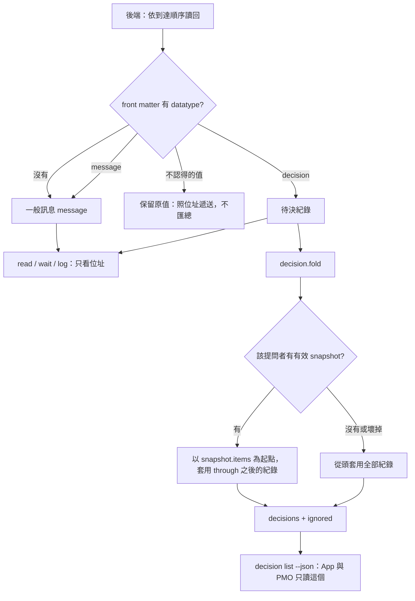
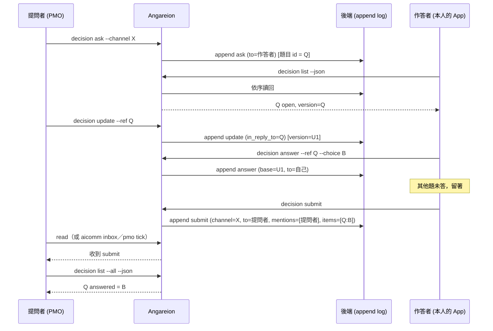
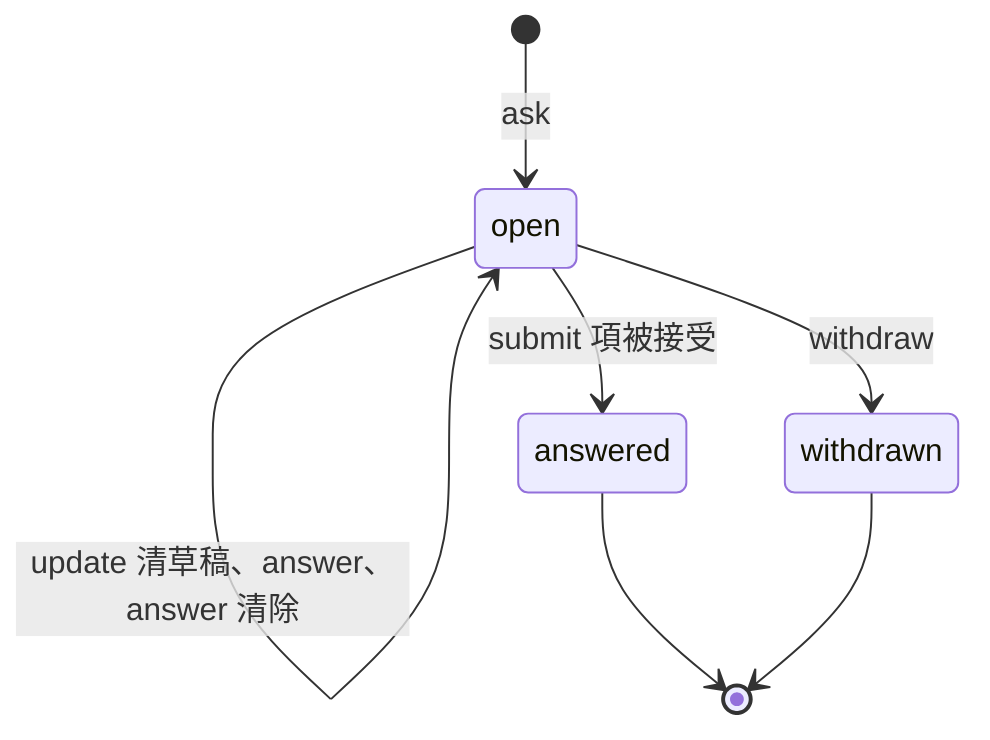

# Design: Angareion 待決（pending decision）（#468，b，作者模式）

作者：專案架構師（作者模式，親寫）。核准方式：非作者的審查者照本文 §15 的架構清單審，PMO 向本人說明，本人同意後才實作。
基準：main `0577584`。文中的 `file:line` 都以這個 commit 為準。

---

## §0 給本人看的一頁

**結論**：待決就是一則一般的 Angareion 訊息，只是 front matter 多了 `datatype: decision`，內文是固定格式的 YAML。新增、更新、撤回、作答、送出、snapshot 都是**另外 append 一則**這種訊息，已經送出的訊息永遠不改。Angareion 讀回整串訊息，照到達順序**匯總**出每一題目前的狀態。後端只需要「append 一則」和「依序讀回」兩種能力，沒有用到 GitHub 的 label、關閉、編輯、reaction。

**做法（我的建議，都已寫進本文）**

1. 格式：front matter 加一個欄位 `datatype`。一般訊息寫 `message`；舊訊息沒有這個欄位，讀的時候當成 `message`。版本號 `angareion: 1` **不升**：舊讀者遇到不是 1 的版本會整則丟掉（§2 L-2）；新增欄位則會被舊讀者略過，訊息照樣送到。
2. 指令：`angareion decision <action>`，共 7 個 action：`ask`、`update`、`withdraw`、`answer`、`submit`、`list`、`snapshot`。現有的 `send`／`read`／`wait`／`log` 就是 `message` 這個 datatype 的動作，不另外加 `angareion message …` 這種別名。
3. 待決存在**提問頻道**裡，綁定（頻道, 提問者）。每一題的 id 就是出題那則訊息的 id（ULID）。
4. 作答是草稿，也 append 進 Angareion，所以 App 或 CLI 等任何畫面看到的都是同一份。本人按「送出」時，Angareion 把**已答**的題按（頻道, 提問者）分組，每組 append 一則 `submit`，寄給提問者（`to` 與 `mentions` 都是提問者）。這一則就是「答案回到提問頻道並 mention 提問者」。未答的題留著不動。
5. 權限：在不改後端權限的前提下，靠**匯總規則**判定。只有出題者能更新或撤回；只有題目指定的作答者能作答或送出。不符的紀錄照樣留在後端（append-only），匯總時略過，並列在診斷裡。這只防誤用，不防冒名，因為 Angareion 本來就不做身分認證（spec「訊息格式」）。
6. snapshot：每個（頻道, 提問者）各自寫，只有提問者能寫。紀錄數超過門檻時自動寫，也可以手動寫。讀的時候找最新一則有效的 snapshot，從它記的 `through` 之後往下匯總。snapshot 壞掉或找不到時，退回上一則有效的 snapshot 或從頭匯總。

**要本人決定的點**（細節見 §17）

- **Q-1** 作答者身分：App 用哪一個 AI 名當 `answerer`。建議由 PMO 指定一個固定的名字。
- **Q-2** v1 規定「只有 PMO 出題」，這條限制放在哪裡。建議不放進 Angareion（通訊層不認識 PMO），改由 App 的顯示過濾和 PMO 的工作規則守。
- **Q-3** 作答可不可以只寫一段文字、不選任何選項（相當於「其他」）。建議可以：`choice` 可以不給，但那樣 `note` 必填。
- **Q-4** 送出時要不要叫醒提問者（poke）。建議 v1 不叫醒；PMO 自己會 `wait` 或 tick 收信。
- **Q-5** 寫入 `datatype: message` 的那一步，要等 MyAiEntry 確認它的讀者能略過未知欄位（§12 R-A1）才能 merge。這是對 App 的要求，要由 PMO 去問。

---

## §1 要件對照表

| # | 要件／已定事項 | 本文位置 |
|---|---|---|
| 1 | 待決綁定「頻道＋提出者」 | §4.3（`ask_channel`＋`asker`；v1 必須等於 front matter 的 `channel`＋`from`）、§6.1（匯總的鍵是（頻道, 提問者））、C-6 |
| 2 | 待決是一般訊息的特殊格式；一般訊息也有自己的格式，兩者可以區分 | §4.1、§4.2（`datatype: message`／`decision`）、C-1～C-3 |
| 3 | 寫入、刪除、更新都是 append；禁止改動已送出的訊息 | §3 P-1、§4.3（每個 op 都是一則新訊息）、§11（不用編輯或刪除）、C-4 |
| 4 | CRUD 由 Angareion 處理；後端只讀寫訊息，不依賴後端特有能力；Angareion 盡量簡單 | §5、§11 後端中立性表、§13 模組切割（後端介面不變）、C-20 |
| 5 | 用 datatype 區分；介面是 `angareion <datatype> <action>`；歷史匯總成目前狀態；太長時寫 snapshot，從 snapshot 往後匯總 | §4.1、§5、§6、§7、C-7～C-17 |
| 已定 | 目前只有 PMO 出題，格式仍保留「提問頻道＋提問者」 | §4.3（欄位保留；v1 限定相等）、Q-2 |
| 已定 | 一題一題作答，不是點了就送 | §4.3 `answer`（草稿）、§9、C-12 |
| 已定 | 按送出時，已答的一次送出、未答的留著 | §9、C-13、C-14 |
| 已定 | 答案回到提問頻道，並 mention 提問者 | §4.3 `submit`（`channel`＝提問頻道，`to`／`mentions`＝提問者）、C-13 |
| 已定 | 待決內容是選擇題：背景、內文、選項、推薦選項、理由 | §4.3 `ask` 欄位（`background`、`body`、`options`、`recommended`、`reason`） |
| 已定 | App 只讀 Angareion 的匯總，不能反過來影響 Angareion | §12 R-A2～R-A4 |

---

## §2 現況與限制（原樣引用）

- **L-1：訊息有六個欄位，再加 id 和 at。** `openspec/specs/angareion/spec.md:125`：「一則訊息 MUST 有 `from`、`to`、`channel`、`urgency`（0～9 的整數，預設 5）、`content`、`attachments`，加上寄件者產生的 `id`（ULID）與 `at`（含時區）；`id` 與 `at` 只用來辨識與顯示，MUST NOT 用來判斷新舊。」
- **L-2：版本號不是 1 的訊息，舊讀者整則丟掉。** `src/angareion/messages.py:195-198`：
  ```python
  if self.angareion != ANGAREION_VERSION:
      raise MessageValidationError(
          f"Unsupported angareion version: {self.angareion} (expected {ANGAREION_VERSION})"
      )
  ```
  非 strict 的 `parse_message` 遇到這個錯誤會回 `None`（`messages.py:433-436`），讀者就把那則跳過（`src/angareion/github.py:374-376`：`if parsed is None or not scope_matches(...): continue`）。所以**升版本號會讓所有舊讀者收不到新訊息**。
- **L-3：舊讀者會略過未知的 front matter 欄位。** `messages.py:405`：`required = {"angareion", "id", "at", "from", "channel", "urgency", "attachments"}`。只檢查這些欄位有沒有；`Message(...)` 也只取已知的鍵（`messages.py:418-430`）。多出來的鍵不會讓解析失敗。
- **L-4：log 快取只存 `message_to_dict`。** `src/angareion/log_cache.py:182`：`"message": message_to_dict(parsed),`。`message_to_dict`（`messages.py:235-248`）只輸出已知欄位，所以 front matter 的新欄位進不了舊快取，`content` 則完整保留。另外 `log_cache.py:18` 是 `LOG_CACHE_VERSION = 1`，spec 規定「版本不認得…MUST 整檔視為空並全量重建」（`spec.md:407`）。
- **L-5：收件範圍只看位址。** `src/angareion/backend.py:304-308`：
  ```python
  def recipient_matches(message: Message, recipient: str | None) -> bool:
      """Whether a message counts as "to me": addressed to me, a broadcast, or it mentions me."""
      if recipient is None:
          return True
      return message.to is None or message.to == recipient or recipient in message.mentions
  ```
  沒有 `to` 就是廣播，「寄給我的」每個人都會收到；也不會排除自己寄的。
- **L-6：判斷新舊只看後端。** `spec.md:66`：「判斷訊息新不新 MUST 只看後端（到達位置與後端記錄的時刻），MUST NOT 使用寄件者填的 `at` 或 `id`。」游標容許晚到的範圍是 `CURSOR_SEEN_MARGIN_SECONDS = 60.0`（`backend.py:19`）。
- **L-7：對外的介面現在固定只有六個。** `spec.md:224`：「Angareion 對外 MUST 只有六個介面…」。`spec.md:292-294` 的 scenario 也斷言頂層子指令「恰好是 `channel`、`send`、`wait`、`read`、`log`」。**本設計會改這條**（delta 見 §19 PR-4）。
- **L-8：後端協定。** `backend.py:247-300` 的 `ChannelBackend` 有 `create_channel`、`verify_channel`、`close_channel`、`send`、`check`、`read`；列舉（`enumerate_conditional`）回 `(到達位置, 後端時刻, 解析結果)`，並依到達位置排序（`backend.py:546-564`；spec「後端可以替換」`spec.md:205`）。
- **L-9：訊息長度有上限。** `messages.py:32`：`MAX_MESSAGE_LENGTH = 65536`。
- **L-10：送出前會讀回檢查。** `messages.py:344-359`：送出前先把訊息讀回來，任何欄位不同就拒送。新增欄位必須一起進 `message_to_dict`，否則讀回比對時會少一欄。
- **L-11：TS 側也有讀者和寫者。** `messages.py:321-322` 的註解說 TS 側的手寫解析器依賴 `mentions` 用 flow 格式（「the TS side's hand-written parser relies on it」）。TS 讀者遇到未知欄位會怎樣，本文**沒驗到**，列為對 MyAiEntry 的要求 R-A1。
- **L-12：PMO 的收信輪。** `src/pmo/round.py:66-71`：team 階段收的是「不是秘書、也不是 PMO 自己寄的」訊息（`return sender != ctx.config.pmo_identity`）。讀 JSON 用的是 `data.get(...)`，多出來的欄位不影響。

---

## §3 原則

- **P-1：一切都是 append。** Angareion 不編輯、不刪除、不關閉任何訊息，也不改後端的任何屬性。狀態完全由「依序讀回的訊息」算出來。
- **P-2：後端不認識 datatype。** 對後端來說，待決就是一則訊息。後端介面（`ChannelBackend`）一個方法都不加，也不改。
- **P-3：只有一份匯總規則，放在 Angareion。** App、PMO、`pmo` 模組都不自己匯總，只讀 `angareion decision list --json`。
- **P-4：寫入嚴格，讀取寬鬆**（沿用 `messages.py:7-13` 的規矩）。寫的時候欄位不合就拒送；讀的時候壞紀錄只略過那一則並記診斷，整份匯總不因此失敗。
- **P-5：位址規則不變。** `read`／`wait`／`aicomm inbox` 仍然只看位址，只多一條小規則：自己寫的待決紀錄不遞送給自己（C-3）。待決紀錄都有 `to`，**不是廣播**，所以不會吵到頻道裡的其他成員。
- **P-6：順序只看到達位置**（L-6）。`at` 和 ULID 不參與排序。

---

## §4 訊息格式

### 4.1 datatype 欄位

- front matter 加一個欄位 `datatype`，值的文法是 `^[a-z][a-z0-9-]{0,31}$`。v1 只有兩個值：`message` 和 `decision`。
- **寫入**：所有新寫的訊息一律寫 `datatype`。`send` 寫 `message`，`angareion decision …` 寫 `decision`。序列化時放在 `angareion` 的下一行。
- **讀取**：
  - 沒有這個欄位，讀成 `message`（舊訊息）。
  - 值不是字串，或不符文法，也讀成 `message`，跟 `mentions` 一樣「壞值丟掉、訊息保留」（`messages.py:363-380`）。
  - 值合法但不認得（例如將來的 `poll`），照原字串保留：照位址遞送，匯總不理它。
- `angareion: 1` **不升版**（理由見 L-2）。
- `message_to_dict` 加 `"datatype"` 鍵，所以 `read --json` 和 `log --json` 都會輸出它。log 快取的版本升到 2，舊快取會整檔重建（L-4）。

### 4.2 一般訊息的格式

就是現在的格式，只是明寫 `datatype: message`：

```text
---
angareion: 1
datatype: message
id: 01J…
at: '2026-11-15T03:00:00+00:00'
from: myaistorage-pm-w1
to: myaistorage-arch-w1-23
channel: team-myaistorage-w1
urgency: 5
attachments: []
---
內文
```

**怎麼區分兩種訊息**：`datatype` 是 `decision` 的才是待決，其他都是一般訊息（含沒有這個欄位的舊訊息）。只看 front matter，不必解析內文。

### 4.3 待決的格式（payload 版本 1）

待決訊息的 front matter 照一般訊息寫（`datatype: decision`）。**內文是一個 YAML mapping**，用 `yaml.safe_dump(…, allow_unicode=True, sort_keys=False)` 寫出。前兩個鍵固定是 `decision: 1`（payload 版本）和 `op`。payload 放在內文而不是 front matter，有兩個原因：

- 舊讀者和舊快取會完整保留內文（L-4）；
- TS 的手寫 front matter 解析器不必學巢狀結構（L-11）。

舊讀者看到的是可讀的 YAML 文字。

| op | `from` | front matter 的 `to`／`mentions` | `in_reply_to` | 內文的鍵（* 為必填） |
|---|---|---|---|---|
| `ask` | 提問者 | `to`＝作答者 | 無 | `decision`*、`op`*、`ask_channel`*、`asker`*、`answerer`*、`title`*、`background`*、`body`*、`options`*、`recommended`*、`reason`* |
| `update` | 提問者 | `to`＝更新後的作答者 | 題目 id | `decision`*、`op`*、`ref`*，以及 ask 的題目欄位全部重給（`answerer`*、`title`*、`background`*、`body`*、`options`*、`recommended`*、`reason`*）。不能改 `ask_channel` 和 `asker` |
| `withdraw` | 提問者 | `to`＝目前的作答者 | 題目 id | `decision`*、`op`*、`ref`*、`reason` |
| `answer` | 作答者 | `to`＝作答者自己 | 題目 id | `decision`*、`op`*、`ref`*、`base`*、`choice`、`note`、`clear` |
| `submit` | 作答者 | `to`＝提問者、`mentions: [提問者]` | 無 | `decision`*、`op`*、`asker`*、`items`*（每一項：`ref`*、`base`*、`title`*、`choice`、`note`） |
| `snapshot` | 提問者 | `to`＝提問者自己 | 無 | `decision`*、`op`*、`asker`*、`through`*、`items`*（每一項是一題 open 題目的完整狀態，見 §7.2） |

欄位規則（寫入時嚴格檢查，任何一條不符就 exit 1、什麼都不送）：

- **題目 id**：等於出題那則 `ask` 訊息的 `id`。`ref` 必須是 26 字的 ULID。
- **`ask_channel`、`asker`（綁定）**：v1 必須等於這則紀錄的 front matter `channel` 和 `from`。這兩個欄位**保留在格式裡**，將來放寬（例如由 PMO 代別人出題）時不必改格式，只要放寬這條等式（Q-6）。
- **`answerer`**：一個合法的 AI 名（當前文法）。
- **`title`**：單行，1～120 字。`background`、`body`、`reason` 是字串，`body` 不得為空。
- **`options`**：2～9 個 `{key, text}`。`key` 符合 `^[A-Z]$`，不得重複；`text` 不得為空。`recommended` 必須是其中一個 `key`。
- **`base`**：作答時看到的那一版的 id。`ask` 本身算第一版，之後每個被接受的 `update` 是新的一版，版本 id 就是那則紀錄的 `id`。
- **`answer`**：恰好是下面三種之一：
  - 給 `choice`（`options` 裡的某個 `key`），`note` 可有可無；
  - 給 `clear: true`（清掉草稿），不得同時有 `choice` 或 `note`；
  - 只給 `note`、不給 `choice`，僅限 Q-3 採「可以」時。
- **`submit.items[].title`**：只是抄一份給人看，匯總時不當依據。
- **整則長度**：不得超過 `MAX_MESSAGE_LENGTH`（L-9）。
- **讀取時**：不認得的 `decision` 版本，整則紀錄略過，診斷 `unsupported_version`；payload 裡多出來的鍵略過不理。

範例（`ask` 的內文）：

```yaml
decision: 1
op: ask
ask_channel: <提問頻道>
asker: <提問者的 AI 名>
answerer: <Q-1 決定的 AI 名>
title: 要不要先合 PR-1
background: …
body: …
options:
- key: A
  text: 先合
- key: B
  text: 等 App 確認
recommended: B
reason: …
```

---

## §5 指令：`angareion decision <action>`

這是新的第七個介面家族（L-7 要改）。旗標與輸出照現有的寫法，不出現後端的概念（spec「六個介面」第二段）。

| action | 用法 | stdout | 為什麼需要（能不加就不加） |
|---|---|---|---|
| `ask` | `--channel <ch> (--body <YAML> \| --body -)` | 新題目的 id | 新增。少了它就沒有待決 |
| `update` | `--channel <ch> --ref <ULID> (--body <YAML> \| --body -)` | 這則紀錄的 id | 本人要求「放太久的要能更新」。不能拿「撤回＋重出」代替：那樣題目 id 會變，已有的草稿和討論串都會斷 |
| `withdraw` | `--channel <ch> --ref <ULID> [--reason <文字>]` | 這則紀錄的 id | 刪除。append-only 的世界裡，刪除就是一則撤回紀錄 |
| `answer` | `--channel <ch> --ref <ULID> (--choice <鍵> [--note <文字>] \| --clear)` | 這則紀錄的 id | 一題一題作答（本人要求「不是點了就送」）。`--clear` 讓已答的題可以退回成未答，不另外開一個 action |
| `submit` | `[--channel <ch>]…` | 每個 submit 紀錄的 id，一行一個；沒有可送的就不印 | 本人要求「一次送出」 |
| `list` | `[--channel <ch>]… [--all] [--json]` | 匯總結果 | App 和 PMO 只讀這個（P-3）。不給 `--all` 只列 open 的題 |
| `snapshot` | `--channel <ch>` | snapshot 紀錄的 id；沒有可涵蓋的就不印 | 手動壓縮，也方便測試。自動觸發見 §7 |

**不加的動作**：

- `show`：查一題的歷史，用 `angareion log --thread <題目 id>`，因為 `update`／`withdraw`／`answer` 的 `in_reply_to` 都是題目 id。
- `reopen`：已答或已撤回的題，要再問就重出一題。
- `angareion message <action>` 別名：現有的頂層指令就是 `message` 的動作。

**共通規則**：

- `ask`／`update` 的 `--body` 給的是題目欄位的 YAML mapping（§4.3 那一列除了 `decision`、`op`、`ask_channel`、`asker`、`ref` 之外的鍵）。那幾個鍵由 Angareion 填；body 裡出現它們，或出現未知的鍵，都 exit 1。沒給 `--body` 也 exit 1（同 `send`，`spec.md:125`）。
- **寫入前的預檢**：寫入的 action 會先照 `log` 的方式同步該頻道的 log 快取（`spec.md:399-402`），用目前的匯總檢查前置條件，不符就 exit 1、什麼都不送。前置條件包括：題目不存在、已經結束、不是出題者、不是作答者、沒有草稿可以清。預檢只是提早擋下；**最終的判定是匯總**（§6），因為兩個寫入者之間有競態。
- `answer` 的 `base` 由 Angareion 填入預檢時看到的目前版本 id。`submit` 的每一項，也用預檢時匯總裡的草稿填。
- **結束碼**同 `spec.md:171`：0 成功；1 用法、輸入或前置條件錯；2 後端、網路或設定錯。`submit` 的部分失敗：已經寫出的 id 照印，exit 2；重跑是安全的，因為已送出的題已經結束，不會再送一次（C-14）。
- 寫入和讀取都**不讀、不動游標**，跟 `log` 一樣（`spec.md:301`）。
- 身分照 `send`：`from` 是解析出的身分（`src/angareion/cli.py:335`）。

`list --json` 的形狀（App 的契約）：

```json
{
  "decisions": [
    {"id": "<題目 id>", "channel": "…", "asker": "…", "answerer": "…",
     "status": "open|answered|withdrawn", "version": "<版本 id>", "revisions": 1,
     "title": "…", "background": "…", "body": "…",
     "options": [{"key": "A", "text": "…"}], "recommended": "A", "reason": "…",
     "asked_at": "<後端時刻>", "updated_at": "<後端時刻>",
     "draft": {"record": "<id>", "base": "<id>", "choice": "A", "note": "…"},
     "answer": {"record": "<submit id>", "choice": "A", "note": "…", "submitted_at": "<後端時刻>"},
     "withdrawn": {"record": "<id>", "reason": "…"}}
  ],
  "ignored": [{"record": "<訊息 id>", "channel": "…", "code": "not_owner"}]
}
```

- `draft`、`answer`、`withdrawn` 沒有值時是 `null`。
- 排序：`(asked_at, channel, id)`，由舊到新，跟 `log` 跨頻道的排序鍵同一套（`spec.md:312`）。
- 文字模式：每題一塊，含狀態、題目、選項、推薦、草稿。`ignored` 只在 stderr 印一行總數。

---

## §6 匯總規則

### 6.1 輸入、順序與鍵

- **輸入**：一個頻道裡，所有 `datatype: decision` 的訊息，照**到達位置**排序（log 快取已經是這個順序，`log_cache.py:197`）。`at` 和 ULID 不參與排序（L-6，P-6）。
- **鍵**：每一題以題目 id 識別，歸屬於（`ask_channel`, `asker`）。v1 的 `ask_channel` 一定是紀錄所在的頻道，所以各頻道分開匯總。
- 匯總是**純函式**：`fold(依到達順序排好的紀錄) → (題目狀態, 診斷)`。每次都用整個快照重算，不做增量累加；同一組輸入一定得到同一個結果。

### 6.2 每一題的狀態

狀態轉移見 §14 圖 3。

| 收到的紀錄（依到達順序處理） | 接受條件 | 效果 | 不接受時的診斷碼 |
|---|---|---|---|
| `ask` | payload 合法；`ask_channel`＝`channel`；`asker`＝`from`；題目 id 沒出現過 | 新增 open 題目；版本＝這則的 id | `bad_payload`／`binding_mismatch`／`duplicate_id` |
| `update` | 題目存在而且是 open；`from`＝出題者 | 換掉題目欄位；版本＝這則的 id；**清掉草稿** | `unknown_ref`／`closed_ref`／`not_owner` |
| `withdraw` | 同上 | 狀態變 withdrawn（結束） | 同上 |
| `answer` | 題目是 open；`from`＝目前的作答者；`base`＝目前的版本 | 設定草稿，後到的蓋掉先到的；`clear` 把草稿設成無 | `unknown_ref`／`closed_ref`／`not_answerer`／`stale_base` |
| `submit` | **逐項判**：題目是 open；`from`＝那題的作答者；`asker`＝那題的提問者；`base`＝目前的版本。整則還要求 front matter 的 `to`＝`asker`，而且 `mentions` 含 `asker`，否則整則都不接受 | 被接受的那幾項：狀態變 answered（結束），答案取 submit 項裡的值（不是取草稿） | 整則：`bad_payload`；逐項：`unknown_ref`／`closed_ref`／`not_answerer`／`stale_base` |
| `snapshot` | 見 §7.3 | 決定該提問者從哪裡開始匯總 | `bad_snapshot` |

### 6.3 邊界情況

- **同一題多次更新**：依到達順序逐一套用，最後一則被接受的就是目前版本。`revisions` 是被接受的 ask 加 update 的數目。
- **同一秒**：到達位置是全序，同一秒也分得出先後。不看 `at`。
- **兩則互相競爭**（例如 `update` 和 `submit`、`withdraw` 和 `submit`、兩個畫面同時 `submit`）：先到達的勝。後到的照上表，判為 `stale_base`／`closed_ref`，題目狀態不會被它改掉。重複的 submit 不會產生第二個答案（C-11）。
- **亂序晚到**（到達位置比較小的紀錄晚一點才出現在列表裡）：因為每次都重算（6.1），它會被放回正確的位置。結果可能和前一次匯總不同，但一定等於「完整歷史的匯總」。唯一的例外是 snapshot 之前的晚到紀錄，見 §7.4。
- **缺漏**：後端少給了某一則，Angareion 無從得知。引用不存在題目的紀錄判 `unknown_ref` 並略過；之後那一則出現了，重算就會修正。
- **後端上的內容被人改過**：Angareion 自己永遠不改（P-1）。若有人繞過 Angareion 在後端改了某則留言，log 快取會用新內容覆蓋（`spec.md:402`），匯總就照新內容算。這是**已知限制**，跟 log 的已知限制同類（`spec.md:410`），寫進 skill 說明。
- **不是 decision 的訊息**（一般訊息、不認得的 datatype）不參與匯總。

---

## §7 snapshot

### 7.1 誰寫、什麼時候寫

- 每個（頻道, 提問者）各自有 snapshot，**只能由那位提問者寫**（`from`＝`asker`）。這樣跟「只有出題者能改題目」是同一條權限線。
- **自動觸發**：出題者的 `ask`／`update`／`withdraw` 寫成功之後，若該（頻道, 提問者）在目前有效 snapshot 的 `through` 之後的相關紀錄已經 ≥ `SNAPSHOT_EVERY`（200 則），就再寫一則 snapshot。
  - 「相關紀錄」指：該提問者的 ask，以及 ref 指向該提問者題目的 update、withdraw、answer、submit 項。
  - 自動寫失敗只在 stderr 警告一次，結束碼和 stdout 不變（原本那筆寫入已經成功）。
- **手動**：`angareion decision snapshot --channel <ch>`，不看門檻。

### 7.2 格式

```yaml
decision: 1
op: snapshot
asker: <提問者>
through: <最後一則被涵蓋的紀錄 id>
items:
- id: <題目 id>
  version: <版本 id>
  revisions: 2
  answerer: …
  title: …
  background: …
  body: …
  options: [...]
  recommended: A
  reason: …
  asked_at: <後端時刻>
  updated_at: <後端時刻>
  draft: {record: <id>, base: <id>, choice: A, note: …}   # 沒有就寫 null
```

- `items` 只放 **open** 的題目。已結束的題目不放：之後若還有紀錄引用它們，結果是 `unknown_ref`，效果和 `closed_ref` 一樣都是略過，只是診斷碼不同（已知差異，寫進說明）。代價是 `list --all` 看不到 snapshot 之前就已結束的題目；要查就用 `log`。
- snapshot 本身也是一則 append 的 decision 訊息，同樣受 64 KB 上限限制。超過就不寫：手動觸發時 exit 1；自動觸發時 stderr 警告，匯總照舊從上一則有效 snapshot 算起。

### 7.3 讀者怎麼找到最新的 snapshot

- 讀者手上本來就有頻道的完整鏡像（log 快取）。匯總時，從尾端往前找該提問者**最新一則有效的** snapshot。有效的條件：
  - payload 合法；
  - `from`＝`asker`；
  - `through` 指向的紀錄在列表裡，而且排在這則 snapshot **之前**。
- 不必去後端額外找「最新 snapshot 的指標」。因為只能 append，也不能有可改動的指標。
- 最新那則無效時，判 `bad_snapshot`，改用前一則有效的；全部無效或根本沒有，就從頭匯總。
- 使用方式：該提問者的題目狀態以 snapshot 的 `items` 為起點，再依到達順序套用 `through` **之後**的所有相關紀錄。`through` 之前的相關紀錄一概不看（「不無限往前追溯」）。
- 有效的定義只看列表裡有什麼，所以任何讀者算出來都一樣。

### 7.4 涵蓋範圍與晚到的紀錄

- `through` 只能選到達時刻 ≤ cutoff 的紀錄，cutoff＝「列表中最新一則訊息的後端時刻 − 60 秒」。60 秒沿用游標的 margin（L-6）。
- 這跟游標用的是同一個假設：「一則訊息在它的後端時刻之後 60 秒內，就會出現在列表裡」。在這個假設下，snapshot 之前不會再冒出新紀錄，所以「從 snapshot 往後匯總」等於「完整匯總」（C-16）。
- 後端若給不出後端時刻（將來別種後端），就不寫 snapshot，一律完整匯總（§11）。

### 7.5 誠實說明 snapshot 省下了什麼

在「只能依序讀回」的限制下，全新的讀者第一次還是要把整串讀一遍（log 快取的全量同步），snapshot 省不掉這一步。它省的是：

1. 匯總時不必從頭走過所有歷史；
2. 很久以前的壞紀錄不再影響目前的狀態；
3. 將來 log 快取若要修剪 snapshot 以前的紀錄，有一個安全的界線（不在本單範圍）。

---

## §8 相容矩陣

讀者：

- 「舊 py」＝main `0577584` 的 `angareion`；
- 「新 py」＝本設計完成後的版本；
- 「TS」＝MyAiEntry 的讀者，現況沒驗到。

| 訊息 \ 讀者 | 舊 py `read`／`wait` | 舊 py `log`（快取 v1） | 新 py `read`／`wait` | 新 py `log` | 新 py `decision list` | TS 讀者 |
|---|---|---|---|---|---|---|
| 舊訊息（沒有 `datatype`） | 照舊 | 照舊 | 照舊；`datatype` 讀成 `message` | 同左；JSON 多一個 `datatype: "message"` | 不參與 | 照舊 |
| 新一般訊息（`datatype: message`） | 照舊（略過未知欄位，L-3） | 照舊（欄位不進快取，L-4） | 照舊 | 照舊 | 不參與 | **要求 R-A1**：必須略過未知欄位；否則這類訊息會不見，所以 PR-2 要等它確認 |
| `ask`／`update`／`withdraw`（`to`＝作答者） | 作答者收到一則內文是 YAML 的訊息；其他人收不到（不是廣播） | 看得到，顯示成一般訊息 | 作答者收到（`wait` 會醒） | 看得到，標 `decision` | 匯總 | R-A1；App 改用 `decision list` |
| `answer`（`to`＝作答者自己） | 作答者自己的 `read` 會收到自己的草稿（雜訊、無害） | 看得到 | **不遞送給自己**（C-3） | 看得到 | 匯總 | 同上 |
| `submit`（`to`／`mentions`＝提問者） | 提問者收到（內文是 YAML，可讀） | 看得到 | 提問者收到；`--mentioned` 也收到 | 看得到 | 匯總 | 同上 |
| `snapshot`（`to`＝提問者自己） | 提問者自己的 `read` 會收到（雜訊，200 則才一次） | 看得到 | 不遞送給自己（C-3） | 看得到 | 匯總 | 同上 |
| `datatype` 是不認得的值 | 照舊 | 照舊 | 照位址遞送 | 照舊，標原值 | 不參與 | R-A1 |

其他讀者：

- **游標**：游標的格式和推進規則都不變。`decision` 的所有 action 不讀也不動游標（C-18）。`read`／`wait` 多的那條規則（自己寫的待決不遞送給自己）只影響「寄給我的」和「@ 我」兩種目標；`--channel` 仍然讀到全部（`spec.md:66`）。
- **`aicomm`**：`aicomm send` 呼叫 `angareion send`，所以寫的是 `datatype: message`。`aicomm inbox` 和 `aicomm log` 是薄包裝，照轉 JSON，不受影響（`src/aicomm/cli.py:682` 只判斷結果是不是空陣列）。待決紀錄由 `angareion decision` 寫，**不經過 aicomm，所以不會叫醒任何人**（Q-4）。
- **`pmo` 模組**：PMO 是提問者，它收到的 `submit` 會在 team 階段印成 `[msg]`（`src/pmo/round.py:66-71`），有去處（D-18）。它自己寫的 snapshot 在新 py 不會遞送給自己；舊 py 會遞送，但 team 階段會把它濾掉（`sender != pmo_identity`）。
- **舊版寫者**：還沒升級的 py 或 TS 寫者寫出沒有 `datatype` 的訊息，新讀者讀成 `message`，不受影響。舊版寫者寫不出 decision。

---

## §9 作答與送出

1. 作答者對每一題執行 `answer`，append 一則草稿（`to` 是自己，不叫醒任何人）。改答案就再 append 一則，後到的蓋掉先到的；退回成未答用 `--clear`。
2. 按「送出」等於執行 `submit`：
   - 用目前的匯總，取出「作答者是我、狀態 open、有草稿、草稿的 `base` 等於目前版本」的題目；
   - 按（`ask_channel`, `asker`）分組，每組在 `ask_channel` append **一則** `submit`。這一則的 `to` 和 `mentions` 都是提問者，`items` 是那一組已答的題目；
   - 這一則就是「答案回到提問頻道並 mention 提問者」；
   - 未答的題不在任何 `items` 裡，維持 open。
3. 提問者用平常的 `read`、`aicomm inbox` 或 `pmo tick` 收到 `submit`。要確認哪幾項真的被接受（有沒有因為競態判成 `stale_base`），一律以 `decision list --all` 為準（R-P2）。
4. 一次送出寫成好幾則（每組一則），**不是原子操作**。但每一則各自完整，而且重跑不會重送（已經被接受的題已經結束），所以不需要兩階段提交。

---

## §10 權限

| 動作 | 誰可以 | 靠什麼 |
|---|---|---|
| 出題 | 任何身分（v1 的「只有 PMO 出題」不放在 Angareion，見 Q-2） | — |
| 更新、撤回 | 只有出題者（`from`＝那題 ask 的 `from`） | 匯總規則（§6.2）＋CLI 預檢 |
| 作答、送出 | 只有那題**目前的** `answerer` | 同上 |
| snapshot | 只有該提問者 | §7.1、§7.3 |

- **不靠後端權限**：不用 issue 的鎖定、指派、label 等任何功能。
- **不防冒名**：spec 明寫「不做嚴格的身分認證（任何人可以用任何名字送）」（`spec.md:125`）。這裡的權限擋的是**誤用**，例如別的 AI 在頻道看到題目、自作主張去作答。題目指定 `answerer`，就是為了擋這種事。
- 不接受的紀錄**留在後端**，因為不能刪也不能改。`list --json` 的 `ignored` 列出它們，留給人追查。

---

## §11 後端中立性

只准用兩種能力：「append 一則」和「依序讀回」。下表逐項列出本設計對後端的使用：

| 使用的能力 | 用在哪 | 是否 GitHub 特有 | 現有協定是否已有 |
|---|---|---|---|
| append 一則訊息到頻道 | 所有寫入的 action | 否 | 是（`ChannelBackend.send`，`backend.py:262`） |
| 依到達順序讀回頻道的全部訊息，附到達位置 | 匯總、預檢、找 snapshot | 否（任何 append log 都有順序） | 是（列舉，`backend.py:546-564`；log 快取） |
| 每則訊息的後端時刻 | 只用在 snapshot 的 cutoff（§7.4）。後端給不出時就不寫 snapshot，功能不受影響 | 否 | 是（游標已經在用，`spec.md:66`） |

**沒有用到**：label、關閉或重開實體、編輯留言、刪除留言、reaction、指派、鎖定、issue 標題或內文、搜尋 API、留言 URL、任何 webhook。

`ChannelBackend` 協定不加也不改任何方法（C-20）。

---

## §12 接法：對 MyAiEntry 與 MyPMO 的要求

只寫對它們的要求，不描述它們的現況。

**MyAiEntry（App，作答的畫面之一）**

- **R-A1**：讀者必須能略過 front matter 裡未知的鍵（至少要能略過 `datatype`），而且把沒有 `datatype` 的訊息當成一般訊息。**PR-2 要等這條確認才能 merge**（Q-5）。
- **R-A2**：待決的清單和狀態只來自 `angareion decision list --json`（或將來由 Angareion 提供的同一份匯總）。App 不自己匯總，也不對待決訊息做任何後端操作。
- **R-A3**：作答和送出只透過 `angareion decision answer` 和 `submit`。App 的 TS 寫者不得寫出 `datatype: decision` 的訊息，也不得編輯或刪除任何訊息。
- **R-A4**：App 自己的介面狀態（例如目前選的是哪一題、還沒按下的選擇）只留在 App 裡，不寫進 Angareion，也不改變 Angareion 的行為。只有按下「作答」才 append。
- **R-A5**：App 用一個固定的 AI 名當作答者（Q-1），並可以照 Q-2 的決定，只顯示允許的提問者出的題。
- 「與 App 草稿對照」：見 §20（留位置）。

**MyPMO（出題端，現在唯一的提問者）**

- **R-P1**：出題、更新、撤回只用 `angareion decision ask`／`update`／`withdraw`；`answerer` 填 Q-1 定的名字。
- **R-P2**：收到 `submit` 之後，以 `angareion decision list --all --json` 確認哪幾項被接受，再照答案行動；不要只依 `submit` 的原文行動，因為可能有 `stale_base`。
- **R-P3**：放太久的題目自己用 `update` 或 `withdraw` 整理；Angareion 不會自動過期。

**本 repo 的 `pmo` 模組**：現狀已經能收到 `submit`（§8）。要不要給它一個專用的事件標籤（例如 `[待決已答]`）列為 Q-7，不在本單必做的範圍。

---

## §13 模組切割、介面、依賴方向、SOLID

### 13.1 模組

| 模組 | 職責 | 不做什麼 |
|---|---|---|
| `angareion/messages.py`（改） | `Message` 加 `datatype` 欄位（預設 `message`）；寫入時嚴格、讀取時寬鬆；`message_to_dict` 加這個鍵 | 不解析 decision 的 payload |
| `angareion/decision.py`（新） | 純函式：payload 的結構與驗證（寫入嚴格、讀取寬鬆）；`fold(records) -> FoldResult`；`snapshot_payload(...)`；`pick_snapshot(...)`；`submit_groups(...)` | 不碰後端、不碰快取、不碰 CLI、不碰時鐘 |
| `angareion/decision_cli.py`（新） | `angareion decision <action>` 的處理函式：同步 log 快取 → 匯總 → 預檢 → 組 `Message` → `backend.send` | 不實作匯總規則 |
| `angareion/cli.py`（改） | 註冊 `decision` 子指令並轉交；`_format_message` 在 `datatype` 不是 `message` 時多印一行 `datatype: …` | 不含待決的邏輯 |
| `angareion/backend.py`（改） | `recipient_matches`／`mention_matches` 加一條：`datatype == "decision"` 而且 `from` 是讀者自己時不算 | 協定的方法不變 |
| `angareion/log_cache.py`（改） | `LOG_CACHE_VERSION` 升到 2；還原 `Message` 時帶 `datatype` | — |

### 13.2 依賴方向（不得有環）

```text
cli → decision_cli → {decision, log_cache, backend, messages}
decision → messages        （只用 Message 型別與 AI 名、ULID 的驗證）
log_cache → {backend, messages}（不變）
backend → messages          （不變）
```

`decision` 不 import `backend`、`log_cache`、`cli`；`decision_cli` 不被 `decision` import。`aicomm` 和 `pmo` 仍然只透過子行程呼叫 `angareion`，不 import 它（不變）。

### 13.3 公開介面（Python）

```python
# decision.py
PAYLOAD_VERSION = 1
SNAPSHOT_EVERY = 200
OPS = ("ask", "update", "withdraw", "answer", "submit", "snapshot")

@dataclass(frozen=True)
class Record:            # 一則 decision 訊息加上它的位置資訊
    message: Message
    received_at: str | None   # 後端時刻；後端給不出時為 None

@dataclass
class FoldResult:
    decisions: list[dict]     # §5 list --json 的 decisions 元素
    ignored: list[dict]       # {"record", "channel", "code"}

def parse_payload(message: Message) -> dict            # 寬鬆讀；不合法時丟 PayloadError（帶診斷碼）
def build_payload(op: str, **fields) -> str           # 嚴格寫；回傳內文 YAML；不合法時丟 MessageValidationError
def fold(records: Sequence[Record]) -> FoldResult     # records 依到達順序排好；純函式
def snapshot_for(records, asker) -> str | None         # 要寫的 snapshot 內文；沒有可涵蓋的或後端給不出時刻時回 None
def submit_groups(result: FoldResult, answerer) -> list[tuple[str, str, list[dict]]]  # (channel, asker, items)
```

### 13.4 SOLID

- **S**：每個模組只有一個改變的理由。格式和匯總規則在 `decision.py`；I/O 和預檢在 `decision_cli.py`；位址遞送在 `backend.py`。符合。
- **O**：將來要加新的 datatype，只要新增 `<datatype>.py` 和 `<datatype>_cli.py`，`messages.py` 不必再改（它已經會保留不認得的 datatype）。符合。
- **L**：`Message` 加了一個有預設值的欄位，現有的建構呼叫照樣成立；`FakeBackend` 和 GitHub 後端的列舉行為一致（`spec.md:219-222`）。符合。
- **I**：後端協定沒有因為待決而變寬；`decision.py` 只拿到排好序的 `Record`，不知道快取的存在。符合。
- **D**：`decision_cli` 依賴的是 `ChannelBackend` 協定和 `LogCache`，不依賴 GitHub 的實作。符合。
- **不符合之處**：`backend.recipient_matches` 認得 `datatype == "decision"` 這個字，等於遞送層知道了一個特定的 datatype。理由：這是整個設計裡唯一一條「依 datatype 決定遞送」的規則，改成一般化的設定（例如「哪些 datatype 不遞送給自己」）要多一層註冊機制，比現在複雜。將來第二個 datatype 也要同樣的規則時，再抽成 `datatype` 的屬性表。

---

## §14 圖（mermaid；語法未機器驗證）

圖 1：訊息種類與匯總流程



圖 2：一次「出題 → 更新 → 作答 → 送出」



圖 3：一題的狀態



---

## §15 架構清單：C-編號契約

每條都寫成「輸入 → 輸出或錯誤」，並註明在哪一層測。測試層的說明：

- **單元**＝`decision.py`、`messages.py` 的純函式；
- **CLI**＝用 `FakeBackend` 跑 `angareion` 的 main；
- 都照 `tests/conftest.py` 的隔離規矩。

| C | 契約 | 測試層 |
|---|---|---|
| C-1 | 文字沒有 `datatype` 的訊息 → `parse_message` 得到 `datatype == "message"`；`message_to_dict` 有 `"datatype": "message"` | 單元 |
| C-2 | `datatype` 值是 `5`、`Decision`、`a b`、長度 33 → 讀成 `message`，訊息照樣讀到；`datatype: poll` → 讀成 `"poll"` | 單元 |
| C-3 | `recipient_matches`／`mention_matches`：`datatype=decision` 而且 `from`＝讀者 → False；`datatype=message` 而且 `from`＝讀者、`to`＝讀者 → True（一般訊息行為不變）；`decision` 而且 `to`＝讀者、`from` 是別人 → True | 單元＋CLI（`read` 不給 `--channel`） |
| C-4 | 任何 `angareion decision` 寫入的 action 跑完之後，FakeBackend 只多了 N 則新留言（`submit` 是 N＝組數，其他是 1），既有的留言內容和數目都不變；FakeBackend 不提供編輯和刪除，測試斷言 `close_channel` 沒被呼叫 | CLI |
| C-5 | `send` 寫出的文字，第二行是 `datatype: message`；讀回比對包含 `datatype`（L-10） | 單元 |
| C-6 | `ask` 時 body 裡出現 `ask_channel`、`asker`、`op`、`decision`、`ref` 或未知的鍵 → exit 1，什麼都沒送。payload 是手工組的、`asker`≠`from`（直接 deliver 到 FakeBackend）→ 匯總判 `binding_mismatch`，不出現在 decisions | CLI＋單元 |
| C-7 | `ask` 的欄位違規（`options` 只有 1 個或有 10 個、`key` 重複、`recommended` 不在 `options` 裡、`title` 多行或 121 字、`body` 是空的、`answerer` 不是 AI 名、整則超過 64 KB）→ exit 1，什麼都沒送；合法 → stdout 印題目 id，等於那則訊息的 `id` | CLI |
| C-8 | 紀錄依到達位置是 ask(Q)、update₁、update₂ → `version`＝update₂ 的 id、`revisions`＝3、題目欄位等於 update₂ 的；**同一組紀錄把 `at` 倒過來、ULID 倒過來**，結果相同 | 單元 |
| C-9 | update 或 withdraw 的 `from` 不是出題者 → 預檢 exit 1；直接 deliver 進後端 → 匯總判 `not_owner`，題目不變 | CLI＋單元 |
| C-10 | 有 answer(base=V1)，之後 update(V2) → 草稿變成 `null`；之後 answer(base=V1) → `stale_base`；answer(base=V2) → 接受 | 單元 |
| C-11 | 同一題兩則 submit 都合法（模擬兩個畫面）→ 只有到達位置在前的那則被接受，答案取它的；後一則判 `closed_ref`；withdraw 先到、submit 後到 → withdrawn，submit 項判 `closed_ref`；submit 先到、withdraw 後到 → answered，withdraw 判 `closed_ref` | 單元 |
| C-12 | `answer --choice Z`（不在 `options` 裡）→ exit 1；`answer` 的身分不是目前的 `answerer` → exit 1；`answer --clear`，但沒有草稿 → exit 1；`--choice` 和 `--clear` 一起給 → exit 1 | CLI |
| C-13 | 兩個頻道 X、Y：X 有 Q1、Q2（都已答），Y 有 Q3（已答），X 另有 Q4（未答）→ `submit` 寫出 2 則：X 一則（`items`＝Q1、Q2，`to`＝`mentions[0]`＝提問者，`channel`＝X）、Y 一則；Q4 仍是 open；stdout 有兩行 id | CLI |
| C-14 | FakeBackend 在寫第 2 則 submit 時注入錯誤 → exit 2，stdout 有第 1 則的 id；重跑 `submit` → 只寫出第 2 組，第 1 組的題目不重送；沒有可送的時候 → exit 0、stdout 空、stderr 有說明 | CLI |
| C-15 | 匯總：壞掉的 YAML、`decision: 2`、未知的 `op` → 各自進 `ignored`（`bad_payload`／`unsupported_version`／`bad_payload`），其他紀錄照常匯總，結束碼 0 | 單元＋CLI（`list`） |
| C-16 | 性質測試：隨機產生一串合法和不合法的紀錄（後端時刻遞增），中間插一則用 `snapshot_for` 產生的 snapshot → `fold(全部)` 的 `decisions` 等於「只用 snapshot 和它的 `through` 之後」算出來的；snapshot 之前的紀錄確實沒有被讀（用計數斷言） | 單元 |
| C-17 | snapshot 無效的情況：`through` 指不到、`through` 排在 snapshot 之後、`from`≠`asker`、YAML 壞掉 → `bad_snapshot`，改用前一則有效的；全部無效 → 結果等於從頭匯總。有效的 snapshot 遇到 `through` 之前有晚到的紀錄 → 那則紀錄不影響結果（已知限制，寫成測試釘住） | 單元 |
| C-18 | 每一個 `decision` action（含寫入）跑完之後，游標檔逐位元相同；`wait` 的 ETag 狀態檔不被讀寫 | CLI |
| C-19 | 自動 snapshot：`SNAPSHOT_EVERY` 用 monkeypatch 設成 3，出題者連寫 4 則相關紀錄之後再一次 `ask` → 多寫一則 snapshot（只涵蓋 cutoff 以前的）；snapshot 超過 64 KB → stderr 警告、`ask` 仍然 exit 0；手動 `snapshot`，但沒有可涵蓋的 → exit 0、stdout 空；手動 `snapshot` 超過 64 KB → exit 1 | CLI |
| C-20 | `ChannelBackend` 協定的方法集合和 main `0577584` 相同（用 `inspect` 斷言方法名）；`decision.py` 不 import `backend`、`log_cache`、`cli`、`github`（import 圖測試） | 單元 |
| C-21 | `log` 快取檔的 `version: 1` → 整檔重建；重建後 `log --json` 每則都有 `datatype` | CLI |
| C-22 | `angareion --help` 的頂層子指令恰好是 `channel`、`send`、`wait`、`read`、`log`、`decision`；`angareion decision --help` 恰好是 7 個 action；`decision` 的旗標、stdout、stderr 都沒有 repo、issue、comment 這些字 | CLI |
| C-23 | `list` 的預設只列 open；`--all` 包含 answered 和 withdrawn；`--json` 的鍵恰好是 §5 列的；排序是 `(asked_at, channel, id)`；`--channel` 指定未登記的頻道 → exit 1；同步失敗 → exit 2，stdout 空（同 `spec.md:404`） | CLI |
| C-24 | 舊讀者相容：把新寫出的一般訊息文字（含 `datatype: message`）交給「只認得舊欄位」的解析（以 main `0577584` 的 `parse_message` 釘成測試資料）→ 解析成功，欄位和預期相同 | 單元 |

---

## §16 被否決的方案

- **把版本號升成 `angareion: 2`**：所有舊讀者會整則丟掉新訊息（L-2），連一般訊息也收不到。否決。
- **payload 放在 front matter**：舊快取只存已知欄位，待決的資料會在舊 `log` 裡消失（L-4）；TS 的手寫解析器也得學巢狀 YAML（L-11）。否決。
- **用後端的功能表達狀態**（label 標狀態、關 issue 表示撤回、編輯留言表示更新、reaction 表示作答）：違反要件 3 和 4。否決。
- **待決另外開一個專用頻道**：待決就不是「綁定提問頻道」了，答案還要另外轉回提問頻道，多一次搬運，也多一個失敗點。否決（將來真的要集中，用 `ask_channel` 放寬，Q-6）。
- **草稿只存在 App 裡**：換個畫面或裝置，草稿就看不到；而且作答變成 App 的機制，CLI 無法參與。否決，草稿 append 進 Angareion（不叫醒任何人）。
- **submit 拆成「decision 紀錄＋一則一般訊息」兩次寫入**：兩次寫入不是原子的，中間失敗就要對帳。改成 submit 本身就是寄給提問者的那一則。否決。
- **新的 `read`／`wait` 完全不遞送 decision**：那 submit 就到不了提問者，還得另外寫一則一般訊息。否決，改成只靠位址（P-5），加 C-3 那一條小規則。
- **update 只帶改動的欄位（patch）**：合併規則複雜，同時兩個 patch 的結果難以說清楚。否決，一律整份替換。
- **後端放一個「最新 snapshot」的指標**：那是可以改動的狀態，違反 append-only。否決（§7.3）。
- **有人讀的時候自動寫 snapshot**：讀取引起寫入，多個讀者會同時寫出重複的 snapshot，而且權限也不清楚。否決，只在出題者寫入時觸發（§7.1）。

---

## §17 未決項

| Q | 問題 | 選項 | 建議 | 誰決定 |
|---|---|---|---|---|
| Q-1 | App 用哪一個 AI 名當 `answerer` | a. PMO 指定一個固定的名字；b. 每個裝置一個名字 | a。b 會讓「作答者是誰」變成好幾個，submit 的權限判斷要改成集合 | PMO 提案，本人同意 |
| Q-2 | 「只有 PMO 出題」守在哪 | a. App 只顯示允許的提問者出的題（設定在 App）；b. Angareion 加一份提問者白名單 | a。通訊層不認識組織角色；b 會讓 Angareion 多一份設定和一條規則 | 本人 |
| Q-3 | 可不可以只寫文字、不選選項 | a. 可以（不給 `choice` 時 `note` 必填）；b. 不可以，一定要選 | a。「都不對」是常見的答案 | 本人 |
| Q-4 | submit 要不要叫醒提問者 | a. v1 不叫醒；b. 由 App 寫完之後另外 poke；c. 在 aicomm 加 `aicomm decision submit` 包裝 | a。PMO 不經 sidecar，自己會 `wait`；要叫醒時再選 c，Angareion 不必改 | PMO |
| Q-5 | PR-2（寫 `datatype: message`）的閘門 | a. 等 MyAiEntry 確認 R-A1 之後才 merge；b. 直接 merge | a。TS 讀者若拒絕未知欄位，App 會看不到所有新訊息 | PM 經 PMO 問 MyAiEntry |
| Q-6 | 將來放寬「提問頻道＋提問者」的規則 | 放寬 §4.3 的等式，例如 `from` 可以是代理人；權限改由 `from` 判斷，回覆寄到 `ask_channel` | 本單不做，格式已經保留欄位 | 本人（將來另開單） |
| Q-7 | `pmo` 模組要不要給 `submit` 一個專用的事件標籤 | a. 照現在印成 `[msg]`；b. 新增 `[待決已答]` | a。現在已經有去處；要做的話另開 d 單 | PM |

---

## §18 測試策略

- **單元**：`decision.py` 是純函式，測 C-8、C-10、C-11、C-15、C-16、C-17、C-20。C-16 用 seed 固定的隨機產生器（不新增依賴）。
- **CLI**：用 FakeBackend（`backend.py:421-441` 的 `deliver` 可以指定到達位置和時刻，用來造同一秒、亂序、競態的情況），跑 C-3、C-4、C-6、C-7、C-9、C-12～C-14、C-18、C-19、C-21～C-23。
- **相容**：C-1、C-2、C-5、C-24 在 `messages` 的單元層。
- **不測**：真的 GitHub、真的 TS 讀者。TS 那邊交給 MyAiEntry，見 R-A1。
- 驗收門檻由 PM 定。

---

## §19 分 PR 切法

| PR | 內容 | 只合這一步，main 會不會更糟 |
|---|---|---|
| PR-1 | 讀取端：`Message.datatype`（讀取寬鬆、預設 `message`）、`message_to_dict`、log 快取升到 v2、`_format_message` 標出 datatype、C-3 的遞送規則。`send` **還不寫** `datatype`。測 C-1～C-3、C-21、C-24 | 不會。舊訊息照舊；還沒有人寫 decision；快取重建一次 |
| PR-2 | 寫入端：`send` 寫 `datatype: message`。測 C-5。**閘門：Q-5** | 只要 R-A1 成立就不會。不成立的話，App 會看不到新訊息，所以要等確認 |
| PR-3 | `decision.py` 純函式（格式、匯總、snapshot、分組），沒有接上 CLI。測 C-8、C-10、C-11、C-15～C-17、C-20 | 不會。沒有人呼叫它 |
| PR-4 | `decision_cli.py` 和 `cli.py` 的 `decision` 子指令（7 個 action，含自動 snapshot）；`skills/angareion/SKILL.md` 和 `docs/angareion.md` 的說明；由 PM 寫 spec delta：`angareion` 的「六個介面」改成七個介面家族、「訊息格式」加 datatype，新增 `angareion-pending-decision` capability。測 C-4、C-6、C-7、C-9、C-12～C-14、C-18、C-19、C-22、C-23 | 不會。新指令只在有人呼叫時才寫入；需要 PR-1（遞送規則）先合，否則草稿會遞送給自己（只是雜訊） |
| PR-5（選做，Q-7） | `pmo` 的事件標籤 | 不會 |

依賴：PR-1 → PR-3 → PR-4。PR-2 可以和 PR-3、PR-4 並行，但受 Q-5 的閘門控制。PR-4 不依賴 PR-2：decision 紀錄本來就寫 `datatype: decision`，不受 Q-5 影響。

架構總圖（`docs/architecture/overview.md`）和決策清單（`docs/architecture/decisions.md`）：本單照 brief 只交 design.md。核准之後，在 PR-1 的同一個 PR 補上總圖的 `angareion` 一節，以及決策 D-30「待決＝append-only 的 decision datatype；匯總在 Angareion；後端只用 append 和依序讀回」。

---

## §20 與 App 草稿對照（留位置）

MyAiEntry 那邊已經做了一版待決欄位的草稿，PM 正在向 PMO 要。拿到之後，在這裡逐欄對照：欄位名稱、必填與否、狀態值、作答與送出的語意。差異列成 X-編號，交本人和 PMO 決定。在拿到之前，本設計以 Angareion 為準（P-3、R-A2）。
